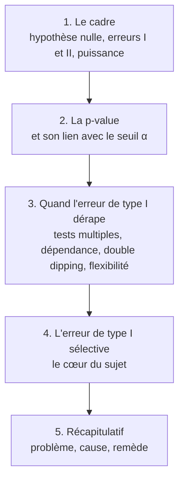
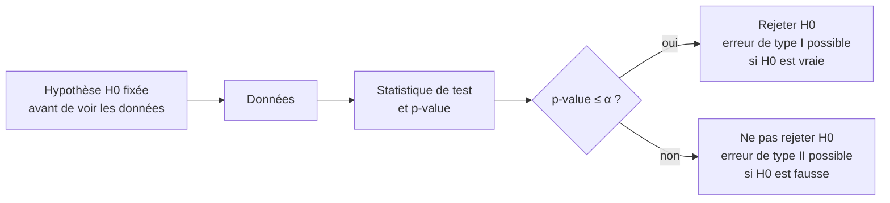
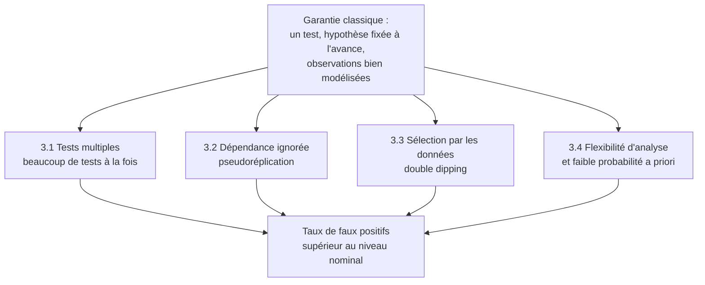
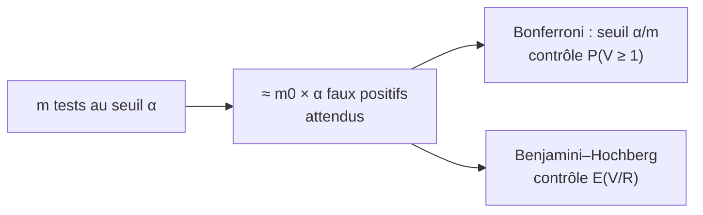
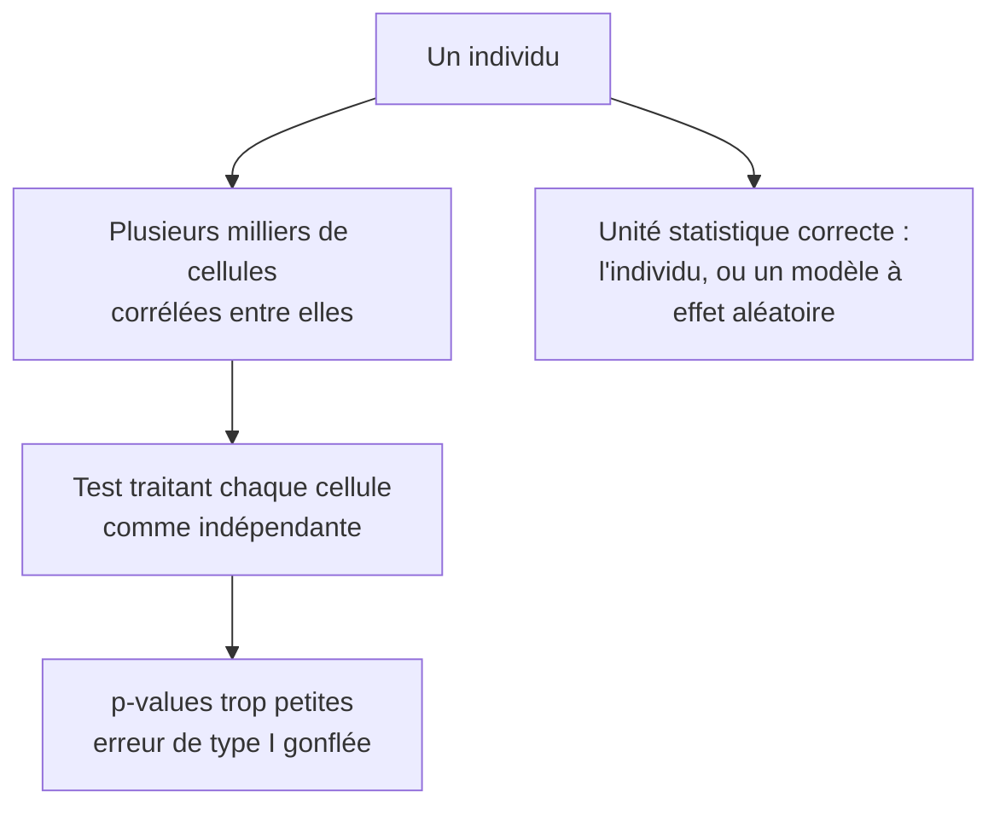
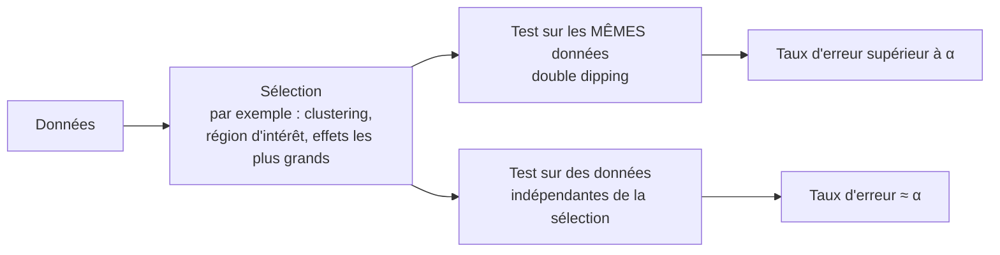
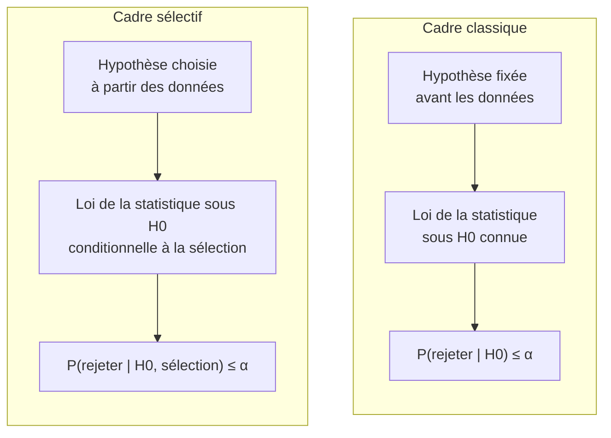
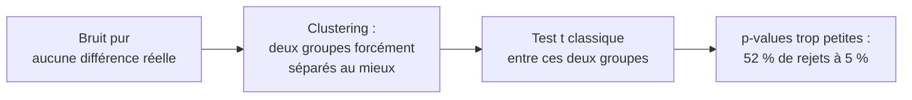
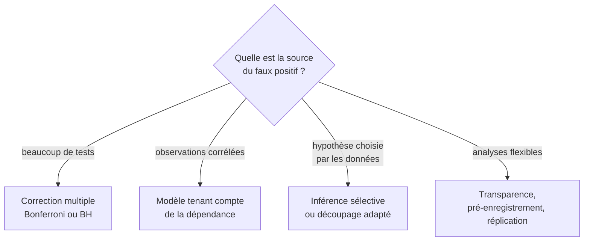

# L'erreur de type I : un cours pour comprendre pourquoi le test d'après clustering pose problème

> [!abstract] Objectif du cours
> Comprendre ce qu'est l'erreur de type I, comment elle est contrôlée dans le cas simple, puis pourquoi ce contrôle se casse dans trois situations : les tests multiples, les données dépendantes et la **sélection de l'hypothèse par les données** (double dipping). Cette dernière situation est celle de l'inférence sélective pour le clustering hiérarchique. Ce cours prolonge [[cours-scrnaseq-inference-selective]] (sections 3.6 et 6).

> [!info] Conventions de lecture
> - Chaque affirmation factuelle renvoie à une **source** par une note de bas de page, par exemple [^np1933]. Les références complètes figurent en fin de document.
> - Les **schémas** (blocs `mermaid`) sont des dessins pédagogiques réalisés pour ce cours. Ils illustrent les idées citées, ils ne reproduisent pas de figures d'articles.
> - Les **figures en couleur** proviennent de **simulations réalisées pour ce cours** (code en annexe). Ce sont des expériences numériques reproductibles, pas des résultats publiés : elles sont signalées comme telles et ne remplacent pas les sources.
> - Les **analogies** sont signalées comme telles.
> - La section « [[#8. Limites et vérifications]] » indique ce qui a été lu en détail, ce qui ne l'a été que partiellement, et ce qui n'est pas couvert.

## 0. Carte du cours



### Vocabulaire en une page

| Terme | Sens | Source |
|---|---|---|
| **Hypothèse nulle** $H_0$ | Hypothèse « rien de particulier » que le test cherche à réfuter | [^np1933] |
| **Erreur de type I** | Rejeter $H_0$ alors qu'elle est vraie (« faux positif ») | [^np1933][^libretexts] |
| **Erreur de type II** | Ne pas rejeter $H_0$ alors qu'elle est fausse (« faux négatif ») | [^np1933][^libretexts] |
| **Niveau** $\alpha$ | $P(\text{rejeter } H_0 \mid H_0 \text{ vraie})$, fixé à l'avance | [^libretexts] |
| **Puissance** $1-\beta$ | Probabilité de rejeter $H_0$ quand elle est fausse | [^libretexts] |
| **p-value** | Probabilité, sous un modèle spécifié, d'obtenir un résumé des données au moins aussi extrême que celui observé | [^asa] |
| **FWER** | Probabilité d'au moins un faux positif parmi les tests | [^cmu] |
| **FDR** | Espérance de la proportion de faux positifs parmi les rejets | [^bh] |
| **Erreur de type I sélective** | Probabilité de rejeter à tort, *sachant que* l'hypothèse testée a été choisie à partir des données | [^fithian] |

---

## 1. Le cadre : tester une hypothèse

### 1.1 Deux façons de se tromper

Un test oppose une hypothèse nulle $H_0$ à une alternative. Deux erreurs sont possibles. Neyman et Pearson les décrivent dès 1933 : rejeter $H_0$ alors qu'elle est vraie (erreur de première espèce), ou l'accepter alors qu'elle est fausse (erreur de seconde espèce).[^np1933] Les manuels actuels parlent de **faux positif** pour l'erreur de type I et de **faux négatif** pour l'erreur de type II.[^libretexts]

| | **Rejeter $H_0$** | **Ne pas rejeter $H_0$** |
|---|---|---|
| **$H_0$ est vraie** | **Erreur de type I** (probabilité $\alpha$) | Décision correcte |
| **$H_0$ est fausse** | Décision correcte (puissance $1-\beta$) | **Erreur de type II** (probabilité $\beta$) |

*(Tableau de décision : structure reprise de [^libretexts].)*

> [!example] Analogie du tribunal (sourcée)
> Dans l'analogie classique, $H_0$ est « l'accusé est innocent ». L'erreur de type I consiste à **condamner un innocent**, l'erreur de type II à **acquitter un coupable**.[^libretexts] Neyman et Pearson recourent eux aussi à l'image du tribunal : la gravité relative des deux erreurs dépend des conséquences, et les mathématiques montrent seulement comment contrôler chaque risque. Le choix de l'équilibre revient à l'investigateur.[^np1933]



### 1.2 Le niveau α, l'erreur β et la puissance

- Le niveau $\alpha$ est la probabilité d'erreur de type I : $P(\text{rejeter } H_0 \mid H_0 \text{ vraie})$. Il est choisi à l'avance.[^libretexts]
- $\beta$ est la probabilité d'erreur de type II : $P(\text{ne pas rejeter } H_0 \mid H_0 \text{ fausse})$. L'augmentation de la taille d'échantillon réduit $\beta$.[^libretexts]
- La **puissance** vaut $1-\beta$ : c'est la probabilité de rejeter correctement une hypothèse nulle fausse.[^libretexts]

<div style="text-align:center">
<svg style="max-width:100%;height:auto" xmlns:xlink="http://www.w3.org/1999/xlink" viewBox="0 0 576 273.6" xmlns="http://www.w3.org/2000/svg" version="1.1">
<defs>
<style type="text/css">*{stroke-linejoin: round; stroke-linecap: butt}</style>
</defs>
<g id="figure_1">
<g id="patch_1">
<path d="M 0 273.6
L 576 273.6
L 576 0
L 0 0
z
" style="fill: #ffffff"/>
</g>
<g id="axes_1">
<g id="patch_2">
<path d="M 11.88 224.100859
L 564.12 224.100859
L 564.12 11.88
L 11.88 11.88
z
" style="fill: #ffffff"/>
</g>
<g id="FillBetweenPolyCollection_1">
<defs>
<path id="mfa20c7f4b5" d="M 294.784275 -96.784305
L 294.784275 -49.499141
L 295.286814 -49.499141
L 295.789353 -49.499141
L 296.291892 -49.499141
L 296.794431 -49.499141
L 297.29697 -49.499141
L 297.799509 -49.499141
L 298.302048 -49.499141
L 298.804586 -49.499141
L 299.307125 -49.499141
L 299.809664 -49.499141
L 300.312203 -49.499141
L 300.814742 -49.499141
L 301.317281 -49.499141
L 301.81982 -49.499141
L 302.322359 -49.499141
L 302.824898 -49.499141
L 303.327437 -49.499141
L 303.829975 -49.499141
L 304.332514 -49.499141
L 304.835053 -49.499141
L 305.337592 -49.499141
L 305.840131 -49.499141
L 306.34267 -49.499141
L 306.845209 -49.499141
L 307.347748 -49.499141
L 307.850287 -49.499141
L 308.352826 -49.499141
L 308.855364 -49.499141
L 309.357903 -49.499141
L 309.860442 -49.499141
L 310.362981 -49.499141
L 310.86552 -49.499141
L 311.368059 -49.499141
L 311.870598 -49.499141
L 312.373137 -49.499141
L 312.875676 -49.499141
L 313.378215 -49.499141
L 313.880753 -49.499141
L 314.383292 -49.499141
L 314.885831 -49.499141
L 315.38837 -49.499141
L 315.890909 -49.499141
L 316.393448 -49.499141
L 316.895987 -49.499141
L 317.398526 -49.499141
L 317.901065 -49.499141
L 318.403604 -49.499141
L 318.906143 -49.499141
L 319.408681 -49.499141
L 319.91122 -49.499141
L 320.413759 -49.499141
L 320.916298 -49.499141
L 321.418837 -49.499141
L 321.921376 -49.499141
L 322.423915 -49.499141
L 322.926454 -49.499141
L 323.428993 -49.499141
L 323.931532 -49.499141
L 324.43407 -49.499141
L 324.936609 -49.499141
L 325.439148 -49.499141
L 325.941687 -49.499141
L 326.444226 -49.499141
L 326.946765 -49.499141
L 327.449304 -49.499141
L 327.951843 -49.499141
L 328.454382 -49.499141
L 328.956921 -49.499141
L 329.459459 -49.499141
L 329.961998 -49.499141
L 330.464537 -49.499141
L 330.967076 -49.499141
L 331.469615 -49.499141
L 331.972154 -49.499141
L 332.474693 -49.499141
L 332.977232 -49.499141
L 333.479771 -49.499141
L 333.98231 -49.499141
L 334.484848 -49.499141
L 334.987387 -49.499141
L 335.489926 -49.499141
L 335.992465 -49.499141
L 336.495004 -49.499141
L 336.997543 -49.499141
L 337.500082 -49.499141
L 338.002621 -49.499141
L 338.50516 -49.499141
L 339.007699 -49.499141
L 339.510238 -49.499141
L 340.012776 -49.499141
L 340.515315 -49.499141
L 341.017854 -49.499141
L 341.520393 -49.499141
L 342.022932 -49.499141
L 342.525471 -49.499141
L 343.02801 -49.499141
L 343.530549 -49.499141
L 344.033088 -49.499141
L 344.535627 -49.499141
L 345.038165 -49.499141
L 345.540704 -49.499141
L 346.043243 -49.499141
L 346.545782 -49.499141
L 347.048321 -49.499141
L 347.55086 -49.499141
L 348.053399 -49.499141
L 348.555938 -49.499141
L 349.058477 -49.499141
L 349.561016 -49.499141
L 350.063554 -49.499141
L 350.566093 -49.499141
L 351.068632 -49.499141
L 351.571171 -49.499141
L 352.07371 -49.499141
L 352.576249 -49.499141
L 353.078788 -49.499141
L 353.581327 -49.499141
L 354.083866 -49.499141
L 354.586405 -49.499141
L 355.088943 -49.499141
L 355.591482 -49.499141
L 356.094021 -49.499141
L 356.59656 -49.499141
L 357.099099 -49.499141
L 357.601638 -49.499141
L 358.104177 -49.499141
L 358.606716 -49.499141
L 359.109255 -49.499141
L 359.611794 -49.499141
L 360.114333 -49.499141
L 360.616871 -49.499141
L 361.11941 -49.499141
L 361.621949 -49.499141
L 362.124488 -49.499141
L 362.627027 -49.499141
L 363.129566 -49.499141
L 363.632105 -49.499141
L 364.134644 -49.499141
L 364.637183 -49.499141
L 365.139722 -49.499141
L 365.64226 -49.499141
L 366.144799 -49.499141
L 366.647338 -49.499141
L 367.149877 -49.499141
L 367.652416 -49.499141
L 368.154955 -49.499141
L 368.657494 -49.499141
L 369.160033 -49.499141
L 369.662572 -49.499141
L 370.165111 -49.499141
L 370.667649 -49.499141
L 371.170188 -49.499141
L 371.672727 -49.499141
L 372.175266 -49.499141
L 372.677805 -49.499141
L 373.180344 -49.499141
L 373.682883 -49.499141
L 374.185422 -49.499141
L 374.687961 -49.499141
L 375.1905 -49.499141
L 375.693038 -49.499141
L 376.195577 -49.499141
L 376.698116 -49.499141
L 377.200655 -49.499141
L 377.703194 -49.499141
L 378.205733 -49.499141
L 378.708272 -49.499141
L 379.210811 -49.499141
L 379.71335 -49.499141
L 380.215889 -49.499141
L 380.718428 -49.499141
L 381.220966 -49.499141
L 381.723505 -49.499141
L 382.226044 -49.499141
L 382.728583 -49.499141
L 383.231122 -49.499141
L 383.733661 -49.499141
L 384.2362 -49.499141
L 384.738739 -49.499141
L 385.241278 -49.499141
L 385.743817 -49.499141
L 386.246355 -49.499141
L 386.748894 -49.499141
L 387.251433 -49.499141
L 387.753972 -49.499141
L 388.256511 -49.499141
L 388.75905 -49.499141
L 389.261589 -49.499141
L 389.764128 -49.499141
L 390.266667 -49.499141
L 390.769206 -49.499141
L 391.271744 -49.499141
L 391.774283 -49.499141
L 392.276822 -49.499141
L 392.779361 -49.499141
L 393.2819 -49.499141
L 393.784439 -49.499141
L 394.286978 -49.499141
L 394.789517 -49.499141
L 395.292056 -49.499141
L 395.794595 -49.499141
L 396.297133 -49.499141
L 396.799672 -49.499141
L 397.302211 -49.499141
L 397.80475 -49.499141
L 398.307289 -49.499141
L 398.809828 -49.499141
L 399.312367 -49.499141
L 399.814906 -49.499141
L 400.317445 -49.499141
L 400.819984 -49.499141
L 401.322523 -49.499141
L 401.825061 -49.499141
L 402.3276 -49.499141
L 402.830139 -49.499141
L 403.332678 -49.499141
L 403.835217 -49.499141
L 404.337756 -49.499141
L 404.840295 -49.499141
L 405.342834 -49.499141
L 405.845373 -49.499141
L 406.347912 -49.499141
L 406.85045 -49.499141
L 407.352989 -49.499141
L 407.855528 -49.499141
L 408.358067 -49.499141
L 408.860606 -49.499141
L 409.363145 -49.499141
L 409.865684 -49.499141
L 410.368223 -49.499141
L 410.870762 -49.499141
L 411.373301 -49.499141
L 411.875839 -49.499141
L 412.378378 -49.499141
L 412.880917 -49.499141
L 413.383456 -49.499141
L 413.885995 -49.499141
L 414.388534 -49.499141
L 414.891073 -49.499141
L 415.393612 -49.499141
L 415.896151 -49.499141
L 416.39869 -49.499141
L 416.901229 -49.499141
L 417.403767 -49.499141
L 417.906306 -49.499141
L 418.408845 -49.499141
L 418.911384 -49.499141
L 419.413923 -49.499141
L 419.916462 -49.499141
L 420.419001 -49.499141
L 420.92154 -49.499141
L 421.424079 -49.499141
L 421.926618 -49.499141
L 422.429156 -49.499141
L 422.931695 -49.499141
L 423.434234 -49.499141
L 423.936773 -49.499141
L 424.439312 -49.499141
L 424.941851 -49.499141
L 425.44439 -49.499141
L 425.946929 -49.499141
L 426.449468 -49.499141
L 426.952007 -49.499141
L 427.454545 -49.499141
L 427.957084 -49.499141
L 428.459623 -49.499141
L 428.962162 -49.499141
L 429.464701 -49.499141
L 429.96724 -49.499141
L 430.469779 -49.499141
L 430.972318 -49.499141
L 431.474857 -49.499141
L 431.977396 -49.499141
L 432.479934 -49.499141
L 432.982473 -49.499141
L 433.485012 -49.499141
L 433.987551 -49.499141
L 434.49009 -49.499141
L 434.992629 -49.499141
L 435.495168 -49.499141
L 435.997707 -49.499141
L 436.500246 -49.499141
L 437.002785 -49.499141
L 437.505324 -49.499141
L 438.007862 -49.499141
L 438.510401 -49.499141
L 439.01294 -49.499141
L 439.515479 -49.499141
L 440.018018 -49.499141
L 440.520557 -49.499141
L 441.023096 -49.499141
L 441.525635 -49.499141
L 442.028174 -49.499141
L 442.530713 -49.499141
L 443.033251 -49.499141
L 443.53579 -49.499141
L 444.038329 -49.499141
L 444.540868 -49.499141
L 445.043407 -49.499141
L 445.545946 -49.499141
L 446.048485 -49.499141
L 446.551024 -49.499141
L 447.053563 -49.499141
L 447.556102 -49.499141
L 448.05864 -49.499141
L 448.561179 -49.499141
L 449.063718 -49.499141
L 449.566257 -49.499141
L 450.068796 -49.499141
L 450.571335 -49.499141
L 451.073874 -49.499141
L 451.576413 -49.499141
L 452.078952 -49.499141
L 452.581491 -49.499141
L 453.084029 -49.499141
L 453.586568 -49.499141
L 454.089107 -49.499141
L 454.591646 -49.499141
L 455.094185 -49.499141
L 455.596724 -49.499141
L 456.099263 -49.499141
L 456.601802 -49.499141
L 457.104341 -49.499141
L 457.60688 -49.499141
L 458.109419 -49.499141
L 458.611957 -49.499141
L 459.114496 -49.499141
L 459.617035 -49.499141
L 460.119574 -49.499141
L 460.622113 -49.499141
L 461.124652 -49.499141
L 461.627191 -49.499141
L 462.12973 -49.499141
L 462.632269 -49.499141
L 463.134808 -49.499141
L 463.637346 -49.499141
L 464.139885 -49.499141
L 464.642424 -49.499141
L 465.144963 -49.499141
L 465.647502 -49.499141
L 466.150041 -49.499141
L 466.65258 -49.499141
L 467.155119 -49.499141
L 467.657658 -49.499141
L 468.160197 -49.499141
L 468.662735 -49.499141
L 469.165274 -49.499141
L 469.667813 -49.499141
L 470.170352 -49.499141
L 470.672891 -49.499141
L 471.17543 -49.499141
L 471.677969 -49.499141
L 472.180508 -49.499141
L 472.683047 -49.499141
L 473.185586 -49.499141
L 473.688124 -49.499141
L 474.190663 -49.499141
L 474.693202 -49.499141
L 475.195741 -49.499141
L 475.69828 -49.499141
L 476.200819 -49.499141
L 476.703358 -49.499141
L 477.205897 -49.499141
L 477.708436 -49.499141
L 478.210975 -49.499141
L 478.713514 -49.499141
L 479.216052 -49.499141
L 479.718591 -49.499141
L 480.22113 -49.499141
L 480.723669 -49.499141
L 481.226208 -49.499141
L 481.728747 -49.499141
L 482.231286 -49.499141
L 482.733825 -49.499141
L 483.236364 -49.499141
L 483.738903 -49.499141
L 484.241441 -49.499141
L 484.74398 -49.499141
L 485.246519 -49.499141
L 485.749058 -49.499141
L 486.251597 -49.499141
L 486.754136 -49.499141
L 487.256675 -49.499141
L 487.759214 -49.499141
L 488.261753 -49.499141
L 488.764292 -49.499141
L 489.26683 -49.499141
L 489.769369 -49.499141
L 490.271908 -49.499141
L 490.774447 -49.499141
L 491.276986 -49.499141
L 491.779525 -49.499141
L 492.282064 -49.499141
L 492.784603 -49.499141
L 493.287142 -49.499141
L 493.789681 -49.499141
L 494.292219 -49.499141
L 494.794758 -49.499141
L 495.297297 -49.499141
L 495.799836 -49.499141
L 496.302375 -49.499141
L 496.804914 -49.499141
L 497.307453 -49.499141
L 497.809992 -49.499141
L 498.312531 -49.499141
L 498.81507 -49.499141
L 499.317609 -49.499141
L 499.820147 -49.499141
L 500.322686 -49.499141
L 500.825225 -49.499141
L 501.327764 -49.499141
L 501.830303 -49.499141
L 502.332842 -49.499141
L 502.835381 -49.499141
L 503.33792 -49.499141
L 503.840459 -49.499141
L 504.342998 -49.499141
L 504.845536 -49.499141
L 505.348075 -49.499141
L 505.850614 -49.499141
L 506.353153 -49.499141
L 506.855692 -49.499141
L 507.358231 -49.499141
L 507.86077 -49.499141
L 508.363309 -49.499141
L 508.865848 -49.499141
L 509.368387 -49.499141
L 509.870925 -49.499141
L 510.373464 -49.499141
L 510.876003 -49.499141
L 511.378542 -49.499141
L 511.881081 -49.499141
L 512.38362 -49.499141
L 512.886159 -49.499141
L 513.388698 -49.499141
L 513.891237 -49.499141
L 514.393776 -49.499141
L 514.896314 -49.499141
L 515.398853 -49.499141
L 515.901392 -49.499141
L 516.403931 -49.499141
L 516.90647 -49.499141
L 517.409009 -49.499141
L 517.911548 -49.499141
L 518.414087 -49.499141
L 518.916626 -49.499141
L 519.419165 -49.499141
L 519.921704 -49.499141
L 520.424242 -49.499141
L 520.926781 -49.499141
L 521.42932 -49.499141
L 521.931859 -49.499141
L 522.434398 -49.499141
L 522.936937 -49.499141
L 523.439476 -49.499141
L 523.942015 -49.499141
L 524.444554 -49.499141
L 524.947093 -49.499141
L 525.449631 -49.499141
L 525.95217 -49.499141
L 526.454709 -49.499141
L 526.957248 -49.499141
L 527.459787 -49.499141
L 527.962326 -49.499141
L 528.464865 -49.499141
L 528.967404 -49.499141
L 529.469943 -49.499141
L 529.972482 -49.499141
L 530.47502 -49.499141
L 530.977559 -49.499141
L 531.480098 -49.499141
L 531.982637 -49.499141
L 532.485176 -49.499141
L 532.987715 -49.499141
L 533.490254 -49.499141
L 533.992793 -49.499141
L 534.495332 -49.499141
L 534.997871 -49.499141
L 535.50041 -49.499141
L 536.002948 -49.499141
L 536.505487 -49.499141
L 537.008026 -49.499141
L 537.510565 -49.499141
L 538.013104 -49.499141
L 538.515643 -49.499141
L 539.018182 -49.499141
L 539.018182 -49.499141
L 539.018182 -49.499141
L 538.515643 -49.499141
L 538.013104 -49.499141
L 537.510565 -49.499141
L 537.008026 -49.499141
L 536.505487 -49.499141
L 536.002948 -49.499141
L 535.50041 -49.499141
L 534.997871 -49.499141
L 534.495332 -49.499141
L 533.992793 -49.499141
L 533.490254 -49.499141
L 532.987715 -49.499141
L 532.485176 -49.499141
L 531.982637 -49.499141
L 531.480098 -49.499141
L 530.977559 -49.499141
L 530.47502 -49.499141
L 529.972482 -49.499141
L 529.469943 -49.499141
L 528.967404 -49.499141
L 528.464865 -49.499141
L 527.962326 -49.499141
L 527.459787 -49.499141
L 526.957248 -49.499141
L 526.454709 -49.499141
L 525.95217 -49.499141
L 525.449631 -49.499141
L 524.947093 -49.499141
L 524.444554 -49.499141
L 523.942015 -49.499141
L 523.439476 -49.499141
L 522.936937 -49.499141
L 522.434398 -49.499141
L 521.931859 -49.499141
L 521.42932 -49.499141
L 520.926781 -49.499141
L 520.424242 -49.499141
L 519.921704 -49.499141
L 519.419165 -49.499141
L 518.916626 -49.499141
L 518.414087 -49.499141
L 517.911548 -49.499141
L 517.409009 -49.499141
L 516.90647 -49.499141
L 516.403931 -49.499141
L 515.901392 -49.499141
L 515.398853 -49.499141
L 514.896314 -49.499141
L 514.393776 -49.499141
L 513.891237 -49.499141
L 513.388698 -49.499141
L 512.886159 -49.499141
L 512.38362 -49.499141
L 511.881081 -49.499141
L 511.378542 -49.499141
L 510.876003 -49.499141
L 510.373464 -49.499141
L 509.870925 -49.499141
L 509.368387 -49.499141
L 508.865848 -49.499141
L 508.363309 -49.499141
L 507.86077 -49.499141
L 507.358231 -49.499141
L 506.855692 -49.499141
L 506.353153 -49.499141
L 505.850614 -49.499141
L 505.348075 -49.499141
L 504.845536 -49.499141
L 504.342998 -49.499141
L 503.840459 -49.499141
L 503.33792 -49.499141
L 502.835381 -49.499141
L 502.332842 -49.499141
L 501.830303 -49.499142
L 501.327764 -49.499142
L 500.825225 -49.499142
L 500.322686 -49.499142
L 499.820147 -49.499142
L 499.317609 -49.499142
L 498.81507 -49.499142
L 498.312531 -49.499142
L 497.809992 -49.499142
L 497.307453 -49.499142
L 496.804914 -49.499142
L 496.302375 -49.499143
L 495.799836 -49.499143
L 495.297297 -49.499143
L 494.794758 -49.499143
L 494.292219 -49.499143
L 493.789681 -49.499143
L 493.287142 -49.499143
L 492.784603 -49.499144
L 492.282064 -49.499144
L 491.779525 -49.499144
L 491.276986 -49.499144
L 490.774447 -49.499145
L 490.271908 -49.499145
L 489.769369 -49.499145
L 489.26683 -49.499145
L 488.764292 -49.499146
L 488.261753 -49.499146
L 487.759214 -49.499146
L 487.256675 -49.499147
L 486.754136 -49.499147
L 486.251597 -49.499148
L 485.749058 -49.499148
L 485.246519 -49.499149
L 484.74398 -49.499149
L 484.241441 -49.49915
L 483.738903 -49.49915
L 483.236364 -49.499151
L 482.733825 -49.499152
L 482.231286 -49.499152
L 481.728747 -49.499153
L 481.226208 -49.499154
L 480.723669 -49.499155
L 480.22113 -49.499156
L 479.718591 -49.499157
L 479.216052 -49.499158
L 478.713514 -49.499159
L 478.210975 -49.49916
L 477.708436 -49.499161
L 477.205897 -49.499163
L 476.703358 -49.499164
L 476.200819 -49.499166
L 475.69828 -49.499167
L 475.195741 -49.499169
L 474.693202 -49.499171
L 474.190663 -49.499173
L 473.688124 -49.499175
L 473.185586 -49.499177
L 472.683047 -49.499179
L 472.180508 -49.499181
L 471.677969 -49.499184
L 471.17543 -49.499187
L 470.672891 -49.49919
L 470.170352 -49.499193
L 469.667813 -49.499196
L 469.165274 -49.499199
L 468.662735 -49.499203
L 468.160197 -49.499207
L 467.657658 -49.499211
L 467.155119 -49.499215
L 466.65258 -49.49922
L 466.150041 -49.499225
L 465.647502 -49.49923
L 465.144963 -49.499235
L 464.642424 -49.499241
L 464.139885 -49.499247
L 463.637346 -49.499254
L 463.134808 -49.499261
L 462.632269 -49.499268
L 462.12973 -49.499276
L 461.627191 -49.499284
L 461.124652 -49.499292
L 460.622113 -49.499301
L 460.119574 -49.499311
L 459.617035 -49.499321
L 459.114496 -49.499332
L 458.611957 -49.499343
L 458.109419 -49.499355
L 457.60688 -49.499368
L 457.104341 -49.499381
L 456.601802 -49.499396
L 456.099263 -49.499411
L 455.596724 -49.499426
L 455.094185 -49.499443
L 454.591646 -49.499461
L 454.089107 -49.499479
L 453.586568 -49.499499
L 453.084029 -49.49952
L 452.581491 -49.499542
L 452.078952 -49.499565
L 451.576413 -49.49959
L 451.073874 -49.499615
L 450.571335 -49.499643
L 450.068796 -49.499671
L 449.566257 -49.499702
L 449.063718 -49.499734
L 448.561179 -49.499767
L 448.05864 -49.499803
L 447.556102 -49.49984
L 447.053563 -49.49988
L 446.551024 -49.499922
L 446.048485 -49.499965
L 445.545946 -49.500012
L 445.043407 -49.500061
L 444.540868 -49.500112
L 444.038329 -49.500166
L 443.53579 -49.500223
L 443.033251 -49.500283
L 442.530713 -49.500346
L 442.028174 -49.500413
L 441.525635 -49.500483
L 441.023096 -49.500557
L 440.520557 -49.500634
L 440.018018 -49.500716
L 439.515479 -49.500802
L 439.01294 -49.500892
L 438.510401 -49.500988
L 438.007862 -49.501088
L 437.505324 -49.501193
L 437.002785 -49.501304
L 436.500246 -49.50142
L 435.997707 -49.501542
L 435.495168 -49.501671
L 434.992629 -49.501806
L 434.49009 -49.501948
L 433.987551 -49.502097
L 433.485012 -49.502254
L 432.982473 -49.502419
L 432.479934 -49.502592
L 431.977396 -49.502774
L 431.474857 -49.502964
L 430.972318 -49.503165
L 430.469779 -49.503375
L 429.96724 -49.503596
L 429.464701 -49.503828
L 428.962162 -49.504071
L 428.459623 -49.504326
L 427.957084 -49.504594
L 427.454545 -49.504875
L 426.952007 -49.505169
L 426.449468 -49.505478
L 425.946929 -49.505802
L 425.44439 -49.506142
L 424.941851 -49.506498
L 424.439312 -49.506871
L 423.936773 -49.507263
L 423.434234 -49.507673
L 422.931695 -49.508102
L 422.429156 -49.508553
L 421.926618 -49.509024
L 421.424079 -49.509518
L 420.92154 -49.510035
L 420.419001 -49.510577
L 419.916462 -49.511144
L 419.413923 -49.511738
L 418.911384 -49.51236
L 418.408845 -49.51301
L 417.906306 -49.513691
L 417.403767 -49.514403
L 416.901229 -49.515149
L 416.39869 -49.515928
L 415.896151 -49.516744
L 415.393612 -49.517596
L 414.891073 -49.518488
L 414.388534 -49.519421
L 413.885995 -49.520396
L 413.383456 -49.521415
L 412.880917 -49.52248
L 412.378378 -49.523593
L 411.875839 -49.524755
L 411.373301 -49.52597
L 410.870762 -49.52724
L 410.368223 -49.528565
L 409.865684 -49.52995
L 409.363145 -49.531396
L 408.860606 -49.532905
L 408.358067 -49.534481
L 407.855528 -49.536126
L 407.352989 -49.537842
L 406.85045 -49.539634
L 406.347912 -49.541503
L 405.845373 -49.543454
L 405.342834 -49.545488
L 404.840295 -49.54761
L 404.337756 -49.549823
L 403.835217 -49.55213
L 403.332678 -49.554536
L 402.830139 -49.557044
L 402.3276 -49.559659
L 401.825061 -49.562383
L 401.322523 -49.565223
L 400.819984 -49.568181
L 400.317445 -49.571263
L 399.814906 -49.574474
L 399.312367 -49.577818
L 398.809828 -49.5813
L 398.307289 -49.584926
L 397.80475 -49.588702
L 397.302211 -49.592632
L 396.799672 -49.596723
L 396.297133 -49.60098
L 395.794595 -49.605411
L 395.292056 -49.61002
L 394.789517 -49.614816
L 394.286978 -49.619804
L 393.784439 -49.624993
L 393.2819 -49.630388
L 392.779361 -49.635998
L 392.276822 -49.641831
L 391.774283 -49.647894
L 391.271744 -49.654196
L 390.769206 -49.660745
L 390.266667 -49.667551
L 389.764128 -49.674622
L 389.261589 -49.681967
L 388.75905 -49.689597
L 388.256511 -49.697522
L 387.753972 -49.705751
L 387.251433 -49.714295
L 386.748894 -49.723166
L 386.246355 -49.732373
L 385.743817 -49.74193
L 385.241278 -49.751848
L 384.738739 -49.76214
L 384.2362 -49.772817
L 383.733661 -49.783893
L 383.231122 -49.795381
L 382.728583 -49.807296
L 382.226044 -49.81965
L 381.723505 -49.83246
L 381.220966 -49.84574
L 380.718428 -49.859505
L 380.215889 -49.873771
L 379.71335 -49.888555
L 379.210811 -49.903873
L 378.708272 -49.919743
L 378.205733 -49.936182
L 377.703194 -49.953209
L 377.200655 -49.970842
L 376.698116 -49.9891
L 376.195577 -50.008003
L 375.693038 -50.027571
L 375.1905 -50.047825
L 374.687961 -50.068787
L 374.185422 -50.090477
L 373.682883 -50.112919
L 373.180344 -50.136136
L 372.677805 -50.16015
L 372.175266 -50.184987
L 371.672727 -50.210671
L 371.170188 -50.237227
L 370.667649 -50.264681
L 370.165111 -50.29306
L 369.662572 -50.322392
L 369.160033 -50.352703
L 368.657494 -50.384024
L 368.154955 -50.416382
L 367.652416 -50.449808
L 367.149877 -50.484334
L 366.647338 -50.519989
L 366.144799 -50.556806
L 365.64226 -50.594818
L 365.139722 -50.634059
L 364.637183 -50.674563
L 364.134644 -50.716365
L 363.632105 -50.7595
L 363.129566 -50.804006
L 362.627027 -50.84992
L 362.124488 -50.89728
L 361.621949 -50.946124
L 361.11941 -50.996494
L 360.616871 -51.048429
L 360.114333 -51.101971
L 359.611794 -51.157163
L 359.109255 -51.214047
L 358.606716 -51.272667
L 358.104177 -51.333069
L 357.601638 -51.395298
L 357.099099 -51.459401
L 356.59656 -51.525426
L 356.094021 -51.59342
L 355.591482 -51.663434
L 355.088943 -51.735517
L 354.586405 -51.809721
L 354.083866 -51.886097
L 353.581327 -51.964699
L 353.078788 -52.045581
L 352.576249 -52.128797
L 352.07371 -52.214404
L 351.571171 -52.302457
L 351.068632 -52.393015
L 350.566093 -52.486136
L 350.063554 -52.58188
L 349.561016 -52.680307
L 349.058477 -52.781479
L 348.555938 -52.885457
L 348.053399 -52.992306
L 347.55086 -53.10209
L 347.048321 -53.214873
L 346.545782 -53.330723
L 346.043243 -53.449705
L 345.540704 -53.571888
L 345.038165 -53.697341
L 344.535627 -53.826134
L 344.033088 -53.958337
L 343.530549 -54.094022
L 343.02801 -54.233262
L 342.525471 -54.37613
L 342.022932 -54.5227
L 341.520393 -54.673048
L 341.017854 -54.82725
L 340.515315 -54.985382
L 340.012776 -55.147522
L 339.510238 -55.31375
L 339.007699 -55.484143
L 338.50516 -55.658783
L 338.002621 -55.837751
L 337.500082 -56.021127
L 336.997543 -56.208995
L 336.495004 -56.401438
L 335.992465 -56.59854
L 335.489926 -56.800384
L 334.987387 -57.007057
L 334.484848 -57.218644
L 333.98231 -57.435232
L 333.479771 -57.656907
L 332.977232 -57.883758
L 332.474693 -58.115872
L 331.972154 -58.353338
L 331.469615 -58.596246
L 330.967076 -58.844684
L 330.464537 -59.098744
L 329.961998 -59.358514
L 329.459459 -59.624086
L 328.956921 -59.895551
L 328.454382 -60.173001
L 327.951843 -60.456526
L 327.449304 -60.746219
L 326.946765 -61.04217
L 326.444226 -61.344474
L 325.941687 -61.65322
L 325.439148 -61.968502
L 324.936609 -62.290412
L 324.43407 -62.619042
L 323.931532 -62.954483
L 323.428993 -63.296827
L 322.926454 -63.646167
L 322.423915 -64.002592
L 321.921376 -64.366195
L 321.418837 -64.737066
L 320.916298 -65.115295
L 320.413759 -65.500972
L 319.91122 -65.894187
L 319.408681 -66.295027
L 318.906143 -66.703582
L 318.403604 -67.119938
L 317.901065 -67.544182
L 317.398526 -67.976399
L 316.895987 -68.416676
L 316.393448 -68.865096
L 315.890909 -69.321741
L 315.38837 -69.786694
L 314.885831 -70.260036
L 314.383292 -70.741845
L 313.880753 -71.232202
L 313.378215 -71.731181
L 312.875676 -72.23886
L 312.373137 -72.755312
L 311.870598 -73.280611
L 311.368059 -73.814825
L 310.86552 -74.358027
L 310.362981 -74.910282
L 309.860442 -75.471656
L 309.357903 -76.042214
L 308.855364 -76.622017
L 308.352826 -77.211125
L 307.850287 -77.809596
L 307.347748 -78.417485
L 306.845209 -79.034846
L 306.34267 -79.661729
L 305.840131 -80.298183
L 305.337592 -80.944254
L 304.835053 -81.599986
L 304.332514 -82.265418
L 303.829975 -82.94059
L 303.327437 -83.625537
L 302.824898 -84.320291
L 302.322359 -85.024881
L 301.81982 -85.739334
L 301.317281 -86.463673
L 300.814742 -87.197919
L 300.312203 -87.942088
L 299.809664 -88.696195
L 299.307125 -89.460249
L 298.804586 -90.234257
L 298.302048 -91.018223
L 297.799509 -91.812146
L 297.29697 -92.616023
L 296.794431 -93.429845
L 296.291892 -94.253602
L 295.789353 -95.087278
L 295.286814 -95.930853
L 294.784275 -96.784305
z
" style="stroke: #c53030; stroke-opacity: 0.55"/>
</defs>
<g clip-path="url(#p7b25535d9e)">
<use xlink:href="#mfa20c7f4b5" x="0" y="273.6" style="fill: #c53030; fill-opacity: 0.55; stroke: #c53030; stroke-opacity: 0.55"/>
</g>
</g>
<g id="FillBetweenPolyCollection_2">
<defs>
<path id="me49b6ce736" d="M 36.981818 -49.499141
L 36.981818 -49.499141
L 37.484357 -49.499141
L 37.986896 -49.499141
L 38.489435 -49.499141
L 38.991974 -49.499141
L 39.494513 -49.499141
L 39.997052 -49.499141
L 40.49959 -49.499141
L 41.002129 -49.499141
L 41.504668 -49.499141
L 42.007207 -49.499141
L 42.509746 -49.499141
L 43.012285 -49.499141
L 43.514824 -49.499141
L 44.017363 -49.499141
L 44.519902 -49.499141
L 45.022441 -49.499141
L 45.52498 -49.499141
L 46.027518 -49.499141
L 46.530057 -49.499141
L 47.032596 -49.499141
L 47.535135 -49.499141
L 48.037674 -49.499141
L 48.540213 -49.499141
L 49.042752 -49.499141
L 49.545291 -49.499141
L 50.04783 -49.499141
L 50.550369 -49.499141
L 51.052907 -49.499141
L 51.555446 -49.499141
L 52.057985 -49.499141
L 52.560524 -49.499141
L 53.063063 -49.499141
L 53.565602 -49.499141
L 54.068141 -49.499141
L 54.57068 -49.499141
L 55.073219 -49.499141
L 55.575758 -49.499141
L 56.078296 -49.499141
L 56.580835 -49.499141
L 57.083374 -49.499141
L 57.585913 -49.499141
L 58.088452 -49.499141
L 58.590991 -49.499141
L 59.09353 -49.499141
L 59.596069 -49.499141
L 60.098608 -49.499141
L 60.601147 -49.499141
L 61.103686 -49.499141
L 61.606224 -49.499141
L 62.108763 -49.499141
L 62.611302 -49.499141
L 63.113841 -49.499141
L 63.61638 -49.499141
L 64.118919 -49.499141
L 64.621458 -49.499141
L 65.123997 -49.499141
L 65.626536 -49.499141
L 66.129075 -49.499141
L 66.631613 -49.499141
L 67.134152 -49.499141
L 67.636691 -49.499141
L 68.13923 -49.499141
L 68.641769 -49.499141
L 69.144308 -49.499141
L 69.646847 -49.499141
L 70.149386 -49.499141
L 70.651925 -49.499141
L 71.154464 -49.499141
L 71.657002 -49.499141
L 72.159541 -49.499141
L 72.66208 -49.499141
L 73.164619 -49.499141
L 73.667158 -49.499141
L 74.169697 -49.499141
L 74.672236 -49.499141
L 75.174775 -49.499141
L 75.677314 -49.499141
L 76.179853 -49.499141
L 76.682391 -49.499141
L 77.18493 -49.499141
L 77.687469 -49.499141
L 78.190008 -49.499141
L 78.692547 -49.499141
L 79.195086 -49.499141
L 79.697625 -49.499141
L 80.200164 -49.499141
L 80.702703 -49.499141
L 81.205242 -49.499141
L 81.707781 -49.499141
L 82.210319 -49.499141
L 82.712858 -49.499141
L 83.215397 -49.499141
L 83.717936 -49.499141
L 84.220475 -49.499141
L 84.723014 -49.499141
L 85.225553 -49.499141
L 85.728092 -49.499141
L 86.230631 -49.499141
L 86.73317 -49.499141
L 87.235708 -49.499141
L 87.738247 -49.499141
L 88.240786 -49.499141
L 88.743325 -49.499141
L 89.245864 -49.499141
L 89.748403 -49.499141
L 90.250942 -49.499141
L 90.753481 -49.499141
L 91.25602 -49.499141
L 91.758559 -49.499141
L 92.261097 -49.499141
L 92.763636 -49.499141
L 93.266175 -49.499141
L 93.768714 -49.499141
L 94.271253 -49.499141
L 94.773792 -49.499141
L 95.276331 -49.499141
L 95.77887 -49.499141
L 96.281409 -49.499141
L 96.783948 -49.499141
L 97.286486 -49.499141
L 97.789025 -49.499141
L 98.291564 -49.499141
L 98.794103 -49.499141
L 99.296642 -49.499141
L 99.799181 -49.499141
L 100.30172 -49.499141
L 100.804259 -49.499141
L 101.306798 -49.499141
L 101.809337 -49.499141
L 102.311876 -49.499141
L 102.814414 -49.499141
L 103.316953 -49.499141
L 103.819492 -49.499141
L 104.322031 -49.499141
L 104.82457 -49.499141
L 105.327109 -49.499141
L 105.829648 -49.499141
L 106.332187 -49.499141
L 106.834726 -49.499141
L 107.337265 -49.499141
L 107.839803 -49.499141
L 108.342342 -49.499141
L 108.844881 -49.499141
L 109.34742 -49.499141
L 109.849959 -49.499141
L 110.352498 -49.499141
L 110.855037 -49.499141
L 111.357576 -49.499141
L 111.860115 -49.499141
L 112.362654 -49.499141
L 112.865192 -49.499141
L 113.367731 -49.499141
L 113.87027 -49.499141
L 114.372809 -49.499141
L 114.875348 -49.499141
L 115.377887 -49.499141
L 115.880426 -49.499141
L 116.382965 -49.499141
L 116.885504 -49.499141
L 117.388043 -49.499141
L 117.890581 -49.499141
L 118.39312 -49.499141
L 118.895659 -49.499141
L 119.398198 -49.499141
L 119.900737 -49.499141
L 120.403276 -49.499141
L 120.905815 -49.499141
L 121.408354 -49.499141
L 121.910893 -49.499141
L 122.413432 -49.499141
L 122.915971 -49.499141
L 123.418509 -49.499141
L 123.921048 -49.499141
L 124.423587 -49.499141
L 124.926126 -49.499141
L 125.428665 -49.499141
L 125.931204 -49.499141
L 126.433743 -49.499141
L 126.936282 -49.499141
L 127.438821 -49.499141
L 127.94136 -49.499141
L 128.443898 -49.499141
L 128.946437 -49.499141
L 129.448976 -49.499141
L 129.951515 -49.499141
L 130.454054 -49.499141
L 130.956593 -49.499141
L 131.459132 -49.499141
L 131.961671 -49.499141
L 132.46421 -49.499141
L 132.966749 -49.499141
L 133.469287 -49.499141
L 133.971826 -49.499141
L 134.474365 -49.499141
L 134.976904 -49.499141
L 135.479443 -49.499141
L 135.981982 -49.499141
L 136.484521 -49.499141
L 136.98706 -49.499141
L 137.489599 -49.499141
L 137.992138 -49.499141
L 138.494676 -49.499141
L 138.997215 -49.499141
L 139.499754 -49.499141
L 140.002293 -49.499141
L 140.504832 -49.499141
L 141.007371 -49.499141
L 141.50991 -49.499141
L 142.012449 -49.499141
L 142.514988 -49.499141
L 143.017527 -49.499141
L 143.520066 -49.499141
L 144.022604 -49.499141
L 144.525143 -49.499141
L 145.027682 -49.499141
L 145.530221 -49.499141
L 146.03276 -49.499141
L 146.535299 -49.499141
L 147.037838 -49.499141
L 147.540377 -49.499141
L 148.042916 -49.499141
L 148.545455 -49.499141
L 149.047993 -49.499141
L 149.550532 -49.499141
L 150.053071 -49.499141
L 150.55561 -49.499141
L 151.058149 -49.499141
L 151.560688 -49.499141
L 152.063227 -49.499141
L 152.565766 -49.499141
L 153.068305 -49.499141
L 153.570844 -49.499141
L 154.073382 -49.499141
L 154.575921 -49.499141
L 155.07846 -49.499141
L 155.580999 -49.499141
L 156.083538 -49.499141
L 156.586077 -49.499141
L 157.088616 -49.499141
L 157.591155 -49.499141
L 158.093694 -49.499141
L 158.596233 -49.499141
L 159.098771 -49.499141
L 159.60131 -49.499141
L 160.103849 -49.499141
L 160.606388 -49.499141
L 161.108927 -49.499141
L 161.611466 -49.499141
L 162.114005 -49.499141
L 162.616544 -49.499141
L 163.119083 -49.499141
L 163.621622 -49.499141
L 164.124161 -49.499141
L 164.626699 -49.499141
L 165.129238 -49.499141
L 165.631777 -49.499141
L 166.134316 -49.499141
L 166.636855 -49.499141
L 167.139394 -49.499141
L 167.641933 -49.499141
L 168.144472 -49.499141
L 168.647011 -49.499141
L 169.14955 -49.499141
L 169.652088 -49.499141
L 170.154627 -49.499141
L 170.657166 -49.499141
L 171.159705 -49.499141
L 171.662244 -49.499141
L 172.164783 -49.499141
L 172.667322 -49.499141
L 173.169861 -49.499141
L 173.6724 -49.499141
L 174.174939 -49.499141
L 174.677477 -49.499141
L 175.180016 -49.499141
L 175.682555 -49.499141
L 176.185094 -49.499141
L 176.687633 -49.499141
L 177.190172 -49.499141
L 177.692711 -49.499141
L 178.19525 -49.499141
L 178.697789 -49.499141
L 179.200328 -49.499141
L 179.702867 -49.499141
L 180.205405 -49.499141
L 180.707944 -49.499141
L 181.210483 -49.499141
L 181.713022 -49.499141
L 182.215561 -49.499141
L 182.7181 -49.499141
L 183.220639 -49.499141
L 183.723178 -49.499141
L 184.225717 -49.499141
L 184.728256 -49.499141
L 185.230794 -49.499141
L 185.733333 -49.499141
L 186.235872 -49.499141
L 186.738411 -49.499141
L 187.24095 -49.499141
L 187.743489 -49.499141
L 188.246028 -49.499141
L 188.748567 -49.499141
L 189.251106 -49.499141
L 189.753645 -49.499141
L 190.256183 -49.499141
L 190.758722 -49.499141
L 191.261261 -49.499141
L 191.7638 -49.499141
L 192.266339 -49.499141
L 192.768878 -49.499141
L 193.271417 -49.499141
L 193.773956 -49.499141
L 194.276495 -49.499141
L 194.779034 -49.499141
L 195.281572 -49.499141
L 195.784111 -49.499141
L 196.28665 -49.499141
L 196.789189 -49.499141
L 197.291728 -49.499141
L 197.794267 -49.499141
L 198.296806 -49.499141
L 198.799345 -49.499141
L 199.301884 -49.499141
L 199.804423 -49.499141
L 200.306962 -49.499141
L 200.8095 -49.499141
L 201.312039 -49.499141
L 201.814578 -49.499141
L 202.317117 -49.499141
L 202.819656 -49.499141
L 203.322195 -49.499141
L 203.824734 -49.499141
L 204.327273 -49.499141
L 204.829812 -49.499141
L 205.332351 -49.499141
L 205.834889 -49.499141
L 206.337428 -49.499141
L 206.839967 -49.499141
L 207.342506 -49.499141
L 207.845045 -49.499141
L 208.347584 -49.499141
L 208.850123 -49.499141
L 209.352662 -49.499141
L 209.855201 -49.499141
L 210.35774 -49.499141
L 210.860278 -49.499141
L 211.362817 -49.499141
L 211.865356 -49.499141
L 212.367895 -49.499141
L 212.870434 -49.499141
L 213.372973 -49.499141
L 213.875512 -49.499141
L 214.378051 -49.499141
L 214.88059 -49.499141
L 215.383129 -49.499141
L 215.885667 -49.499141
L 216.388206 -49.499141
L 216.890745 -49.499141
L 217.393284 -49.499141
L 217.895823 -49.499141
L 218.398362 -49.499141
L 218.900901 -49.499141
L 219.40344 -49.499141
L 219.905979 -49.499141
L 220.408518 -49.499141
L 220.911057 -49.499141
L 221.413595 -49.499141
L 221.916134 -49.499141
L 222.418673 -49.499141
L 222.921212 -49.499141
L 223.423751 -49.499141
L 223.92629 -49.499141
L 224.428829 -49.499141
L 224.931368 -49.499141
L 225.433907 -49.499141
L 225.936446 -49.499141
L 226.438984 -49.499141
L 226.941523 -49.499141
L 227.444062 -49.499141
L 227.946601 -49.499141
L 228.44914 -49.499141
L 228.951679 -49.499141
L 229.454218 -49.499141
L 229.956757 -49.499141
L 230.459296 -49.499141
L 230.961835 -49.499141
L 231.464373 -49.499141
L 231.966912 -49.499141
L 232.469451 -49.499141
L 232.97199 -49.499141
L 233.474529 -49.499141
L 233.977068 -49.499141
L 234.479607 -49.499141
L 234.982146 -49.499141
L 235.484685 -49.499141
L 235.987224 -49.499141
L 236.489762 -49.499141
L 236.992301 -49.499141
L 237.49484 -49.499141
L 237.997379 -49.499141
L 238.499918 -49.499141
L 239.002457 -49.499141
L 239.504996 -49.499141
L 240.007535 -49.499141
L 240.510074 -49.499141
L 241.012613 -49.499141
L 241.515152 -49.499141
L 242.01769 -49.499141
L 242.520229 -49.499141
L 243.022768 -49.499141
L 243.525307 -49.499141
L 244.027846 -49.499141
L 244.530385 -49.499141
L 245.032924 -49.499141
L 245.535463 -49.499141
L 246.038002 -49.499141
L 246.540541 -49.499141
L 247.043079 -49.499141
L 247.545618 -49.499141
L 248.048157 -49.499141
L 248.550696 -49.499141
L 249.053235 -49.499141
L 249.555774 -49.499141
L 250.058313 -49.499141
L 250.560852 -49.499141
L 251.063391 -49.499141
L 251.56593 -49.499141
L 252.068468 -49.499141
L 252.571007 -49.499141
L 253.073546 -49.499141
L 253.576085 -49.499141
L 254.078624 -49.499141
L 254.581163 -49.499141
L 255.083702 -49.499141
L 255.586241 -49.499141
L 256.08878 -49.499141
L 256.591319 -49.499141
L 257.093857 -49.499141
L 257.596396 -49.499141
L 258.098935 -49.499141
L 258.601474 -49.499141
L 259.104013 -49.499141
L 259.606552 -49.499141
L 260.109091 -49.499141
L 260.61163 -49.499141
L 261.114169 -49.499141
L 261.616708 -49.499141
L 262.119247 -49.499141
L 262.621785 -49.499141
L 263.124324 -49.499141
L 263.626863 -49.499141
L 264.129402 -49.499141
L 264.631941 -49.499141
L 265.13448 -49.499141
L 265.637019 -49.499141
L 266.139558 -49.499141
L 266.642097 -49.499141
L 267.144636 -49.499141
L 267.647174 -49.499141
L 268.149713 -49.499141
L 268.652252 -49.499141
L 269.154791 -49.499141
L 269.65733 -49.499141
L 270.159869 -49.499141
L 270.662408 -49.499141
L 271.164947 -49.499141
L 271.667486 -49.499141
L 272.170025 -49.499141
L 272.672563 -49.499141
L 273.175102 -49.499141
L 273.677641 -49.499141
L 274.18018 -49.499141
L 274.682719 -49.499141
L 275.185258 -49.499141
L 275.687797 -49.499141
L 276.190336 -49.499141
L 276.692875 -49.499141
L 277.195414 -49.499141
L 277.697952 -49.499141
L 278.200491 -49.499141
L 278.70303 -49.499141
L 279.205569 -49.499141
L 279.708108 -49.499141
L 280.210647 -49.499141
L 280.713186 -49.499141
L 281.215725 -49.499141
L 281.718264 -49.499141
L 282.220803 -49.499141
L 282.723342 -49.499141
L 283.22588 -49.499141
L 283.728419 -49.499141
L 284.230958 -49.499141
L 284.733497 -49.499141
L 285.236036 -49.499141
L 285.738575 -49.499141
L 286.241114 -49.499141
L 286.743653 -49.499141
L 287.246192 -49.499141
L 287.748731 -49.499141
L 288.251269 -49.499141
L 288.753808 -49.499141
L 289.256347 -49.499141
L 289.758886 -49.499141
L 290.261425 -49.499141
L 290.763964 -49.499141
L 291.266503 -49.499141
L 291.769042 -49.499141
L 292.271581 -49.499141
L 292.77412 -49.499141
L 293.276658 -49.499141
L 293.779197 -49.499141
L 294.281736 -49.499141
L 294.281736 -176.397108
L 294.281736 -176.397108
L 293.779197 -175.190234
L 293.276658 -173.979744
L 292.77412 -172.765966
L 292.271581 -171.549225
L 291.769042 -170.329844
L 291.266503 -169.108142
L 290.763964 -167.884439
L 290.261425 -166.65905
L 289.758886 -165.432288
L 289.256347 -164.204463
L 288.753808 -162.975882
L 288.251269 -161.746851
L 287.748731 -160.51767
L 287.246192 -159.288637
L 286.743653 -158.060047
L 286.241114 -156.832192
L 285.738575 -155.605359
L 285.236036 -154.379832
L 284.733497 -153.155891
L 284.230958 -151.933813
L 283.728419 -150.713871
L 283.22588 -149.496333
L 282.723342 -148.281464
L 282.220803 -147.069524
L 281.718264 -145.860769
L 281.215725 -144.655452
L 280.713186 -143.453818
L 280.210647 -142.256113
L 279.708108 -141.062573
L 279.205569 -139.873433
L 278.70303 -138.688922
L 278.200491 -137.509265
L 277.697952 -136.334682
L 277.195414 -135.165388
L 276.692875 -134.001593
L 276.190336 -132.843503
L 275.687797 -131.691319
L 275.185258 -130.545236
L 274.682719 -129.405446
L 274.18018 -128.272133
L 273.677641 -127.14548
L 273.175102 -126.025662
L 272.672563 -124.912851
L 272.170025 -123.807211
L 271.667486 -122.708904
L 271.164947 -121.618087
L 270.662408 -120.534909
L 270.159869 -119.459518
L 269.65733 -118.392053
L 269.154791 -117.332651
L 268.652252 -116.281443
L 268.149713 -115.238554
L 267.647174 -114.204106
L 267.144636 -113.178214
L 266.642097 -112.16099
L 266.139558 -111.15254
L 265.637019 -110.152965
L 265.13448 -109.162362
L 264.631941 -108.180823
L 264.129402 -107.208433
L 263.626863 -106.245277
L 263.124324 -105.29143
L 262.621785 -104.346967
L 262.119247 -103.411954
L 261.616708 -102.486457
L 261.114169 -101.570533
L 260.61163 -100.664238
L 260.109091 -99.767622
L 259.606552 -98.880731
L 259.104013 -98.003606
L 258.601474 -97.136285
L 258.098935 -96.2788
L 257.596396 -95.431181
L 257.093857 -94.593453
L 256.591319 -93.765637
L 256.08878 -92.947749
L 255.586241 -92.139802
L 255.083702 -91.341806
L 254.581163 -90.553767
L 254.078624 -89.775685
L 253.576085 -89.007559
L 253.073546 -88.249385
L 252.571007 -87.501151
L 252.068468 -86.762848
L 251.56593 -86.034458
L 251.063391 -85.315963
L 250.560852 -84.607341
L 250.058313 -83.908567
L 249.555774 -83.219612
L 249.053235 -82.540446
L 248.550696 -81.871033
L 248.048157 -81.211338
L 247.545618 -80.56132
L 247.043079 -79.920937
L 246.540541 -79.290144
L 246.038002 -78.668894
L 245.535463 -78.057136
L 245.032924 -77.454819
L 244.530385 -76.861888
L 244.027846 -76.278285
L 243.525307 -75.703952
L 243.022768 -75.138829
L 242.520229 -74.582851
L 242.01769 -74.035954
L 241.515152 -73.498071
L 241.012613 -72.969134
L 240.510074 -72.449072
L 240.007535 -71.937813
L 239.504996 -71.435283
L 239.002457 -70.941408
L 238.499918 -70.456112
L 237.997379 -69.979315
L 237.49484 -69.51094
L 236.992301 -69.050906
L 236.489762 -68.599132
L 235.987224 -68.155534
L 235.484685 -67.720029
L 234.982146 -67.292534
L 234.479607 -66.872961
L 233.977068 -66.461226
L 233.474529 -66.05724
L 232.97199 -65.660917
L 232.469451 -65.272167
L 231.966912 -64.890902
L 231.464373 -64.517031
L 230.961835 -64.150466
L 230.459296 -63.791115
L 229.956757 -63.438888
L 229.454218 -63.093693
L 228.951679 -62.755439
L 228.44914 -62.424034
L 227.946601 -62.099387
L 227.444062 -61.781404
L 226.941523 -61.469995
L 226.438984 -61.165067
L 225.936446 -60.866528
L 225.433907 -60.574286
L 224.931368 -60.288249
L 224.428829 -60.008325
L 223.92629 -59.734423
L 223.423751 -59.466451
L 222.921212 -59.204318
L 222.418673 -58.947933
L 221.916134 -58.697206
L 221.413595 -58.452047
L 220.911057 -58.212365
L 220.408518 -57.978072
L 219.905979 -57.749079
L 219.40344 -57.525297
L 218.900901 -57.306639
L 218.398362 -57.093016
L 217.895823 -56.884344
L 217.393284 -56.680534
L 216.890745 -56.481503
L 216.388206 -56.287164
L 215.885667 -56.097435
L 215.383129 -55.912231
L 214.88059 -55.73147
L 214.378051 -55.555069
L 213.875512 -55.382948
L 213.372973 -55.215026
L 212.870434 -55.051223
L 212.367895 -54.891461
L 211.865356 -54.73566
L 211.362817 -54.583745
L 210.860278 -54.435639
L 210.35774 -54.291265
L 209.855201 -54.15055
L 209.352662 -54.013419
L 208.850123 -53.8798
L 208.347584 -53.749621
L 207.845045 -53.62281
L 207.342506 -53.499298
L 206.839967 -53.379015
L 206.337428 -53.261892
L 205.834889 -53.147862
L 205.332351 -53.036859
L 204.829812 -52.928818
L 204.327273 -52.823673
L 203.824734 -52.72136
L 203.322195 -52.621818
L 202.819656 -52.524984
L 202.317117 -52.430797
L 201.814578 -52.339197
L 201.312039 -52.250126
L 200.8095 -52.163526
L 200.306962 -52.079339
L 199.804423 -51.997509
L 199.301884 -51.917981
L 198.799345 -51.8407
L 198.296806 -51.765614
L 197.794267 -51.69267
L 197.291728 -51.621816
L 196.789189 -51.553001
L 196.28665 -51.486177
L 195.784111 -51.421293
L 195.281572 -51.358303
L 194.779034 -51.297159
L 194.276495 -51.237815
L 193.773956 -51.180226
L 193.271417 -51.124348
L 192.768878 -51.070136
L 192.266339 -51.017549
L 191.7638 -50.966543
L 191.261261 -50.91708
L 190.758722 -50.869117
L 190.256183 -50.822617
L 189.753645 -50.777539
L 189.251106 -50.733848
L 188.748567 -50.691505
L 188.246028 -50.650474
L 187.743489 -50.610721
L 187.24095 -50.57221
L 186.738411 -50.534908
L 186.235872 -50.498781
L 185.733333 -50.463798
L 185.230794 -50.429926
L 184.728256 -50.397134
L 184.225717 -50.365392
L 183.723178 -50.334672
L 183.220639 -50.304943
L 182.7181 -50.276177
L 182.215561 -50.248348
L 181.713022 -50.221427
L 181.210483 -50.19539
L 180.707944 -50.17021
L 180.205405 -50.145862
L 179.702867 -50.122322
L 179.200328 -50.099566
L 178.697789 -50.077571
L 178.19525 -50.056313
L 177.692711 -50.035773
L 177.190172 -50.015926
L 176.687633 -49.996754
L 176.185094 -49.978234
L 175.682555 -49.960348
L 175.180016 -49.943076
L 174.677477 -49.926399
L 174.174939 -49.910298
L 173.6724 -49.894756
L 173.169861 -49.879756
L 172.667322 -49.86528
L 172.164783 -49.851311
L 171.662244 -49.837835
L 171.159705 -49.824835
L 170.657166 -49.812296
L 170.154627 -49.800203
L 169.652088 -49.788542
L 169.14955 -49.777299
L 168.647011 -49.76646
L 168.144472 -49.756013
L 167.641933 -49.745943
L 167.139394 -49.73624
L 166.636855 -49.726891
L 166.134316 -49.717884
L 165.631777 -49.709207
L 165.129238 -49.700851
L 164.626699 -49.692803
L 164.124161 -49.685054
L 163.621622 -49.677593
L 163.119083 -49.670411
L 162.616544 -49.663498
L 162.114005 -49.656845
L 161.611466 -49.650443
L 161.108927 -49.644283
L 160.606388 -49.638357
L 160.103849 -49.632657
L 159.60131 -49.627174
L 159.098771 -49.621902
L 158.596233 -49.616833
L 158.093694 -49.611959
L 157.591155 -49.607275
L 157.088616 -49.602772
L 156.586077 -49.598444
L 156.083538 -49.594286
L 155.580999 -49.590291
L 155.07846 -49.586453
L 154.575921 -49.582766
L 154.073382 -49.579225
L 153.570844 -49.575825
L 153.068305 -49.572561
L 152.565766 -49.569427
L 152.063227 -49.566418
L 151.560688 -49.563531
L 151.058149 -49.56076
L 150.55561 -49.558101
L 150.053071 -49.55555
L 149.550532 -49.553102
L 149.047993 -49.550755
L 148.545455 -49.548504
L 148.042916 -49.546345
L 147.540377 -49.544275
L 147.037838 -49.542291
L 146.535299 -49.540389
L 146.03276 -49.538566
L 145.530221 -49.536819
L 145.027682 -49.535145
L 144.525143 -49.533541
L 144.022604 -49.532005
L 143.520066 -49.530534
L 143.017527 -49.529124
L 142.514988 -49.527775
L 142.012449 -49.526483
L 141.50991 -49.525246
L 141.007371 -49.524062
L 140.504832 -49.522929
L 140.002293 -49.521845
L 139.499754 -49.520807
L 138.997215 -49.519814
L 138.494676 -49.518865
L 137.992138 -49.517957
L 137.489599 -49.517088
L 136.98706 -49.516257
L 136.484521 -49.515463
L 135.981982 -49.514704
L 135.479443 -49.513978
L 134.976904 -49.513285
L 134.474365 -49.512622
L 133.971826 -49.511989
L 133.469287 -49.511384
L 132.966749 -49.510806
L 132.46421 -49.510254
L 131.961671 -49.509727
L 131.459132 -49.509223
L 130.956593 -49.508743
L 130.454054 -49.508284
L 129.951515 -49.507846
L 129.448976 -49.507428
L 128.946437 -49.507029
L 128.443898 -49.506649
L 127.94136 -49.506286
L 127.438821 -49.505939
L 126.936282 -49.505609
L 126.433743 -49.505294
L 125.931204 -49.504994
L 125.428665 -49.504707
L 124.926126 -49.504434
L 124.423587 -49.504174
L 123.921048 -49.503926
L 123.418509 -49.503689
L 122.915971 -49.503464
L 122.413432 -49.50325
L 121.910893 -49.503045
L 121.408354 -49.502851
L 120.905815 -49.502665
L 120.403276 -49.502489
L 119.900737 -49.502321
L 119.398198 -49.502161
L 118.895659 -49.502008
L 118.39312 -49.501863
L 117.890581 -49.501725
L 117.388043 -49.501594
L 116.885504 -49.501469
L 116.382965 -49.50135
L 115.880426 -49.501238
L 115.377887 -49.50113
L 114.875348 -49.501028
L 114.372809 -49.500931
L 113.87027 -49.500838
L 113.367731 -49.500751
L 112.865192 -49.500667
L 112.362654 -49.500588
L 111.860115 -49.500513
L 111.357576 -49.500441
L 110.855037 -49.500373
L 110.352498 -49.500309
L 109.849959 -49.500247
L 109.34742 -49.500189
L 108.844881 -49.500134
L 108.342342 -49.500081
L 107.839803 -49.500031
L 107.337265 -49.499984
L 106.834726 -49.499939
L 106.332187 -49.499897
L 105.829648 -49.499856
L 105.327109 -49.499818
L 104.82457 -49.499782
L 104.322031 -49.499747
L 103.819492 -49.499715
L 103.316953 -49.499684
L 102.814414 -49.499654
L 102.311876 -49.499626
L 101.809337 -49.4996
L 101.306798 -49.499575
L 100.804259 -49.499551
L 100.30172 -49.499529
L 99.799181 -49.499507
L 99.296642 -49.499487
L 98.794103 -49.499468
L 98.291564 -49.49945
L 97.789025 -49.499433
L 97.286486 -49.499417
L 96.783948 -49.499402
L 96.281409 -49.499387
L 95.77887 -49.499373
L 95.276331 -49.49936
L 94.773792 -49.499348
L 94.271253 -49.499336
L 93.768714 -49.499325
L 93.266175 -49.499315
L 92.763636 -49.499305
L 92.261097 -49.499296
L 91.758559 -49.499287
L 91.25602 -49.499279
L 90.753481 -49.499271
L 90.250942 -49.499264
L 89.748403 -49.499256
L 89.245864 -49.49925
L 88.743325 -49.499244
L 88.240786 -49.499238
L 87.738247 -49.499232
L 87.235708 -49.499227
L 86.73317 -49.499222
L 86.230631 -49.499217
L 85.728092 -49.499213
L 85.225553 -49.499209
L 84.723014 -49.499205
L 84.220475 -49.499201
L 83.717936 -49.499197
L 83.215397 -49.499194
L 82.712858 -49.499191
L 82.210319 -49.499188
L 81.707781 -49.499185
L 81.205242 -49.499182
L 80.702703 -49.49918
L 80.200164 -49.499178
L 79.697625 -49.499175
L 79.195086 -49.499173
L 78.692547 -49.499171
L 78.190008 -49.49917
L 77.687469 -49.499168
L 77.18493 -49.499166
L 76.682391 -49.499165
L 76.179853 -49.499163
L 75.677314 -49.499162
L 75.174775 -49.499161
L 74.672236 -49.499159
L 74.169697 -49.499158
L 73.667158 -49.499157
L 73.164619 -49.499156
L 72.66208 -49.499155
L 72.159541 -49.499154
L 71.657002 -49.499154
L 71.154464 -49.499153
L 70.651925 -49.499152
L 70.149386 -49.499151
L 69.646847 -49.499151
L 69.144308 -49.49915
L 68.641769 -49.499149
L 68.13923 -49.499149
L 67.636691 -49.499148
L 67.134152 -49.499148
L 66.631613 -49.499147
L 66.129075 -49.499147
L 65.626536 -49.499147
L 65.123997 -49.499146
L 64.621458 -49.499146
L 64.118919 -49.499146
L 63.61638 -49.499145
L 63.113841 -49.499145
L 62.611302 -49.499145
L 62.108763 -49.499144
L 61.606224 -49.499144
L 61.103686 -49.499144
L 60.601147 -49.499144
L 60.098608 -49.499144
L 59.596069 -49.499143
L 59.09353 -49.499143
L 58.590991 -49.499143
L 58.088452 -49.499143
L 57.585913 -49.499143
L 57.083374 -49.499143
L 56.580835 -49.499142
L 56.078296 -49.499142
L 55.575758 -49.499142
L 55.073219 -49.499142
L 54.57068 -49.499142
L 54.068141 -49.499142
L 53.565602 -49.499142
L 53.063063 -49.499142
L 52.560524 -49.499142
L 52.057985 -49.499142
L 51.555446 -49.499142
L 51.052907 -49.499141
L 50.550369 -49.499141
L 50.04783 -49.499141
L 49.545291 -49.499141
L 49.042752 -49.499141
L 48.540213 -49.499141
L 48.037674 -49.499141
L 47.535135 -49.499141
L 47.032596 -49.499141
L 46.530057 -49.499141
L 46.027518 -49.499141
L 45.52498 -49.499141
L 45.022441 -49.499141
L 44.519902 -49.499141
L 44.017363 -49.499141
L 43.514824 -49.499141
L 43.012285 -49.499141
L 42.509746 -49.499141
L 42.007207 -49.499141
L 41.504668 -49.499141
L 41.002129 -49.499141
L 40.49959 -49.499141
L 39.997052 -49.499141
L 39.494513 -49.499141
L 38.991974 -49.499141
L 38.489435 -49.499141
L 37.986896 -49.499141
L 37.484357 -49.499141
L 36.981818 -49.499141
z
" style="stroke: #718096; stroke-opacity: 0.35"/>
</defs>
<g clip-path="url(#p7b25535d9e)">
<use xlink:href="#me49b6ce736" x="0" y="273.6" style="fill: #718096; fill-opacity: 0.35; stroke: #718096; stroke-opacity: 0.35"/>
</g>
</g>
<g id="matplotlib.axis_1">
<g id="xtick_1">
<g id="line2d_1">
<defs>
<path id="m199cf3b62c" d="M 0 0
L 0 3.5
" style="stroke: #000000; stroke-width: 0.8"/>
</defs>
<g>
<use xlink:href="#m199cf3b62c" x="36.981818" y="224.100859" style="stroke: #000000; stroke-width: 0.8"/>
</g>
</g>
<g id="text_1">
<!-- −4 -->
<g transform="translate(29.790568 241.757109) scale(0.11 -0.11)">
<defs>
<path id="Inter-Regular-602" d="M 3584 2600
L 656 2600
L 656 2063
L 3584 2063
L 3584 2600
z
" transform="scale(0.015625)"/>
<path id="Inter-Regular-544" d="M 375 947
L 2566 947
L 2566 0
L 3134 0
L 3134 947
L 3766 947
L 3766 1469
L 3134 1469
L 3134 4656
L 2413 4656
L 375 1431
L 375 947
z
M 2569 1469
L 1009 1469
L 1009 1506
L 2531 3913
L 2569 3913
L 2569 1469
z
" transform="scale(0.015625)"/>
</defs>
<use xlink:href="#Inter-Regular-602"/>
<use xlink:href="#Inter-Regular-544" transform="translate(66.15625 0)"/>
</g>
</g>
</g>
<g id="xtick_2">
<g id="line2d_2">
<g>
<use xlink:href="#m199cf3b62c" x="128.261157" y="224.100859" style="stroke: #000000; stroke-width: 0.8"/>
</g>
</g>
<g id="text_2">
<!-- −2 -->
<g transform="translate(121.454048 241.757109) scale(0.11 -0.11)">
<defs>
<path id="Inter-Regular-541" d="M 481 0
L 3447 0
L 3447 522
L 1300 522
L 1300 559
L 2319 1644
C 3141 2519 3369 2916 3369 3419
C 3369 4147 2778 4719 1947 4719
C 1119 4719 494 4159 494 3334
L 1063 3334
C 1063 3859 1400 4203 1931 4203
C 2428 4203 2806 3900 2806 3413
C 2806 2984 2544 2666 2028 2106
L 481 428
L 481 0
z
" transform="scale(0.015625)"/>
</defs>
<use xlink:href="#Inter-Regular-602"/>
<use xlink:href="#Inter-Regular-541" transform="translate(62.78125 0)"/>
</g>
</g>
</g>
<g id="xtick_3">
<g id="line2d_3">
<g>
<use xlink:href="#m199cf3b62c" x="219.540496" y="224.100859" style="stroke: #000000; stroke-width: 0.8"/>
</g>
</g>
<g id="text_3">
<!-- 0 -->
<g transform="translate(216.07034 241.757109) scale(0.11 -0.11)">
<defs>
<path id="Inter-Regular-53f" d="M 2019 -63
C 3059 -63 3656 809 3656 2325
C 3656 3834 3050 4719 2019 4719
C 988 4719 381 3834 381 2325
C 381 806 981 -63 2019 -63
z
M 2019 456
C 1338 456 953 1144 953 2325
C 953 3509 1338 4203 2019 4203
C 2700 4203 3084 3513 3084 2325
C 3084 1144 2700 456 2019 456
z
" transform="scale(0.015625)"/>
</defs>
<use xlink:href="#Inter-Regular-53f"/>
</g>
</g>
</g>
<g id="xtick_4">
<g id="line2d_4">
<g>
<use xlink:href="#m199cf3b62c" x="310.819835" y="224.100859" style="stroke: #000000; stroke-width: 0.8"/>
</g>
</g>
<g id="text_4">
<!-- 2 -->
<g transform="translate(307.465694 241.757109) scale(0.11 -0.11)">
<use xlink:href="#Inter-Regular-541"/>
</g>
</g>
</g>
<g id="xtick_5">
<g id="line2d_5">
<g>
<use xlink:href="#m199cf3b62c" x="402.099174" y="224.100859" style="stroke: #000000; stroke-width: 0.8"/>
</g>
</g>
<g id="text_5">
<!-- 4 -->
<g transform="translate(398.546517 241.757109) scale(0.11 -0.11)">
<use xlink:href="#Inter-Regular-544"/>
</g>
</g>
</g>
<g id="xtick_6">
<g id="line2d_6">
<g>
<use xlink:href="#m199cf3b62c" x="493.378512" y="224.100859" style="stroke: #000000; stroke-width: 0.8"/>
</g>
</g>
<g id="text_6">
<!-- 6 -->
<g transform="translate(489.967653 241.757109) scale(0.11 -0.11)">
<defs>
<path id="Inter-Regular-547" d="M 2019 -63
C 2969 -63 3588 634 3588 1503
C 3588 2403 2925 3044 2128 3044
C 1644 3044 1231 2813 981 2425
L 944 2425
C 944 3544 1375 4194 2091 4194
C 2575 4194 2866 3888 2969 3484
L 3550 3484
C 3438 4216 2872 4719 2091 4719
C 1034 4719 381 3788 381 2150
C 381 434 1241 -63 2019 -63
z
M 2019 459
C 1447 459 1028 947 1028 1497
C 1028 2041 1469 2528 2034 2528
C 2597 2528 3013 2072 3013 1503
C 3013 922 2578 459 2019 459
z
" transform="scale(0.015625)"/>
</defs>
<use xlink:href="#Inter-Regular-547"/>
</g>
</g>
</g>
<g id="text_7">
<!-- Valeur de la statistique de test -->
<g transform="translate(209.766797 259.06668) scale(0.11 -0.11)">
<defs>
<path id="Inter-Regular-1c9" d="M 1875 0
L 2559 0
L 4253 4656
L 3622 4656
L 2663 1894
C 2563 1606 2416 1163 2219 481
C 2025 1147 1875 1606 1772 1894
L 788 4656
L 163 4656
L 1875 0
z
" transform="scale(0.015625)"/>
<path id="Inter-Regular-1fc" d="M 1472 -81
C 2063 -81 2391 228 2509 475
L 2547 475
L 2547 0
L 3100 0
L 3100 2303
C 3100 3394 2259 3538 1791 3538
C 1250 3538 650 3344 381 2709
L 922 2531
C 1031 2775 1303 3044 1806 3044
C 2291 3044 2538 2794 2538 2359
L 2538 2341
C 2538 2081 2263 2100 1641 2022
C 994 1941 281 1794 281 994
C 281 306 809 -81 1472 -81
z
M 1569 416
C 1150 416 847 603 847 966
C 847 1363 1206 1494 1616 1547
C 1831 1575 2444 1638 2538 1747
L 2538 1263
C 2538 834 2191 416 1569 416
z
" transform="scale(0.015625)"/>
<path id="Inter-Regular-2e2" d="M 1056 4656
L 494 4656
L 494 0
L 1056 0
L 1056 4656
z
" transform="scale(0.015625)"/>
<path id="Inter-Regular-267" d="M 1963 -75
C 2678 -75 3200 284 3363 813
L 2819 963
C 2688 606 2378 425 1966 425
C 1347 425 922 825 894 1556
L 3419 1556
L 3419 1791
C 3419 3081 2638 3538 1897 3538
C 944 3538 325 2791 325 1719
C 325 644 950 -75 1963 -75
z
M 897 2031
C 931 2566 1297 3038 1897 3038
C 2472 3038 2794 2625 2847 2031
L 897 2031
z
" transform="scale(0.015625)"/>
<path id="Inter-Regular-395" d="M 1678 -44
C 2138 -44 2519 144 2747 653
L 2747 0
L 3291 0
L 3291 3494
L 2725 3494
L 2725 1400
C 2725 803 2347 463 1847 463
C 1359 463 1056 784 1056 1322
L 1056 3494
L 494 3494
L 494 1275
C 494 391 972 -44 1678 -44
z
" transform="scale(0.015625)"/>
<path id="Inter-Regular-356" d="M 494 0
L 1056 0
L 1056 2188
C 1056 2659 1425 3000 1928 3000
C 2078 3000 2231 2975 2266 2969
L 2266 3534
C 2200 3538 2063 3544 1981 3544
C 1566 3544 1203 3309 1075 2956
L 1038 2956
L 1038 3494
L 494 3494
L 494 0
z
" transform="scale(0.015625)"/>
<path id="Inter-Regular-6eb" transform="scale(0.015625)"/>
<path id="Inter-Regular-256" d="M 1803 -75
C 2469 -75 2703 347 2819 541
L 2881 541
L 2881 0
L 3425 0
L 3425 4656
L 2863 4656
L 2863 2934
L 2819 2934
C 2703 3119 2488 3538 1806 3538
C 934 3538 325 2844 325 1738
C 325 625 931 -75 1803 -75
z
M 1888 428
C 1234 428 897 1009 897 1744
C 897 2469 1225 3034 1888 3034
C 2531 3034 2869 2516 2869 1744
C 2869 966 2522 428 1888 428
z
" transform="scale(0.015625)"/>
<path id="Inter-Regular-369" d="M 1681 -75
C 2500 -75 3059 372 3059 984
C 3059 1463 2763 1778 2128 1928
L 1600 2053
C 1191 2150 1013 2294 1013 2553
C 1013 2844 1325 3059 1741 3059
C 2191 3059 2388 2816 2484 2566
L 2994 2697
C 2834 3188 2456 3538 1738 3538
C 994 3538 444 3119 444 2519
C 444 2028 747 1716 1381 1566
L 1963 1428
C 2306 1347 2475 1188 2475 947
C 2475 659 2163 419 1675 419
C 1256 419 972 591 872 975
L 338 847
C 463 244 963 -75 1681 -75
z
" transform="scale(0.015625)"/>
<path id="Inter-Regular-37b" d="M 1869 3494
L 1150 3494
L 1150 4325
L 588 4325
L 588 3494
L 63 3494
L 63 3013
L 588 3013
L 588 863
C 588 291 944 -44 1547 -44
C 1691 -44 1850 -22 1966 19
L 1850 494
C 1756 475 1634 456 1563 456
C 1266 456 1150 594 1150 906
L 1150 3013
L 1869 3013
L 1869 3494
z
" transform="scale(0.015625)"/>
<path id="Inter-Regular-2b2" d="M 494 0
L 1056 0
L 1056 3494
L 494 3494
L 494 0
z
M 778 4066
C 994 4066 1172 4231 1172 4438
C 1172 4644 994 4809 778 4809
C 566 4809 388 4644 388 4438
C 388 4231 566 4066 778 4066
z
" transform="scale(0.015625)"/>
<path id="Inter-Regular-353" d="M 3425 -1306
L 3425 3494
L 2881 3494
L 2881 2934
L 2819 2934
C 2703 3119 2488 3538 1806 3538
C 934 3538 325 2844 325 1738
C 325 625 931 -75 1803 -75
C 2469 -75 2703 347 2819 541
L 2863 541
L 2863 -1306
L 3425 -1306
z
M 1888 428
C 1234 428 897 1009 897 1744
C 897 2469 1225 3034 1888 3034
C 2531 3034 2869 2516 2869 1744
C 2869 966 2522 428 1888 428
z
" transform="scale(0.015625)"/>
</defs>
<use xlink:href="#Inter-Regular-1c9"/>
<use xlink:href="#Inter-Regular-1fc" transform="translate(63.921875 0)"/>
<use xlink:href="#Inter-Regular-2e2" transform="translate(120.078125 0)"/>
<use xlink:href="#Inter-Regular-267" transform="translate(144.296875 0)"/>
<use xlink:href="#Inter-Regular-395" transform="translate(202.59375 0)"/>
<use xlink:href="#Inter-Regular-356" transform="translate(261.71875 0)"/>
<use xlink:href="#Inter-Regular-6eb" transform="translate(299.359375 0)"/>
<use xlink:href="#Inter-Regular-256" transform="translate(327.484375 0)"/>
<use xlink:href="#Inter-Regular-267" transform="translate(388.71875 0)"/>
<use xlink:href="#Inter-Regular-6eb" transform="translate(447.015625 0)"/>
<use xlink:href="#Inter-Regular-2e2" transform="translate(475.140625 0)"/>
<use xlink:href="#Inter-Regular-1fc" transform="translate(499.359375 0)"/>
<use xlink:href="#Inter-Regular-6eb" transform="translate(555.515625 0)"/>
<use xlink:href="#Inter-Regular-369" transform="translate(583.640625 0)"/>
<use xlink:href="#Inter-Regular-37b" transform="translate(636.421875 0)"/>
<use xlink:href="#Inter-Regular-1fc" transform="translate(669.625 0)"/>
<use xlink:href="#Inter-Regular-37b" transform="translate(725.78125 0)"/>
<use xlink:href="#Inter-Regular-2b2" transform="translate(758.5 0)"/>
<use xlink:href="#Inter-Regular-369" transform="translate(782.71875 0)"/>
<use xlink:href="#Inter-Regular-37b" transform="translate(835.5 0)"/>
<use xlink:href="#Inter-Regular-2b2" transform="translate(868.21875 0)"/>
<use xlink:href="#Inter-Regular-353" transform="translate(892.4375 0)"/>
<use xlink:href="#Inter-Regular-395" transform="translate(953.671875 0)"/>
<use xlink:href="#Inter-Regular-267" transform="translate(1012.796875 0)"/>
<use xlink:href="#Inter-Regular-6eb" transform="translate(1071.09375 0)"/>
<use xlink:href="#Inter-Regular-256" transform="translate(1099.21875 0)"/>
<use xlink:href="#Inter-Regular-267" transform="translate(1160.453125 0)"/>
<use xlink:href="#Inter-Regular-6eb" transform="translate(1218.75 0)"/>
<use xlink:href="#Inter-Regular-37b" transform="translate(1246.875 0)"/>
<use xlink:href="#Inter-Regular-267" transform="translate(1278.625 0)"/>
<use xlink:href="#Inter-Regular-369" transform="translate(1336.921875 0)"/>
<use xlink:href="#Inter-Regular-37b" transform="translate(1389.703125 0)"/>
</g>
</g>
</g>
<g id="matplotlib.axis_2"/>
<g id="line2d_7">
<path d="M 36.981818 224.039117
L 54.57068 223.833056
L 65.123997 223.499417
L 73.164619 223.026066
L 79.697625 222.417194
L 85.225553 221.678454
L 90.250942 220.77161
L 94.773792 219.714201
L 98.794103 218.54142
L 102.311876 217.304103
L 105.829648 215.840626
L 109.34742 214.121496
L 112.362654 212.421212
L 115.377887 210.490767
L 118.39312 208.310326
L 121.408354 205.860349
L 124.423587 203.122014
L 127.438821 200.077674
L 130.454054 196.711364
L 133.469287 193.009343
L 136.484521 188.960662
L 139.499754 184.557742
L 142.514988 179.79695
L 146.03276 173.791833
L 149.550532 167.311145
L 153.068305 160.375342
L 157.088616 151.932495
L 161.611466 141.85644
L 166.636855 130.091645
L 174.174939 111.797278
L 182.7181 91.18063
L 187.24095 80.822017
L 190.758722 73.23814
L 194.276495 66.19374
L 197.291728 60.669063
L 199.804423 56.477614
L 202.317117 52.698986
L 204.829812 49.365615
L 206.839967 47.039138
L 208.850123 45.0294
L 210.860278 43.347829
L 212.870434 42.004056
L 214.378051 41.222635
L 215.885667 40.638161
L 217.393284 40.25254
L 218.900901 40.067033
L 220.408518 40.082245
L 221.916134 40.298128
L 223.423751 40.713975
L 224.931368 41.328428
L 226.438984 42.139484
L 228.44914 43.522069
L 230.459296 45.241451
L 232.469451 47.28779
L 234.479607 49.64946
L 236.489762 52.313156
L 239.002457 56.04473
L 241.515152 60.192814
L 244.530385 65.670738
L 247.545618 71.632523
L 251.063391 79.107062
L 255.083702 88.194028
L 260.109091 100.116422
L 277.697952 142.378281
L 282.220803 152.425963
L 286.241114 160.838977
L 289.758886 167.746063
L 293.276658 174.196375
L 296.794431 180.170155
L 300.312203 185.657912
L 303.327437 189.974463
L 306.34267 193.938271
L 309.357903 197.557786
L 312.373137 200.844688
L 315.38837 203.813306
L 318.403604 206.480062
L 321.418837 208.862934
L 324.43407 210.980958
L 327.449304 212.853781
L 330.967076 214.755316
L 334.484848 216.381356
L 338.002621 217.762249
L 342.022932 219.0773
L 346.043243 220.150295
L 350.566093 221.113864
L 355.591482 221.936566
L 361.11941 222.603506
L 367.652416 223.150192
L 375.1905 223.552175
L 385.241278 223.848152
L 399.814906 224.025526
L 427.957084 224.095406
L 539.018182 224.100859
L 539.018182 224.100859
" clip-path="url(#p7b25535d9e)" style="fill: none; stroke: #2b6cb0; stroke-width: 2; stroke-linecap: square"/>
</g>
<g id="line2d_8">
<path d="M 36.981818 224.100859
L 157.591155 223.992725
L 172.164783 223.748689
L 181.713022 223.378573
L 189.251106 222.866152
L 195.281572 222.241697
L 200.306962 221.520661
L 204.829812 220.671182
L 209.352662 219.586581
L 213.372973 218.384974
L 216.890745 217.118497
L 220.408518 215.621928
L 223.92629 213.865577
L 226.941523 212.130005
L 229.956757 210.161112
L 232.97199 207.939083
L 235.987224 205.444466
L 239.002457 202.658592
L 242.01769 199.564046
L 245.032924 196.145181
L 248.048157 192.388662
L 251.063391 188.284037
L 254.078624 183.824315
L 257.093857 179.006547
L 260.61163 172.935762
L 264.129402 166.391567
L 267.647174 159.395894
L 271.667486 150.891096
L 276.190336 140.756497
L 281.718264 127.739231
L 291.266503 104.491858
L 297.799509 88.883806
L 302.322359 78.656728
L 305.840131 71.212065
L 308.855364 65.28111
L 311.870598 59.838605
L 314.383292 55.723319
L 316.895987 52.027287
L 319.408681 48.782332
L 321.418837 46.53031
L 323.428993 44.597912
L 325.439148 42.996147
L 327.449304 41.734201
L 328.956921 41.015199
L 330.464537 40.49382
L 331.972154 40.171766
L 333.479771 40.05009
L 334.987387 40.129189
L 336.495004 40.408804
L 338.002621 40.888023
L 339.510238 41.565279
L 341.017854 42.438366
L 343.02801 43.902118
L 345.038165 45.700487
L 347.048321 47.823197
L 349.058477 50.25821
L 351.571171 53.720156
L 354.083866 57.618543
L 356.59656 61.920059
L 359.611794 67.562987
L 362.627027 73.66761
L 366.144799 81.279493
L 370.667649 91.664165
L 376.698116 106.160978
L 389.261589 136.518454
L 394.286978 147.979816
L 398.307289 156.650561
L 402.3276 164.795615
L 405.845373 171.447717
L 409.363145 177.630568
L 412.880917 183.330324
L 415.896151 187.827957
L 418.911384 191.969978
L 421.926618 195.762978
L 424.941851 199.217068
L 427.957084 202.345305
L 430.972318 205.163118
L 433.987551 207.687759
L 437.002785 209.937787
L 440.018018 211.932591
L 443.033251 213.691968
L 446.551024 215.473451
L 450.068796 216.992389
L 453.586568 218.278596
L 457.60688 219.499727
L 461.627191 220.492849
L 466.150041 221.381647
L 471.17543 222.137639
L 476.703358 222.747959
L 483.236364 223.245895
L 491.276986 223.628342
L 501.830303 223.893868
L 517.911548 224.047762
L 539.018182 224.093485
L 539.018182 224.093485
" clip-path="url(#p7b25535d9e)" style="fill: none; stroke: #dd6b20; stroke-width: 2; stroke-linecap: square"/>
</g>
<g id="line2d_9">
<path d="M 294.611072 224.100859
L 294.611072 11.88
" clip-path="url(#p7b25535d9e)" style="fill: none; stroke-dasharray: 3.7,1.6; stroke-dashoffset: 0; stroke: #000000"/>
</g>
<g id="patch_3">
<path d="M 11.88 224.100859
L 11.88 11.88
" style="fill: none; stroke: #000000; stroke-width: 0.8; stroke-linejoin: miter; stroke-linecap: square"/>
</g>
<g id="patch_4">
<path d="M 11.88 224.100859
L 564.12 224.100859
" style="fill: none; stroke: #000000; stroke-width: 0.8; stroke-linejoin: miter; stroke-linecap: square"/>
</g>
<g id="text_8">
<!-- seuil critique : -->
<g transform="translate(299.175039 74.201322) scale(0.095 -0.095)">
<defs>
<path id="Inter-Regular-24b" d="M 1916 -75
C 2600 -75 3156 297 3344 919
L 2806 1072
C 2703 694 2384 428 1916 428
C 1219 428 897 1038 897 1725
C 897 2422 1219 3034 1916 3034
C 2375 3034 2688 2778 2791 2419
L 3331 2572
C 3141 3181 2591 3538 1916 3538
C 966 3538 325 2819 325 1725
C 325 647 966 -75 1916 -75
z
" transform="scale(0.015625)"/>
<path id="Inter-Regular-5e3" d="M 922 -41
C 1156 -41 1344 147 1344 381
C 1344 616 1156 803 922 803
C 688 803 500 616 500 381
C 500 147 688 -41 922 -41
z
M 922 2488
C 1156 2488 1344 2675 1344 2909
C 1344 3144 1156 3331 922 3331
C 688 3331 500 3144 500 2909
C 500 2675 688 2488 922 2488
z
" transform="scale(0.015625)"/>
</defs>
<use xlink:href="#Inter-Regular-369"/>
<use xlink:href="#Inter-Regular-267" transform="translate(52.78125 0)"/>
<use xlink:href="#Inter-Regular-395" transform="translate(111.078125 0)"/>
<use xlink:href="#Inter-Regular-2b2" transform="translate(170.203125 0)"/>
<use xlink:href="#Inter-Regular-2e2" transform="translate(194.421875 0)"/>
<use xlink:href="#Inter-Regular-6eb" transform="translate(218.640625 0)"/>
<use xlink:href="#Inter-Regular-24b" transform="translate(246.765625 0)"/>
<use xlink:href="#Inter-Regular-356" transform="translate(303.890625 0)"/>
<use xlink:href="#Inter-Regular-2b2" transform="translate(343.09375 0)"/>
<use xlink:href="#Inter-Regular-37b" transform="translate(367.3125 0)"/>
<use xlink:href="#Inter-Regular-2b2" transform="translate(400.03125 0)"/>
<use xlink:href="#Inter-Regular-353" transform="translate(424.25 0)"/>
<use xlink:href="#Inter-Regular-395" transform="translate(485.484375 0)"/>
<use xlink:href="#Inter-Regular-267" transform="translate(544.609375 0)"/>
<use xlink:href="#Inter-Regular-6eb" transform="translate(602.90625 0)"/>
<use xlink:href="#Inter-Regular-5e3" transform="translate(631.03125 0)"/>
</g>
<!-- à droite, on rejette $H_0$ -->
<g transform="translate(299.175039 85.695951) scale(0.095 -0.095)">
<defs>
<path id="Inter-Regular-211" d="M 1472 -81
C 2063 -81 2391 228 2509 475
L 2547 475
L 2547 0
L 3100 0
L 3100 2303
C 3100 3394 2259 3538 1791 3538
C 1250 3538 650 3344 381 2709
L 922 2531
C 1031 2775 1303 3044 1806 3044
C 2291 3044 2538 2794 2538 2359
L 2538 2341
C 2538 2081 2263 2100 1641 2022
C 994 1941 281 1794 281 994
C 281 306 809 -81 1472 -81
z
M 1569 416
C 1150 416 847 603 847 966
C 847 1363 1206 1494 1616 1547
C 1831 1575 2444 1638 2538 1747
L 2538 1263
C 2538 834 2191 416 1569 416
z
M 1522 3950
L 1984 3950
L 1547 4869
L 919 4869
L 1522 3950
z
" transform="scale(0.015625)"/>
<path id="Inter-Regular-318" d="M 1916 -75
C 2869 -75 3513 647 3513 1725
C 3513 2819 2869 3538 1916 3538
C 966 3538 325 2819 325 1725
C 325 647 966 -75 1916 -75
z
M 1916 428
C 1219 428 897 1038 897 1725
C 897 2422 1219 3034 1916 3034
C 2622 3034 2944 2419 2944 1725
C 2944 1038 2622 428 1916 428
z
" transform="scale(0.015625)"/>
<path id="Inter-Regular-5df" d="M 400 -1122
L 831 -1122
L 1319 650
L 675 650
L 400 -1122
z
" transform="scale(0.015625)"/>
<path id="Inter-Regular-307" d="M 1056 2094
C 1056 2691 1434 3031 1938 3031
C 2425 3031 2725 2709 2725 2172
L 2725 0
L 3288 0
L 3288 2219
C 3288 3103 2813 3538 2106 3538
C 1638 3538 1263 3341 1038 2847
L 1034 3494
L 494 3494
L 494 0
L 1056 0
L 1056 2094
z
" transform="scale(0.015625)"/>
<path id="Inter-Regular-2d1" d="M 491 3494
L 491 -250
C 491 -597 347 -788 22 -788
L -81 -788
L -81 -1306
L 31 -1306
C 709 -1306 1059 -916 1056 -250
L 1056 3494
L 491 3494
z
M 775 4066
C 991 4066 1169 4231 1169 4438
C 1169 4644 991 4809 775 4809
C 563 4809 384 4644 384 4438
C 384 4231 563 4066 775 4066
z
" transform="scale(0.015625)"/>
<path id="DejaVuSans-Oblique-2b" d="M 1081 4666
L 1716 4666
L 1344 2753
L 3634 2753
L 4006 4666
L 4641 4666
L 3731 0
L 3097 0
L 3531 2222
L 1241 2222
L 806 0
L 172 0
L 1081 4666
z
" transform="scale(0.015625)"/>
<path id="DejaVuSans-13" d="M 2034 4250
Q 1547 4250 1301 3770
Q 1056 3291 1056 2328
Q 1056 1369 1301 889
Q 1547 409 2034 409
Q 2525 409 2770 889
Q 3016 1369 3016 2328
Q 3016 3291 2770 3770
Q 2525 4250 2034 4250
z
M 2034 4750
Q 2819 4750 3233 4129
Q 3647 3509 3647 2328
Q 3647 1150 3233 529
Q 2819 -91 2034 -91
Q 1250 -91 836 529
Q 422 1150 422 2328
Q 422 3509 836 4129
Q 1250 4750 2034 4750
z
" transform="scale(0.015625)"/>
</defs>
<use xlink:href="#Inter-Regular-211" transform="translate(0 0.921875)"/>
<use xlink:href="#Inter-Regular-6eb" transform="translate(56.152344 0.921875)"/>
<use xlink:href="#Inter-Regular-256" transform="translate(84.277344 0.921875)"/>
<use xlink:href="#Inter-Regular-356" transform="translate(145.507812 0.921875)"/>
<use xlink:href="#Inter-Regular-318" transform="translate(183.154297 0.921875)"/>
<use xlink:href="#Inter-Regular-2b2" transform="translate(243.115234 0.921875)"/>
<use xlink:href="#Inter-Regular-37b" transform="translate(267.333984 0.921875)"/>
<use xlink:href="#Inter-Regular-267" transform="translate(300.048828 0.921875)"/>
<use xlink:href="#Inter-Regular-5df" transform="translate(358.349609 0.921875)"/>
<use xlink:href="#Inter-Regular-6eb" transform="translate(387.158203 0.921875)"/>
<use xlink:href="#Inter-Regular-318" transform="translate(415.283203 0.921875)"/>
<use xlink:href="#Inter-Regular-307" transform="translate(475.244141 0.921875)"/>
<use xlink:href="#Inter-Regular-6eb" transform="translate(534.326172 0.921875)"/>
<use xlink:href="#Inter-Regular-356" transform="translate(562.451172 0.921875)"/>
<use xlink:href="#Inter-Regular-267" transform="translate(600.097656 0.921875)"/>
<use xlink:href="#Inter-Regular-2d1" transform="translate(658.398438 0.921875)"/>
<use xlink:href="#Inter-Regular-267" transform="translate(682.617188 0.921875)"/>
<use xlink:href="#Inter-Regular-37b" transform="translate(740.917969 0.921875)"/>
<use xlink:href="#Inter-Regular-37b" transform="translate(773.632812 0.921875)"/>
<use xlink:href="#Inter-Regular-267" transform="translate(806.347656 0.921875)"/>
<use xlink:href="#Inter-Regular-6eb" transform="translate(864.648438 0.921875)"/>
<use xlink:href="#DejaVuSans-Oblique-2b" transform="translate(892.773438 0.921875)"/>
<use xlink:href="#DejaVuSans-13" transform="translate(967.96875 -14.078076) scale(0.7)"/>
</g>
</g>
<g id="legend_1">
<g id="line2d_10">
<path d="M 412.38 25.54875
L 421.38 25.54875
L 430.38 25.54875
" style="fill: none; stroke: #2b6cb0; stroke-width: 2; stroke-linecap: square"/>
</g>
<g id="text_9">
<!-- Loi de la statistique sous $H_0$ -->
<g transform="translate(437.58 28.69875) scale(0.09 -0.09)">
<defs>
<path id="Inter-Regular-11a" d="M 563 0
L 3313 0
L 3313 525
L 1156 525
L 1156 4656
L 563 4656
L 563 0
z
" transform="scale(0.015625)"/>
</defs>
<use xlink:href="#Inter-Regular-11a" transform="translate(0 0.859375)"/>
<use xlink:href="#Inter-Regular-318" transform="translate(56.542969 0.859375)"/>
<use xlink:href="#Inter-Regular-2b2" transform="translate(116.503906 0.859375)"/>
<use xlink:href="#Inter-Regular-6eb" transform="translate(140.722656 0.859375)"/>
<use xlink:href="#Inter-Regular-256" transform="translate(168.847656 0.859375)"/>
<use xlink:href="#Inter-Regular-267" transform="translate(230.078125 0.859375)"/>
<use xlink:href="#Inter-Regular-6eb" transform="translate(288.378906 0.859375)"/>
<use xlink:href="#Inter-Regular-2e2" transform="translate(316.503906 0.859375)"/>
<use xlink:href="#Inter-Regular-1fc" transform="translate(340.722656 0.859375)"/>
<use xlink:href="#Inter-Regular-6eb" transform="translate(396.875 0.859375)"/>
<use xlink:href="#Inter-Regular-369" transform="translate(425 0.859375)"/>
<use xlink:href="#Inter-Regular-37b" transform="translate(477.783203 0.859375)"/>
<use xlink:href="#Inter-Regular-1fc" transform="translate(510.498047 0.859375)"/>
<use xlink:href="#Inter-Regular-37b" transform="translate(566.650391 0.859375)"/>
<use xlink:href="#Inter-Regular-2b2" transform="translate(599.365234 0.859375)"/>
<use xlink:href="#Inter-Regular-369" transform="translate(623.583984 0.859375)"/>
<use xlink:href="#Inter-Regular-37b" transform="translate(676.367188 0.859375)"/>
<use xlink:href="#Inter-Regular-2b2" transform="translate(709.082031 0.859375)"/>
<use xlink:href="#Inter-Regular-353" transform="translate(733.300781 0.859375)"/>
<use xlink:href="#Inter-Regular-395" transform="translate(794.53125 0.859375)"/>
<use xlink:href="#Inter-Regular-267" transform="translate(853.662109 0.859375)"/>
<use xlink:href="#Inter-Regular-6eb" transform="translate(911.962891 0.859375)"/>
<use xlink:href="#Inter-Regular-369" transform="translate(940.087891 0.859375)"/>
<use xlink:href="#Inter-Regular-318" transform="translate(992.871094 0.859375)"/>
<use xlink:href="#Inter-Regular-395" transform="translate(1052.832031 0.859375)"/>
<use xlink:href="#Inter-Regular-369" transform="translate(1111.962891 0.859375)"/>
<use xlink:href="#Inter-Regular-6eb" transform="translate(1164.746094 0.859375)"/>
<use xlink:href="#DejaVuSans-Oblique-2b" transform="translate(1192.871094 0.859375)"/>
<use xlink:href="#DejaVuSans-13" transform="translate(1268.066406 -14.140576) scale(0.7)"/>
</g>
</g>
<g id="line2d_11">
<path d="M 412.38 40.938398
L 421.38 40.938398
L 430.38 40.938398
" style="fill: none; stroke: #dd6b20; stroke-width: 2; stroke-linecap: square"/>
</g>
<g id="text_10">
<!-- Loi sous une alternative $H_1$ -->
<g transform="translate(437.58 44.088398) scale(0.09 -0.09)">
<defs>
<path id="Inter-Regular-3d6" d="M 1503 0
L 2094 0
L 3428 3494
L 2813 3494
L 2069 1422
C 1959 1119 1878 813 1800 522
C 1719 813 1638 1119 1528 1422
L 784 3494
L 169 3494
L 1503 0
z
" transform="scale(0.015625)"/>
<path id="DejaVuSans-14" d="M 794 531
L 1825 531
L 1825 4091
L 703 3866
L 703 4441
L 1819 4666
L 2450 4666
L 2450 531
L 3481 531
L 3481 0
L 794 0
L 794 531
z
" transform="scale(0.015625)"/>
</defs>
<use xlink:href="#Inter-Regular-11a" transform="translate(0 0.859375)"/>
<use xlink:href="#Inter-Regular-318" transform="translate(56.542969 0.859375)"/>
<use xlink:href="#Inter-Regular-2b2" transform="translate(116.503906 0.859375)"/>
<use xlink:href="#Inter-Regular-6eb" transform="translate(140.722656 0.859375)"/>
<use xlink:href="#Inter-Regular-369" transform="translate(168.847656 0.859375)"/>
<use xlink:href="#Inter-Regular-318" transform="translate(221.630859 0.859375)"/>
<use xlink:href="#Inter-Regular-395" transform="translate(281.591797 0.859375)"/>
<use xlink:href="#Inter-Regular-369" transform="translate(340.722656 0.859375)"/>
<use xlink:href="#Inter-Regular-6eb" transform="translate(393.505859 0.859375)"/>
<use xlink:href="#Inter-Regular-395" transform="translate(421.630859 0.859375)"/>
<use xlink:href="#Inter-Regular-307" transform="translate(480.761719 0.859375)"/>
<use xlink:href="#Inter-Regular-267" transform="translate(539.84375 0.859375)"/>
<use xlink:href="#Inter-Regular-6eb" transform="translate(598.144531 0.859375)"/>
<use xlink:href="#Inter-Regular-1fc" transform="translate(626.269531 0.859375)"/>
<use xlink:href="#Inter-Regular-2e2" transform="translate(682.421875 0.859375)"/>
<use xlink:href="#Inter-Regular-37b" transform="translate(706.640625 0.859375)"/>
<use xlink:href="#Inter-Regular-267" transform="translate(739.355469 0.859375)"/>
<use xlink:href="#Inter-Regular-356" transform="translate(797.65625 0.859375)"/>
<use xlink:href="#Inter-Regular-307" transform="translate(835.302734 0.859375)"/>
<use xlink:href="#Inter-Regular-1fc" transform="translate(894.384766 0.859375)"/>
<use xlink:href="#Inter-Regular-37b" transform="translate(950.537109 0.859375)"/>
<use xlink:href="#Inter-Regular-2b2" transform="translate(983.251953 0.859375)"/>
<use xlink:href="#Inter-Regular-3d6" transform="translate(1007.470703 0.859375)"/>
<use xlink:href="#Inter-Regular-267" transform="translate(1063.671875 0.859375)"/>
<use xlink:href="#Inter-Regular-6eb" transform="translate(1121.972656 0.859375)"/>
<use xlink:href="#DejaVuSans-Oblique-2b" transform="translate(1150.097656 0.859375)"/>
<use xlink:href="#DejaVuSans-14" transform="translate(1225.292969 -14.140576) scale(0.7)"/>
</g>
</g>
<g id="patch_5">
<path d="M 412.38 59.478047
L 430.38 59.478047
L 430.38 53.178047
L 412.38 53.178047
z
" style="fill: #c53030; fill-opacity: 0.55; stroke: #c53030; stroke-opacity: 0.55; stroke-linejoin: miter"/>
</g>
<g id="text_11">
<!-- Erreur de type I (aire $\alpha$) -->
<g transform="translate(437.58 59.478047) scale(0.09 -0.09)">
<defs>
<path id="Inter-Regular-5f" d="M 563 0
L 3428 0
L 3428 525
L 1156 525
L 1156 2088
L 3247 2088
L 3247 2613
L 1156 2613
L 1156 4131
L 3400 4131
L 3400 4656
L 563 4656
L 563 0
z
" transform="scale(0.015625)"/>
<path id="Inter-Regular-3e8" d="M 438 -1266
C 497 -1294 650 -1331 850 -1331
C 1344 -1331 1681 -1078 1894 -522
L 3428 3494
L 2816 3494
L 2066 1422
C 1956 1119 1875 816 1797 525
C 1716 816 1638 1116 1528 1422
L 784 3494
L 169 3494
L 1503 -19
L 1403 -309
C 1231 -809 984 -884 641 -794
L 581 -778
L 438 -1266
z
" transform="scale(0.015625)"/>
<path id="Inter-Regular-34d" d="M 494 -1306
L 1056 -1306
L 1056 541
L 1100 541
C 1216 347 1450 -75 2116 -75
C 2988 -75 3594 625 3594 1738
C 3594 2844 2984 3538 2113 3538
C 1431 3538 1216 3119 1100 2934
L 1038 2934
L 1038 3494
L 494 3494
L 494 -1306
z
M 2031 428
C 1397 428 1050 966 1050 1744
C 1050 2516 1388 3034 2031 3034
C 2694 3034 3022 2469 3022 1744
C 3022 1009 2684 428 2031 428
z
" transform="scale(0.015625)"/>
<path id="Inter-Regular-c5" d="M 1156 4656
L 563 4656
L 563 0
L 1156 0
L 1156 4656
z
" transform="scale(0.015625)"/>
<path id="Inter-Regular-59f" d="M 681 1897
C 681 984 956 31 1488 -872
L 2034 -872
C 1497 238 1253 1069 1253 1897
C 1253 2809 1550 3956 2034 4941
L 1488 4941
C 1019 4169 681 2913 681 1897
z
" transform="scale(0.015625)"/>
<path id="DejaVuSans-Oblique-345" d="M 2619 1628
L 2622 2350
Q 2625 3088 2069 3091
Q 1653 3094 1394 2747
Q 1069 2319 959 1747
Q 825 1059 994 731
Q 1169 397 1547 397
Q 1966 397 2319 1063
L 2619 1628
z
M 2166 3578
Q 3141 3594 3128 2584
Q 3128 2584 3616 3500
L 4128 3500
L 3119 1603
L 3109 919
Q 3109 766 3194 638
Q 3291 488 3391 488
L 3669 488
L 3575 0
L 3228 0
Q 2934 0 2722 263
Q 2622 394 2619 669
Q 2416 334 2066 50
Q 1900 -81 1453 -78
Q 722 -72 456 397
Q 184 884 353 1747
Q 534 2675 1009 3097
Q 1544 3569 2166 3578
z
" transform="scale(0.015625)"/>
<path id="Inter-Regular-5a0" d="M 300 -872
L 847 -872
C 1369 16 1653 969 1653 1897
C 1653 2909 1316 4172 847 4941
L 300 4941
C 784 3956 1081 2809 1081 1897
C 1081 1094 853 269 300 -872
z
" transform="scale(0.015625)"/>
</defs>
<use xlink:href="#Inter-Regular-5f" transform="translate(0 0.796875)"/>
<use xlink:href="#Inter-Regular-356" transform="translate(60.107422 0.796875)"/>
<use xlink:href="#Inter-Regular-356" transform="translate(97.753906 0.796875)"/>
<use xlink:href="#Inter-Regular-267" transform="translate(135.400391 0.796875)"/>
<use xlink:href="#Inter-Regular-395" transform="translate(193.701172 0.796875)"/>
<use xlink:href="#Inter-Regular-356" transform="translate(252.832031 0.796875)"/>
<use xlink:href="#Inter-Regular-6eb" transform="translate(290.478516 0.796875)"/>
<use xlink:href="#Inter-Regular-256" transform="translate(318.603516 0.796875)"/>
<use xlink:href="#Inter-Regular-267" transform="translate(379.833984 0.796875)"/>
<use xlink:href="#Inter-Regular-6eb" transform="translate(438.134766 0.796875)"/>
<use xlink:href="#Inter-Regular-37b" transform="translate(466.259766 0.796875)"/>
<use xlink:href="#Inter-Regular-3e8" transform="translate(498.974609 0.796875)"/>
<use xlink:href="#Inter-Regular-34d" transform="translate(555.175781 0.796875)"/>
<use xlink:href="#Inter-Regular-267" transform="translate(616.40625 0.796875)"/>
<use xlink:href="#Inter-Regular-6eb" transform="translate(674.707031 0.796875)"/>
<use xlink:href="#Inter-Regular-c5" transform="translate(702.832031 0.796875)"/>
<use xlink:href="#Inter-Regular-6eb" transform="translate(729.6875 0.796875)"/>
<use xlink:href="#Inter-Regular-59f" transform="translate(757.8125 0.796875)"/>
<use xlink:href="#Inter-Regular-1fc" transform="translate(794.287109 0.796875)"/>
<use xlink:href="#Inter-Regular-2b2" transform="translate(850.439453 0.796875)"/>
<use xlink:href="#Inter-Regular-356" transform="translate(874.658203 0.796875)"/>
<use xlink:href="#Inter-Regular-267" transform="translate(912.304688 0.796875)"/>
<use xlink:href="#Inter-Regular-6eb" transform="translate(970.605469 0.796875)"/>
<use xlink:href="#DejaVuSans-Oblique-345" transform="translate(998.730469 0.796875)"/>
<use xlink:href="#Inter-Regular-5a0" transform="translate(1064.648438 0.796875)"/>
</g>
</g>
<g id="patch_6">
<path d="M 412.38 74.867695
L 430.38 74.867695
L 430.38 68.567695
L 412.38 68.567695
z
" style="fill: #718096; fill-opacity: 0.35; stroke: #718096; stroke-opacity: 0.35; stroke-linejoin: miter"/>
</g>
<g id="text_12">
<!-- Erreur de type II (aire $\beta$) -->
<g transform="translate(437.58 74.867695) scale(0.09 -0.09)">
<defs>
<path id="DejaVuSans-Oblique-346" d="M 872 216
L 572 -1331
L -6 -1331
L 928 3478
Q 1206 4903 2538 4903
Q 3888 4903 3659 3700
Q 3503 2844 2894 2531
Q 3713 2250 3553 1416
Q 3272 -69 1759 -66
Q 1097 -63 872 216
z
M 1019 966
Q 1259 422 1875 425
Q 2775 425 2966 1406
Q 3138 2288 1675 2219
L 1778 2750
Q 2909 2731 3106 3750
Q 3241 4438 2509 4434
Q 1691 4434 1503 3459
L 1019 966
z
" transform="scale(0.015625)"/>
</defs>
<use xlink:href="#Inter-Regular-5f" transform="translate(0 0.796875)"/>
<use xlink:href="#Inter-Regular-356" transform="translate(60.107422 0.796875)"/>
<use xlink:href="#Inter-Regular-356" transform="translate(97.753906 0.796875)"/>
<use xlink:href="#Inter-Regular-267" transform="translate(135.400391 0.796875)"/>
<use xlink:href="#Inter-Regular-395" transform="translate(193.701172 0.796875)"/>
<use xlink:href="#Inter-Regular-356" transform="translate(252.832031 0.796875)"/>
<use xlink:href="#Inter-Regular-6eb" transform="translate(290.478516 0.796875)"/>
<use xlink:href="#Inter-Regular-256" transform="translate(318.603516 0.796875)"/>
<use xlink:href="#Inter-Regular-267" transform="translate(379.833984 0.796875)"/>
<use xlink:href="#Inter-Regular-6eb" transform="translate(438.134766 0.796875)"/>
<use xlink:href="#Inter-Regular-37b" transform="translate(466.259766 0.796875)"/>
<use xlink:href="#Inter-Regular-3e8" transform="translate(498.974609 0.796875)"/>
<use xlink:href="#Inter-Regular-34d" transform="translate(555.175781 0.796875)"/>
<use xlink:href="#Inter-Regular-267" transform="translate(616.40625 0.796875)"/>
<use xlink:href="#Inter-Regular-6eb" transform="translate(674.707031 0.796875)"/>
<use xlink:href="#Inter-Regular-c5" transform="translate(702.832031 0.796875)"/>
<use xlink:href="#Inter-Regular-c5" transform="translate(729.6875 0.796875)"/>
<use xlink:href="#Inter-Regular-6eb" transform="translate(756.542969 0.796875)"/>
<use xlink:href="#Inter-Regular-59f" transform="translate(784.667969 0.796875)"/>
<use xlink:href="#Inter-Regular-1fc" transform="translate(821.142578 0.796875)"/>
<use xlink:href="#Inter-Regular-2b2" transform="translate(877.294922 0.796875)"/>
<use xlink:href="#Inter-Regular-356" transform="translate(901.513672 0.796875)"/>
<use xlink:href="#Inter-Regular-267" transform="translate(939.160156 0.796875)"/>
<use xlink:href="#Inter-Regular-6eb" transform="translate(997.460938 0.796875)"/>
<use xlink:href="#DejaVuSans-Oblique-346" transform="translate(1025.585938 0.796875)"/>
<use xlink:href="#Inter-Regular-5a0" transform="translate(1089.404297 0.796875)"/>
</g>
</g>
</g>
</g>
</g>
<defs>
<clipPath id="p7b25535d9e">
<rect x="11.88" y="11.88" width="552.24" height="212.220859"/>
</clipPath>
</defs>
</svg>
</div>

*Figure 1 : schéma pédagogique (statistique de test gaussienne, alternative décalée de 2,5 écarts-types, seuil unilatéral à 5 %). Aire rouge = $\alpha$ = 5 %. Aire grise = $\beta$ ≈ 19,6 %, soit une puissance d'environ 80,4 %. Le décalage de 2,5 est un choix arbitraire de dessin (calcul : voir annexe).*

### 1.3 Deux erreurs à équilibrer

Neyman et Pearson indiquent que la première erreur est facile à contrôler en choisissant un niveau $\varepsilon$ petit, tandis que la seconde est minimisée par le choix de la meilleure région critique.[^np1933] Le niveau est « au choix » de l'investigateur et traduit l'arbitrage entre les deux erreurs.[^np1933] Sur la figure 1, le déplacement du seuil vers la droite fait diminuer l'aire rouge et augmenter l'aire grise (lecture du schéma).

### 1.4 Un test est une règle de comportement à long terme

Neyman et Pearson précisent qu'un test ne dit pas, dans un cas particulier, si l'hypothèse est vraie ou fausse. Il fournit une règle de conduite qui, appliquée à long terme, rend rares les rejets erronés d'hypothèses vraies.[^np1933] Dans cette lecture, $\alpha$ est un **taux d'erreur à long terme** de la procédure, fixé à l'avance.[^schneider] Un seuil de 5 % ne signifie donc pas « 5 % de chances que ce résultat précis soit faux » (voir section 6).

> [!tip] À retenir de la section 1
> - Erreur de type I = faux positif ; probabilité $\alpha$, choisie à l'avance.
> - Erreur de type II = faux négatif ; probabilité $\beta$ ; puissance $= 1-\beta$.
> - $\alpha$ décrit la **procédure** répétée, pas un résultat isolé.

---

## 2. La p-value et son lien avec α

### 2.1 Définition et mises en garde

L'American Statistical Association donne une définition informelle : sous un modèle statistique spécifié, la p-value est la probabilité d'obtenir un résumé des données (par exemple la différence observée entre deux groupes) au moins aussi extrême que celui observé.[^asa] Sa déclaration de 2016 énonce six principes, résumés ici :[^asa]

| # | Principe (paraphrase) |
|---|---|
| 1 | Une p-value peut indiquer à quel point les données sont incompatibles avec un modèle statistique spécifié |
| 2 | Elle ne mesure ni la probabilité que l'hypothèse étudiée soit vraie, ni la probabilité que le hasard seul ait produit les données |
| 3 | Les conclusions scientifiques et les décisions ne devraient pas reposer uniquement sur le franchissement d'un seuil |
| 4 | Une inférence correcte exige un compte rendu complet et transparent (toutes les analyses réalisées, pas seulement les significatives) |
| 5 | Une p-value ne mesure ni la taille d'un effet, ni son importance |
| 6 | Seule, une p-value ne constitue pas une bonne mesure de preuve |

### 2.2 Deux traditions mélangées : Fisher et Neyman–Pearson

La pratique courante mêle deux cadres historiquement distincts.[^schneider]

| | **Fisher (test de signification)** | **Neyman–Pearson (test d'hypothèses)** |
|---|---|---|
| Hypothèses | Une seule, l'hypothèse nulle | Deux hypothèses complémentaires |
| Rôle de la p-value | Calculée après les données ; mesure de surprise sous $H_0$ ; indice contre $H_0$ pour une expérience | Non utilisée : la statistique est comparée à une valeur critique |
| $\alpha$, $\beta$ | Pas de taux d'erreur à long terme au centre du dispositif | $\alpha$ fixé à l'avance (erreur de type I à long terme), $\beta$ (type II), puissance pour choisir le test et planifier l'échantillon |
| Résultat non significatif | Suspension du jugement, pas un appui à $H_0$ | Accepter une hypothèse ne signifie pas qu'elle est vraie |

D'après la même source, les manuels appliqués ont fusionné les deux approches à partir des années 1940 en un hybride (le « NHST »), avec des lectures fautives : p-value interprétée comme taux d'erreur de type I observé et comme preuve à la fois, résultat non significatif lu comme acceptation de $H_0$, et p-value lue comme probabilité que $H_0$ soit vraie.[^schneider]

### 2.3 Pourquoi « rejeter si p ≤ α » donne exactement un taux α

Lorsque la loi de la statistique de test est connue, la p-value est **uniformément distribuée** sous $H_0$ : elle est la transformée intégrale de probabilité de la statistique.[^wicklin] Il en résulte que le seuil 0,05 produit une erreur de type I dans 5 % des cas :[^wicklin]

$$P(p \le \alpha \mid H_0) = \alpha .$$

> [!example] Simulation réalisée pour ce cours (non sourcée : voir annexe)
> 20 000 tests t à deux échantillons (20 observations par groupe, deux groupes tirés dans la même loi normale, donc $H_0$ vraie) :
> - $p < 0{,}05$ dans **4,85 %** des tests ;
> - $p < 0{,}01$ dans **0,94 %** ;
> - $p < 0{,}10$ dans **9,71 %**.
>
> Chaque seuil reproduit son propre niveau, aux fluctuations d'échantillonnage près. L'expérience de Wicklin, avec 10 000 échantillons et un test t unilatéral, montre le même histogramme plat.[^wicklin]

<div style="text-align:center">
<svg style="max-width:100%;height:auto" xmlns:xlink="http://www.w3.org/1999/xlink" viewBox="0 0 576 259.2" xmlns="http://www.w3.org/2000/svg" version="1.1">
<defs>
<style type="text/css">*{stroke-linejoin: round; stroke-linecap: butt}</style>
</defs>
<g id="figure_1">
<g id="patch_1">
<path d="M 0 259.2
L 576 259.2
L 576 0
L 0 0
z
" style="fill: #ffffff"/>
</g>
<g id="axes_1">
<g id="patch_2">
<path d="M 61.65957 209.700859
L 564.12 209.700859
L 564.12 28.53625
L 61.65957 28.53625
z
" style="fill: #ffffff"/>
</g>
<g id="patch_3">
<path d="M 84.498681 209.700859
L 107.337791 209.700859
L 107.337791 88.507983
L 84.498681 88.507983
z
" clip-path="url(#p322bdd93f4)" style="fill: #c53030; stroke: #ffffff; stroke-linejoin: miter"/>
</g>
<g id="patch_4">
<path d="M 107.337791 209.700859
L 130.176902 209.700859
L 130.176902 88.258101
L 107.337791 88.258101
z
" clip-path="url(#p322bdd93f4)" style="fill: #2b6cb0; stroke: #ffffff; stroke-linejoin: miter"/>
</g>
<g id="patch_5">
<path d="M 130.176902 209.700859
L 153.016012 209.700859
L 153.016012 82.885633
L 130.176902 82.885633
z
" clip-path="url(#p322bdd93f4)" style="fill: #2b6cb0; stroke: #ffffff; stroke-linejoin: miter"/>
</g>
<g id="patch_6">
<path d="M 153.016012 209.700859
L 175.855123 209.700859
L 175.855123 83.635279
L 153.016012 83.635279
z
" clip-path="url(#p322bdd93f4)" style="fill: #2b6cb0; stroke: #ffffff; stroke-linejoin: miter"/>
</g>
<g id="patch_7">
<path d="M 175.855123 209.700859
L 198.694233 209.700859
L 198.694233 84.634808
L 175.855123 84.634808
z
" clip-path="url(#p322bdd93f4)" style="fill: #2b6cb0; stroke: #ffffff; stroke-linejoin: miter"/>
</g>
<g id="patch_8">
<path d="M 198.694233 209.700859
L 221.533343 209.700859
L 221.533343 87.258572
L 198.694233 87.258572
z
" clip-path="url(#p322bdd93f4)" style="fill: #2b6cb0; stroke: #ffffff; stroke-linejoin: miter"/>
</g>
<g id="patch_9">
<path d="M 221.533343 209.700859
L 244.372454 209.700859
L 244.372454 83.635279
L 221.533343 83.635279
z
" clip-path="url(#p322bdd93f4)" style="fill: #2b6cb0; stroke: #ffffff; stroke-linejoin: miter"/>
</g>
<g id="patch_10">
<path d="M 244.372454 209.700859
L 267.211564 209.700859
L 267.211564 83.760221
L 244.372454 83.760221
z
" clip-path="url(#p322bdd93f4)" style="fill: #2b6cb0; stroke: #ffffff; stroke-linejoin: miter"/>
</g>
<g id="patch_11">
<path d="M 267.211564 209.700859
L 290.050675 209.700859
L 290.050675 81.136457
L 267.211564 81.136457
z
" clip-path="url(#p322bdd93f4)" style="fill: #2b6cb0; stroke: #ffffff; stroke-linejoin: miter"/>
</g>
<g id="patch_12">
<path d="M 290.050675 209.700859
L 312.889785 209.700859
L 312.889785 83.760221
L 290.050675 83.760221
z
" clip-path="url(#p322bdd93f4)" style="fill: #2b6cb0; stroke: #ffffff; stroke-linejoin: miter"/>
</g>
<g id="patch_13">
<path d="M 312.889785 209.700859
L 335.728896 209.700859
L 335.728896 93.88045
L 312.889785 93.88045
z
" clip-path="url(#p322bdd93f4)" style="fill: #2b6cb0; stroke: #ffffff; stroke-linejoin: miter"/>
</g>
<g id="patch_14">
<path d="M 335.728896 209.700859
L 358.568006 209.700859
L 358.568006 84.634808
L 335.728896 84.634808
z
" clip-path="url(#p322bdd93f4)" style="fill: #2b6cb0; stroke: #ffffff; stroke-linejoin: miter"/>
</g>
<g id="patch_15">
<path d="M 358.568006 209.700859
L 381.407116 209.700859
L 381.407116 81.636222
L 358.568006 81.636222
z
" clip-path="url(#p322bdd93f4)" style="fill: #2b6cb0; stroke: #ffffff; stroke-linejoin: miter"/>
</g>
<g id="patch_16">
<path d="M 381.407116 209.700859
L 404.246227 209.700859
L 404.246227 85.259514
L 381.407116 85.259514
z
" clip-path="url(#p322bdd93f4)" style="fill: #2b6cb0; stroke: #ffffff; stroke-linejoin: miter"/>
</g>
<g id="patch_17">
<path d="M 404.246227 209.700859
L 427.085337 209.700859
L 427.085337 84.384926
L 404.246227 84.384926
z
" clip-path="url(#p322bdd93f4)" style="fill: #2b6cb0; stroke: #ffffff; stroke-linejoin: miter"/>
</g>
<g id="patch_18">
<path d="M 427.085337 209.700859
L 449.924448 209.700859
L 449.924448 90.007276
L 427.085337 90.007276
z
" clip-path="url(#p322bdd93f4)" style="fill: #2b6cb0; stroke: #ffffff; stroke-linejoin: miter"/>
</g>
<g id="patch_19">
<path d="M 449.924448 209.700859
L 472.763558 209.700859
L 472.763558 79.387282
L 449.924448 79.387282
z
" clip-path="url(#p322bdd93f4)" style="fill: #2b6cb0; stroke: #ffffff; stroke-linejoin: miter"/>
</g>
<g id="patch_20">
<path d="M 472.763558 209.700859
L 495.602669 209.700859
L 495.602669 82.260927
L 472.763558 82.260927
z
" clip-path="url(#p322bdd93f4)" style="fill: #2b6cb0; stroke: #ffffff; stroke-linejoin: miter"/>
</g>
<g id="patch_21">
<path d="M 495.602669 209.700859
L 518.441779 209.700859
L 518.441779 77.013401
L 495.602669 77.013401
z
" clip-path="url(#p322bdd93f4)" style="fill: #2b6cb0; stroke: #ffffff; stroke-linejoin: miter"/>
</g>
<g id="patch_22">
<path d="M 518.441779 209.700859
L 541.28089 209.700859
L 541.28089 89.257629
L 518.441779 89.257629
z
" clip-path="url(#p322bdd93f4)" style="fill: #2b6cb0; stroke: #ffffff; stroke-linejoin: miter"/>
</g>
<g id="matplotlib.axis_1">
<g id="xtick_1">
<g id="line2d_1">
<defs>
<path id="m0697c5a3c1" d="M 0 0
L 0 3.5
" style="stroke: #000000; stroke-width: 0.8"/>
</defs>
<g>
<use xlink:href="#m0697c5a3c1" x="84.498681" y="209.700859" style="stroke: #000000; stroke-width: 0.8"/>
</g>
</g>
<g id="text_1">
<!-- 0.0 -->
<g transform="translate(76.252118 227.357109) scale(0.11 -0.11)">
<defs>
<path id="Inter-Regular-53f" d="M 2019 -63
C 3059 -63 3656 809 3656 2325
C 3656 3834 3050 4719 2019 4719
C 988 4719 381 3834 381 2325
C 381 806 981 -63 2019 -63
z
M 2019 456
C 1338 456 953 1144 953 2325
C 953 3509 1338 4203 2019 4203
C 2700 4203 3084 3513 3084 2325
C 3084 1144 2700 456 2019 456
z
" transform="scale(0.015625)"/>
<path id="Inter-Regular-5e0" d="M 922 -41
C 1156 -41 1344 147 1344 381
C 1344 616 1156 803 922 803
C 688 803 500 616 500 381
C 500 147 688 -41 922 -41
z
" transform="scale(0.015625)"/>
</defs>
<use xlink:href="#Inter-Regular-53f"/>
<use xlink:href="#Inter-Regular-5e0" transform="translate(60.5625 0)"/>
<use xlink:href="#Inter-Regular-53f" transform="translate(86.84375 0)"/>
</g>
</g>
</g>
<g id="xtick_2">
<g id="line2d_2">
<g>
<use xlink:href="#m0697c5a3c1" x="175.855123" y="209.700859" style="stroke: #000000; stroke-width: 0.8"/>
</g>
</g>
<g id="text_2">
<!-- 0.2 -->
<g transform="translate(167.585357 227.357109) scale(0.11 -0.11)">
<defs>
<path id="Inter-Regular-541" d="M 481 0
L 3447 0
L 3447 522
L 1300 522
L 1300 559
L 2319 1644
C 3141 2519 3369 2916 3369 3419
C 3369 4147 2778 4719 1947 4719
C 1119 4719 494 4159 494 3334
L 1063 3334
C 1063 3859 1400 4203 1931 4203
C 2428 4203 2806 3900 2806 3413
C 2806 2984 2544 2666 2028 2106
L 481 428
L 481 0
z
" transform="scale(0.015625)"/>
</defs>
<use xlink:href="#Inter-Regular-53f"/>
<use xlink:href="#Inter-Regular-5e0" transform="translate(60.5625 0)"/>
<use xlink:href="#Inter-Regular-541" transform="translate(89.375 0)"/>
</g>
</g>
</g>
<g id="xtick_3">
<g id="line2d_3">
<g>
<use xlink:href="#m0697c5a3c1" x="267.211564" y="209.700859" style="stroke: #000000; stroke-width: 0.8"/>
</g>
</g>
<g id="text_3">
<!-- 0.4 -->
<g transform="translate(258.743283 227.357109) scale(0.11 -0.11)">
<defs>
<path id="Inter-Regular-544" d="M 375 947
L 2566 947
L 2566 0
L 3134 0
L 3134 947
L 3766 947
L 3766 1469
L 3134 1469
L 3134 4656
L 2413 4656
L 375 1431
L 375 947
z
M 2569 1469
L 1009 1469
L 1009 1506
L 2531 3913
L 2569 3913
L 2569 1469
z
" transform="scale(0.015625)"/>
</defs>
<use xlink:href="#Inter-Regular-53f"/>
<use xlink:href="#Inter-Regular-5e0" transform="translate(60.5625 0)"/>
<use xlink:href="#Inter-Regular-544" transform="translate(89.375 0)"/>
</g>
</g>
</g>
<g id="xtick_4">
<g id="line2d_4">
<g>
<use xlink:href="#m0697c5a3c1" x="358.568006" y="209.700859" style="stroke: #000000; stroke-width: 0.8"/>
</g>
</g>
<g id="text_4">
<!-- 0.6 -->
<g transform="translate(350.38074 227.357109) scale(0.11 -0.11)">
<defs>
<path id="Inter-Regular-547" d="M 2019 -63
C 2969 -63 3588 634 3588 1503
C 3588 2403 2925 3044 2128 3044
C 1644 3044 1231 2813 981 2425
L 944 2425
C 944 3544 1375 4194 2091 4194
C 2575 4194 2866 3888 2969 3484
L 3550 3484
C 3438 4216 2872 4719 2091 4719
C 1034 4719 381 3788 381 2150
C 381 434 1241 -63 2019 -63
z
M 2019 459
C 1447 459 1028 947 1028 1497
C 1028 2041 1469 2528 2034 2528
C 2597 2528 3013 2072 3013 1503
C 3013 922 2578 459 2019 459
z
" transform="scale(0.015625)"/>
</defs>
<use xlink:href="#Inter-Regular-53f"/>
<use xlink:href="#Inter-Regular-5e0" transform="translate(60.5625 0)"/>
<use xlink:href="#Inter-Regular-547" transform="translate(86.84375 0)"/>
</g>
</g>
</g>
<g id="xtick_5">
<g id="line2d_5">
<g>
<use xlink:href="#m0697c5a3c1" x="449.924448" y="209.700859" style="stroke: #000000; stroke-width: 0.8"/>
</g>
</g>
<g id="text_5">
<!-- 0.8 -->
<g transform="translate(441.730307 227.357109) scale(0.11 -0.11)">
<defs>
<path id="Inter-Regular-549" d="M 1978 -63
C 2916 -63 3578 478 3578 1238
C 3578 1825 3175 2325 2669 2419
L 2669 2444
C 3109 2559 3403 2988 3403 3481
C 3403 4191 2794 4719 1978 4719
C 1150 4719 550 4191 550 3481
C 550 2988 838 2559 1291 2444
L 1291 2419
C 769 2325 381 1825 381 1238
C 381 478 1031 -63 1978 -63
z
M 1978 453
C 1350 453 966 775 966 1269
C 966 1784 1391 2153 1978 2153
C 2553 2153 2984 1784 2984 1269
C 2984 775 2594 453 1978 453
z
M 1978 2650
C 1475 2650 1125 2966 1125 3438
C 1125 3903 1463 4206 1978 4206
C 2484 4206 2828 3903 2828 3438
C 2828 2966 2469 2650 1978 2650
z
" transform="scale(0.015625)"/>
</defs>
<use xlink:href="#Inter-Regular-53f"/>
<use xlink:href="#Inter-Regular-5e0" transform="translate(60.5625 0)"/>
<use xlink:href="#Inter-Regular-549" transform="translate(87.125 0)"/>
</g>
</g>
</g>
<g id="xtick_6">
<g id="line2d_6">
<g>
<use xlink:href="#m0697c5a3c1" x="541.28089" y="209.700859" style="stroke: #000000; stroke-width: 0.8"/>
</g>
</g>
<g id="text_6">
<!-- 1.0 -->
<g transform="translate(534.128311 227.357109) scale(0.11 -0.11)">
<defs>
<path id="Inter-Regular-540" d="M 2041 4656
L 1313 4656
L 300 3909
L 300 3272
L 1425 4106
L 1456 4106
L 1456 0
L 2041 0
L 2041 4656
z
" transform="scale(0.015625)"/>
</defs>
<use xlink:href="#Inter-Regular-540"/>
<use xlink:href="#Inter-Regular-5e0" transform="translate(40.671875 0)"/>
<use xlink:href="#Inter-Regular-53f" transform="translate(66.953125 0)"/>
</g>
</g>
</g>
<g id="text_7">
<!-- p-value -->
<g transform="translate(293.048535 244.66668) scale(0.11 -0.11)">
<defs>
<path id="Inter-Regular-34d" d="M 494 -1306
L 1056 -1306
L 1056 541
L 1100 541
C 1216 347 1450 -75 2116 -75
C 2988 -75 3594 625 3594 1738
C 3594 2844 2984 3538 2113 3538
C 1431 3538 1216 3119 1100 2934
L 1038 2934
L 1038 3494
L 494 3494
L 494 -1306
z
M 2031 428
C 1397 428 1050 966 1050 1744
C 1050 2516 1388 3034 2031 3034
C 2694 3034 3022 2469 3022 1744
C 3022 1009 2684 428 2031 428
z
" transform="scale(0.015625)"/>
<path id="Inter-Regular-5b5" d="M 2494 2247
L 450 2247
L 450 1728
L 2494 1728
L 2494 2247
z
" transform="scale(0.015625)"/>
<path id="Inter-Regular-3d6" d="M 1503 0
L 2094 0
L 3428 3494
L 2813 3494
L 2069 1422
C 1959 1119 1878 813 1800 522
C 1719 813 1638 1119 1528 1422
L 784 3494
L 169 3494
L 1503 0
z
" transform="scale(0.015625)"/>
<path id="Inter-Regular-1fc" d="M 1472 -81
C 2063 -81 2391 228 2509 475
L 2547 475
L 2547 0
L 3100 0
L 3100 2303
C 3100 3394 2259 3538 1791 3538
C 1250 3538 650 3344 381 2709
L 922 2531
C 1031 2775 1303 3044 1806 3044
C 2291 3044 2538 2794 2538 2359
L 2538 2341
C 2538 2081 2263 2100 1641 2022
C 994 1941 281 1794 281 994
C 281 306 809 -81 1472 -81
z
M 1569 416
C 1150 416 847 603 847 966
C 847 1363 1206 1494 1616 1547
C 1831 1575 2444 1638 2538 1747
L 2538 1263
C 2538 834 2191 416 1569 416
z
" transform="scale(0.015625)"/>
<path id="Inter-Regular-2e2" d="M 1056 4656
L 494 4656
L 494 0
L 1056 0
L 1056 4656
z
" transform="scale(0.015625)"/>
<path id="Inter-Regular-395" d="M 1678 -44
C 2138 -44 2519 144 2747 653
L 2747 0
L 3291 0
L 3291 3494
L 2725 3494
L 2725 1400
C 2725 803 2347 463 1847 463
C 1359 463 1056 784 1056 1322
L 1056 3494
L 494 3494
L 494 1275
C 494 391 972 -44 1678 -44
z
" transform="scale(0.015625)"/>
<path id="Inter-Regular-267" d="M 1963 -75
C 2678 -75 3200 284 3363 813
L 2819 963
C 2688 606 2378 425 1966 425
C 1347 425 922 825 894 1556
L 3419 1556
L 3419 1791
C 3419 3081 2638 3538 1897 3538
C 944 3538 325 2791 325 1719
C 325 644 950 -75 1963 -75
z
M 897 2031
C 931 2566 1297 3038 1897 3038
C 2472 3038 2794 2625 2847 2031
L 897 2031
z
" transform="scale(0.015625)"/>
</defs>
<use xlink:href="#Inter-Regular-34d"/>
<use xlink:href="#Inter-Regular-5b5" transform="translate(61.234375 0)"/>
<use xlink:href="#Inter-Regular-3d6" transform="translate(107.234375 0)"/>
<use xlink:href="#Inter-Regular-1fc" transform="translate(162.953125 0)"/>
<use xlink:href="#Inter-Regular-2e2" transform="translate(219.109375 0)"/>
<use xlink:href="#Inter-Regular-395" transform="translate(243.328125 0)"/>
<use xlink:href="#Inter-Regular-267" transform="translate(302.453125 0)"/>
</g>
</g>
</g>
<g id="matplotlib.axis_2">
<g id="ytick_1">
<g id="line2d_7">
<defs>
<path id="md481c8082f" d="M 0 0
L -3.5 0
" style="stroke: #000000; stroke-width: 0.8"/>
</defs>
<g>
<use xlink:href="#md481c8082f" x="61.65957" y="209.700859" style="stroke: #000000; stroke-width: 0.8"/>
</g>
</g>
<g id="text_8">
<!-- 0 -->
<g transform="translate(47.719258 215.028984) scale(0.11 -0.11)">
<use xlink:href="#Inter-Regular-53f"/>
</g>
</g>
</g>
<g id="ytick_2">
<g id="line2d_8">
<g>
<use xlink:href="#md481c8082f" x="61.65957" y="184.712637" style="stroke: #000000; stroke-width: 0.8"/>
</g>
</g>
<g id="text_9">
<!-- 200 -->
<g transform="translate(34.070664 190.040762) scale(0.11 -0.11)">
<use xlink:href="#Inter-Regular-541"/>
<use xlink:href="#Inter-Regular-53f" transform="translate(60.984375 0)"/>
<use xlink:href="#Inter-Regular-53f" transform="translate(124.078125 0)"/>
</g>
</g>
</g>
<g id="ytick_3">
<g id="line2d_9">
<g>
<use xlink:href="#md481c8082f" x="61.65957" y="159.724415" style="stroke: #000000; stroke-width: 0.8"/>
</g>
</g>
<g id="text_10">
<!-- 400 -->
<g transform="translate(33.673633 165.05254) scale(0.11 -0.11)">
<use xlink:href="#Inter-Regular-544"/>
<use xlink:href="#Inter-Regular-53f" transform="translate(64.59375 0)"/>
<use xlink:href="#Inter-Regular-53f" transform="translate(127.6875 0)"/>
</g>
</g>
</g>
<g id="ytick_4">
<g id="line2d_10">
<g>
<use xlink:href="#md481c8082f" x="61.65957" y="134.736193" style="stroke: #000000; stroke-width: 0.8"/>
</g>
</g>
<g id="text_11">
<!-- 600 -->
<g transform="translate(33.957227 140.064318) scale(0.11 -0.11)">
<use xlink:href="#Inter-Regular-547"/>
<use xlink:href="#Inter-Regular-53f" transform="translate(62.015625 0)"/>
<use xlink:href="#Inter-Regular-53f" transform="translate(125.109375 0)"/>
</g>
</g>
</g>
<g id="ytick_5">
<g id="line2d_11">
<g>
<use xlink:href="#md481c8082f" x="61.65957" y="109.747971" style="stroke: #000000; stroke-width: 0.8"/>
</g>
</g>
<g id="text_12">
<!-- 800 -->
<g transform="translate(33.974414 115.076096) scale(0.11 -0.11)">
<use xlink:href="#Inter-Regular-549"/>
<use xlink:href="#Inter-Regular-53f" transform="translate(61.859375 0)"/>
<use xlink:href="#Inter-Regular-53f" transform="translate(124.953125 0)"/>
</g>
</g>
</g>
<g id="ytick_6">
<g id="line2d_12">
<g>
<use xlink:href="#md481c8082f" x="61.65957" y="84.759749" style="stroke: #000000; stroke-width: 0.8"/>
</g>
</g>
<g id="text_13">
<!-- 1000 -->
<g transform="translate(29.364727 90.087874) scale(0.11 -0.11)">
<use xlink:href="#Inter-Regular-540"/>
<use xlink:href="#Inter-Regular-53f" transform="translate(40.671875 0)"/>
<use xlink:href="#Inter-Regular-53f" transform="translate(103.765625 0)"/>
<use xlink:href="#Inter-Regular-53f" transform="translate(166.859375 0)"/>
</g>
</g>
</g>
<g id="ytick_7">
<g id="line2d_13">
<g>
<use xlink:href="#md481c8082f" x="61.65957" y="59.771527" style="stroke: #000000; stroke-width: 0.8"/>
</g>
</g>
<g id="text_14">
<!-- 1200 -->
<g transform="translate(29.596758 65.099652) scale(0.11 -0.11)">
<use xlink:href="#Inter-Regular-540"/>
<use xlink:href="#Inter-Regular-541" transform="translate(40.671875 0)"/>
<use xlink:href="#Inter-Regular-53f" transform="translate(101.65625 0)"/>
<use xlink:href="#Inter-Regular-53f" transform="translate(164.75 0)"/>
</g>
</g>
</g>
<g id="ytick_8">
<g id="line2d_14">
<g>
<use xlink:href="#md481c8082f" x="61.65957" y="34.783305" style="stroke: #000000; stroke-width: 0.8"/>
</g>
</g>
<g id="text_15">
<!-- 1400 -->
<g transform="translate(29.199727 40.11143) scale(0.11 -0.11)">
<use xlink:href="#Inter-Regular-540"/>
<use xlink:href="#Inter-Regular-544" transform="translate(40.671875 0)"/>
<use xlink:href="#Inter-Regular-53f" transform="translate(105.265625 0)"/>
<use xlink:href="#Inter-Regular-53f" transform="translate(168.359375 0)"/>
</g>
</g>
</g>
<g id="text_16">
<!-- Nombre de tests (sur 20 000) -->
<g transform="translate(22.546406 196.216523) rotate(-90) scale(0.11 -0.11)">
<defs>
<path id="Inter-Regular-12d" d="M 563 0
L 1159 0
L 1159 2656
C 1159 2881 1138 3347 1113 3944
C 1475 3297 1653 2984 1866 2650
L 3553 0
L 4259 0
L 4259 4656
L 3666 4656
L 3666 1800
C 3666 1550 3669 1153 3706 703
C 3494 1125 3281 1481 3156 1678
L 1263 4656
L 563 4656
L 563 0
z
" transform="scale(0.015625)"/>
<path id="Inter-Regular-318" d="M 1916 -75
C 2869 -75 3513 647 3513 1725
C 3513 2819 2869 3538 1916 3538
C 966 3538 325 2819 325 1725
C 325 647 966 -75 1916 -75
z
M 1916 428
C 1219 428 897 1038 897 1725
C 897 2422 1219 3034 1916 3034
C 2622 3034 2944 2419 2944 1725
C 2944 1038 2622 428 1916 428
z
" transform="scale(0.015625)"/>
<path id="Inter-Regular-300" d="M 494 0
L 1056 0
L 1056 2200
C 1056 2756 1428 3044 1838 3044
C 2231 3044 2522 2784 2522 2397
L 2522 0
L 3084 0
L 3084 2281
C 3084 2722 3372 3044 3844 3044
C 4219 3044 4547 2844 4547 2341
L 4547 0
L 5113 0
L 5113 2356
C 5113 3166 4619 3556 4013 3556
C 3506 3556 3078 3284 2913 2844
C 2788 3275 2481 3556 2022 3556
C 1609 3556 1216 3325 1044 2853
L 1041 3494
L 494 3494
L 494 0
z
" transform="scale(0.015625)"/>
<path id="Inter-Regular-243" d="M 2116 -75
C 2988 -75 3594 625 3594 1738
C 3594 2844 2984 3538 2113 3538
C 1431 3538 1216 3119 1100 2934
L 1056 2934
L 1056 4656
L 494 4656
L 494 0
L 1038 0
L 1038 541
L 1100 541
C 1216 347 1450 -75 2116 -75
z
M 2031 428
C 1397 428 1050 966 1050 1744
C 1050 2516 1388 3034 2031 3034
C 2694 3034 3022 2469 3022 1744
C 3022 1009 2684 428 2031 428
z
" transform="scale(0.015625)"/>
<path id="Inter-Regular-356" d="M 494 0
L 1056 0
L 1056 2188
C 1056 2659 1425 3000 1928 3000
C 2078 3000 2231 2975 2266 2969
L 2266 3534
C 2200 3538 2063 3544 1981 3544
C 1566 3544 1203 3309 1075 2956
L 1038 2956
L 1038 3494
L 494 3494
L 494 0
z
" transform="scale(0.015625)"/>
<path id="Inter-Regular-6eb" transform="scale(0.015625)"/>
<path id="Inter-Regular-256" d="M 1803 -75
C 2469 -75 2703 347 2819 541
L 2881 541
L 2881 0
L 3425 0
L 3425 4656
L 2863 4656
L 2863 2934
L 2819 2934
C 2703 3119 2488 3538 1806 3538
C 934 3538 325 2844 325 1738
C 325 625 931 -75 1803 -75
z
M 1888 428
C 1234 428 897 1009 897 1744
C 897 2469 1225 3034 1888 3034
C 2531 3034 2869 2516 2869 1744
C 2869 966 2522 428 1888 428
z
" transform="scale(0.015625)"/>
<path id="Inter-Regular-37b" d="M 1869 3494
L 1150 3494
L 1150 4325
L 588 4325
L 588 3494
L 63 3494
L 63 3013
L 588 3013
L 588 863
C 588 291 944 -44 1547 -44
C 1691 -44 1850 -22 1966 19
L 1850 494
C 1756 475 1634 456 1563 456
C 1266 456 1150 594 1150 906
L 1150 3013
L 1869 3013
L 1869 3494
z
" transform="scale(0.015625)"/>
<path id="Inter-Regular-369" d="M 1681 -75
C 2500 -75 3059 372 3059 984
C 3059 1463 2763 1778 2128 1928
L 1600 2053
C 1191 2150 1013 2294 1013 2553
C 1013 2844 1325 3059 1741 3059
C 2191 3059 2388 2816 2484 2566
L 2994 2697
C 2834 3188 2456 3538 1738 3538
C 994 3538 444 3119 444 2519
C 444 2028 747 1716 1381 1566
L 1963 1428
C 2306 1347 2475 1188 2475 947
C 2475 659 2163 419 1675 419
C 1256 419 972 591 872 975
L 338 847
C 463 244 963 -75 1681 -75
z
" transform="scale(0.015625)"/>
<path id="Inter-Regular-59f" d="M 681 1897
C 681 984 956 31 1488 -872
L 2034 -872
C 1497 238 1253 1069 1253 1897
C 1253 2809 1550 3956 2034 4941
L 1488 4941
C 1019 4169 681 2913 681 1897
z
" transform="scale(0.015625)"/>
<path id="Inter-Regular-5a9" d="M 300 -578
L 847 -578
C 1369 309 1653 1263 1653 2191
C 1653 3203 1316 4466 847 5234
L 300 5234
C 784 4250 1081 3103 1081 2191
C 1081 1388 853 563 300 -578
z
" transform="scale(0.015625)"/>
</defs>
<use xlink:href="#Inter-Regular-12d"/>
<use xlink:href="#Inter-Regular-318" transform="translate(75.34375 0)"/>
<use xlink:href="#Inter-Regular-300" transform="translate(135.3125 0)"/>
<use xlink:href="#Inter-Regular-243" transform="translate(222.90625 0)"/>
<use xlink:href="#Inter-Regular-356" transform="translate(284.140625 0)"/>
<use xlink:href="#Inter-Regular-267" transform="translate(320.125 0)"/>
<use xlink:href="#Inter-Regular-6eb" transform="translate(378.421875 0)"/>
<use xlink:href="#Inter-Regular-256" transform="translate(406.546875 0)"/>
<use xlink:href="#Inter-Regular-267" transform="translate(467.78125 0)"/>
<use xlink:href="#Inter-Regular-6eb" transform="translate(526.078125 0)"/>
<use xlink:href="#Inter-Regular-37b" transform="translate(554.203125 0)"/>
<use xlink:href="#Inter-Regular-267" transform="translate(585.953125 0)"/>
<use xlink:href="#Inter-Regular-369" transform="translate(644.25 0)"/>
<use xlink:href="#Inter-Regular-37b" transform="translate(697.03125 0)"/>
<use xlink:href="#Inter-Regular-369" transform="translate(728.78125 0)"/>
<use xlink:href="#Inter-Regular-6eb" transform="translate(781.5625 0)"/>
<use xlink:href="#Inter-Regular-59f" transform="translate(809.6875 0)"/>
<use xlink:href="#Inter-Regular-369" transform="translate(846.15625 0)"/>
<use xlink:href="#Inter-Regular-395" transform="translate(898.9375 0)"/>
<use xlink:href="#Inter-Regular-356" transform="translate(958.0625 0)"/>
<use xlink:href="#Inter-Regular-6eb" transform="translate(995.703125 0)"/>
<use xlink:href="#Inter-Regular-541" transform="translate(1023.828125 0)"/>
<use xlink:href="#Inter-Regular-53f" transform="translate(1084.8125 0)"/>
<use xlink:href="#Inter-Regular-6eb" transform="translate(1147.90625 0)"/>
<use xlink:href="#Inter-Regular-53f" transform="translate(1176.03125 0)"/>
<use xlink:href="#Inter-Regular-53f" transform="translate(1239.125 0)"/>
<use xlink:href="#Inter-Regular-53f" transform="translate(1302.21875 0)"/>
<use xlink:href="#Inter-Regular-5a9" transform="translate(1365.3125 0)"/>
</g>
</g>
</g>
<g id="line2d_15">
<path d="M 61.65957 84.759749
L 564.12 84.759749
" clip-path="url(#p322bdd93f4)" style="fill: none; stroke-dasharray: 3.7,1.6; stroke-dashoffset: 0; stroke: #718096"/>
</g>
<g id="patch_23">
<path d="M 61.65957 209.700859
L 61.65957 28.53625
" style="fill: none; stroke: #000000; stroke-width: 0.8; stroke-linejoin: miter; stroke-linecap: square"/>
</g>
<g id="patch_24">
<path d="M 61.65957 209.700859
L 564.12 209.700859
" style="fill: none; stroke: #000000; stroke-width: 0.8; stroke-linejoin: miter; stroke-linecap: square"/>
</g>
<g id="text_17">
<!-- barre rouge : p &lt; 0,05, soit 4,9 % des tests -->
<g transform="translate(121.041257 57.272705) scale(0.095 -0.095)">
<defs>
<path id="Inter-Regular-293" d="M 1909 -1381
C 2759 -1381 3431 -994 3431 -91
L 3431 3494
L 2884 3494
L 2884 2934
L 2831 2934
C 2713 3122 2488 3538 1813 3538
C 941 3538 325 2844 325 1763
C 325 666 963 56 1800 56
C 2475 56 2697 441 2816 641
L 2869 641
L 2869 -59
C 2869 -634 2466 -891 1909 -891
C 1294 -891 1075 -578 928 -375
L 472 -669
C 688 -1053 1134 -1381 1909 -1381
z
M 1894 556
C 1238 556 897 1056 897 1775
C 897 2472 1228 3034 1894 3034
C 2538 3034 2875 2516 2875 1775
C 2875 1013 2528 556 1894 556
z
" transform="scale(0.015625)"/>
<path id="Inter-Regular-5e3" d="M 922 -41
C 1156 -41 1344 147 1344 381
C 1344 616 1156 803 922 803
C 688 803 500 616 500 381
C 500 147 688 -41 922 -41
z
M 922 2488
C 1156 2488 1344 2675 1344 2909
C 1344 3144 1156 3331 922 3331
C 688 3331 500 3144 500 2909
C 500 2675 688 2488 922 2488
z
" transform="scale(0.015625)"/>
<path id="Inter-Regular-5fb" d="M 544 2134
L 3494 647
L 3494 1253
L 1269 2309
L 1269 2347
L 3494 3403
L 3494 4016
L 544 2528
L 544 2134
z
" transform="scale(0.015625)"/>
<path id="Inter-Regular-5df" d="M 400 -1122
L 831 -1122
L 1319 650
L 675 650
L 400 -1122
z
" transform="scale(0.015625)"/>
<path id="Inter-Regular-545" d="M 1956 -63
C 2853 -63 3509 594 3509 1488
C 3509 2388 2881 3047 2028 3047
C 1706 3047 1397 2934 1206 2775
L 1181 2775
L 1341 4134
L 3291 4134
L 3291 4656
L 841 4656
L 566 2350
L 1122 2281
C 1306 2422 1631 2525 1919 2525
C 2503 2525 2928 2078 2928 1478
C 2928 888 2519 459 1956 459
C 1488 459 1106 759 1069 1175
L 494 1175
C 525 463 1138 -63 1956 -63
z
" transform="scale(0.015625)"/>
<path id="Inter-Regular-2b2" d="M 494 0
L 1056 0
L 1056 3494
L 494 3494
L 494 0
z
M 778 4066
C 994 4066 1172 4231 1172 4438
C 1172 4644 994 4809 778 4809
C 566 4809 388 4644 388 4438
C 388 4231 566 4066 778 4066
z
" transform="scale(0.015625)"/>
<path id="Inter-Regular-54a" d="M 1884 -63
C 2938 -63 3588 866 3588 2513
C 3588 4225 2728 4706 1963 4719
C 1006 4734 381 4025 381 3156
C 381 2259 1044 1616 1847 1616
C 2334 1616 2744 1856 2994 2238
L 3031 2238
C 3031 1109 2594 463 1884 463
C 1394 463 1103 772 1006 1184
L 419 1184
C 528 441 1094 -63 1884 -63
z
M 1934 2134
C 1372 2134 963 2588 963 3159
C 963 3734 1391 4197 1953 4197
C 2525 4197 2947 3706 2947 3172
C 2947 2625 2500 2134 1934 2134
z
" transform="scale(0.015625)"/>
<path id="Inter-Regular-6ca" d="M 4656 -91
C 5247 -91 5566 344 5566 856
L 5566 1100
C 5566 1609 5256 2044 4656 2044
C 4069 2044 3741 1613 3741 1100
L 3741 856
C 3741 344 4059 -91 4656 -91
z
M 1634 2597
C 2225 2597 2544 3031 2544 3544
L 2544 3788
C 2544 4297 2234 4731 1634 4731
C 1047 4731 719 4300 719 3788
L 719 3544
C 719 3031 1038 2597 1634 2597
z
M 1263 0
L 1791 0
L 4991 4656
L 4463 4656
L 1263 0
z
M 4656 319
C 4334 319 4219 578 4219 856
L 4219 1100
C 4219 1375 4344 1638 4656 1638
C 4981 1638 5088 1375 5088 1100
L 5088 856
C 5088 578 4972 319 4656 319
z
M 1634 3006
C 1313 3006 1197 3266 1197 3544
L 1197 3788
C 1197 4063 1322 4325 1634 4325
C 1959 4325 2066 4063 2066 3788
L 2066 3544
C 2066 3266 1950 3006 1634 3006
z
" transform="scale(0.015625)"/>
</defs>
<use xlink:href="#Inter-Regular-243"/>
<use xlink:href="#Inter-Regular-1fc" transform="translate(62.21875 0)"/>
<use xlink:href="#Inter-Regular-356" transform="translate(118.375 0)"/>
<use xlink:href="#Inter-Regular-356" transform="translate(157.578125 0)"/>
<use xlink:href="#Inter-Regular-267" transform="translate(193.5625 0)"/>
<use xlink:href="#Inter-Regular-6eb" transform="translate(251.859375 0)"/>
<use xlink:href="#Inter-Regular-356" transform="translate(279.984375 0)"/>
<use xlink:href="#Inter-Regular-318" transform="translate(315.96875 0)"/>
<use xlink:href="#Inter-Regular-395" transform="translate(375.9375 0)"/>
<use xlink:href="#Inter-Regular-293" transform="translate(435.0625 0)"/>
<use xlink:href="#Inter-Regular-267" transform="translate(496.390625 0)"/>
<use xlink:href="#Inter-Regular-6eb" transform="translate(554.6875 0)"/>
<use xlink:href="#Inter-Regular-5e3" transform="translate(582.8125 0)"/>
<use xlink:href="#Inter-Regular-6eb" transform="translate(611.625 0)"/>
<use xlink:href="#Inter-Regular-34d" transform="translate(639.75 0)"/>
<use xlink:href="#Inter-Regular-6eb" transform="translate(700.984375 0)"/>
<use xlink:href="#Inter-Regular-5fb" transform="translate(729.109375 0)"/>
<use xlink:href="#Inter-Regular-6eb" transform="translate(795.265625 0)"/>
<use xlink:href="#Inter-Regular-53f" transform="translate(823.390625 0)"/>
<use xlink:href="#Inter-Regular-5df" transform="translate(883.953125 0)"/>
<use xlink:href="#Inter-Regular-53f" transform="translate(910.234375 0)"/>
<use xlink:href="#Inter-Regular-545" transform="translate(973.328125 0)"/>
<use xlink:href="#Inter-Regular-5df" transform="translate(1031.4375 0)"/>
<use xlink:href="#Inter-Regular-6eb" transform="translate(1060.25 0)"/>
<use xlink:href="#Inter-Regular-369" transform="translate(1088.375 0)"/>
<use xlink:href="#Inter-Regular-318" transform="translate(1141.15625 0)"/>
<use xlink:href="#Inter-Regular-2b2" transform="translate(1201.125 0)"/>
<use xlink:href="#Inter-Regular-37b" transform="translate(1225.34375 0)"/>
<use xlink:href="#Inter-Regular-6eb" transform="translate(1258.0625 0)"/>
<use xlink:href="#Inter-Regular-544" transform="translate(1286.1875 0)"/>
<use xlink:href="#Inter-Regular-5df" transform="translate(1347.40625 0)"/>
<use xlink:href="#Inter-Regular-54a" transform="translate(1375.53125 0)"/>
<use xlink:href="#Inter-Regular-6eb" transform="translate(1437.546875 0)"/>
<use xlink:href="#Inter-Regular-6ca" transform="translate(1465.671875 0)"/>
<use xlink:href="#Inter-Regular-6eb" transform="translate(1563.859375 0)"/>
<use xlink:href="#Inter-Regular-256" transform="translate(1591.984375 0)"/>
<use xlink:href="#Inter-Regular-267" transform="translate(1653.21875 0)"/>
<use xlink:href="#Inter-Regular-369" transform="translate(1711.515625 0)"/>
<use xlink:href="#Inter-Regular-6eb" transform="translate(1764.296875 0)"/>
<use xlink:href="#Inter-Regular-37b" transform="translate(1792.421875 0)"/>
<use xlink:href="#Inter-Regular-267" transform="translate(1824.171875 0)"/>
<use xlink:href="#Inter-Regular-369" transform="translate(1882.46875 0)"/>
<use xlink:href="#Inter-Regular-37b" transform="translate(1935.25 0)"/>
<use xlink:href="#Inter-Regular-369" transform="translate(1967 0)"/>
</g>
</g>
<g id="text_18">
<!-- 20 000 tests où $H_0$ est vraie : la p-value est uniforme sur [0, 1] -->
<g transform="translate(150.804785 22.53625) scale(0.11 -0.11)">
<defs>
<path id="Inter-Regular-39b" d="M 1678 -44
C 2138 -44 2519 144 2747 653
L 2747 0
L 3291 0
L 3291 3494
L 2725 3494
L 2725 1400
C 2725 803 2347 463 1847 463
C 1359 463 1056 784 1056 1322
L 1056 3494
L 494 3494
L 494 1275
C 494 391 972 -44 1678 -44
z
M 1669 3950
L 2131 3950
L 1694 4869
L 1066 4869
L 1669 3950
z
" transform="scale(0.015625)"/>
<path id="DejaVuSans-Oblique-2b" d="M 1081 4666
L 1716 4666
L 1344 2753
L 3634 2753
L 4006 4666
L 4641 4666
L 3731 0
L 3097 0
L 3531 2222
L 1241 2222
L 806 0
L 172 0
L 1081 4666
z
" transform="scale(0.015625)"/>
<path id="DejaVuSans-13" d="M 2034 4250
Q 1547 4250 1301 3770
Q 1056 3291 1056 2328
Q 1056 1369 1301 889
Q 1547 409 2034 409
Q 2525 409 2770 889
Q 3016 1369 3016 2328
Q 3016 3291 2770 3770
Q 2525 4250 2034 4250
z
M 2034 4750
Q 2819 4750 3233 4129
Q 3647 3509 3647 2328
Q 3647 1150 3233 529
Q 2819 -91 2034 -91
Q 1250 -91 836 529
Q 422 1150 422 2328
Q 422 3509 836 4129
Q 1250 4750 2034 4750
z
" transform="scale(0.015625)"/>
<path id="Inter-Regular-307" d="M 1056 2094
C 1056 2691 1434 3031 1938 3031
C 2425 3031 2725 2709 2725 2172
L 2725 0
L 3288 0
L 3288 2219
C 3288 3103 2813 3538 2106 3538
C 1638 3538 1263 3341 1038 2847
L 1034 3494
L 494 3494
L 494 0
L 1056 0
L 1056 2094
z
" transform="scale(0.015625)"/>
<path id="Inter-Regular-288" d="M 2119 3494
L 1313 3494
L 1313 3834
C 1313 4172 1463 4353 1809 4353
C 1966 4353 2053 4319 2113 4300
L 2269 4781
C 2184 4819 2009 4875 1744 4875
C 1234 4875 750 4566 750 3959
L 750 3494
L 63 3494
L 63 3013
L 750 3013
L 750 0
L 1313 0
L 1313 3013
L 2119 3013
L 2119 3494
z
" transform="scale(0.015625)"/>
<path id="Inter-Regular-5a1" d="M 706 -872
L 1950 -872
L 1950 -394
L 1244 -394
L 1244 4463
L 1950 4463
L 1950 4941
L 706 4941
L 706 -872
z
" transform="scale(0.015625)"/>
<path id="Inter-Regular-5a3" d="M 384 -872
L 1628 -872
L 1628 4941
L 384 4941
L 384 4463
L 1091 4463
L 1091 -394
L 384 -394
L 384 -872
z
" transform="scale(0.015625)"/>
</defs>
<use xlink:href="#Inter-Regular-541" transform="translate(0 0.796875)"/>
<use xlink:href="#Inter-Regular-53f" transform="translate(60.986328 0.796875)"/>
<use xlink:href="#Inter-Regular-6eb" transform="translate(124.072266 0.796875)"/>
<use xlink:href="#Inter-Regular-53f" transform="translate(152.197266 0.796875)"/>
<use xlink:href="#Inter-Regular-53f" transform="translate(215.283203 0.796875)"/>
<use xlink:href="#Inter-Regular-53f" transform="translate(278.369141 0.796875)"/>
<use xlink:href="#Inter-Regular-6eb" transform="translate(341.455078 0.796875)"/>
<use xlink:href="#Inter-Regular-37b" transform="translate(369.580078 0.796875)"/>
<use xlink:href="#Inter-Regular-267" transform="translate(402.294922 0.796875)"/>
<use xlink:href="#Inter-Regular-369" transform="translate(460.595703 0.796875)"/>
<use xlink:href="#Inter-Regular-37b" transform="translate(513.378906 0.796875)"/>
<use xlink:href="#Inter-Regular-369" transform="translate(546.09375 0.796875)"/>
<use xlink:href="#Inter-Regular-6eb" transform="translate(598.876953 0.796875)"/>
<use xlink:href="#Inter-Regular-318" transform="translate(627.001953 0.796875)"/>
<use xlink:href="#Inter-Regular-39b" transform="translate(686.962891 0.796875)"/>
<use xlink:href="#Inter-Regular-6eb" transform="translate(746.09375 0.796875)"/>
<use xlink:href="#DejaVuSans-Oblique-2b" transform="translate(774.21875 0.796875)"/>
<use xlink:href="#DejaVuSans-13" transform="translate(849.414062 -14.203076) scale(0.7)"/>
<use xlink:href="#Inter-Regular-6eb" transform="translate(896.68457 0.796875)"/>
<use xlink:href="#Inter-Regular-267" transform="translate(924.80957 0.796875)"/>
<use xlink:href="#Inter-Regular-369" transform="translate(983.110352 0.796875)"/>
<use xlink:href="#Inter-Regular-37b" transform="translate(1035.893555 0.796875)"/>
<use xlink:href="#Inter-Regular-6eb" transform="translate(1068.608398 0.796875)"/>
<use xlink:href="#Inter-Regular-3d6" transform="translate(1096.733398 0.796875)"/>
<use xlink:href="#Inter-Regular-356" transform="translate(1152.93457 0.796875)"/>
<use xlink:href="#Inter-Regular-1fc" transform="translate(1190.581055 0.796875)"/>
<use xlink:href="#Inter-Regular-2b2" transform="translate(1246.733398 0.796875)"/>
<use xlink:href="#Inter-Regular-267" transform="translate(1270.952148 0.796875)"/>
<use xlink:href="#Inter-Regular-6eb" transform="translate(1329.25293 0.796875)"/>
<use xlink:href="#Inter-Regular-5e3" transform="translate(1357.37793 0.796875)"/>
<use xlink:href="#Inter-Regular-6eb" transform="translate(1386.186523 0.796875)"/>
<use xlink:href="#Inter-Regular-2e2" transform="translate(1414.311523 0.796875)"/>
<use xlink:href="#Inter-Regular-1fc" transform="translate(1438.530273 0.796875)"/>
<use xlink:href="#Inter-Regular-6eb" transform="translate(1494.682617 0.796875)"/>
<use xlink:href="#Inter-Regular-34d" transform="translate(1522.807617 0.796875)"/>
<use xlink:href="#Inter-Regular-5b5" transform="translate(1584.038086 0.796875)"/>
<use xlink:href="#Inter-Regular-3d6" transform="translate(1630.03418 0.796875)"/>
<use xlink:href="#Inter-Regular-1fc" transform="translate(1686.235352 0.796875)"/>
<use xlink:href="#Inter-Regular-2e2" transform="translate(1742.387695 0.796875)"/>
<use xlink:href="#Inter-Regular-395" transform="translate(1766.606445 0.796875)"/>
<use xlink:href="#Inter-Regular-267" transform="translate(1825.737305 0.796875)"/>
<use xlink:href="#Inter-Regular-6eb" transform="translate(1884.038086 0.796875)"/>
<use xlink:href="#Inter-Regular-267" transform="translate(1912.163086 0.796875)"/>
<use xlink:href="#Inter-Regular-369" transform="translate(1970.463867 0.796875)"/>
<use xlink:href="#Inter-Regular-37b" transform="translate(2023.24707 0.796875)"/>
<use xlink:href="#Inter-Regular-6eb" transform="translate(2055.961914 0.796875)"/>
<use xlink:href="#Inter-Regular-395" transform="translate(2084.086914 0.796875)"/>
<use xlink:href="#Inter-Regular-307" transform="translate(2143.217773 0.796875)"/>
<use xlink:href="#Inter-Regular-2b2" transform="translate(2202.299805 0.796875)"/>
<use xlink:href="#Inter-Regular-288" transform="translate(2226.518555 0.796875)"/>
<use xlink:href="#Inter-Regular-318" transform="translate(2263.530273 0.796875)"/>
<use xlink:href="#Inter-Regular-356" transform="translate(2323.491211 0.796875)"/>
<use xlink:href="#Inter-Regular-300" transform="translate(2361.137695 0.796875)"/>
<use xlink:href="#Inter-Regular-267" transform="translate(2448.735352 0.796875)"/>
<use xlink:href="#Inter-Regular-6eb" transform="translate(2507.036133 0.796875)"/>
<use xlink:href="#Inter-Regular-369" transform="translate(2535.161133 0.796875)"/>
<use xlink:href="#Inter-Regular-395" transform="translate(2587.944336 0.796875)"/>
<use xlink:href="#Inter-Regular-356" transform="translate(2647.075195 0.796875)"/>
<use xlink:href="#Inter-Regular-6eb" transform="translate(2684.72168 0.796875)"/>
<use xlink:href="#Inter-Regular-5a1" transform="translate(2712.84668 0.796875)"/>
<use xlink:href="#Inter-Regular-53f" transform="translate(2749.321289 0.796875)"/>
<use xlink:href="#Inter-Regular-5df" transform="translate(2812.407227 0.796875)"/>
<use xlink:href="#Inter-Regular-6eb" transform="translate(2841.21582 0.796875)"/>
<use xlink:href="#Inter-Regular-540" transform="translate(2869.34082 0.796875)"/>
<use xlink:href="#Inter-Regular-5a3" transform="translate(2910.014648 0.796875)"/>
</g>
</g>
</g>
</g>
<defs>
<clipPath id="p322bdd93f4">
<rect x="61.65957" y="28.53625" width="502.46043" height="181.164609"/>
</clipPath>
</defs>
</svg>
</div>

*Figure 2 : simulation pour ce cours. Sous $H_0$, la p-value est uniforme ; la première barre (p < 0,05) contient environ 5 % des tests.*

> [!tip] À retenir de la section 2
> - La p-value mesure l'incompatibilité des données avec $H_0$ ; elle ne donne pas la probabilité que $H_0$ soit vraie.[^asa]
> - Sous $H_0$ et avec un test correctement construit, la p-value est uniforme : le niveau nominal $\alpha$ est alors le vrai taux d'erreur.[^wicklin]
> - **Tout ce qui suit repose sur la condition « test correctement construit, hypothèse fixée à l'avance ».** Les sections 3 et 4 examinent ce qui se passe quand elle n'est plus remplie.

---

## 3. Quand l'erreur de type I dérape

La garantie « $\alpha$ = taux d'erreur » vaut pour **un test, une hypothèse fixée à l'avance, des observations convenablement modélisées**. Quatre mécanismes sont documentés pour la fragiliser.



### 3.1 Les tests multiples

**Le problème.** Une expérience de type microarray avec 10 000 tests au seuil de 0,05 donnerait environ 500 gènes « significatifs » même si aucun gène n'avait d'effet réel.[^cmu] Le nombre attendu de faux positifs vaut $E[V]=m_0\alpha$, où $m_0$ est le nombre d'hypothèses nulles vraies.[^cmu]

**Deux critères de contrôle.**

| Critère | Définition | Procédure classique | Conséquence |
|---|---|---|---|
| **FWER** (taux d'erreur par famille) | $P(V \ge 1)$ : probabilité d'au moins un faux positif[^cmu] | **Bonferroni** : tester chaque hypothèse au niveau $\alpha/m$[^cmu] | Contrôle fort de la FWER, mais perte de puissance importante[^cmu] |
| **FDR** (taux de fausses découvertes) | $E[V/R]$, avec $V/R=0$ si $R=0$ : espérance de la proportion de faux positifs parmi les rejets[^bh] | **Benjamini–Hochberg** : trier les p-values, retenir le plus grand $k$ tel que $p_{(k)} \le \tfrac{k}{m}\,q$, rejeter les $k$ plus petites[^bh] | FDR contrôlé à $q$ pour des statistiques indépendantes ; critère moins strict que la FWER, donc plus de puissance[^bh] |

Notations : $m$ hypothèses testées, $V$ faux positifs, $R$ rejets au total.[^bh] Avec toutes les hypothèses nulles vraies, FDR et FWER coïncident ; sinon la FDR est inférieure ou égale à la FWER.[^bh]



> [!example] Simulation réalisée pour ce cours (non sourcée : voir annexe)
> **Scénario 1, toutes les hypothèses nulles sont vraies** (10 000 gènes, 100 répétitions). Sans correction, la première répétition contient 464 faux positifs (valeur attendue : 500). Probabilité d'au moins un faux positif, estimée sur les 100 répétitions : **100 %** sans correction, **6 %** avec Bonferroni, **6 %** avec Benjamini–Hochberg (niveau visé : 5 %, l'écart restant compatible avec la fluctuation d'une estimation sur 100 répétitions).
>
> **Scénario 2, 1 000 gènes sur 10 000 ont un vrai effet** (différence d'un écart-type, 20 observations par groupe, moyenne sur 100 répétitions) :
>
> | Méthode | Gènes déclarés significatifs | dont faux | FDR estimée | $P(V\ge1)$ estimée |
> |---|---|---|---|---|
> | Sans correction | 1 317 | 448 | 34,0 % | 100 % |
> | Bonferroni | 35 | moins de 0,1 | 0,04 % | 1 % |
> | Benjamini–Hochberg | 501 | 22 | 4,4 % | 100 % |
>
> Lecture : Bonferroni évite presque tout faux positif mais ne détecte que 35 des 1 000 vrais effets. Benjamini–Hochberg en détecte environ 480 pour une proportion de fausses découvertes d'environ 4 %, sous le niveau visé de 5 % ; la FWER n'est en revanche pas contrôlée (au moins un faux positif dans chaque répétition). Cette différence illustre le propos de Benjamini et Hochberg : un critère moins strict autorise plus de rejets.[^bh]

<div style="text-align:center">
<svg style="max-width:100%;height:auto" xmlns:xlink="http://www.w3.org/1999/xlink" viewBox="0 0 576 273.6" xmlns="http://www.w3.org/2000/svg" version="1.1">
<defs>
<style type="text/css">*{stroke-linejoin: round; stroke-linecap: butt}</style>
</defs>
<g id="figure_1">
<g id="patch_1">
<path d="M 0 273.6
L 576 273.6
L 576 0
L 0 0
z
" style="fill: #ffffff"/>
</g>
<g id="axes_1">
<g id="patch_2">
<path d="M 126.23875 224.100859
L 564.12 224.100859
L 564.12 28.53625
L 126.23875 28.53625
z
" style="fill: #ffffff"/>
</g>
<g id="patch_3">
<path d="M 126.23875 37.42555
L 325.404386 37.42555
L 325.404386 88.221553
L 126.23875 88.221553
z
" clip-path="url(#p25b238e18c)" style="fill: #2f855a"/>
</g>
<g id="patch_4">
<path d="M 126.23875 100.920553
L 134.170145 100.920553
L 134.170145 151.716556
L 126.23875 151.716556
z
" clip-path="url(#p25b238e18c)" style="fill: #2f855a"/>
</g>
<g id="patch_5">
<path d="M 126.23875 164.415557
L 236.209448 164.415557
L 236.209448 215.211559
L 126.23875 215.211559
z
" clip-path="url(#p25b238e18c)" style="fill: #2f855a"/>
</g>
<g id="patch_6">
<path d="M 325.404386 37.42555
L 428.225819 37.42555
L 428.225819 88.221553
L 325.404386 88.221553
z
" clip-path="url(#p25b238e18c)" style="fill: #c53030"/>
</g>
<g id="patch_7">
<path d="M 134.170145 100.920553
L 134.172439 100.920553
L 134.172439 151.716556
L 134.170145 151.716556
z
" clip-path="url(#p25b238e18c)" style="fill: #c53030"/>
</g>
<g id="patch_8">
<path d="M 236.209448 164.415557
L 241.225631 164.415557
L 241.225631 215.211559
L 236.209448 215.211559
z
" clip-path="url(#p25b238e18c)" style="fill: #c53030"/>
</g>
<g id="matplotlib.axis_1">
<g id="xtick_1">
<g id="line2d_1">
<defs>
<path id="mcfa2d0ce99" d="M 0 0
L 0 3.5
" style="stroke: #000000; stroke-width: 0.8"/>
</defs>
<g>
<use xlink:href="#mcfa2d0ce99" x="126.23875" y="224.100859" style="stroke: #000000; stroke-width: 0.8"/>
</g>
</g>
<g id="text_1">
<!-- 0 -->
<g transform="translate(122.768594 241.757109) scale(0.11 -0.11)">
<defs>
<path id="Inter-Regular-53f" d="M 2019 -63
C 3059 -63 3656 809 3656 2325
C 3656 3834 3050 4719 2019 4719
C 988 4719 381 3834 381 2325
C 381 806 981 -63 2019 -63
z
M 2019 456
C 1338 456 953 1144 953 2325
C 953 3509 1338 4203 2019 4203
C 2700 4203 3084 3513 3084 2325
C 3084 1144 2700 456 2019 456
z
" transform="scale(0.015625)"/>
</defs>
<use xlink:href="#Inter-Regular-53f"/>
</g>
</g>
</g>
<g id="xtick_2">
<g id="line2d_2">
<g>
<use xlink:href="#mcfa2d0ce99" x="183.579664" y="224.100859" style="stroke: #000000; stroke-width: 0.8"/>
</g>
</g>
<g id="text_2">
<!-- 250 -->
<g transform="translate(173.411539 241.757109) scale(0.11 -0.11)">
<defs>
<path id="Inter-Regular-541" d="M 481 0
L 3447 0
L 3447 522
L 1300 522
L 1300 559
L 2319 1644
C 3141 2519 3369 2916 3369 3419
C 3369 4147 2778 4719 1947 4719
C 1119 4719 494 4159 494 3334
L 1063 3334
C 1063 3859 1400 4203 1931 4203
C 2428 4203 2806 3900 2806 3413
C 2806 2984 2544 2666 2028 2106
L 481 428
L 481 0
z
" transform="scale(0.015625)"/>
<path id="Inter-Regular-545" d="M 1956 -63
C 2853 -63 3509 594 3509 1488
C 3509 2388 2881 3047 2028 3047
C 1706 3047 1397 2934 1206 2775
L 1181 2775
L 1341 4134
L 3291 4134
L 3291 4656
L 841 4656
L 566 2350
L 1122 2281
C 1306 2422 1631 2525 1919 2525
C 2503 2525 2928 2078 2928 1478
C 2928 888 2519 459 1956 459
C 1488 459 1106 759 1069 1175
L 494 1175
C 525 463 1138 -63 1956 -63
z
" transform="scale(0.015625)"/>
</defs>
<use xlink:href="#Inter-Regular-541"/>
<use xlink:href="#Inter-Regular-545" transform="translate(60.984375 0)"/>
<use xlink:href="#Inter-Regular-53f" transform="translate(121.78125 0)"/>
</g>
</g>
</g>
<g id="xtick_3">
<g id="line2d_3">
<g>
<use xlink:href="#mcfa2d0ce99" x="240.920577" y="224.100859" style="stroke: #000000; stroke-width: 0.8"/>
</g>
</g>
<g id="text_3">
<!-- 500 -->
<g transform="translate(230.636437 241.757109) scale(0.11 -0.11)">
<use xlink:href="#Inter-Regular-545"/>
<use xlink:href="#Inter-Regular-53f" transform="translate(60.796875 0)"/>
<use xlink:href="#Inter-Regular-53f" transform="translate(123.890625 0)"/>
</g>
</g>
</g>
<g id="xtick_4">
<g id="line2d_4">
<g>
<use xlink:href="#mcfa2d0ce99" x="298.261491" y="224.100859" style="stroke: #000000; stroke-width: 0.8"/>
</g>
</g>
<g id="text_4">
<!-- 750 -->
<g transform="translate(288.388132 241.757109) scale(0.11 -0.11)">
<defs>
<path id="Inter-Regular-548" d="M 625 0
L 1250 0
L 3316 4103
L 3316 4656
L 306 4656
L 306 4134
L 2694 4134
L 2694 4097
L 625 0
z
" transform="scale(0.015625)"/>
</defs>
<use xlink:href="#Inter-Regular-548"/>
<use xlink:href="#Inter-Regular-545" transform="translate(55.625 0)"/>
<use xlink:href="#Inter-Regular-53f" transform="translate(116.421875 0)"/>
</g>
</g>
</g>
<g id="xtick_5">
<g id="line2d_5">
<g>
<use xlink:href="#mcfa2d0ce99" x="355.602405" y="224.100859" style="stroke: #000000; stroke-width: 0.8"/>
</g>
</g>
<g id="text_5">
<!-- 1000 -->
<g transform="translate(342.954983 241.757109) scale(0.11 -0.11)">
<defs>
<path id="Inter-Regular-540" d="M 2041 4656
L 1313 4656
L 300 3909
L 300 3272
L 1425 4106
L 1456 4106
L 1456 0
L 2041 0
L 2041 4656
z
" transform="scale(0.015625)"/>
</defs>
<use xlink:href="#Inter-Regular-540"/>
<use xlink:href="#Inter-Regular-53f" transform="translate(40.671875 0)"/>
<use xlink:href="#Inter-Regular-53f" transform="translate(103.765625 0)"/>
<use xlink:href="#Inter-Regular-53f" transform="translate(166.859375 0)"/>
</g>
</g>
</g>
<g id="xtick_6">
<g id="line2d_6">
<g>
<use xlink:href="#mcfa2d0ce99" x="412.943319" y="224.100859" style="stroke: #000000; stroke-width: 0.8"/>
</g>
</g>
<g id="text_6">
<!-- 1250 -->
<g transform="translate(400.538241 241.757109) scale(0.11 -0.11)">
<use xlink:href="#Inter-Regular-540"/>
<use xlink:href="#Inter-Regular-541" transform="translate(40.671875 0)"/>
<use xlink:href="#Inter-Regular-545" transform="translate(101.65625 0)"/>
<use xlink:href="#Inter-Regular-53f" transform="translate(162.453125 0)"/>
</g>
</g>
</g>
<g id="xtick_7">
<g id="line2d_7">
<g>
<use xlink:href="#mcfa2d0ce99" x="470.284232" y="224.100859" style="stroke: #000000; stroke-width: 0.8"/>
</g>
</g>
<g id="text_7">
<!-- 1500 -->
<g transform="translate(457.763139 241.757109) scale(0.11 -0.11)">
<use xlink:href="#Inter-Regular-540"/>
<use xlink:href="#Inter-Regular-545" transform="translate(40.671875 0)"/>
<use xlink:href="#Inter-Regular-53f" transform="translate(101.46875 0)"/>
<use xlink:href="#Inter-Regular-53f" transform="translate(164.5625 0)"/>
</g>
</g>
</g>
<g id="xtick_8">
<g id="line2d_8">
<g>
<use xlink:href="#mcfa2d0ce99" x="527.625146" y="224.100859" style="stroke: #000000; stroke-width: 0.8"/>
</g>
</g>
<g id="text_8">
<!-- 1750 -->
<g transform="translate(515.514834 241.757109) scale(0.11 -0.11)">
<use xlink:href="#Inter-Regular-540"/>
<use xlink:href="#Inter-Regular-548" transform="translate(40.671875 0)"/>
<use xlink:href="#Inter-Regular-545" transform="translate(96.296875 0)"/>
<use xlink:href="#Inter-Regular-53f" transform="translate(157.09375 0)"/>
</g>
</g>
</g>
<g id="text_9">
<!-- Nombre moyen de gènes déclarés « significatifs » -->
<g transform="translate(215.156797 259.06668) scale(0.11 -0.11)">
<defs>
<path id="Inter-Regular-12d" d="M 563 0
L 1159 0
L 1159 2656
C 1159 2881 1138 3347 1113 3944
C 1475 3297 1653 2984 1866 2650
L 3553 0
L 4259 0
L 4259 4656
L 3666 4656
L 3666 1800
C 3666 1550 3669 1153 3706 703
C 3494 1125 3281 1481 3156 1678
L 1263 4656
L 563 4656
L 563 0
z
" transform="scale(0.015625)"/>
<path id="Inter-Regular-318" d="M 1916 -75
C 2869 -75 3513 647 3513 1725
C 3513 2819 2869 3538 1916 3538
C 966 3538 325 2819 325 1725
C 325 647 966 -75 1916 -75
z
M 1916 428
C 1219 428 897 1038 897 1725
C 897 2422 1219 3034 1916 3034
C 2622 3034 2944 2419 2944 1725
C 2944 1038 2622 428 1916 428
z
" transform="scale(0.015625)"/>
<path id="Inter-Regular-300" d="M 494 0
L 1056 0
L 1056 2200
C 1056 2756 1428 3044 1838 3044
C 2231 3044 2522 2784 2522 2397
L 2522 0
L 3084 0
L 3084 2281
C 3084 2722 3372 3044 3844 3044
C 4219 3044 4547 2844 4547 2341
L 4547 0
L 5113 0
L 5113 2356
C 5113 3166 4619 3556 4013 3556
C 3506 3556 3078 3284 2913 2844
C 2788 3275 2481 3556 2022 3556
C 1609 3556 1216 3325 1044 2853
L 1041 3494
L 494 3494
L 494 0
z
" transform="scale(0.015625)"/>
<path id="Inter-Regular-243" d="M 2116 -75
C 2988 -75 3594 625 3594 1738
C 3594 2844 2984 3538 2113 3538
C 1431 3538 1216 3119 1100 2934
L 1056 2934
L 1056 4656
L 494 4656
L 494 0
L 1038 0
L 1038 541
L 1100 541
C 1216 347 1450 -75 2116 -75
z
M 2031 428
C 1397 428 1050 966 1050 1744
C 1050 2516 1388 3034 2031 3034
C 2694 3034 3022 2469 3022 1744
C 3022 1009 2684 428 2031 428
z
" transform="scale(0.015625)"/>
<path id="Inter-Regular-356" d="M 494 0
L 1056 0
L 1056 2188
C 1056 2659 1425 3000 1928 3000
C 2078 3000 2231 2975 2266 2969
L 2266 3534
C 2200 3538 2063 3544 1981 3544
C 1566 3544 1203 3309 1075 2956
L 1038 2956
L 1038 3494
L 494 3494
L 494 0
z
" transform="scale(0.015625)"/>
<path id="Inter-Regular-267" d="M 1963 -75
C 2678 -75 3200 284 3363 813
L 2819 963
C 2688 606 2378 425 1966 425
C 1347 425 922 825 894 1556
L 3419 1556
L 3419 1791
C 3419 3081 2638 3538 1897 3538
C 944 3538 325 2791 325 1719
C 325 644 950 -75 1963 -75
z
M 897 2031
C 931 2566 1297 3038 1897 3038
C 2472 3038 2794 2625 2847 2031
L 897 2031
z
" transform="scale(0.015625)"/>
<path id="Inter-Regular-6eb" transform="scale(0.015625)"/>
<path id="Inter-Regular-3e8" d="M 438 -1266
C 497 -1294 650 -1331 850 -1331
C 1344 -1331 1681 -1078 1894 -522
L 3428 3494
L 2816 3494
L 2066 1422
C 1956 1119 1875 816 1797 525
C 1716 816 1638 1116 1528 1422
L 784 3494
L 169 3494
L 1503 -19
L 1403 -309
C 1231 -809 984 -884 641 -794
L 581 -778
L 438 -1266
z
" transform="scale(0.015625)"/>
<path id="Inter-Regular-307" d="M 1056 2094
C 1056 2691 1434 3031 1938 3031
C 2425 3031 2725 2709 2725 2172
L 2725 0
L 3288 0
L 3288 2219
C 3288 3103 2813 3538 2106 3538
C 1638 3538 1263 3341 1038 2847
L 1034 3494
L 494 3494
L 494 0
L 1056 0
L 1056 2094
z
" transform="scale(0.015625)"/>
<path id="Inter-Regular-256" d="M 1803 -75
C 2469 -75 2703 347 2819 541
L 2881 541
L 2881 0
L 3425 0
L 3425 4656
L 2863 4656
L 2863 2934
L 2819 2934
C 2703 3119 2488 3538 1806 3538
C 934 3538 325 2844 325 1738
C 325 625 931 -75 1803 -75
z
M 1888 428
C 1234 428 897 1009 897 1744
C 897 2469 1225 3034 1888 3034
C 2531 3034 2869 2516 2869 1744
C 2869 966 2522 428 1888 428
z
" transform="scale(0.015625)"/>
<path id="Inter-Regular-293" d="M 1909 -1381
C 2759 -1381 3431 -994 3431 -91
L 3431 3494
L 2884 3494
L 2884 2934
L 2831 2934
C 2713 3122 2488 3538 1813 3538
C 941 3538 325 2844 325 1763
C 325 666 963 56 1800 56
C 2475 56 2697 441 2816 641
L 2869 641
L 2869 -59
C 2869 -634 2466 -891 1909 -891
C 1294 -891 1075 -578 928 -375
L 472 -669
C 688 -1053 1134 -1381 1909 -1381
z
M 1894 556
C 1238 556 897 1056 897 1775
C 897 2472 1228 3034 1894 3034
C 2538 3034 2875 2516 2875 1775
C 2875 1013 2528 556 1894 556
z
" transform="scale(0.015625)"/>
<path id="Inter-Regular-26a" d="M 1963 -75
C 2678 -75 3200 284 3363 813
L 2819 963
C 2688 606 2378 425 1966 425
C 1347 425 922 825 894 1556
L 3419 1556
L 3419 1791
C 3419 3081 2638 3538 1897 3538
C 944 3538 325 2791 325 1719
C 325 644 950 -75 1963 -75
z
M 897 2031
C 931 2566 1297 3038 1897 3038
C 2472 3038 2794 2625 2847 2031
L 897 2031
z
M 1663 3950
L 2125 3950
L 1688 4869
L 1059 4869
L 1663 3950
z
" transform="scale(0.015625)"/>
<path id="Inter-Regular-369" d="M 1681 -75
C 2500 -75 3059 372 3059 984
C 3059 1463 2763 1778 2128 1928
L 1600 2053
C 1191 2150 1013 2294 1013 2553
C 1013 2844 1325 3059 1741 3059
C 2191 3059 2388 2816 2484 2566
L 2994 2697
C 2834 3188 2456 3538 1738 3538
C 994 3538 444 3119 444 2519
C 444 2028 747 1716 1381 1566
L 1963 1428
C 2306 1347 2475 1188 2475 947
C 2475 659 2163 419 1675 419
C 1256 419 972 591 872 975
L 338 847
C 463 244 963 -75 1681 -75
z
" transform="scale(0.015625)"/>
<path id="Inter-Regular-26b" d="M 1963 -75
C 2678 -75 3200 284 3363 813
L 2819 963
C 2688 606 2378 425 1966 425
C 1347 425 922 825 894 1556
L 3419 1556
L 3419 1791
C 3419 3081 2638 3538 1897 3538
C 944 3538 325 2791 325 1719
C 325 644 950 -75 1963 -75
z
M 897 2031
C 931 2566 1297 3038 1897 3038
C 2472 3038 2794 2625 2847 2031
L 897 2031
z
M 1638 3950
L 2097 3950
L 2703 4869
L 2075 4869
L 1638 3950
z
" transform="scale(0.015625)"/>
<path id="Inter-Regular-24b" d="M 1916 -75
C 2600 -75 3156 297 3344 919
L 2806 1072
C 2703 694 2384 428 1916 428
C 1219 428 897 1038 897 1725
C 897 2422 1219 3034 1916 3034
C 2375 3034 2688 2778 2791 2419
L 3331 2572
C 3141 3181 2591 3538 1916 3538
C 966 3538 325 2819 325 1725
C 325 647 966 -75 1916 -75
z
" transform="scale(0.015625)"/>
<path id="Inter-Regular-2e2" d="M 1056 4656
L 494 4656
L 494 0
L 1056 0
L 1056 4656
z
" transform="scale(0.015625)"/>
<path id="Inter-Regular-1fc" d="M 1472 -81
C 2063 -81 2391 228 2509 475
L 2547 475
L 2547 0
L 3100 0
L 3100 2303
C 3100 3394 2259 3538 1791 3538
C 1250 3538 650 3344 381 2709
L 922 2531
C 1031 2775 1303 3044 1806 3044
C 2291 3044 2538 2794 2538 2359
L 2538 2341
C 2538 2081 2263 2100 1641 2022
C 994 1941 281 1794 281 994
C 281 306 809 -81 1472 -81
z
M 1569 416
C 1150 416 847 603 847 966
C 847 1363 1206 1494 1616 1547
C 1831 1575 2444 1638 2538 1747
L 2538 1263
C 2538 834 2191 416 1569 416
z
" transform="scale(0.015625)"/>
<path id="Inter-Regular-5ec" d="M 1566 450
L 2209 450
L 978 1925
L 2209 3400
L 1566 3400
L 313 1925
L 1566 450
z
M 2834 450
L 3478 450
L 2247 1925
L 3478 3400
L 2834 3400
L 1581 1925
L 2834 450
z
" transform="scale(0.015625)"/>
<path id="Inter-Regular-2b2" d="M 494 0
L 1056 0
L 1056 3494
L 494 3494
L 494 0
z
M 778 4066
C 994 4066 1172 4231 1172 4438
C 1172 4644 994 4809 778 4809
C 566 4809 388 4644 388 4438
C 388 4231 566 4066 778 4066
z
" transform="scale(0.015625)"/>
<path id="Inter-Regular-288" d="M 2119 3494
L 1313 3494
L 1313 3834
C 1313 4172 1463 4353 1809 4353
C 1966 4353 2053 4319 2113 4300
L 2269 4781
C 2184 4819 2009 4875 1744 4875
C 1234 4875 750 4566 750 3959
L 750 3494
L 63 3494
L 63 3013
L 750 3013
L 750 0
L 1313 0
L 1313 3013
L 2119 3013
L 2119 3494
z
" transform="scale(0.015625)"/>
<path id="Inter-Regular-37b" d="M 1869 3494
L 1150 3494
L 1150 4325
L 588 4325
L 588 3494
L 63 3494
L 63 3013
L 588 3013
L 588 863
C 588 291 944 -44 1547 -44
C 1691 -44 1850 -22 1966 19
L 1850 494
C 1756 475 1634 456 1563 456
C 1266 456 1150 594 1150 906
L 1150 3013
L 1869 3013
L 1869 3494
z
" transform="scale(0.015625)"/>
<path id="Inter-Regular-5ed" d="M 250 450
L 894 450
L 2147 1925
L 894 3400
L 250 3400
L 1481 1925
L 250 450
z
M 1519 450
L 2163 450
L 3416 1925
L 2163 3400
L 1519 3400
L 2750 1925
L 1519 450
z
" transform="scale(0.015625)"/>
</defs>
<use xlink:href="#Inter-Regular-12d"/>
<use xlink:href="#Inter-Regular-318" transform="translate(75.34375 0)"/>
<use xlink:href="#Inter-Regular-300" transform="translate(135.3125 0)"/>
<use xlink:href="#Inter-Regular-243" transform="translate(222.90625 0)"/>
<use xlink:href="#Inter-Regular-356" transform="translate(284.140625 0)"/>
<use xlink:href="#Inter-Regular-267" transform="translate(320.125 0)"/>
<use xlink:href="#Inter-Regular-6eb" transform="translate(378.421875 0)"/>
<use xlink:href="#Inter-Regular-300" transform="translate(406.546875 0)"/>
<use xlink:href="#Inter-Regular-318" transform="translate(494.140625 0)"/>
<use xlink:href="#Inter-Regular-3e8" transform="translate(552.15625 0)"/>
<use xlink:href="#Inter-Regular-267" transform="translate(606.40625 0)"/>
<use xlink:href="#Inter-Regular-307" transform="translate(664.703125 0)"/>
<use xlink:href="#Inter-Regular-6eb" transform="translate(723.78125 0)"/>
<use xlink:href="#Inter-Regular-256" transform="translate(751.90625 0)"/>
<use xlink:href="#Inter-Regular-267" transform="translate(813.140625 0)"/>
<use xlink:href="#Inter-Regular-6eb" transform="translate(871.4375 0)"/>
<use xlink:href="#Inter-Regular-293" transform="translate(899.5625 0)"/>
<use xlink:href="#Inter-Regular-26a" transform="translate(960.890625 0)"/>
<use xlink:href="#Inter-Regular-307" transform="translate(1019.1875 0)"/>
<use xlink:href="#Inter-Regular-267" transform="translate(1078.265625 0)"/>
<use xlink:href="#Inter-Regular-369" transform="translate(1136.5625 0)"/>
<use xlink:href="#Inter-Regular-6eb" transform="translate(1189.34375 0)"/>
<use xlink:href="#Inter-Regular-256" transform="translate(1217.46875 0)"/>
<use xlink:href="#Inter-Regular-26b" transform="translate(1278.703125 0)"/>
<use xlink:href="#Inter-Regular-24b" transform="translate(1337 0)"/>
<use xlink:href="#Inter-Regular-2e2" transform="translate(1394.125 0)"/>
<use xlink:href="#Inter-Regular-1fc" transform="translate(1418.34375 0)"/>
<use xlink:href="#Inter-Regular-356" transform="translate(1474.5 0)"/>
<use xlink:href="#Inter-Regular-26b" transform="translate(1510.484375 0)"/>
<use xlink:href="#Inter-Regular-369" transform="translate(1568.78125 0)"/>
<use xlink:href="#Inter-Regular-6eb" transform="translate(1621.5625 0)"/>
<use xlink:href="#Inter-Regular-5ec" transform="translate(1649.6875 0)"/>
<use xlink:href="#Inter-Regular-6eb" transform="translate(1707.9375 0)"/>
<use xlink:href="#Inter-Regular-369" transform="translate(1736.0625 0)"/>
<use xlink:href="#Inter-Regular-2b2" transform="translate(1788.84375 0)"/>
<use xlink:href="#Inter-Regular-293" transform="translate(1813.0625 0)"/>
<use xlink:href="#Inter-Regular-307" transform="translate(1874.390625 0)"/>
<use xlink:href="#Inter-Regular-2b2" transform="translate(1933.46875 0)"/>
<use xlink:href="#Inter-Regular-288" transform="translate(1957.6875 0)"/>
<use xlink:href="#Inter-Regular-2b2" transform="translate(1994.703125 0)"/>
<use xlink:href="#Inter-Regular-24b" transform="translate(2018.921875 0)"/>
<use xlink:href="#Inter-Regular-1fc" transform="translate(2077.03125 0)"/>
<use xlink:href="#Inter-Regular-37b" transform="translate(2133.1875 0)"/>
<use xlink:href="#Inter-Regular-2b2" transform="translate(2165.90625 0)"/>
<use xlink:href="#Inter-Regular-288" transform="translate(2190.125 0)"/>
<use xlink:href="#Inter-Regular-369" transform="translate(2224.890625 0)"/>
<use xlink:href="#Inter-Regular-6eb" transform="translate(2277.671875 0)"/>
<use xlink:href="#Inter-Regular-5ed" transform="translate(2305.796875 0)"/>
</g>
</g>
</g>
<g id="matplotlib.axis_2">
<g id="ytick_1">
<g id="line2d_9">
<defs>
<path id="mfafbea9410" d="M 0 0
L -3.5 0
" style="stroke: #000000; stroke-width: 0.8"/>
</defs>
<g>
<use xlink:href="#mfafbea9410" x="126.23875" y="62.823552" style="stroke: #000000; stroke-width: 0.8"/>
</g>
</g>
<g id="text_10">
<!-- sans correction -->
<g transform="translate(38.651719 68.151677) scale(0.11 -0.11)">
<use xlink:href="#Inter-Regular-369"/>
<use xlink:href="#Inter-Regular-1fc" transform="translate(52.78125 0)"/>
<use xlink:href="#Inter-Regular-307" transform="translate(108.9375 0)"/>
<use xlink:href="#Inter-Regular-369" transform="translate(168.015625 0)"/>
<use xlink:href="#Inter-Regular-6eb" transform="translate(220.796875 0)"/>
<use xlink:href="#Inter-Regular-24b" transform="translate(248.921875 0)"/>
<use xlink:href="#Inter-Regular-318" transform="translate(306.046875 0)"/>
<use xlink:href="#Inter-Regular-356" transform="translate(366.015625 0)"/>
<use xlink:href="#Inter-Regular-356" transform="translate(405.21875 0)"/>
<use xlink:href="#Inter-Regular-267" transform="translate(441.203125 0)"/>
<use xlink:href="#Inter-Regular-24b" transform="translate(499.5 0)"/>
<use xlink:href="#Inter-Regular-37b" transform="translate(556.625 0)"/>
<use xlink:href="#Inter-Regular-2b2" transform="translate(589.34375 0)"/>
<use xlink:href="#Inter-Regular-318" transform="translate(613.5625 0)"/>
<use xlink:href="#Inter-Regular-307" transform="translate(673.53125 0)"/>
</g>
</g>
</g>
<g id="ytick_2">
<g id="line2d_10">
<g>
<use xlink:href="#mfafbea9410" x="126.23875" y="126.318555" style="stroke: #000000; stroke-width: 0.8"/>
</g>
</g>
<g id="text_11">
<!-- Bonferroni -->
<g transform="translate(64.752656 131.64668) scale(0.11 -0.11)">
<defs>
<path id="Inter-Regular-41" d="M 563 0
L 2266 0
C 3363 0 3825 538 3825 1241
C 3825 1972 3316 2372 2881 2400
L 2881 2444
C 3288 2553 3644 2825 3644 3422
C 3644 4103 3184 4656 2213 4656
L 563 4656
L 563 0
z
M 1156 525
L 1156 2113
L 2281 2113
C 2878 2113 3253 1713 3253 1247
C 3253 844 2975 525 2250 525
L 1156 525
z
M 1156 2613
L 1156 4131
L 2200 4131
C 2803 4131 3075 3813 3075 3409
C 3075 2928 2681 2613 2181 2613
L 1156 2613
z
" transform="scale(0.015625)"/>
</defs>
<use xlink:href="#Inter-Regular-41"/>
<use xlink:href="#Inter-Regular-318" transform="translate(65.4375 0)"/>
<use xlink:href="#Inter-Regular-307" transform="translate(125.40625 0)"/>
<use xlink:href="#Inter-Regular-288" transform="translate(184.484375 0)"/>
<use xlink:href="#Inter-Regular-267" transform="translate(218.578125 0)"/>
<use xlink:href="#Inter-Regular-356" transform="translate(276.875 0)"/>
<use xlink:href="#Inter-Regular-356" transform="translate(316.078125 0)"/>
<use xlink:href="#Inter-Regular-318" transform="translate(352.0625 0)"/>
<use xlink:href="#Inter-Regular-307" transform="translate(412.03125 0)"/>
<use xlink:href="#Inter-Regular-2b2" transform="translate(471.109375 0)"/>
</g>
</g>
</g>
<g id="ytick_3">
<g id="line2d_11">
<g>
<use xlink:href="#mfafbea9410" x="126.23875" y="189.813558" style="stroke: #000000; stroke-width: 0.8"/>
</g>
</g>
<g id="text_12">
<!-- Benjamini–Hochberg -->
<g transform="translate(11.914844 195.141683) scale(0.11 -0.11)">
<defs>
<path id="Inter-Regular-2d1" d="M 491 3494
L 491 -250
C 491 -597 347 -788 22 -788
L -81 -788
L -81 -1306
L 31 -1306
C 709 -1306 1059 -916 1056 -250
L 1056 3494
L 491 3494
z
M 775 4066
C 991 4066 1169 4231 1169 4438
C 1169 4644 991 4809 775 4809
C 563 4809 384 4644 384 4438
C 384 4231 563 4066 775 4066
z
" transform="scale(0.015625)"/>
<path id="Inter-Regular-5b6" d="M 3200 2247
L 0 2247
L 0 1728
L 3200 1728
L 3200 2247
z
" transform="scale(0.015625)"/>
<path id="Inter-Regular-a1" d="M 563 0
L 1156 0
L 1156 2119
L 3600 2119
L 3600 0
L 4194 0
L 4194 4656
L 3600 4656
L 3600 2644
L 1156 2644
L 1156 4656
L 563 4656
L 563 0
z
" transform="scale(0.015625)"/>
<path id="Inter-Regular-29f" d="M 1056 2094
C 1056 2691 1434 3031 1938 3031
C 2425 3031 2725 2709 2725 2172
L 2725 0
L 3291 0
L 3291 2219
C 3291 3103 2813 3538 2106 3538
C 1650 3538 1284 3353 1056 2888
L 1056 4656
L 494 4656
L 494 0
L 1056 0
L 1056 2094
z
" transform="scale(0.015625)"/>
</defs>
<use xlink:href="#Inter-Regular-41"/>
<use xlink:href="#Inter-Regular-267" transform="translate(65.4375 0)"/>
<use xlink:href="#Inter-Regular-307" transform="translate(123.734375 0)"/>
<use xlink:href="#Inter-Regular-2d1" transform="translate(182.8125 0)"/>
<use xlink:href="#Inter-Regular-1fc" transform="translate(207.03125 0)"/>
<use xlink:href="#Inter-Regular-300" transform="translate(263.1875 0)"/>
<use xlink:href="#Inter-Regular-2b2" transform="translate(350.78125 0)"/>
<use xlink:href="#Inter-Regular-307" transform="translate(375 0)"/>
<use xlink:href="#Inter-Regular-2b2" transform="translate(434.078125 0)"/>
<use xlink:href="#Inter-Regular-5b6" transform="translate(458.296875 0)"/>
<use xlink:href="#Inter-Regular-a1" transform="translate(508.296875 0)"/>
<use xlink:href="#Inter-Regular-318" transform="translate(582.609375 0)"/>
<use xlink:href="#Inter-Regular-24b" transform="translate(642.578125 0)"/>
<use xlink:href="#Inter-Regular-29f" transform="translate(699.703125 0)"/>
<use xlink:href="#Inter-Regular-243" transform="translate(758.828125 0)"/>
<use xlink:href="#Inter-Regular-267" transform="translate(820.0625 0)"/>
<use xlink:href="#Inter-Regular-356" transform="translate(878.359375 0)"/>
<use xlink:href="#Inter-Regular-293" transform="translate(914.34375 0)"/>
</g>
</g>
</g>
</g>
<g id="patch_9">
<path d="M 126.23875 224.100859
L 126.23875 28.53625
" style="fill: none; stroke: #000000; stroke-width: 0.8; stroke-linejoin: miter; stroke-linecap: square"/>
</g>
<g id="patch_10">
<path d="M 126.23875 224.100859
L 564.12 224.100859
" style="fill: none; stroke: #000000; stroke-width: 0.8; stroke-linejoin: miter; stroke-linecap: square"/>
</g>
<g id="text_13">
<!-- 448 fausses sur 1317 -->
<g transform="translate(430.978183 66.279362) scale(0.095 -0.095)">
<defs>
<path id="Inter-Regular-544" d="M 375 947
L 2566 947
L 2566 0
L 3134 0
L 3134 947
L 3766 947
L 3766 1469
L 3134 1469
L 3134 4656
L 2413 4656
L 375 1431
L 375 947
z
M 2569 1469
L 1009 1469
L 1009 1506
L 2531 3913
L 2569 3913
L 2569 1469
z
" transform="scale(0.015625)"/>
<path id="Inter-Regular-549" d="M 1978 -63
C 2916 -63 3578 478 3578 1238
C 3578 1825 3175 2325 2669 2419
L 2669 2444
C 3109 2559 3403 2988 3403 3481
C 3403 4191 2794 4719 1978 4719
C 1150 4719 550 4191 550 3481
C 550 2988 838 2559 1291 2444
L 1291 2419
C 769 2325 381 1825 381 1238
C 381 478 1031 -63 1978 -63
z
M 1978 453
C 1350 453 966 775 966 1269
C 966 1784 1391 2153 1978 2153
C 2553 2153 2984 1784 2984 1269
C 2984 775 2594 453 1978 453
z
M 1978 2650
C 1475 2650 1125 2966 1125 3438
C 1125 3903 1463 4206 1978 4206
C 2484 4206 2828 3903 2828 3438
C 2828 2966 2469 2650 1978 2650
z
" transform="scale(0.015625)"/>
<path id="Inter-Regular-395" d="M 1678 -44
C 2138 -44 2519 144 2747 653
L 2747 0
L 3291 0
L 3291 3494
L 2725 3494
L 2725 1400
C 2725 803 2347 463 1847 463
C 1359 463 1056 784 1056 1322
L 1056 3494
L 494 3494
L 494 1275
C 494 391 972 -44 1678 -44
z
" transform="scale(0.015625)"/>
<path id="Inter-Regular-543" d="M 1984 -63
C 2897 -63 3572 503 3572 1266
C 3572 1853 3225 2284 2631 2381
L 2631 2419
C 3106 2559 3403 2944 3403 3469
C 3403 4131 2872 4719 2003 4719
C 1184 4719 516 4216 491 3484
L 1063 3484
C 1081 3938 1516 4203 1991 4203
C 2497 4203 2822 3900 2822 3438
C 2822 2956 2447 2644 1903 2644
L 1525 2644
L 1525 2128
L 1903 2128
C 2594 2128 2984 1775 2984 1272
C 2984 788 2559 459 1975 459
C 1444 459 1025 731 991 1175
L 391 1175
C 422 438 1072 -63 1984 -63
z
" transform="scale(0.015625)"/>
</defs>
<use xlink:href="#Inter-Regular-544"/>
<use xlink:href="#Inter-Regular-544" transform="translate(64.59375 0)"/>
<use xlink:href="#Inter-Regular-549" transform="translate(129.1875 0)"/>
<use xlink:href="#Inter-Regular-6eb" transform="translate(191.046875 0)"/>
<use xlink:href="#Inter-Regular-288" transform="translate(219.171875 0)"/>
<use xlink:href="#Inter-Regular-1fc" transform="translate(254.625 0)"/>
<use xlink:href="#Inter-Regular-395" transform="translate(310.78125 0)"/>
<use xlink:href="#Inter-Regular-369" transform="translate(369.90625 0)"/>
<use xlink:href="#Inter-Regular-369" transform="translate(422.6875 0)"/>
<use xlink:href="#Inter-Regular-267" transform="translate(475.46875 0)"/>
<use xlink:href="#Inter-Regular-369" transform="translate(533.765625 0)"/>
<use xlink:href="#Inter-Regular-6eb" transform="translate(586.546875 0)"/>
<use xlink:href="#Inter-Regular-369" transform="translate(614.671875 0)"/>
<use xlink:href="#Inter-Regular-395" transform="translate(667.453125 0)"/>
<use xlink:href="#Inter-Regular-356" transform="translate(726.578125 0)"/>
<use xlink:href="#Inter-Regular-6eb" transform="translate(764.21875 0)"/>
<use xlink:href="#Inter-Regular-540" transform="translate(792.34375 0)"/>
<use xlink:href="#Inter-Regular-543" transform="translate(833.015625 0)"/>
<use xlink:href="#Inter-Regular-540" transform="translate(894.78125 0)"/>
<use xlink:href="#Inter-Regular-548" transform="translate(935.453125 0)"/>
</g>
</g>
<g id="text_14">
<!-- moins de 0,1 fausses sur 35 -->
<g transform="translate(136.924803 129.774365) scale(0.095 -0.095)">
<defs>
<path id="Inter-Regular-5df" d="M 400 -1122
L 831 -1122
L 1319 650
L 675 650
L 400 -1122
z
" transform="scale(0.015625)"/>
</defs>
<use xlink:href="#Inter-Regular-300"/>
<use xlink:href="#Inter-Regular-318" transform="translate(87.59375 0)"/>
<use xlink:href="#Inter-Regular-2b2" transform="translate(147.5625 0)"/>
<use xlink:href="#Inter-Regular-307" transform="translate(171.78125 0)"/>
<use xlink:href="#Inter-Regular-369" transform="translate(230.859375 0)"/>
<use xlink:href="#Inter-Regular-6eb" transform="translate(283.640625 0)"/>
<use xlink:href="#Inter-Regular-256" transform="translate(311.765625 0)"/>
<use xlink:href="#Inter-Regular-267" transform="translate(373 0)"/>
<use xlink:href="#Inter-Regular-6eb" transform="translate(431.296875 0)"/>
<use xlink:href="#Inter-Regular-53f" transform="translate(459.421875 0)"/>
<use xlink:href="#Inter-Regular-5df" transform="translate(519.984375 0)"/>
<use xlink:href="#Inter-Regular-540" transform="translate(540.15625 0)"/>
<use xlink:href="#Inter-Regular-6eb" transform="translate(580.828125 0)"/>
<use xlink:href="#Inter-Regular-288" transform="translate(608.953125 0)"/>
<use xlink:href="#Inter-Regular-1fc" transform="translate(644.40625 0)"/>
<use xlink:href="#Inter-Regular-395" transform="translate(700.5625 0)"/>
<use xlink:href="#Inter-Regular-369" transform="translate(759.6875 0)"/>
<use xlink:href="#Inter-Regular-369" transform="translate(812.46875 0)"/>
<use xlink:href="#Inter-Regular-267" transform="translate(865.25 0)"/>
<use xlink:href="#Inter-Regular-369" transform="translate(923.546875 0)"/>
<use xlink:href="#Inter-Regular-6eb" transform="translate(976.328125 0)"/>
<use xlink:href="#Inter-Regular-369" transform="translate(1004.453125 0)"/>
<use xlink:href="#Inter-Regular-395" transform="translate(1057.234375 0)"/>
<use xlink:href="#Inter-Regular-356" transform="translate(1116.359375 0)"/>
<use xlink:href="#Inter-Regular-6eb" transform="translate(1154 0)"/>
<use xlink:href="#Inter-Regular-543" transform="translate(1182.125 0)"/>
<use xlink:href="#Inter-Regular-545" transform="translate(1243.890625 0)"/>
</g>
</g>
<g id="text_15">
<!-- 22 fausses sur 501 -->
<g transform="translate(243.977995 193.269368) scale(0.095 -0.095)">
<use xlink:href="#Inter-Regular-541"/>
<use xlink:href="#Inter-Regular-541" transform="translate(60.984375 0)"/>
<use xlink:href="#Inter-Regular-6eb" transform="translate(121.96875 0)"/>
<use xlink:href="#Inter-Regular-288" transform="translate(150.09375 0)"/>
<use xlink:href="#Inter-Regular-1fc" transform="translate(185.546875 0)"/>
<use xlink:href="#Inter-Regular-395" transform="translate(241.703125 0)"/>
<use xlink:href="#Inter-Regular-369" transform="translate(300.828125 0)"/>
<use xlink:href="#Inter-Regular-369" transform="translate(353.609375 0)"/>
<use xlink:href="#Inter-Regular-267" transform="translate(406.390625 0)"/>
<use xlink:href="#Inter-Regular-369" transform="translate(464.6875 0)"/>
<use xlink:href="#Inter-Regular-6eb" transform="translate(517.46875 0)"/>
<use xlink:href="#Inter-Regular-369" transform="translate(545.59375 0)"/>
<use xlink:href="#Inter-Regular-395" transform="translate(598.375 0)"/>
<use xlink:href="#Inter-Regular-356" transform="translate(657.5 0)"/>
<use xlink:href="#Inter-Regular-6eb" transform="translate(695.140625 0)"/>
<use xlink:href="#Inter-Regular-545" transform="translate(723.265625 0)"/>
<use xlink:href="#Inter-Regular-53f" transform="translate(784.0625 0)"/>
<use xlink:href="#Inter-Regular-540" transform="translate(847.15625 0)"/>
</g>
</g>
<g id="text_16">
<!-- 10 000 gènes dont 1 000 ont un vrai effet (moyenne sur 100 simulations) -->
<g transform="translate(157.688672 22.53625) scale(0.11 -0.11)">
<defs>
<path id="Inter-Regular-3d6" d="M 1503 0
L 2094 0
L 3428 3494
L 2813 3494
L 2069 1422
C 1959 1119 1878 813 1800 522
C 1719 813 1638 1119 1528 1422
L 784 3494
L 169 3494
L 1503 0
z
" transform="scale(0.015625)"/>
<path id="Inter-Regular-59f" d="M 681 1897
C 681 984 956 31 1488 -872
L 2034 -872
C 1497 238 1253 1069 1253 1897
C 1253 2809 1550 3956 2034 4941
L 1488 4941
C 1019 4169 681 2913 681 1897
z
" transform="scale(0.015625)"/>
<path id="Inter-Regular-5a0" d="M 300 -872
L 847 -872
C 1369 16 1653 969 1653 1897
C 1653 2909 1316 4172 847 4941
L 300 4941
C 784 3956 1081 2809 1081 1897
C 1081 1094 853 269 300 -872
z
" transform="scale(0.015625)"/>
</defs>
<use xlink:href="#Inter-Regular-540"/>
<use xlink:href="#Inter-Regular-53f" transform="translate(40.671875 0)"/>
<use xlink:href="#Inter-Regular-6eb" transform="translate(103.765625 0)"/>
<use xlink:href="#Inter-Regular-53f" transform="translate(131.890625 0)"/>
<use xlink:href="#Inter-Regular-53f" transform="translate(194.984375 0)"/>
<use xlink:href="#Inter-Regular-53f" transform="translate(258.078125 0)"/>
<use xlink:href="#Inter-Regular-6eb" transform="translate(321.171875 0)"/>
<use xlink:href="#Inter-Regular-293" transform="translate(349.296875 0)"/>
<use xlink:href="#Inter-Regular-26a" transform="translate(410.625 0)"/>
<use xlink:href="#Inter-Regular-307" transform="translate(468.921875 0)"/>
<use xlink:href="#Inter-Regular-267" transform="translate(528 0)"/>
<use xlink:href="#Inter-Regular-369" transform="translate(586.296875 0)"/>
<use xlink:href="#Inter-Regular-6eb" transform="translate(639.078125 0)"/>
<use xlink:href="#Inter-Regular-256" transform="translate(667.203125 0)"/>
<use xlink:href="#Inter-Regular-318" transform="translate(728.4375 0)"/>
<use xlink:href="#Inter-Regular-307" transform="translate(788.40625 0)"/>
<use xlink:href="#Inter-Regular-37b" transform="translate(847.484375 0)"/>
<use xlink:href="#Inter-Regular-6eb" transform="translate(880.203125 0)"/>
<use xlink:href="#Inter-Regular-540" transform="translate(908.328125 0)"/>
<use xlink:href="#Inter-Regular-6eb" transform="translate(949 0)"/>
<use xlink:href="#Inter-Regular-53f" transform="translate(977.125 0)"/>
<use xlink:href="#Inter-Regular-53f" transform="translate(1040.21875 0)"/>
<use xlink:href="#Inter-Regular-53f" transform="translate(1103.3125 0)"/>
<use xlink:href="#Inter-Regular-6eb" transform="translate(1166.40625 0)"/>
<use xlink:href="#Inter-Regular-318" transform="translate(1194.53125 0)"/>
<use xlink:href="#Inter-Regular-307" transform="translate(1254.5 0)"/>
<use xlink:href="#Inter-Regular-37b" transform="translate(1313.578125 0)"/>
<use xlink:href="#Inter-Regular-6eb" transform="translate(1346.296875 0)"/>
<use xlink:href="#Inter-Regular-395" transform="translate(1374.421875 0)"/>
<use xlink:href="#Inter-Regular-307" transform="translate(1433.546875 0)"/>
<use xlink:href="#Inter-Regular-6eb" transform="translate(1492.625 0)"/>
<use xlink:href="#Inter-Regular-3d6" transform="translate(1520.75 0)"/>
<use xlink:href="#Inter-Regular-356" transform="translate(1576.953125 0)"/>
<use xlink:href="#Inter-Regular-1fc" transform="translate(1614.59375 0)"/>
<use xlink:href="#Inter-Regular-2b2" transform="translate(1670.75 0)"/>
<use xlink:href="#Inter-Regular-6eb" transform="translate(1694.96875 0)"/>
<use xlink:href="#Inter-Regular-267" transform="translate(1723.09375 0)"/>
<use xlink:href="#Inter-Regular-288" transform="translate(1781.390625 0)"/>
<use xlink:href="#Inter-Regular-288" transform="translate(1814.5 0)"/>
<use xlink:href="#Inter-Regular-267" transform="translate(1848.59375 0)"/>
<use xlink:href="#Inter-Regular-37b" transform="translate(1906.890625 0)"/>
<use xlink:href="#Inter-Regular-6eb" transform="translate(1939.609375 0)"/>
<use xlink:href="#Inter-Regular-59f" transform="translate(1967.734375 0)"/>
<use xlink:href="#Inter-Regular-300" transform="translate(2004.203125 0)"/>
<use xlink:href="#Inter-Regular-318" transform="translate(2091.796875 0)"/>
<use xlink:href="#Inter-Regular-3e8" transform="translate(2149.8125 0)"/>
<use xlink:href="#Inter-Regular-267" transform="translate(2204.0625 0)"/>
<use xlink:href="#Inter-Regular-307" transform="translate(2262.359375 0)"/>
<use xlink:href="#Inter-Regular-307" transform="translate(2321.4375 0)"/>
<use xlink:href="#Inter-Regular-267" transform="translate(2380.515625 0)"/>
<use xlink:href="#Inter-Regular-6eb" transform="translate(2438.8125 0)"/>
<use xlink:href="#Inter-Regular-369" transform="translate(2466.9375 0)"/>
<use xlink:href="#Inter-Regular-395" transform="translate(2519.71875 0)"/>
<use xlink:href="#Inter-Regular-356" transform="translate(2578.84375 0)"/>
<use xlink:href="#Inter-Regular-6eb" transform="translate(2616.484375 0)"/>
<use xlink:href="#Inter-Regular-540" transform="translate(2644.609375 0)"/>
<use xlink:href="#Inter-Regular-53f" transform="translate(2685.28125 0)"/>
<use xlink:href="#Inter-Regular-53f" transform="translate(2748.375 0)"/>
<use xlink:href="#Inter-Regular-6eb" transform="translate(2811.46875 0)"/>
<use xlink:href="#Inter-Regular-369" transform="translate(2839.59375 0)"/>
<use xlink:href="#Inter-Regular-2b2" transform="translate(2892.375 0)"/>
<use xlink:href="#Inter-Regular-300" transform="translate(2916.59375 0)"/>
<use xlink:href="#Inter-Regular-395" transform="translate(3004.1875 0)"/>
<use xlink:href="#Inter-Regular-2e2" transform="translate(3063.3125 0)"/>
<use xlink:href="#Inter-Regular-1fc" transform="translate(3087.53125 0)"/>
<use xlink:href="#Inter-Regular-37b" transform="translate(3143.6875 0)"/>
<use xlink:href="#Inter-Regular-2b2" transform="translate(3176.40625 0)"/>
<use xlink:href="#Inter-Regular-318" transform="translate(3200.625 0)"/>
<use xlink:href="#Inter-Regular-307" transform="translate(3260.59375 0)"/>
<use xlink:href="#Inter-Regular-369" transform="translate(3319.671875 0)"/>
<use xlink:href="#Inter-Regular-5a0" transform="translate(3372.453125 0)"/>
</g>
</g>
<g id="legend_1">
<g id="patch_11">
<path d="M 362.676094 198.440312
L 380.676094 198.440312
L 380.676094 192.140312
L 362.676094 192.140312
z
" style="fill: #2f855a"/>
</g>
<g id="text_17">
<!-- vraies découvertes ($H_0$ fausse, rejetée) -->
<g transform="translate(387.876094 198.440312) scale(0.09 -0.09)">
<defs>
<path id="DejaVuSans-Oblique-2b" d="M 1081 4666
L 1716 4666
L 1344 2753
L 3634 2753
L 4006 4666
L 4641 4666
L 3731 0
L 3097 0
L 3531 2222
L 1241 2222
L 806 0
L 172 0
L 1081 4666
z
" transform="scale(0.015625)"/>
<path id="DejaVuSans-13" d="M 2034 4250
Q 1547 4250 1301 3770
Q 1056 3291 1056 2328
Q 1056 1369 1301 889
Q 1547 409 2034 409
Q 2525 409 2770 889
Q 3016 1369 3016 2328
Q 3016 3291 2770 3770
Q 2525 4250 2034 4250
z
M 2034 4750
Q 2819 4750 3233 4129
Q 3647 3509 3647 2328
Q 3647 1150 3233 529
Q 2819 -91 2034 -91
Q 1250 -91 836 529
Q 422 1150 422 2328
Q 422 3509 836 4129
Q 1250 4750 2034 4750
z
" transform="scale(0.015625)"/>
</defs>
<use xlink:href="#Inter-Regular-3d6" transform="translate(0 0.796875)"/>
<use xlink:href="#Inter-Regular-356" transform="translate(56.201172 0.796875)"/>
<use xlink:href="#Inter-Regular-1fc" transform="translate(93.847656 0.796875)"/>
<use xlink:href="#Inter-Regular-2b2" transform="translate(150 0.796875)"/>
<use xlink:href="#Inter-Regular-267" transform="translate(174.21875 0.796875)"/>
<use xlink:href="#Inter-Regular-369" transform="translate(232.519531 0.796875)"/>
<use xlink:href="#Inter-Regular-6eb" transform="translate(285.302734 0.796875)"/>
<use xlink:href="#Inter-Regular-256" transform="translate(313.427734 0.796875)"/>
<use xlink:href="#Inter-Regular-26b" transform="translate(374.658203 0.796875)"/>
<use xlink:href="#Inter-Regular-24b" transform="translate(432.958984 0.796875)"/>
<use xlink:href="#Inter-Regular-318" transform="translate(490.087891 0.796875)"/>
<use xlink:href="#Inter-Regular-395" transform="translate(550.048828 0.796875)"/>
<use xlink:href="#Inter-Regular-3d6" transform="translate(609.179688 0.796875)"/>
<use xlink:href="#Inter-Regular-267" transform="translate(665.380859 0.796875)"/>
<use xlink:href="#Inter-Regular-356" transform="translate(723.681641 0.796875)"/>
<use xlink:href="#Inter-Regular-37b" transform="translate(761.328125 0.796875)"/>
<use xlink:href="#Inter-Regular-267" transform="translate(794.042969 0.796875)"/>
<use xlink:href="#Inter-Regular-369" transform="translate(852.34375 0.796875)"/>
<use xlink:href="#Inter-Regular-6eb" transform="translate(905.126953 0.796875)"/>
<use xlink:href="#Inter-Regular-59f" transform="translate(933.251953 0.796875)"/>
<use xlink:href="#DejaVuSans-Oblique-2b" transform="translate(969.726562 0.796875)"/>
<use xlink:href="#DejaVuSans-13" transform="translate(1044.921875 -14.203076) scale(0.7)"/>
<use xlink:href="#Inter-Regular-6eb" transform="translate(1092.192383 0.796875)"/>
<use xlink:href="#Inter-Regular-288" transform="translate(1120.317383 0.796875)"/>
<use xlink:href="#Inter-Regular-1fc" transform="translate(1157.329102 0.796875)"/>
<use xlink:href="#Inter-Regular-395" transform="translate(1213.481445 0.796875)"/>
<use xlink:href="#Inter-Regular-369" transform="translate(1272.612305 0.796875)"/>
<use xlink:href="#Inter-Regular-369" transform="translate(1325.395508 0.796875)"/>
<use xlink:href="#Inter-Regular-267" transform="translate(1378.178711 0.796875)"/>
<use xlink:href="#Inter-Regular-5df" transform="translate(1436.479492 0.796875)"/>
<use xlink:href="#Inter-Regular-6eb" transform="translate(1465.288086 0.796875)"/>
<use xlink:href="#Inter-Regular-356" transform="translate(1493.413086 0.796875)"/>
<use xlink:href="#Inter-Regular-267" transform="translate(1531.05957 0.796875)"/>
<use xlink:href="#Inter-Regular-2d1" transform="translate(1589.360352 0.796875)"/>
<use xlink:href="#Inter-Regular-267" transform="translate(1613.579102 0.796875)"/>
<use xlink:href="#Inter-Regular-37b" transform="translate(1671.879883 0.796875)"/>
<use xlink:href="#Inter-Regular-26b" transform="translate(1704.594727 0.796875)"/>
<use xlink:href="#Inter-Regular-267" transform="translate(1762.895508 0.796875)"/>
<use xlink:href="#Inter-Regular-5a0" transform="translate(1821.196289 0.796875)"/>
</g>
</g>
<g id="patch_12">
<path d="M 362.676094 213.829961
L 380.676094 213.829961
L 380.676094 207.529961
L 362.676094 207.529961
z
" style="fill: #c53030"/>
</g>
<g id="text_18">
<!-- fausses découvertes (erreurs de type I) -->
<g transform="translate(387.876094 213.829961) scale(0.09 -0.09)">
<defs>
<path id="Inter-Regular-34d" d="M 494 -1306
L 1056 -1306
L 1056 541
L 1100 541
C 1216 347 1450 -75 2116 -75
C 2988 -75 3594 625 3594 1738
C 3594 2844 2984 3538 2113 3538
C 1431 3538 1216 3119 1100 2934
L 1038 2934
L 1038 3494
L 494 3494
L 494 -1306
z
M 2031 428
C 1397 428 1050 966 1050 1744
C 1050 2516 1388 3034 2031 3034
C 2694 3034 3022 2469 3022 1744
C 3022 1009 2684 428 2031 428
z
" transform="scale(0.015625)"/>
<path id="Inter-Regular-c5" d="M 1156 4656
L 563 4656
L 563 0
L 1156 0
L 1156 4656
z
" transform="scale(0.015625)"/>
<path id="Inter-Regular-5a9" d="M 300 -578
L 847 -578
C 1369 309 1653 1263 1653 2191
C 1653 3203 1316 4466 847 5234
L 300 5234
C 784 4250 1081 3103 1081 2191
C 1081 1388 853 563 300 -578
z
" transform="scale(0.015625)"/>
</defs>
<use xlink:href="#Inter-Regular-288"/>
<use xlink:href="#Inter-Regular-1fc" transform="translate(35.453125 0)"/>
<use xlink:href="#Inter-Regular-395" transform="translate(91.609375 0)"/>
<use xlink:href="#Inter-Regular-369" transform="translate(150.734375 0)"/>
<use xlink:href="#Inter-Regular-369" transform="translate(203.515625 0)"/>
<use xlink:href="#Inter-Regular-267" transform="translate(256.296875 0)"/>
<use xlink:href="#Inter-Regular-369" transform="translate(314.59375 0)"/>
<use xlink:href="#Inter-Regular-6eb" transform="translate(367.375 0)"/>
<use xlink:href="#Inter-Regular-256" transform="translate(395.5 0)"/>
<use xlink:href="#Inter-Regular-26b" transform="translate(456.734375 0)"/>
<use xlink:href="#Inter-Regular-24b" transform="translate(515.03125 0)"/>
<use xlink:href="#Inter-Regular-318" transform="translate(572.15625 0)"/>
<use xlink:href="#Inter-Regular-395" transform="translate(632.125 0)"/>
<use xlink:href="#Inter-Regular-3d6" transform="translate(691.25 0)"/>
<use xlink:href="#Inter-Regular-267" transform="translate(745.5 0)"/>
<use xlink:href="#Inter-Regular-356" transform="translate(803.796875 0)"/>
<use xlink:href="#Inter-Regular-37b" transform="translate(843 0)"/>
<use xlink:href="#Inter-Regular-267" transform="translate(874.75 0)"/>
<use xlink:href="#Inter-Regular-369" transform="translate(933.046875 0)"/>
<use xlink:href="#Inter-Regular-6eb" transform="translate(985.828125 0)"/>
<use xlink:href="#Inter-Regular-59f" transform="translate(1013.953125 0)"/>
<use xlink:href="#Inter-Regular-267" transform="translate(1049.296875 0)"/>
<use xlink:href="#Inter-Regular-356" transform="translate(1107.59375 0)"/>
<use xlink:href="#Inter-Regular-356" transform="translate(1146.796875 0)"/>
<use xlink:href="#Inter-Regular-267" transform="translate(1182.78125 0)"/>
<use xlink:href="#Inter-Regular-395" transform="translate(1241.078125 0)"/>
<use xlink:href="#Inter-Regular-356" transform="translate(1300.203125 0)"/>
<use xlink:href="#Inter-Regular-369" transform="translate(1337.84375 0)"/>
<use xlink:href="#Inter-Regular-6eb" transform="translate(1390.625 0)"/>
<use xlink:href="#Inter-Regular-256" transform="translate(1418.75 0)"/>
<use xlink:href="#Inter-Regular-267" transform="translate(1479.984375 0)"/>
<use xlink:href="#Inter-Regular-6eb" transform="translate(1538.28125 0)"/>
<use xlink:href="#Inter-Regular-37b" transform="translate(1566.40625 0)"/>
<use xlink:href="#Inter-Regular-3e8" transform="translate(1601.078125 0)"/>
<use xlink:href="#Inter-Regular-34d" transform="translate(1657.28125 0)"/>
<use xlink:href="#Inter-Regular-267" transform="translate(1718.515625 0)"/>
<use xlink:href="#Inter-Regular-6eb" transform="translate(1776.8125 0)"/>
<use xlink:href="#Inter-Regular-c5" transform="translate(1804.9375 0)"/>
<use xlink:href="#Inter-Regular-5a9" transform="translate(1831.796875 0)"/>
</g>
</g>
</g>
</g>
</g>
<defs>
<clipPath id="p25b238e18c">
<rect x="126.23875" y="28.53625" width="437.88125" height="195.564609"/>
</clipPath>
</defs>
</svg>
</div>

*Figure 3 : simulation pour ce cours (scénario 2).*

Pour une présentation d'ensemble de ces corrections en biologie, l'article de Noble (*Nature Biotechnology*, 2009) pose la question de la correction des événements aléatoires qui paraissent faussement significatifs ; seul son résumé a été lu pour ce cours.[^noble]

### 3.2 Des observations qui ne sont pas indépendantes : la pseudoréplication

Dans les données de single-cell, les cellules d'un même individu partagent un fonds génétique et environnemental. Ignorer cette structure conduit à une inférence biaisée et à un taux d'erreur de type I fortement gonflé.[^zimmerman] Selon Squair et al., les méthodes qui ignorent la variation entre réplicats biologiques peuvent trouver des centaines de gènes différentiels en l'absence de vraie différence biologique, et les méthodes de type pseudobulk obtiennent de meilleurs résultats dans leur banc d'essai.[^squair] Zimmerman et al. soutiennent, eux, que les modèles linéaires généralisés mixtes sont plus puissants que l'agrégation pseudobulk, jugée conservatrice.[^zimmerman] Le détail figure dans [[cours-scrnaseq-inference-selective]], section 3.6.



### 3.3 La sélection par les données : le double dipping

Kriegeskorte et ses coauteurs définissent le *double dipping* comme l'utilisation d'un **même jeu de données** pour sélectionner des données puis pour analyser le sous-ensemble sélectionné. Cela peut déformer les statistiques descriptives et rendre l'inférence invalide.[^kriegeskorte] Le problème survient lorsque les statistiques de test ne sont pas indépendantes du critère de sélection sous l'hypothèse nulle.[^kriegeskorte]

Trois éléments chiffrés de cette source :[^kriegeskorte]

- Sur 134 articles d'IRM fonctionnelle de 2008 parus dans cinq revues de premier plan, 42 % comportaient au moins une analyse sélective non indépendante, et 14 % de plus pouvaient en comporter une faute de détails méthodologiques.
- Dans leur simulation d'une région d'intérêt définie à partir des données, un test censé donner une différence nulle était significatif dans 20 répétitions sur 100 à $p<0{,}05$ et dans 9 sur 100 à $p<0{,}01$ : des taux « nettement supérieurs au niveau nominal », même avec correction des comparaisons multiples dans l'étape de sélection.
- Avec des données de pur bruit, des effets illusoires apparaissent aussi bien dans l'analyse univariée que dans l'analyse multivariée.

Les recommandations de Kriegeskorte et al. : privilégier une analyse non sélective quand elle est possible ; sinon vérifier que les statistiques de test sont indépendantes du critère de sélection sous $H_0$ ; à défaut, **scinder les données** (une partie pour sélectionner, l'autre pour tester) ; en dernier recours, modéliser l'effet de la sélection par simulation.[^kriegeskorte]

Un autre exemple, issu de la littérature statistique : dans l'« effet tiroir » (*file drawer effect*), un test au niveau nominal $\alpha=0{,}05$ appliqué seulement aux effets sélectionnés parce qu'ils sont grands a un taux de rejet à tort d'environ **0,16** parmi les hypothèses nulles vraies effectivement testées.[^fithian]



### 3.4 Flexibilité des analyses et faible probabilité a priori

Ioannidis relie l'erreur de type I à un autre ingrédient : la probabilité qu'une relation soit vraie *avant* l'étude. Avec $\alpha$ le niveau, $1-\beta$ la puissance et $R$ le rapport entre relations vraies et relations nulles parmi celles testées, la **valeur prédictive positive** (probabilité qu'un résultat déclaré significatif soit vrai), sans biais, est :[^ioannidis]

$$\mathrm{PPV}=\frac{(1-\beta)\,R}{R-\beta R+\alpha}.$$

Un résultat est plus souvent vrai que faux lorsque $(1-\beta)R > \alpha$.[^ioannidis] Exemple de l'auteur : 100 000 polymorphismes testés, environ 10 vraiment associés ($R=10^{-4}$), puissance de 60 %, $\alpha=0{,}05$ ; la probabilité qu'un résultat significatif soit vrai est d'environ $12\times10^{-4}$.[^ioannidis] Les corollaires listés incluent un plus grand nombre de relations testées avec moins de présélection, ainsi qu'une plus grande flexibilité des plans, des critères et des analyses, qui augmente le biais.[^ioannidis]

> [!example] Calcul réalisé pour ce cours à partir de la formule ci-dessus ($\alpha=0{,}05$, sans biais)
> | $R$ (relations vraies / nulles) | PPV, puissance 80 % | PPV, puissance 20 % |
> |---|---|---|
> | 1 | 0,94 | 0,80 |
> | 0,1 | 0,62 | 0,29 |
> | 0,01 | 0,14 | 0,04 |
> | 0,001 | 0,016 | 0,004 |
>
> Avec le même $\alpha=0{,}05$, la fiabilité d'un résultat « significatif » varie fortement selon le contexte. Le niveau $\alpha$ borne la probabilité de rejeter à tort **sous $H_0$** ; il ne dit pas quelle proportion des résultats significatifs est fausse (cohérent avec le principe 2 de l'ASA[^asa]).

> [!tip] À retenir de la section 3
> - **Tests multiples** : sans correction, environ $m\alpha$ faux positifs ; Bonferroni contrôle la FWER, Benjamini–Hochberg la FDR.
> - **Dépendance** : traiter des cellules corrélées comme indépendantes gonfle l'erreur de type I.
> - **Double dipping** : sélectionner puis tester sur les mêmes données fausse l'inférence.
> - **Probabilité a priori faible et flexibilité** : un $\alpha$ de 5 % ne garantit pas que 95 % des résultats significatifs soient vrais.

---

## 4. L'erreur de type I sélective

### 4.1 La garantie classique et la garantie sélective

Fithian, Sun et Taylor décrivent l'enjeu : la sélection adaptative (le *data snooping*) casse l'hypothèse sous-jacente à la plupart des méthodes, selon laquelle les questions ont été fixées avant de voir les données. Leur principe directeur : **« la réponse doit être valide, étant donné que la question a été posée »**.[^fithian]

Soit $(M, H_0)$ le couple *modèle, hypothèse* sélectionné à partir des données. Les deux garanties (écriture adaptée de [^fithian], équations 2 et 3) sont :

$$\underbrace{P_{M,H_0}\big(\text{rejeter } H_0\big) \le \alpha}_{\text{garantie classique : sans tenir compte de la sélection}}
\qquad\qquad
\underbrace{P_{M,H_0}\big(\text{rejeter } H_0 \,\big|\, (M,H_0)\ \text{a été sélectionné}\big) \le \alpha}_{\text{garantie sélective : conditionnelle à la sélection}}$$

La différence tient au **conditionnement** : le contrôle classique ne dépend pas de la sélection, le contrôle sélectif vaut parmi les cas où la question a effectivement été posée.[^fithian] Lorsque la sélection est indépendante des données utilisées pour l'inférence, les deux garanties coïncident ; le découpage des données en est un cas particulier, et la méthode de « data carving » proposée par les auteurs vise plus d'efficacité en conditionnant sur une partie moindre des données.[^fithian]



### 4.2 Application au clustering hiérarchique

Gao, Bien et Witten étudient le test d'une **différence de moyennes entre deux clusters** estimés par clustering hiérarchique. Les tests classiques de différence de moyennes conservent leur erreur de type I lorsque les groupes sont spécifiés à l'avance. Lorsque les groupes sont formés par clustering des mêmes données, ils produisent en revanche un taux de faux positifs très supérieur ; les auteurs montrent que ce problème persiste même lorsqu'un jeu de données indépendant sert à former les clusters et un autre à tester.[^gao] Leur méthode contrôle l'**erreur de type I sélective** en tenant compte du fait que l'hypothèse nulle a été choisie à partir des données, et fournit des p-values exactes pour le clustering agglomératif avec plusieurs critères de liaison courants.[^gao]

En notant $\hat C_1,\hat C_2$ deux clusters produits par l'algorithme appliqué aux données $X$, l'hypothèse testée est :

$$H_0 : \mu_{\hat C_1}=\mu_{\hat C_2},$$

et la garantie visée prend la forme sélective de la section 4.1, c'est-à-dire un contrôle de $P(\text{rejeter } H_0 \mid \hat C_1,\hat C_2 \text{ ont été obtenus par l'algorithme})$ (adaptation de [^fithian] au cadre de [^gao] ; la formulation exacte est à vérifier dans l'article). Pour k-means, Chen et Witten construisent une p-value qui conditionne sur toutes les affectations intermédiaires de l'algorithme et contrôle l'erreur de type I sélective en échantillon fini.[^chen]

> [!warning] Ce que ce cours ne reproduit pas
> La formule de la p-value sélective (statistique conditionnée à l'événement de clustering, loi tronquée) n'est pas donnée ici : seuls les résumés de [^gao] ont pu être lus. Sa lecture complète est l'étape suivante pour la suite du travail.

### 4.3 Illustration par simulation : du bruit pur, deux clusters, un test classique

> [!example] Simulation réalisée pour ce cours (non sourcée : voir annexe)
> **Protocole.** 100 « cellules » et 10 « gènes », tous tirés indépendamment dans une loi normale centrée réduite : **aucune structure**, donc toute différence de moyenne entre groupes est nulle. Clustering hiérarchique (liaison de Ward) coupé en 2 clusters ; test t classique sur un gène choisi au hasard, entre les deux clusters. 5 000 répétitions. Témoin : le même test avec 2 groupes tirés au hasard avant de voir les données.
>
> | Situation | Rejets à $\alpha=0{,}05$ | Rejets à $\alpha=0{,}001$ |
> |---|---|---|
> | Groupes fixés à l'avance (aléatoires) | **4,6 %** | |
> | Groupes obtenus par clustering | **52,1 %** | **27,6 %** |
>
> Un test nominal à 5 % rejette donc à tort dans plus d'un cas sur deux après clustering, et un test nominal à 0,1 % dans plus d'un quart des cas.

<div style="text-align:center">
<svg style="max-width:100%;height:auto" xmlns:xlink="http://www.w3.org/1999/xlink" viewBox="0 0 792 259.2" xmlns="http://www.w3.org/2000/svg" version="1.1">
<defs>
<style type="text/css">*{stroke-linejoin: round; stroke-linecap: butt}</style>
</defs>
<g id="figure_1">
<g id="patch_1">
<path d="M 0 259.2
L 792 259.2
L 792 0
L 0 0
z
" style="fill: #ffffff"/>
</g>
<g id="axes_1">
<g id="patch_2">
<path d="M 49.80207 209.700859
L 254.583419 209.700859
L 254.583419 39.667109
L 49.80207 39.667109
z
" style="fill: #ffffff"/>
</g>
<g id="PathCollection_1">
<defs>
<path id="mb22242e0c5" d="M 0 2.12132
C 0.562581 2.12132 1.102195 1.897805 1.5 1.5
C 1.897805 1.102195 2.12132 0.562581 2.12132 0
C 2.12132 -0.562581 1.897805 -1.102195 1.5 -1.5
C 1.102195 -1.897805 0.562581 -2.12132 0 -2.12132
C -0.562581 -2.12132 -1.102195 -1.897805 -1.5 -1.5
C -1.897805 -1.102195 -2.12132 -0.562581 -2.12132 0
C -2.12132 0.562581 -1.897805 1.102195 -1.5 1.5
C -1.102195 1.897805 -0.562581 2.12132 0 2.12132
z
" style="stroke: #2b6cb0"/>
</defs>
<g clip-path="url(#p17bbef4b11)">
<use xlink:href="#mb22242e0c5" x="180.826417" y="144.695849" style="fill: #2b6cb0; stroke: #2b6cb0"/>
<use xlink:href="#mb22242e0c5" x="142.476433" y="137.393019" style="fill: #2b6cb0; stroke: #2b6cb0"/>
<use xlink:href="#mb22242e0c5" x="173.218073" y="141.720413" style="fill: #2b6cb0; stroke: #2b6cb0"/>
<use xlink:href="#mb22242e0c5" x="162.196455" y="135.82472" style="fill: #2b6cb0; stroke: #2b6cb0"/>
<use xlink:href="#mb22242e0c5" x="185.901801" y="83.033042" style="fill: #2b6cb0; stroke: #2b6cb0"/>
<use xlink:href="#mb22242e0c5" x="120.780781" y="116.525147" style="fill: #2b6cb0; stroke: #2b6cb0"/>
<use xlink:href="#mb22242e0c5" x="162.656785" y="115.702825" style="fill: #2b6cb0; stroke: #2b6cb0"/>
<use xlink:href="#mb22242e0c5" x="117.819978" y="164.299002" style="fill: #2b6cb0; stroke: #2b6cb0"/>
<use xlink:href="#mb22242e0c5" x="202.957742" y="145.02066" style="fill: #2b6cb0; stroke: #2b6cb0"/>
<use xlink:href="#mb22242e0c5" x="174.106335" y="165.458302" style="fill: #2b6cb0; stroke: #2b6cb0"/>
<use xlink:href="#mb22242e0c5" x="191.517435" y="151.452651" style="fill: #2b6cb0; stroke: #2b6cb0"/>
<use xlink:href="#mb22242e0c5" x="185.610894" y="114.448293" style="fill: #2b6cb0; stroke: #2b6cb0"/>
<use xlink:href="#mb22242e0c5" x="155.304295" y="90.837353" style="fill: #2b6cb0; stroke: #2b6cb0"/>
<use xlink:href="#mb22242e0c5" x="239.053887" y="86.939629" style="fill: #2b6cb0; stroke: #2b6cb0"/>
<use xlink:href="#mb22242e0c5" x="102.285849" y="164.117429" style="fill: #2b6cb0; stroke: #2b6cb0"/>
<use xlink:href="#mb22242e0c5" x="140.338832" y="77.012759" style="fill: #2b6cb0; stroke: #2b6cb0"/>
<use xlink:href="#mb22242e0c5" x="149.570278" y="86.693729" style="fill: #2b6cb0; stroke: #2b6cb0"/>
<use xlink:href="#mb22242e0c5" x="189.307468" y="171.099927" style="fill: #2b6cb0; stroke: #2b6cb0"/>
<use xlink:href="#mb22242e0c5" x="119.876238" y="129.459681" style="fill: #2b6cb0; stroke: #2b6cb0"/>
<use xlink:href="#mb22242e0c5" x="152.180327" y="125.513269" style="fill: #2b6cb0; stroke: #2b6cb0"/>
<use xlink:href="#mb22242e0c5" x="137.021468" y="130.735023" style="fill: #2b6cb0; stroke: #2b6cb0"/>
<use xlink:href="#mb22242e0c5" x="204.716035" y="92.621163" style="fill: #2b6cb0; stroke: #2b6cb0"/>
<use xlink:href="#mb22242e0c5" x="130.255991" y="201.972053" style="fill: #2b6cb0; stroke: #2b6cb0"/>
<use xlink:href="#mb22242e0c5" x="143.222529" y="169.112258" style="fill: #2b6cb0; stroke: #2b6cb0"/>
<use xlink:href="#mb22242e0c5" x="171.42327" y="158.436098" style="fill: #2b6cb0; stroke: #2b6cb0"/>
<use xlink:href="#mb22242e0c5" x="160.501325" y="132.938979" style="fill: #2b6cb0; stroke: #2b6cb0"/>
<use xlink:href="#mb22242e0c5" x="161.883521" y="155.998336" style="fill: #2b6cb0; stroke: #2b6cb0"/>
<use xlink:href="#mb22242e0c5" x="196.301358" y="123.909226" style="fill: #2b6cb0; stroke: #2b6cb0"/>
<use xlink:href="#mb22242e0c5" x="182.542547" y="114.430941" style="fill: #2b6cb0; stroke: #2b6cb0"/>
<use xlink:href="#mb22242e0c5" x="163.549032" y="174.819352" style="fill: #2b6cb0; stroke: #2b6cb0"/>
<use xlink:href="#mb22242e0c5" x="179.156691" y="113.918764" style="fill: #2b6cb0; stroke: #2b6cb0"/>
<use xlink:href="#mb22242e0c5" x="137.608106" y="120.18538" style="fill: #2b6cb0; stroke: #2b6cb0"/>
<use xlink:href="#mb22242e0c5" x="150.398029" y="151.724719" style="fill: #2b6cb0; stroke: #2b6cb0"/>
<use xlink:href="#mb22242e0c5" x="202.310678" y="104.93488" style="fill: #2b6cb0; stroke: #2b6cb0"/>
<use xlink:href="#mb22242e0c5" x="196.620125" y="140.336244" style="fill: #2b6cb0; stroke: #2b6cb0"/>
<use xlink:href="#mb22242e0c5" x="194.925571" y="150.030012" style="fill: #2b6cb0; stroke: #2b6cb0"/>
<use xlink:href="#mb22242e0c5" x="187.912618" y="114.872179" style="fill: #2b6cb0; stroke: #2b6cb0"/>
<use xlink:href="#mb22242e0c5" x="134.441786" y="152.921357" style="fill: #2b6cb0; stroke: #2b6cb0"/>
</g>
</g>
<g id="PathCollection_2">
<defs>
<path id="m2797f3b4b3" d="M 0 2.12132
C 0.562581 2.12132 1.102195 1.897805 1.5 1.5
C 1.897805 1.102195 2.12132 0.562581 2.12132 0
C 2.12132 -0.562581 1.897805 -1.102195 1.5 -1.5
C 1.102195 -1.897805 0.562581 -2.12132 0 -2.12132
C -0.562581 -2.12132 -1.102195 -1.897805 -1.5 -1.5
C -1.897805 -1.102195 -2.12132 -0.562581 -2.12132 0
C -2.12132 0.562581 -1.897805 1.102195 -1.5 1.5
C -1.102195 1.897805 -0.562581 2.12132 0 2.12132
z
" style="stroke: #dd6b20"/>
</defs>
<g clip-path="url(#p17bbef4b11)">
<use xlink:href="#m2797f3b4b3" x="166.064181" y="157.360224" style="fill: #dd6b20; stroke: #dd6b20"/>
<use xlink:href="#m2797f3b4b3" x="118.630313" y="130.406782" style="fill: #dd6b20; stroke: #dd6b20"/>
<use xlink:href="#m2797f3b4b3" x="174.498484" y="150.698047" style="fill: #dd6b20; stroke: #dd6b20"/>
<use xlink:href="#m2797f3b4b3" x="187.539591" y="55.152704" style="fill: #dd6b20; stroke: #dd6b20"/>
<use xlink:href="#m2797f3b4b3" x="122.89879" y="101.398569" style="fill: #dd6b20; stroke: #dd6b20"/>
<use xlink:href="#m2797f3b4b3" x="170.430589" y="140.822055" style="fill: #dd6b20; stroke: #dd6b20"/>
<use xlink:href="#m2797f3b4b3" x="115.455013" y="147.386095" style="fill: #dd6b20; stroke: #dd6b20"/>
<use xlink:href="#m2797f3b4b3" x="245.275176" y="98.381429" style="fill: #dd6b20; stroke: #dd6b20"/>
<use xlink:href="#m2797f3b4b3" x="132.112137" y="114.318334" style="fill: #dd6b20; stroke: #dd6b20"/>
<use xlink:href="#m2797f3b4b3" x="156.319418" y="65.665804" style="fill: #dd6b20; stroke: #dd6b20"/>
<use xlink:href="#m2797f3b4b3" x="74.079671" y="89.614443" style="fill: #dd6b20; stroke: #dd6b20"/>
<use xlink:href="#m2797f3b4b3" x="112.890643" y="124.724363" style="fill: #dd6b20; stroke: #dd6b20"/>
<use xlink:href="#m2797f3b4b3" x="145.012602" y="65.553654" style="fill: #dd6b20; stroke: #dd6b20"/>
<use xlink:href="#m2797f3b4b3" x="177.801969" y="80.779344" style="fill: #dd6b20; stroke: #dd6b20"/>
<use xlink:href="#m2797f3b4b3" x="139.186576" y="87.456431" style="fill: #dd6b20; stroke: #dd6b20"/>
<use xlink:href="#m2797f3b4b3" x="204.728126" y="164.830905" style="fill: #dd6b20; stroke: #dd6b20"/>
<use xlink:href="#m2797f3b4b3" x="148.04044" y="132.473733" style="fill: #dd6b20; stroke: #dd6b20"/>
<use xlink:href="#m2797f3b4b3" x="124.839709" y="104.644944" style="fill: #dd6b20; stroke: #dd6b20"/>
<use xlink:href="#m2797f3b4b3" x="193.434528" y="91.659273" style="fill: #dd6b20; stroke: #dd6b20"/>
<use xlink:href="#m2797f3b4b3" x="164.327706" y="94.651572" style="fill: #dd6b20; stroke: #dd6b20"/>
<use xlink:href="#m2797f3b4b3" x="182.779659" y="150.963608" style="fill: #dd6b20; stroke: #dd6b20"/>
<use xlink:href="#m2797f3b4b3" x="182.058455" y="123.299731" style="fill: #dd6b20; stroke: #dd6b20"/>
<use xlink:href="#m2797f3b4b3" x="137.747528" y="110.402879" style="fill: #dd6b20; stroke: #dd6b20"/>
<use xlink:href="#m2797f3b4b3" x="139.608307" y="124.807633" style="fill: #dd6b20; stroke: #dd6b20"/>
<use xlink:href="#m2797f3b4b3" x="191.080402" y="74.680442" style="fill: #dd6b20; stroke: #dd6b20"/>
<use xlink:href="#m2797f3b4b3" x="190.939848" y="47.395916" style="fill: #dd6b20; stroke: #dd6b20"/>
<use xlink:href="#m2797f3b4b3" x="143.509275" y="74.211266" style="fill: #dd6b20; stroke: #dd6b20"/>
<use xlink:href="#m2797f3b4b3" x="204.020905" y="136.827214" style="fill: #dd6b20; stroke: #dd6b20"/>
<use xlink:href="#m2797f3b4b3" x="135.369088" y="117.743853" style="fill: #dd6b20; stroke: #dd6b20"/>
<use xlink:href="#m2797f3b4b3" x="143.366941" y="128.644615" style="fill: #dd6b20; stroke: #dd6b20"/>
<use xlink:href="#m2797f3b4b3" x="187.099492" y="93.511585" style="fill: #dd6b20; stroke: #dd6b20"/>
<use xlink:href="#m2797f3b4b3" x="167.594498" y="112.924676" style="fill: #dd6b20; stroke: #dd6b20"/>
<use xlink:href="#m2797f3b4b3" x="148.966118" y="108.69729" style="fill: #dd6b20; stroke: #dd6b20"/>
<use xlink:href="#m2797f3b4b3" x="134.069546" y="111.60325" style="fill: #dd6b20; stroke: #dd6b20"/>
<use xlink:href="#m2797f3b4b3" x="115.717431" y="51.997323" style="fill: #dd6b20; stroke: #dd6b20"/>
<use xlink:href="#m2797f3b4b3" x="140.87156" y="106.012553" style="fill: #dd6b20; stroke: #dd6b20"/>
<use xlink:href="#m2797f3b4b3" x="158.009977" y="112.020644" style="fill: #dd6b20; stroke: #dd6b20"/>
<use xlink:href="#m2797f3b4b3" x="140.533896" y="122.952019" style="fill: #dd6b20; stroke: #dd6b20"/>
<use xlink:href="#m2797f3b4b3" x="183.025022" y="79.208638" style="fill: #dd6b20; stroke: #dd6b20"/>
<use xlink:href="#m2797f3b4b3" x="173.744749" y="73.291434" style="fill: #dd6b20; stroke: #dd6b20"/>
<use xlink:href="#m2797f3b4b3" x="169.230659" y="117.595193" style="fill: #dd6b20; stroke: #dd6b20"/>
<use xlink:href="#m2797f3b4b3" x="80.640451" y="140.088954" style="fill: #dd6b20; stroke: #dd6b20"/>
<use xlink:href="#m2797f3b4b3" x="191.457878" y="134.074726" style="fill: #dd6b20; stroke: #dd6b20"/>
<use xlink:href="#m2797f3b4b3" x="126.526471" y="58.049002" style="fill: #dd6b20; stroke: #dd6b20"/>
<use xlink:href="#m2797f3b4b3" x="173.871256" y="130.056391" style="fill: #dd6b20; stroke: #dd6b20"/>
<use xlink:href="#m2797f3b4b3" x="186.48735" y="87.478276" style="fill: #dd6b20; stroke: #dd6b20"/>
<use xlink:href="#m2797f3b4b3" x="134.091242" y="100.98897" style="fill: #dd6b20; stroke: #dd6b20"/>
<use xlink:href="#m2797f3b4b3" x="178.441932" y="143.760297" style="fill: #dd6b20; stroke: #dd6b20"/>
<use xlink:href="#m2797f3b4b3" x="205.756314" y="136.871511" style="fill: #dd6b20; stroke: #dd6b20"/>
<use xlink:href="#m2797f3b4b3" x="164.912269" y="56.480035" style="fill: #dd6b20; stroke: #dd6b20"/>
<use xlink:href="#m2797f3b4b3" x="124.473958" y="115.562247" style="fill: #dd6b20; stroke: #dd6b20"/>
<use xlink:href="#m2797f3b4b3" x="171.120566" y="110.015421" style="fill: #dd6b20; stroke: #dd6b20"/>
<use xlink:href="#m2797f3b4b3" x="159.822029" y="111.132842" style="fill: #dd6b20; stroke: #dd6b20"/>
<use xlink:href="#m2797f3b4b3" x="94.822087" y="164.242278" style="fill: #dd6b20; stroke: #dd6b20"/>
<use xlink:href="#m2797f3b4b3" x="82.07527" y="137.253751" style="fill: #dd6b20; stroke: #dd6b20"/>
<use xlink:href="#m2797f3b4b3" x="145.556205" y="123.766799" style="fill: #dd6b20; stroke: #dd6b20"/>
<use xlink:href="#m2797f3b4b3" x="218.477794" y="147.740852" style="fill: #dd6b20; stroke: #dd6b20"/>
<use xlink:href="#m2797f3b4b3" x="134.58888" y="62.937316" style="fill: #dd6b20; stroke: #dd6b20"/>
<use xlink:href="#m2797f3b4b3" x="190.538881" y="147.158374" style="fill: #dd6b20; stroke: #dd6b20"/>
<use xlink:href="#m2797f3b4b3" x="59.110313" y="108.905114" style="fill: #dd6b20; stroke: #dd6b20"/>
<use xlink:href="#m2797f3b4b3" x="183.266509" y="89.060509" style="fill: #dd6b20; stroke: #dd6b20"/>
<use xlink:href="#m2797f3b4b3" x="178.031053" y="118.73494" style="fill: #dd6b20; stroke: #dd6b20"/>
</g>
</g>
<g id="matplotlib.axis_1">
<g id="xtick_1">
<g id="line2d_1">
<defs>
<path id="m315f0e5376" d="M 0 0
L 0 3.5
" style="stroke: #000000; stroke-width: 0.8"/>
</defs>
<g>
<use xlink:href="#m315f0e5376" x="92.112465" y="209.700859" style="stroke: #000000; stroke-width: 0.8"/>
</g>
</g>
<g id="text_1">
<!-- −2 -->
<g transform="translate(85.305356 227.357109) scale(0.11 -0.11)">
<defs>
<path id="Inter-Regular-602" d="M 3584 2600
L 656 2600
L 656 2063
L 3584 2063
L 3584 2600
z
" transform="scale(0.015625)"/>
<path id="Inter-Regular-541" d="M 481 0
L 3447 0
L 3447 522
L 1300 522
L 1300 559
L 2319 1644
C 3141 2519 3369 2916 3369 3419
C 3369 4147 2778 4719 1947 4719
C 1119 4719 494 4159 494 3334
L 1063 3334
C 1063 3859 1400 4203 1931 4203
C 2428 4203 2806 3900 2806 3413
C 2806 2984 2544 2666 2028 2106
L 481 428
L 481 0
z
" transform="scale(0.015625)"/>
</defs>
<use xlink:href="#Inter-Regular-602"/>
<use xlink:href="#Inter-Regular-541" transform="translate(62.78125 0)"/>
</g>
</g>
</g>
<g id="xtick_2">
<g id="line2d_2">
<g>
<use xlink:href="#m315f0e5376" x="158.366037" y="209.700859" style="stroke: #000000; stroke-width: 0.8"/>
</g>
</g>
<g id="text_2">
<!-- 0 -->
<g transform="translate(154.89588 227.357109) scale(0.11 -0.11)">
<defs>
<path id="Inter-Regular-53f" d="M 2019 -63
C 3059 -63 3656 809 3656 2325
C 3656 3834 3050 4719 2019 4719
C 988 4719 381 3834 381 2325
C 381 806 981 -63 2019 -63
z
M 2019 456
C 1338 456 953 1144 953 2325
C 953 3509 1338 4203 2019 4203
C 2700 4203 3084 3513 3084 2325
C 3084 1144 2700 456 2019 456
z
" transform="scale(0.015625)"/>
</defs>
<use xlink:href="#Inter-Regular-53f"/>
</g>
</g>
</g>
<g id="xtick_3">
<g id="line2d_3">
<g>
<use xlink:href="#m315f0e5376" x="224.619608" y="209.700859" style="stroke: #000000; stroke-width: 0.8"/>
</g>
</g>
<g id="text_3">
<!-- 2 -->
<g transform="translate(221.265467 227.357109) scale(0.11 -0.11)">
<use xlink:href="#Inter-Regular-541"/>
</g>
</g>
</g>
<g id="text_4">
<!-- gène 1 -->
<g transform="translate(135.373917 244.66668) scale(0.11 -0.11)">
<defs>
<path id="Inter-Regular-293" d="M 1909 -1381
C 2759 -1381 3431 -994 3431 -91
L 3431 3494
L 2884 3494
L 2884 2934
L 2831 2934
C 2713 3122 2488 3538 1813 3538
C 941 3538 325 2844 325 1763
C 325 666 963 56 1800 56
C 2475 56 2697 441 2816 641
L 2869 641
L 2869 -59
C 2869 -634 2466 -891 1909 -891
C 1294 -891 1075 -578 928 -375
L 472 -669
C 688 -1053 1134 -1381 1909 -1381
z
M 1894 556
C 1238 556 897 1056 897 1775
C 897 2472 1228 3034 1894 3034
C 2538 3034 2875 2516 2875 1775
C 2875 1013 2528 556 1894 556
z
" transform="scale(0.015625)"/>
<path id="Inter-Regular-26a" d="M 1963 -75
C 2678 -75 3200 284 3363 813
L 2819 963
C 2688 606 2378 425 1966 425
C 1347 425 922 825 894 1556
L 3419 1556
L 3419 1791
C 3419 3081 2638 3538 1897 3538
C 944 3538 325 2791 325 1719
C 325 644 950 -75 1963 -75
z
M 897 2031
C 931 2566 1297 3038 1897 3038
C 2472 3038 2794 2625 2847 2031
L 897 2031
z
M 1663 3950
L 2125 3950
L 1688 4869
L 1059 4869
L 1663 3950
z
" transform="scale(0.015625)"/>
<path id="Inter-Regular-307" d="M 1056 2094
C 1056 2691 1434 3031 1938 3031
C 2425 3031 2725 2709 2725 2172
L 2725 0
L 3288 0
L 3288 2219
C 3288 3103 2813 3538 2106 3538
C 1638 3538 1263 3341 1038 2847
L 1034 3494
L 494 3494
L 494 0
L 1056 0
L 1056 2094
z
" transform="scale(0.015625)"/>
<path id="Inter-Regular-267" d="M 1963 -75
C 2678 -75 3200 284 3363 813
L 2819 963
C 2688 606 2378 425 1966 425
C 1347 425 922 825 894 1556
L 3419 1556
L 3419 1791
C 3419 3081 2638 3538 1897 3538
C 944 3538 325 2791 325 1719
C 325 644 950 -75 1963 -75
z
M 897 2031
C 931 2566 1297 3038 1897 3038
C 2472 3038 2794 2625 2847 2031
L 897 2031
z
" transform="scale(0.015625)"/>
<path id="Inter-Regular-6eb" transform="scale(0.015625)"/>
<path id="Inter-Regular-540" d="M 2041 4656
L 1313 4656
L 300 3909
L 300 3272
L 1425 4106
L 1456 4106
L 1456 0
L 2041 0
L 2041 4656
z
" transform="scale(0.015625)"/>
</defs>
<use xlink:href="#Inter-Regular-293"/>
<use xlink:href="#Inter-Regular-26a" transform="translate(61.328125 0)"/>
<use xlink:href="#Inter-Regular-307" transform="translate(119.625 0)"/>
<use xlink:href="#Inter-Regular-267" transform="translate(178.703125 0)"/>
<use xlink:href="#Inter-Regular-6eb" transform="translate(237 0)"/>
<use xlink:href="#Inter-Regular-540" transform="translate(265.125 0)"/>
</g>
</g>
</g>
<g id="matplotlib.axis_2">
<g id="ytick_1">
<g id="line2d_4">
<defs>
<path id="mfaa04fee63" d="M 0 0
L -3.5 0
" style="stroke: #000000; stroke-width: 0.8"/>
</defs>
<g>
<use xlink:href="#mfaa04fee63" x="49.80207" y="180.953034" style="stroke: #000000; stroke-width: 0.8"/>
</g>
</g>
<g id="text_5">
<!-- −2 -->
<g transform="translate(29.187852 186.281159) scale(0.11 -0.11)">
<use xlink:href="#Inter-Regular-602"/>
<use xlink:href="#Inter-Regular-541" transform="translate(62.78125 0)"/>
</g>
</g>
</g>
<g id="ytick_2">
<g id="line2d_5">
<g>
<use xlink:href="#mfaa04fee63" x="49.80207" y="148.413034" style="stroke: #000000; stroke-width: 0.8"/>
</g>
</g>
<g id="text_6">
<!-- −1 -->
<g transform="translate(31.050977 153.741159) scale(0.11 -0.11)">
<use xlink:href="#Inter-Regular-602"/>
<use xlink:href="#Inter-Regular-540" transform="translate(66.15625 0)"/>
</g>
</g>
</g>
<g id="ytick_3">
<g id="line2d_6">
<g>
<use xlink:href="#mfaa04fee63" x="49.80207" y="115.873033" style="stroke: #000000; stroke-width: 0.8"/>
</g>
</g>
<g id="text_7">
<!-- 0 -->
<g transform="translate(35.861758 121.201158) scale(0.11 -0.11)">
<use xlink:href="#Inter-Regular-53f"/>
</g>
</g>
</g>
<g id="ytick_4">
<g id="line2d_7">
<g>
<use xlink:href="#mfaa04fee63" x="49.80207" y="83.333033" style="stroke: #000000; stroke-width: 0.8"/>
</g>
</g>
<g id="text_8">
<!-- 1 -->
<g transform="translate(38.328164 88.661158) scale(0.11 -0.11)">
<use xlink:href="#Inter-Regular-540"/>
</g>
</g>
</g>
<g id="ytick_5">
<g id="line2d_8">
<g>
<use xlink:href="#mfaa04fee63" x="49.80207" y="50.793032" style="stroke: #000000; stroke-width: 0.8"/>
</g>
</g>
<g id="text_9">
<!-- 2 -->
<g transform="translate(36.093789 56.121157) scale(0.11 -0.11)">
<use xlink:href="#Inter-Regular-541"/>
</g>
</g>
</g>
<g id="text_10">
<!-- gène 2 -->
<g transform="translate(22.534531 142.62) rotate(-90) scale(0.11 -0.11)">
<use xlink:href="#Inter-Regular-293"/>
<use xlink:href="#Inter-Regular-26a" transform="translate(61.328125 0)"/>
<use xlink:href="#Inter-Regular-307" transform="translate(119.625 0)"/>
<use xlink:href="#Inter-Regular-267" transform="translate(178.703125 0)"/>
<use xlink:href="#Inter-Regular-6eb" transform="translate(237 0)"/>
<use xlink:href="#Inter-Regular-541" transform="translate(265.125 0)"/>
</g>
</g>
</g>
<g id="patch_3">
<path d="M 49.80207 209.700859
L 49.80207 39.667109
" style="fill: none; stroke: #000000; stroke-width: 0.8; stroke-linejoin: miter; stroke-linecap: square"/>
</g>
<g id="patch_4">
<path d="M 49.80207 209.700859
L 254.583419 209.700859
" style="fill: none; stroke: #000000; stroke-width: 0.8; stroke-linejoin: miter; stroke-linecap: square"/>
</g>
<g id="text_11">
<!-- Bruit pur, coupé en 2 clusters -->
<g transform="translate(82.784932 33.667109) scale(0.1 -0.1)">
<defs>
<path id="Inter-Regular-41" d="M 563 0
L 2266 0
C 3363 0 3825 538 3825 1241
C 3825 1972 3316 2372 2881 2400
L 2881 2444
C 3288 2553 3644 2825 3644 3422
C 3644 4103 3184 4656 2213 4656
L 563 4656
L 563 0
z
M 1156 525
L 1156 2113
L 2281 2113
C 2878 2113 3253 1713 3253 1247
C 3253 844 2975 525 2250 525
L 1156 525
z
M 1156 2613
L 1156 4131
L 2200 4131
C 2803 4131 3075 3813 3075 3409
C 3075 2928 2681 2613 2181 2613
L 1156 2613
z
" transform="scale(0.015625)"/>
<path id="Inter-Regular-356" d="M 494 0
L 1056 0
L 1056 2188
C 1056 2659 1425 3000 1928 3000
C 2078 3000 2231 2975 2266 2969
L 2266 3534
C 2200 3538 2063 3544 1981 3544
C 1566 3544 1203 3309 1075 2956
L 1038 2956
L 1038 3494
L 494 3494
L 494 0
z
" transform="scale(0.015625)"/>
<path id="Inter-Regular-395" d="M 1678 -44
C 2138 -44 2519 144 2747 653
L 2747 0
L 3291 0
L 3291 3494
L 2725 3494
L 2725 1400
C 2725 803 2347 463 1847 463
C 1359 463 1056 784 1056 1322
L 1056 3494
L 494 3494
L 494 1275
C 494 391 972 -44 1678 -44
z
" transform="scale(0.015625)"/>
<path id="Inter-Regular-2b2" d="M 494 0
L 1056 0
L 1056 3494
L 494 3494
L 494 0
z
M 778 4066
C 994 4066 1172 4231 1172 4438
C 1172 4644 994 4809 778 4809
C 566 4809 388 4644 388 4438
C 388 4231 566 4066 778 4066
z
" transform="scale(0.015625)"/>
<path id="Inter-Regular-37b" d="M 1869 3494
L 1150 3494
L 1150 4325
L 588 4325
L 588 3494
L 63 3494
L 63 3013
L 588 3013
L 588 863
C 588 291 944 -44 1547 -44
C 1691 -44 1850 -22 1966 19
L 1850 494
C 1756 475 1634 456 1563 456
C 1266 456 1150 594 1150 906
L 1150 3013
L 1869 3013
L 1869 3494
z
" transform="scale(0.015625)"/>
<path id="Inter-Regular-34d" d="M 494 -1306
L 1056 -1306
L 1056 541
L 1100 541
C 1216 347 1450 -75 2116 -75
C 2988 -75 3594 625 3594 1738
C 3594 2844 2984 3538 2113 3538
C 1431 3538 1216 3119 1100 2934
L 1038 2934
L 1038 3494
L 494 3494
L 494 -1306
z
M 2031 428
C 1397 428 1050 966 1050 1744
C 1050 2516 1388 3034 2031 3034
C 2694 3034 3022 2469 3022 1744
C 3022 1009 2684 428 2031 428
z
" transform="scale(0.015625)"/>
<path id="Inter-Regular-5df" d="M 400 -1122
L 831 -1122
L 1319 650
L 675 650
L 400 -1122
z
" transform="scale(0.015625)"/>
<path id="Inter-Regular-24b" d="M 1916 -75
C 2600 -75 3156 297 3344 919
L 2806 1072
C 2703 694 2384 428 1916 428
C 1219 428 897 1038 897 1725
C 897 2422 1219 3034 1916 3034
C 2375 3034 2688 2778 2791 2419
L 3331 2572
C 3141 3181 2591 3538 1916 3538
C 966 3538 325 2819 325 1725
C 325 647 966 -75 1916 -75
z
" transform="scale(0.015625)"/>
<path id="Inter-Regular-318" d="M 1916 -75
C 2869 -75 3513 647 3513 1725
C 3513 2819 2869 3538 1916 3538
C 966 3538 325 2819 325 1725
C 325 647 966 -75 1916 -75
z
M 1916 428
C 1219 428 897 1038 897 1725
C 897 2422 1219 3034 1916 3034
C 2622 3034 2944 2419 2944 1725
C 2944 1038 2622 428 1916 428
z
" transform="scale(0.015625)"/>
<path id="Inter-Regular-26b" d="M 1963 -75
C 2678 -75 3200 284 3363 813
L 2819 963
C 2688 606 2378 425 1966 425
C 1347 425 922 825 894 1556
L 3419 1556
L 3419 1791
C 3419 3081 2638 3538 1897 3538
C 944 3538 325 2791 325 1719
C 325 644 950 -75 1963 -75
z
M 897 2031
C 931 2566 1297 3038 1897 3038
C 2472 3038 2794 2625 2847 2031
L 897 2031
z
M 1638 3950
L 2097 3950
L 2703 4869
L 2075 4869
L 1638 3950
z
" transform="scale(0.015625)"/>
<path id="Inter-Regular-2e2" d="M 1056 4656
L 494 4656
L 494 0
L 1056 0
L 1056 4656
z
" transform="scale(0.015625)"/>
<path id="Inter-Regular-369" d="M 1681 -75
C 2500 -75 3059 372 3059 984
C 3059 1463 2763 1778 2128 1928
L 1600 2053
C 1191 2150 1013 2294 1013 2553
C 1013 2844 1325 3059 1741 3059
C 2191 3059 2388 2816 2484 2566
L 2994 2697
C 2834 3188 2456 3538 1738 3538
C 994 3538 444 3119 444 2519
C 444 2028 747 1716 1381 1566
L 1963 1428
C 2306 1347 2475 1188 2475 947
C 2475 659 2163 419 1675 419
C 1256 419 972 591 872 975
L 338 847
C 463 244 963 -75 1681 -75
z
" transform="scale(0.015625)"/>
</defs>
<use xlink:href="#Inter-Regular-41"/>
<use xlink:href="#Inter-Regular-356" transform="translate(65.4375 0)"/>
<use xlink:href="#Inter-Regular-395" transform="translate(103.078125 0)"/>
<use xlink:href="#Inter-Regular-2b2" transform="translate(162.203125 0)"/>
<use xlink:href="#Inter-Regular-37b" transform="translate(186.421875 0)"/>
<use xlink:href="#Inter-Regular-6eb" transform="translate(219.140625 0)"/>
<use xlink:href="#Inter-Regular-34d" transform="translate(247.265625 0)"/>
<use xlink:href="#Inter-Regular-395" transform="translate(308.5 0)"/>
<use xlink:href="#Inter-Regular-356" transform="translate(367.625 0)"/>
<use xlink:href="#Inter-Regular-5df" transform="translate(399.015625 0)"/>
<use xlink:href="#Inter-Regular-6eb" transform="translate(427.828125 0)"/>
<use xlink:href="#Inter-Regular-24b" transform="translate(455.953125 0)"/>
<use xlink:href="#Inter-Regular-318" transform="translate(513.078125 0)"/>
<use xlink:href="#Inter-Regular-395" transform="translate(573.046875 0)"/>
<use xlink:href="#Inter-Regular-34d" transform="translate(632.171875 0)"/>
<use xlink:href="#Inter-Regular-26b" transform="translate(693.40625 0)"/>
<use xlink:href="#Inter-Regular-6eb" transform="translate(751.703125 0)"/>
<use xlink:href="#Inter-Regular-267" transform="translate(779.828125 0)"/>
<use xlink:href="#Inter-Regular-307" transform="translate(838.125 0)"/>
<use xlink:href="#Inter-Regular-6eb" transform="translate(897.203125 0)"/>
<use xlink:href="#Inter-Regular-541" transform="translate(925.328125 0)"/>
<use xlink:href="#Inter-Regular-6eb" transform="translate(986.3125 0)"/>
<use xlink:href="#Inter-Regular-24b" transform="translate(1014.4375 0)"/>
<use xlink:href="#Inter-Regular-2e2" transform="translate(1071.5625 0)"/>
<use xlink:href="#Inter-Regular-395" transform="translate(1095.78125 0)"/>
<use xlink:href="#Inter-Regular-369" transform="translate(1154.90625 0)"/>
<use xlink:href="#Inter-Regular-37b" transform="translate(1207.6875 0)"/>
<use xlink:href="#Inter-Regular-267" transform="translate(1239.4375 0)"/>
<use xlink:href="#Inter-Regular-356" transform="translate(1297.734375 0)"/>
<use xlink:href="#Inter-Regular-369" transform="translate(1335.375 0)"/>
</g>
</g>
<g id="legend_1">
<g id="PathCollection_3">
<g>
<use xlink:href="#mb22242e0c5" x="65.00207" y="184.791484" style="fill: #2b6cb0; stroke: #2b6cb0"/>
</g>
</g>
<g id="text_12">
<!-- « cluster 1 » -->
<g transform="translate(79.40207 186.891484) scale(0.08 -0.08)">
<defs>
<path id="Inter-Regular-5ec" d="M 1566 450
L 2209 450
L 978 1925
L 2209 3400
L 1566 3400
L 313 1925
L 1566 450
z
M 2834 450
L 3478 450
L 2247 1925
L 3478 3400
L 2834 3400
L 1581 1925
L 2834 450
z
" transform="scale(0.015625)"/>
<path id="Inter-Regular-5ed" d="M 250 450
L 894 450
L 2147 1925
L 894 3400
L 250 3400
L 1481 1925
L 250 450
z
M 1519 450
L 2163 450
L 3416 1925
L 2163 3400
L 1519 3400
L 2750 1925
L 1519 450
z
" transform="scale(0.015625)"/>
</defs>
<use xlink:href="#Inter-Regular-5ec"/>
<use xlink:href="#Inter-Regular-6eb" transform="translate(58.25 0)"/>
<use xlink:href="#Inter-Regular-24b" transform="translate(86.375 0)"/>
<use xlink:href="#Inter-Regular-2e2" transform="translate(143.5 0)"/>
<use xlink:href="#Inter-Regular-395" transform="translate(167.71875 0)"/>
<use xlink:href="#Inter-Regular-369" transform="translate(226.84375 0)"/>
<use xlink:href="#Inter-Regular-37b" transform="translate(279.625 0)"/>
<use xlink:href="#Inter-Regular-267" transform="translate(311.375 0)"/>
<use xlink:href="#Inter-Regular-356" transform="translate(369.671875 0)"/>
<use xlink:href="#Inter-Regular-6eb" transform="translate(407.3125 0)"/>
<use xlink:href="#Inter-Regular-540" transform="translate(435.4375 0)"/>
<use xlink:href="#Inter-Regular-6eb" transform="translate(476.109375 0)"/>
<use xlink:href="#Inter-Regular-5ed" transform="translate(504.234375 0)"/>
</g>
</g>
<g id="PathCollection_4">
<g>
<use xlink:href="#m2797f3b4b3" x="65.00207" y="198.471172" style="fill: #dd6b20; stroke: #dd6b20"/>
</g>
</g>
<g id="text_13">
<!-- « cluster 2 » -->
<g transform="translate(79.40207 200.571172) scale(0.08 -0.08)">
<use xlink:href="#Inter-Regular-5ec"/>
<use xlink:href="#Inter-Regular-6eb" transform="translate(58.25 0)"/>
<use xlink:href="#Inter-Regular-24b" transform="translate(86.375 0)"/>
<use xlink:href="#Inter-Regular-2e2" transform="translate(143.5 0)"/>
<use xlink:href="#Inter-Regular-395" transform="translate(167.71875 0)"/>
<use xlink:href="#Inter-Regular-369" transform="translate(226.84375 0)"/>
<use xlink:href="#Inter-Regular-37b" transform="translate(279.625 0)"/>
<use xlink:href="#Inter-Regular-267" transform="translate(311.375 0)"/>
<use xlink:href="#Inter-Regular-356" transform="translate(369.671875 0)"/>
<use xlink:href="#Inter-Regular-6eb" transform="translate(407.3125 0)"/>
<use xlink:href="#Inter-Regular-541" transform="translate(435.4375 0)"/>
<use xlink:href="#Inter-Regular-6eb" transform="translate(496.421875 0)"/>
<use xlink:href="#Inter-Regular-5ed" transform="translate(524.546875 0)"/>
</g>
</g>
</g>
</g>
<g id="axes_2">
<g id="patch_5">
<path d="M 311.360489 209.700859
L 516.141838 209.700859
L 516.141838 39.667109
L 311.360489 39.667109
z
" style="fill: #ffffff"/>
</g>
<g id="patch_6">
<path d="M 320.668733 209.700859
L 329.976976 209.700859
L 329.976976 75.524567
L 320.668733 75.524567
z
" clip-path="url(#pbffccdadd4)" style="fill: #2b6cb0; stroke: #ffffff; stroke-linejoin: miter"/>
</g>
<g id="patch_7">
<path d="M 329.976976 209.700859
L 339.285219 209.700859
L 339.285219 62.222607
L 329.976976 62.222607
z
" clip-path="url(#pbffccdadd4)" style="fill: #2b6cb0; stroke: #ffffff; stroke-linejoin: miter"/>
</g>
<g id="patch_8">
<path d="M 339.285219 209.700859
L 348.593462 209.700859
L 348.593462 76.681259
L 339.285219 76.681259
z
" clip-path="url(#pbffccdadd4)" style="fill: #2b6cb0; stroke: #ffffff; stroke-linejoin: miter"/>
</g>
<g id="patch_9">
<path d="M 348.593462 209.700859
L 357.901705 209.700859
L 357.901705 53.547415
L 348.593462 53.547415
z
" clip-path="url(#pbffccdadd4)" style="fill: #2b6cb0; stroke: #ffffff; stroke-linejoin: miter"/>
</g>
<g id="patch_10">
<path d="M 357.901705 209.700859
L 367.209948 209.700859
L 367.209948 69.741106
L 357.901705 69.741106
z
" clip-path="url(#pbffccdadd4)" style="fill: #2b6cb0; stroke: #ffffff; stroke-linejoin: miter"/>
</g>
<g id="patch_11">
<path d="M 367.209948 209.700859
L 376.518191 209.700859
L 376.518191 52.969069
L 367.209948 52.969069
z
" clip-path="url(#pbffccdadd4)" style="fill: #2b6cb0; stroke: #ffffff; stroke-linejoin: miter"/>
</g>
<g id="patch_12">
<path d="M 376.518191 209.700859
L 385.826434 209.700859
L 385.826434 51.234031
L 376.518191 51.234031
z
" clip-path="url(#pbffccdadd4)" style="fill: #2b6cb0; stroke: #ffffff; stroke-linejoin: miter"/>
</g>
<g id="patch_13">
<path d="M 385.826434 209.700859
L 395.134678 209.700859
L 395.134678 47.763955
L 385.826434 47.763955
z
" clip-path="url(#pbffccdadd4)" style="fill: #2b6cb0; stroke: #ffffff; stroke-linejoin: miter"/>
</g>
<g id="patch_14">
<path d="M 395.134678 209.700859
L 404.442921 209.700859
L 404.442921 66.271029
L 395.134678 66.271029
z
" clip-path="url(#pbffccdadd4)" style="fill: #2b6cb0; stroke: #ffffff; stroke-linejoin: miter"/>
</g>
<g id="patch_15">
<path d="M 404.442921 209.700859
L 413.751164 209.700859
L 413.751164 76.102913
L 404.442921 76.102913
z
" clip-path="url(#pbffccdadd4)" style="fill: #2b6cb0; stroke: #ffffff; stroke-linejoin: miter"/>
</g>
<g id="patch_16">
<path d="M 413.751164 209.700859
L 423.059407 209.700859
L 423.059407 60.487569
L 413.751164 60.487569
z
" clip-path="url(#pbffccdadd4)" style="fill: #2b6cb0; stroke: #ffffff; stroke-linejoin: miter"/>
</g>
<g id="patch_17">
<path d="M 423.059407 209.700859
L 432.36765 209.700859
L 432.36765 61.644261
L 423.059407 61.644261
z
" clip-path="url(#pbffccdadd4)" style="fill: #2b6cb0; stroke: #ffffff; stroke-linejoin: miter"/>
</g>
<g id="patch_18">
<path d="M 432.36765 209.700859
L 441.675893 209.700859
L 441.675893 70.897798
L 432.36765 70.897798
z
" clip-path="url(#pbffccdadd4)" style="fill: #2b6cb0; stroke: #ffffff; stroke-linejoin: miter"/>
</g>
<g id="patch_19">
<path d="M 441.675893 209.700859
L 450.984136 209.700859
L 450.984136 66.271029
L 441.675893 66.271029
z
" clip-path="url(#pbffccdadd4)" style="fill: #2b6cb0; stroke: #ffffff; stroke-linejoin: miter"/>
</g>
<g id="patch_20">
<path d="M 450.984136 209.700859
L 460.292379 209.700859
L 460.292379 67.427722
L 450.984136 67.427722
z
" clip-path="url(#pbffccdadd4)" style="fill: #2b6cb0; stroke: #ffffff; stroke-linejoin: miter"/>
</g>
<g id="patch_21">
<path d="M 460.292379 209.700859
L 469.600623 209.700859
L 469.600623 73.789529
L 460.292379 73.789529
z
" clip-path="url(#pbffccdadd4)" style="fill: #2b6cb0; stroke: #ffffff; stroke-linejoin: miter"/>
</g>
<g id="patch_22">
<path d="M 469.600623 209.700859
L 478.908866 209.700859
L 478.908866 82.46472
L 469.600623 82.46472
z
" clip-path="url(#pbffccdadd4)" style="fill: #2b6cb0; stroke: #ffffff; stroke-linejoin: miter"/>
</g>
<g id="patch_23">
<path d="M 478.908866 209.700859
L 488.217109 209.700859
L 488.217109 57.595838
L 478.908866 57.595838
z
" clip-path="url(#pbffccdadd4)" style="fill: #2b6cb0; stroke: #ffffff; stroke-linejoin: miter"/>
</g>
<g id="patch_24">
<path d="M 488.217109 209.700859
L 497.525352 209.700859
L 497.525352 58.174184
L 488.217109 58.174184
z
" clip-path="url(#pbffccdadd4)" style="fill: #2b6cb0; stroke: #ffffff; stroke-linejoin: miter"/>
</g>
<g id="patch_25">
<path d="M 497.525352 209.700859
L 506.833595 209.700859
L 506.833595 71.476144
L 497.525352 71.476144
z
" clip-path="url(#pbffccdadd4)" style="fill: #2b6cb0; stroke: #ffffff; stroke-linejoin: miter"/>
</g>
<g id="matplotlib.axis_3">
<g id="xtick_4">
<g id="line2d_9">
<g>
<use xlink:href="#m315f0e5376" x="320.668733" y="209.700859" style="stroke: #000000; stroke-width: 0.8"/>
</g>
</g>
<g id="text_14">
<!-- 0.0 -->
<g transform="translate(312.42217 227.357109) scale(0.11 -0.11)">
<defs>
<path id="Inter-Regular-5e0" d="M 922 -41
C 1156 -41 1344 147 1344 381
C 1344 616 1156 803 922 803
C 688 803 500 616 500 381
C 500 147 688 -41 922 -41
z
" transform="scale(0.015625)"/>
</defs>
<use xlink:href="#Inter-Regular-53f"/>
<use xlink:href="#Inter-Regular-5e0" transform="translate(60.5625 0)"/>
<use xlink:href="#Inter-Regular-53f" transform="translate(86.84375 0)"/>
</g>
</g>
</g>
<g id="xtick_5">
<g id="line2d_10">
<g>
<use xlink:href="#m315f0e5376" x="357.901705" y="209.700859" style="stroke: #000000; stroke-width: 0.8"/>
</g>
</g>
<g id="text_15">
<!-- 0.2 -->
<g transform="translate(349.631939 227.357109) scale(0.11 -0.11)">
<use xlink:href="#Inter-Regular-53f"/>
<use xlink:href="#Inter-Regular-5e0" transform="translate(60.5625 0)"/>
<use xlink:href="#Inter-Regular-541" transform="translate(89.375 0)"/>
</g>
</g>
</g>
<g id="xtick_6">
<g id="line2d_11">
<g>
<use xlink:href="#m315f0e5376" x="395.134678" y="209.700859" style="stroke: #000000; stroke-width: 0.8"/>
</g>
</g>
<g id="text_16">
<!-- 0.4 -->
<g transform="translate(386.666396 227.357109) scale(0.11 -0.11)">
<defs>
<path id="Inter-Regular-544" d="M 375 947
L 2566 947
L 2566 0
L 3134 0
L 3134 947
L 3766 947
L 3766 1469
L 3134 1469
L 3134 4656
L 2413 4656
L 375 1431
L 375 947
z
M 2569 1469
L 1009 1469
L 1009 1506
L 2531 3913
L 2569 3913
L 2569 1469
z
" transform="scale(0.015625)"/>
</defs>
<use xlink:href="#Inter-Regular-53f"/>
<use xlink:href="#Inter-Regular-5e0" transform="translate(60.5625 0)"/>
<use xlink:href="#Inter-Regular-544" transform="translate(89.375 0)"/>
</g>
</g>
</g>
<g id="xtick_7">
<g id="line2d_12">
<g>
<use xlink:href="#m315f0e5376" x="432.36765" y="209.700859" style="stroke: #000000; stroke-width: 0.8"/>
</g>
</g>
<g id="text_17">
<!-- 0.6 -->
<g transform="translate(424.180384 227.357109) scale(0.11 -0.11)">
<defs>
<path id="Inter-Regular-547" d="M 2019 -63
C 2969 -63 3588 634 3588 1503
C 3588 2403 2925 3044 2128 3044
C 1644 3044 1231 2813 981 2425
L 944 2425
C 944 3544 1375 4194 2091 4194
C 2575 4194 2866 3888 2969 3484
L 3550 3484
C 3438 4216 2872 4719 2091 4719
C 1034 4719 381 3788 381 2150
C 381 434 1241 -63 2019 -63
z
M 2019 459
C 1447 459 1028 947 1028 1497
C 1028 2041 1469 2528 2034 2528
C 2597 2528 3013 2072 3013 1503
C 3013 922 2578 459 2019 459
z
" transform="scale(0.015625)"/>
</defs>
<use xlink:href="#Inter-Regular-53f"/>
<use xlink:href="#Inter-Regular-5e0" transform="translate(60.5625 0)"/>
<use xlink:href="#Inter-Regular-547" transform="translate(86.84375 0)"/>
</g>
</g>
</g>
<g id="xtick_8">
<g id="line2d_13">
<g>
<use xlink:href="#m315f0e5376" x="469.600623" y="209.700859" style="stroke: #000000; stroke-width: 0.8"/>
</g>
</g>
<g id="text_18">
<!-- 0.8 -->
<g transform="translate(461.406482 227.357109) scale(0.11 -0.11)">
<defs>
<path id="Inter-Regular-549" d="M 1978 -63
C 2916 -63 3578 478 3578 1238
C 3578 1825 3175 2325 2669 2419
L 2669 2444
C 3109 2559 3403 2988 3403 3481
C 3403 4191 2794 4719 1978 4719
C 1150 4719 550 4191 550 3481
C 550 2988 838 2559 1291 2444
L 1291 2419
C 769 2325 381 1825 381 1238
C 381 478 1031 -63 1978 -63
z
M 1978 453
C 1350 453 966 775 966 1269
C 966 1784 1391 2153 1978 2153
C 2553 2153 2984 1784 2984 1269
C 2984 775 2594 453 1978 453
z
M 1978 2650
C 1475 2650 1125 2966 1125 3438
C 1125 3903 1463 4206 1978 4206
C 2484 4206 2828 3903 2828 3438
C 2828 2966 2469 2650 1978 2650
z
" transform="scale(0.015625)"/>
</defs>
<use xlink:href="#Inter-Regular-53f"/>
<use xlink:href="#Inter-Regular-5e0" transform="translate(60.5625 0)"/>
<use xlink:href="#Inter-Regular-549" transform="translate(87.125 0)"/>
</g>
</g>
</g>
<g id="xtick_9">
<g id="line2d_14">
<g>
<use xlink:href="#m315f0e5376" x="506.833595" y="209.700859" style="stroke: #000000; stroke-width: 0.8"/>
</g>
</g>
<g id="text_19">
<!-- 1.0 -->
<g transform="translate(499.681017 227.357109) scale(0.11 -0.11)">
<use xlink:href="#Inter-Regular-540"/>
<use xlink:href="#Inter-Regular-5e0" transform="translate(40.671875 0)"/>
<use xlink:href="#Inter-Regular-53f" transform="translate(66.953125 0)"/>
</g>
</g>
</g>
<g id="text_20">
<!-- p-value du test t classique -->
<g transform="translate(345.121476 244.66668) scale(0.11 -0.11)">
<defs>
<path id="Inter-Regular-5b5" d="M 2494 2247
L 450 2247
L 450 1728
L 2494 1728
L 2494 2247
z
" transform="scale(0.015625)"/>
<path id="Inter-Regular-3d6" d="M 1503 0
L 2094 0
L 3428 3494
L 2813 3494
L 2069 1422
C 1959 1119 1878 813 1800 522
C 1719 813 1638 1119 1528 1422
L 784 3494
L 169 3494
L 1503 0
z
" transform="scale(0.015625)"/>
<path id="Inter-Regular-1fc" d="M 1472 -81
C 2063 -81 2391 228 2509 475
L 2547 475
L 2547 0
L 3100 0
L 3100 2303
C 3100 3394 2259 3538 1791 3538
C 1250 3538 650 3344 381 2709
L 922 2531
C 1031 2775 1303 3044 1806 3044
C 2291 3044 2538 2794 2538 2359
L 2538 2341
C 2538 2081 2263 2100 1641 2022
C 994 1941 281 1794 281 994
C 281 306 809 -81 1472 -81
z
M 1569 416
C 1150 416 847 603 847 966
C 847 1363 1206 1494 1616 1547
C 1831 1575 2444 1638 2538 1747
L 2538 1263
C 2538 834 2191 416 1569 416
z
" transform="scale(0.015625)"/>
<path id="Inter-Regular-256" d="M 1803 -75
C 2469 -75 2703 347 2819 541
L 2881 541
L 2881 0
L 3425 0
L 3425 4656
L 2863 4656
L 2863 2934
L 2819 2934
C 2703 3119 2488 3538 1806 3538
C 934 3538 325 2844 325 1738
C 325 625 931 -75 1803 -75
z
M 1888 428
C 1234 428 897 1009 897 1744
C 897 2469 1225 3034 1888 3034
C 2531 3034 2869 2516 2869 1744
C 2869 966 2522 428 1888 428
z
" transform="scale(0.015625)"/>
<path id="Inter-Regular-353" d="M 3425 -1306
L 3425 3494
L 2881 3494
L 2881 2934
L 2819 2934
C 2703 3119 2488 3538 1806 3538
C 934 3538 325 2844 325 1738
C 325 625 931 -75 1803 -75
C 2469 -75 2703 347 2819 541
L 2863 541
L 2863 -1306
L 3425 -1306
z
M 1888 428
C 1234 428 897 1009 897 1744
C 897 2469 1225 3034 1888 3034
C 2531 3034 2869 2516 2869 1744
C 2869 966 2522 428 1888 428
z
" transform="scale(0.015625)"/>
</defs>
<use xlink:href="#Inter-Regular-34d"/>
<use xlink:href="#Inter-Regular-5b5" transform="translate(61.234375 0)"/>
<use xlink:href="#Inter-Regular-3d6" transform="translate(107.234375 0)"/>
<use xlink:href="#Inter-Regular-1fc" transform="translate(162.953125 0)"/>
<use xlink:href="#Inter-Regular-2e2" transform="translate(219.109375 0)"/>
<use xlink:href="#Inter-Regular-395" transform="translate(243.328125 0)"/>
<use xlink:href="#Inter-Regular-267" transform="translate(302.453125 0)"/>
<use xlink:href="#Inter-Regular-6eb" transform="translate(360.75 0)"/>
<use xlink:href="#Inter-Regular-256" transform="translate(388.875 0)"/>
<use xlink:href="#Inter-Regular-395" transform="translate(450.109375 0)"/>
<use xlink:href="#Inter-Regular-6eb" transform="translate(509.234375 0)"/>
<use xlink:href="#Inter-Regular-37b" transform="translate(537.359375 0)"/>
<use xlink:href="#Inter-Regular-267" transform="translate(569.109375 0)"/>
<use xlink:href="#Inter-Regular-369" transform="translate(627.40625 0)"/>
<use xlink:href="#Inter-Regular-37b" transform="translate(680.1875 0)"/>
<use xlink:href="#Inter-Regular-6eb" transform="translate(712.90625 0)"/>
<use xlink:href="#Inter-Regular-37b" transform="translate(741.03125 0)"/>
<use xlink:href="#Inter-Regular-6eb" transform="translate(773.75 0)"/>
<use xlink:href="#Inter-Regular-24b" transform="translate(801.875 0)"/>
<use xlink:href="#Inter-Regular-2e2" transform="translate(859 0)"/>
<use xlink:href="#Inter-Regular-1fc" transform="translate(883.21875 0)"/>
<use xlink:href="#Inter-Regular-369" transform="translate(939.375 0)"/>
<use xlink:href="#Inter-Regular-369" transform="translate(992.15625 0)"/>
<use xlink:href="#Inter-Regular-2b2" transform="translate(1044.9375 0)"/>
<use xlink:href="#Inter-Regular-353" transform="translate(1069.15625 0)"/>
<use xlink:href="#Inter-Regular-395" transform="translate(1130.390625 0)"/>
<use xlink:href="#Inter-Regular-267" transform="translate(1189.515625 0)"/>
</g>
</g>
</g>
<g id="matplotlib.axis_4">
<g id="ytick_6">
<g id="line2d_15">
<g>
<use xlink:href="#mfaa04fee63" x="311.360489" y="209.700859" style="stroke: #000000; stroke-width: 0.8"/>
</g>
</g>
<g id="text_21">
<!-- 0 -->
<g transform="translate(297.420177 215.028984) scale(0.11 -0.11)">
<use xlink:href="#Inter-Regular-53f"/>
</g>
</g>
</g>
<g id="ytick_7">
<g id="line2d_16">
<g>
<use xlink:href="#mfaa04fee63" x="311.360489" y="180.783555" style="stroke: #000000; stroke-width: 0.8"/>
</g>
</g>
<g id="text_22">
<!-- 50 -->
<g transform="translate(290.732521 186.11168) scale(0.11 -0.11)">
<defs>
<path id="Inter-Regular-545" d="M 1956 -63
C 2853 -63 3509 594 3509 1488
C 3509 2388 2881 3047 2028 3047
C 1706 3047 1397 2934 1206 2775
L 1181 2775
L 1341 4134
L 3291 4134
L 3291 4656
L 841 4656
L 566 2350
L 1122 2281
C 1306 2422 1631 2525 1919 2525
C 2503 2525 2928 2078 2928 1478
C 2928 888 2519 459 1956 459
C 1488 459 1106 759 1069 1175
L 494 1175
C 525 463 1138 -63 1956 -63
z
" transform="scale(0.015625)"/>
</defs>
<use xlink:href="#Inter-Regular-545"/>
<use xlink:href="#Inter-Regular-53f" transform="translate(60.796875 0)"/>
</g>
</g>
</g>
<g id="ytick_8">
<g id="line2d_17">
<g>
<use xlink:href="#mfaa04fee63" x="311.360489" y="151.866251" style="stroke: #000000; stroke-width: 0.8"/>
</g>
</g>
<g id="text_23">
<!-- 100 -->
<g transform="translate(286.005958 157.194376) scale(0.11 -0.11)">
<use xlink:href="#Inter-Regular-540"/>
<use xlink:href="#Inter-Regular-53f" transform="translate(40.671875 0)"/>
<use xlink:href="#Inter-Regular-53f" transform="translate(103.765625 0)"/>
</g>
</g>
</g>
<g id="ytick_9">
<g id="line2d_18">
<g>
<use xlink:href="#mfaa04fee63" x="311.360489" y="122.948946" style="stroke: #000000; stroke-width: 0.8"/>
</g>
</g>
<g id="text_24">
<!-- 150 -->
<g transform="translate(286.258614 128.277071) scale(0.11 -0.11)">
<use xlink:href="#Inter-Regular-540"/>
<use xlink:href="#Inter-Regular-545" transform="translate(40.671875 0)"/>
<use xlink:href="#Inter-Regular-53f" transform="translate(101.46875 0)"/>
</g>
</g>
</g>
<g id="ytick_10">
<g id="line2d_19">
<g>
<use xlink:href="#mfaa04fee63" x="311.360489" y="94.031642" style="stroke: #000000; stroke-width: 0.8"/>
</g>
</g>
<g id="text_25">
<!-- 200 -->
<g transform="translate(283.771583 99.359767) scale(0.11 -0.11)">
<use xlink:href="#Inter-Regular-541"/>
<use xlink:href="#Inter-Regular-53f" transform="translate(60.984375 0)"/>
<use xlink:href="#Inter-Regular-53f" transform="translate(124.078125 0)"/>
</g>
</g>
</g>
<g id="ytick_11">
<g id="line2d_20">
<g>
<use xlink:href="#mfaa04fee63" x="311.360489" y="65.114337" style="stroke: #000000; stroke-width: 0.8"/>
</g>
</g>
<g id="text_26">
<!-- 250 -->
<g transform="translate(284.024239 70.442462) scale(0.11 -0.11)">
<use xlink:href="#Inter-Regular-541"/>
<use xlink:href="#Inter-Regular-545" transform="translate(60.984375 0)"/>
<use xlink:href="#Inter-Regular-53f" transform="translate(121.78125 0)"/>
</g>
</g>
</g>
<g id="text_27">
<!-- Nombre de simulations -->
<g transform="translate(277.118263 184.472422) rotate(-90) scale(0.11 -0.11)">
<defs>
<path id="Inter-Regular-12d" d="M 563 0
L 1159 0
L 1159 2656
C 1159 2881 1138 3347 1113 3944
C 1475 3297 1653 2984 1866 2650
L 3553 0
L 4259 0
L 4259 4656
L 3666 4656
L 3666 1800
C 3666 1550 3669 1153 3706 703
C 3494 1125 3281 1481 3156 1678
L 1263 4656
L 563 4656
L 563 0
z
" transform="scale(0.015625)"/>
<path id="Inter-Regular-300" d="M 494 0
L 1056 0
L 1056 2200
C 1056 2756 1428 3044 1838 3044
C 2231 3044 2522 2784 2522 2397
L 2522 0
L 3084 0
L 3084 2281
C 3084 2722 3372 3044 3844 3044
C 4219 3044 4547 2844 4547 2341
L 4547 0
L 5113 0
L 5113 2356
C 5113 3166 4619 3556 4013 3556
C 3506 3556 3078 3284 2913 2844
C 2788 3275 2481 3556 2022 3556
C 1609 3556 1216 3325 1044 2853
L 1041 3494
L 494 3494
L 494 0
z
" transform="scale(0.015625)"/>
<path id="Inter-Regular-243" d="M 2116 -75
C 2988 -75 3594 625 3594 1738
C 3594 2844 2984 3538 2113 3538
C 1431 3538 1216 3119 1100 2934
L 1056 2934
L 1056 4656
L 494 4656
L 494 0
L 1038 0
L 1038 541
L 1100 541
C 1216 347 1450 -75 2116 -75
z
M 2031 428
C 1397 428 1050 966 1050 1744
C 1050 2516 1388 3034 2031 3034
C 2694 3034 3022 2469 3022 1744
C 3022 1009 2684 428 2031 428
z
" transform="scale(0.015625)"/>
</defs>
<use xlink:href="#Inter-Regular-12d"/>
<use xlink:href="#Inter-Regular-318" transform="translate(75.34375 0)"/>
<use xlink:href="#Inter-Regular-300" transform="translate(135.3125 0)"/>
<use xlink:href="#Inter-Regular-243" transform="translate(222.90625 0)"/>
<use xlink:href="#Inter-Regular-356" transform="translate(284.140625 0)"/>
<use xlink:href="#Inter-Regular-267" transform="translate(320.125 0)"/>
<use xlink:href="#Inter-Regular-6eb" transform="translate(378.421875 0)"/>
<use xlink:href="#Inter-Regular-256" transform="translate(406.546875 0)"/>
<use xlink:href="#Inter-Regular-267" transform="translate(467.78125 0)"/>
<use xlink:href="#Inter-Regular-6eb" transform="translate(526.078125 0)"/>
<use xlink:href="#Inter-Regular-369" transform="translate(554.203125 0)"/>
<use xlink:href="#Inter-Regular-2b2" transform="translate(606.984375 0)"/>
<use xlink:href="#Inter-Regular-300" transform="translate(631.203125 0)"/>
<use xlink:href="#Inter-Regular-395" transform="translate(718.796875 0)"/>
<use xlink:href="#Inter-Regular-2e2" transform="translate(777.921875 0)"/>
<use xlink:href="#Inter-Regular-1fc" transform="translate(802.140625 0)"/>
<use xlink:href="#Inter-Regular-37b" transform="translate(858.296875 0)"/>
<use xlink:href="#Inter-Regular-2b2" transform="translate(891.015625 0)"/>
<use xlink:href="#Inter-Regular-318" transform="translate(915.234375 0)"/>
<use xlink:href="#Inter-Regular-307" transform="translate(975.203125 0)"/>
<use xlink:href="#Inter-Regular-369" transform="translate(1034.28125 0)"/>
</g>
</g>
</g>
<g id="patch_26">
<path d="M 311.360489 209.700859
L 311.360489 39.667109
" style="fill: none; stroke: #000000; stroke-width: 0.8; stroke-linejoin: miter; stroke-linecap: square"/>
</g>
<g id="patch_27">
<path d="M 311.360489 209.700859
L 516.141838 209.700859
" style="fill: none; stroke: #000000; stroke-width: 0.8; stroke-linejoin: miter; stroke-linecap: square"/>
</g>
<g id="text_28">
<!-- Groupes fixés à l'avance -->
<g transform="translate(355.628508 21.5675) scale(0.1 -0.1)">
<defs>
<path id="Inter-Regular-8d" d="M 2466 -63
C 3575 -63 4375 675 4375 1831
L 4375 2341
L 2588 2341
L 2588 1822
L 3794 1822
C 3778 1003 3244 488 2466 488
C 1609 488 959 1138 959 2325
C 959 3522 1613 4169 2431 4169
C 3091 4169 3538 3794 3728 3197
L 4341 3197
C 4172 4100 3413 4719 2428 4719
C 1234 4719 381 3803 381 2325
C 381 853 1222 -63 2466 -63
z
" transform="scale(0.015625)"/>
<path id="Inter-Regular-288" d="M 2119 3494
L 1313 3494
L 1313 3834
C 1313 4172 1463 4353 1809 4353
C 1966 4353 2053 4319 2113 4300
L 2269 4781
C 2184 4819 2009 4875 1744 4875
C 1234 4875 750 4566 750 3959
L 750 3494
L 63 3494
L 63 3013
L 750 3013
L 750 0
L 1313 0
L 1313 3013
L 2119 3013
L 2119 3494
z
" transform="scale(0.015625)"/>
<path id="Inter-Regular-3e3" d="M 203 0
L 853 0
L 1372 784
C 1528 1022 1634 1234 1741 1431
C 1856 1234 1972 1022 2125 784
L 2638 0
L 3291 0
L 2066 1763
L 3234 3494
L 2591 3494
L 2147 2816
C 1984 2569 1878 2344 1766 2134
C 1644 2344 1525 2569 1366 2816
L 931 3494
L 275 3494
L 1431 1794
L 203 0
z
" transform="scale(0.015625)"/>
<path id="Inter-Regular-211" d="M 1472 -81
C 2063 -81 2391 228 2509 475
L 2547 475
L 2547 0
L 3100 0
L 3100 2303
C 3100 3394 2259 3538 1791 3538
C 1250 3538 650 3344 381 2709
L 922 2531
C 1031 2775 1303 3044 1806 3044
C 2291 3044 2538 2794 2538 2359
L 2538 2341
C 2538 2081 2263 2100 1641 2022
C 994 1941 281 1794 281 994
C 281 306 809 -81 1472 -81
z
M 1569 416
C 1150 416 847 603 847 966
C 847 1363 1206 1494 1616 1547
C 1831 1575 2444 1638 2538 1747
L 2538 1263
C 2538 834 2191 416 1569 416
z
M 1522 3950
L 1984 3950
L 1547 4869
L 919 4869
L 1522 3950
z
" transform="scale(0.015625)"/>
<path id="Inter-Regular-5ce" d="M 725 2884
L 1194 2884
L 1263 4656
L 656 4656
L 725 2884
z
" transform="scale(0.015625)"/>
</defs>
<use xlink:href="#Inter-Regular-8d"/>
<use xlink:href="#Inter-Regular-356" transform="translate(74.609375 0)"/>
<use xlink:href="#Inter-Regular-318" transform="translate(110.59375 0)"/>
<use xlink:href="#Inter-Regular-395" transform="translate(170.5625 0)"/>
<use xlink:href="#Inter-Regular-34d" transform="translate(229.6875 0)"/>
<use xlink:href="#Inter-Regular-267" transform="translate(290.921875 0)"/>
<use xlink:href="#Inter-Regular-369" transform="translate(349.21875 0)"/>
<use xlink:href="#Inter-Regular-6eb" transform="translate(402 0)"/>
<use xlink:href="#Inter-Regular-288" transform="translate(430.125 0)"/>
<use xlink:href="#Inter-Regular-2b2" transform="translate(467.140625 0)"/>
<use xlink:href="#Inter-Regular-3e3" transform="translate(491.359375 0)"/>
<use xlink:href="#Inter-Regular-26b" transform="translate(543.703125 0)"/>
<use xlink:href="#Inter-Regular-369" transform="translate(602 0)"/>
<use xlink:href="#Inter-Regular-6eb" transform="translate(654.78125 0)"/>
<use xlink:href="#Inter-Regular-211" transform="translate(682.90625 0)"/>
<use xlink:href="#Inter-Regular-6eb" transform="translate(739.0625 0)"/>
<use xlink:href="#Inter-Regular-2e2" transform="translate(767.1875 0)"/>
<use xlink:href="#Inter-Regular-5ce" transform="translate(791.40625 0)"/>
<use xlink:href="#Inter-Regular-1fc" transform="translate(821.390625 0)"/>
<use xlink:href="#Inter-Regular-3d6" transform="translate(876.078125 0)"/>
<use xlink:href="#Inter-Regular-1fc" transform="translate(931.796875 0)"/>
<use xlink:href="#Inter-Regular-307" transform="translate(987.953125 0)"/>
<use xlink:href="#Inter-Regular-24b" transform="translate(1047.03125 0)"/>
<use xlink:href="#Inter-Regular-267" transform="translate(1104.15625 0)"/>
</g>
<!-- 4,6 % de p &lt; 0,05 -->
<g transform="translate(371.451945 33.667109) scale(0.1 -0.1)">
<defs>
<path id="Inter-Regular-6ca" d="M 4656 -91
C 5247 -91 5566 344 5566 856
L 5566 1100
C 5566 1609 5256 2044 4656 2044
C 4069 2044 3741 1613 3741 1100
L 3741 856
C 3741 344 4059 -91 4656 -91
z
M 1634 2597
C 2225 2597 2544 3031 2544 3544
L 2544 3788
C 2544 4297 2234 4731 1634 4731
C 1047 4731 719 4300 719 3788
L 719 3544
C 719 3031 1038 2597 1634 2597
z
M 1263 0
L 1791 0
L 4991 4656
L 4463 4656
L 1263 0
z
M 4656 319
C 4334 319 4219 578 4219 856
L 4219 1100
C 4219 1375 4344 1638 4656 1638
C 4981 1638 5088 1375 5088 1100
L 5088 856
C 5088 578 4972 319 4656 319
z
M 1634 3006
C 1313 3006 1197 3266 1197 3544
L 1197 3788
C 1197 4063 1322 4325 1634 4325
C 1959 4325 2066 4063 2066 3788
L 2066 3544
C 2066 3266 1950 3006 1634 3006
z
" transform="scale(0.015625)"/>
<path id="Inter-Regular-5fb" d="M 544 2134
L 3494 647
L 3494 1253
L 1269 2309
L 1269 2347
L 3494 3403
L 3494 4016
L 544 2528
L 544 2134
z
" transform="scale(0.015625)"/>
</defs>
<use xlink:href="#Inter-Regular-544"/>
<use xlink:href="#Inter-Regular-5df" transform="translate(61.21875 0)"/>
<use xlink:href="#Inter-Regular-547" transform="translate(87.5 0)"/>
<use xlink:href="#Inter-Regular-6eb" transform="translate(149.515625 0)"/>
<use xlink:href="#Inter-Regular-6ca" transform="translate(177.640625 0)"/>
<use xlink:href="#Inter-Regular-6eb" transform="translate(275.828125 0)"/>
<use xlink:href="#Inter-Regular-256" transform="translate(303.953125 0)"/>
<use xlink:href="#Inter-Regular-267" transform="translate(365.1875 0)"/>
<use xlink:href="#Inter-Regular-6eb" transform="translate(423.484375 0)"/>
<use xlink:href="#Inter-Regular-34d" transform="translate(451.609375 0)"/>
<use xlink:href="#Inter-Regular-6eb" transform="translate(512.84375 0)"/>
<use xlink:href="#Inter-Regular-5fb" transform="translate(540.96875 0)"/>
<use xlink:href="#Inter-Regular-6eb" transform="translate(607.125 0)"/>
<use xlink:href="#Inter-Regular-53f" transform="translate(635.25 0)"/>
<use xlink:href="#Inter-Regular-5df" transform="translate(695.8125 0)"/>
<use xlink:href="#Inter-Regular-53f" transform="translate(722.09375 0)"/>
<use xlink:href="#Inter-Regular-545" transform="translate(785.1875 0)"/>
</g>
</g>
</g>
<g id="axes_3">
<g id="patch_28">
<path d="M 572.918909 209.700859
L 777.700257 209.700859
L 777.700257 39.667109
L 572.918909 39.667109
z
" style="fill: #ffffff"/>
</g>
<g id="patch_29">
<path d="M 582.227152 209.700859
L 591.535395 209.700859
L 591.535395 47.763955
L 582.227152 47.763955
z
" clip-path="url(#p087b440e14)" style="fill: #c53030; stroke: #ffffff; stroke-linejoin: miter"/>
</g>
<g id="patch_30">
<path d="M 591.535395 209.700859
L 600.843638 209.700859
L 600.843638 187.259699
L 591.535395 187.259699
z
" clip-path="url(#p087b440e14)" style="fill: #c53030; stroke: #ffffff; stroke-linejoin: miter"/>
</g>
<g id="patch_31">
<path d="M 600.843638 209.700859
L 610.151881 209.700859
L 610.151881 195.030184
L 600.843638 195.030184
z
" clip-path="url(#p087b440e14)" style="fill: #c53030; stroke: #ffffff; stroke-linejoin: miter"/>
</g>
<g id="patch_32">
<path d="M 610.151881 209.700859
L 619.460124 209.700859
L 619.460124 198.511361
L 610.151881 198.511361
z
" clip-path="url(#p087b440e14)" style="fill: #c53030; stroke: #ffffff; stroke-linejoin: miter"/>
</g>
<g id="patch_33">
<path d="M 619.460124 209.700859
L 628.768367 209.700859
L 628.768367 198.635689
L 619.460124 198.635689
z
" clip-path="url(#p087b440e14)" style="fill: #c53030; stroke: #ffffff; stroke-linejoin: miter"/>
</g>
<g id="patch_34">
<path d="M 628.768367 209.700859
L 638.07661 209.700859
L 638.07661 199.816803
L 628.768367 199.816803
z
" clip-path="url(#p087b440e14)" style="fill: #c53030; stroke: #ffffff; stroke-linejoin: miter"/>
</g>
<g id="patch_35">
<path d="M 638.07661 209.700859
L 647.384854 209.700859
L 647.384854 202.303358
L 638.07661 202.303358
z
" clip-path="url(#p087b440e14)" style="fill: #c53030; stroke: #ffffff; stroke-linejoin: miter"/>
</g>
<g id="patch_36">
<path d="M 647.384854 209.700859
L 656.693097 209.700859
L 656.693097 202.800669
L 647.384854 202.800669
z
" clip-path="url(#p087b440e14)" style="fill: #c53030; stroke: #ffffff; stroke-linejoin: miter"/>
</g>
<g id="patch_37">
<path d="M 656.693097 209.700859
L 666.00134 209.700859
L 666.00134 203.608799
L 656.693097 203.608799
z
" clip-path="url(#p087b440e14)" style="fill: #c53030; stroke: #ffffff; stroke-linejoin: miter"/>
</g>
<g id="patch_38">
<path d="M 666.00134 209.700859
L 675.309583 209.700859
L 675.309583 202.862833
L 666.00134 202.862833
z
" clip-path="url(#p087b440e14)" style="fill: #c53030; stroke: #ffffff; stroke-linejoin: miter"/>
</g>
<g id="patch_39">
<path d="M 675.309583 209.700859
L 684.617826 209.700859
L 684.617826 203.484471
L 675.309583 203.484471
z
" clip-path="url(#p087b440e14)" style="fill: #c53030; stroke: #ffffff; stroke-linejoin: miter"/>
</g>
<g id="patch_40">
<path d="M 684.617826 209.700859
L 693.926069 209.700859
L 693.926069 204.41693
L 684.617826 204.41693
z
" clip-path="url(#p087b440e14)" style="fill: #c53030; stroke: #ffffff; stroke-linejoin: miter"/>
</g>
<g id="patch_41">
<path d="M 693.926069 209.700859
L 703.234312 209.700859
L 703.234312 204.354766
L 693.926069 204.354766
z
" clip-path="url(#p087b440e14)" style="fill: #c53030; stroke: #ffffff; stroke-linejoin: miter"/>
</g>
<g id="patch_42">
<path d="M 703.234312 209.700859
L 712.542555 209.700859
L 712.542555 204.914241
L 703.234312 204.914241
z
" clip-path="url(#p087b440e14)" style="fill: #c53030; stroke: #ffffff; stroke-linejoin: miter"/>
</g>
<g id="patch_43">
<path d="M 712.542555 209.700859
L 721.850799 209.700859
L 721.850799 204.230438
L 712.542555 204.230438
z
" clip-path="url(#p087b440e14)" style="fill: #c53030; stroke: #ffffff; stroke-linejoin: miter"/>
</g>
<g id="patch_44">
<path d="M 721.850799 209.700859
L 731.159042 209.700859
L 731.159042 204.789913
L 721.850799 204.789913
z
" clip-path="url(#p087b440e14)" style="fill: #c53030; stroke: #ffffff; stroke-linejoin: miter"/>
</g>
<g id="patch_45">
<path d="M 731.159042 209.700859
L 740.467285 209.700859
L 740.467285 204.541257
L 731.159042 204.541257
z
" clip-path="url(#p087b440e14)" style="fill: #c53030; stroke: #ffffff; stroke-linejoin: miter"/>
</g>
<g id="patch_46">
<path d="M 740.467285 209.700859
L 749.775528 209.700859
L 749.775528 204.789913
L 740.467285 204.789913
z
" clip-path="url(#p087b440e14)" style="fill: #c53030; stroke: #ffffff; stroke-linejoin: miter"/>
</g>
<g id="patch_47">
<path d="M 749.775528 209.700859
L 759.083771 209.700859
L 759.083771 203.857455
L 749.775528 203.857455
z
" clip-path="url(#p087b440e14)" style="fill: #c53030; stroke: #ffffff; stroke-linejoin: miter"/>
</g>
<g id="patch_48">
<path d="M 759.083771 209.700859
L 768.392014 209.700859
L 768.392014 205.22506
L 759.083771 205.22506
z
" clip-path="url(#p087b440e14)" style="fill: #c53030; stroke: #ffffff; stroke-linejoin: miter"/>
</g>
<g id="matplotlib.axis_5">
<g id="xtick_10">
<g id="line2d_21">
<g>
<use xlink:href="#m315f0e5376" x="582.227152" y="209.700859" style="stroke: #000000; stroke-width: 0.8"/>
</g>
</g>
<g id="text_29">
<!-- 0.0 -->
<g transform="translate(573.980589 227.357109) scale(0.11 -0.11)">
<use xlink:href="#Inter-Regular-53f"/>
<use xlink:href="#Inter-Regular-5e0" transform="translate(60.5625 0)"/>
<use xlink:href="#Inter-Regular-53f" transform="translate(86.84375 0)"/>
</g>
</g>
</g>
<g id="xtick_11">
<g id="line2d_22">
<g>
<use xlink:href="#m315f0e5376" x="619.460124" y="209.700859" style="stroke: #000000; stroke-width: 0.8"/>
</g>
</g>
<g id="text_30">
<!-- 0.2 -->
<g transform="translate(611.190359 227.357109) scale(0.11 -0.11)">
<use xlink:href="#Inter-Regular-53f"/>
<use xlink:href="#Inter-Regular-5e0" transform="translate(60.5625 0)"/>
<use xlink:href="#Inter-Regular-541" transform="translate(89.375 0)"/>
</g>
</g>
</g>
<g id="xtick_12">
<g id="line2d_23">
<g>
<use xlink:href="#m315f0e5376" x="656.693097" y="209.700859" style="stroke: #000000; stroke-width: 0.8"/>
</g>
</g>
<g id="text_31">
<!-- 0.4 -->
<g transform="translate(648.224815 227.357109) scale(0.11 -0.11)">
<use xlink:href="#Inter-Regular-53f"/>
<use xlink:href="#Inter-Regular-5e0" transform="translate(60.5625 0)"/>
<use xlink:href="#Inter-Regular-544" transform="translate(89.375 0)"/>
</g>
</g>
</g>
<g id="xtick_13">
<g id="line2d_24">
<g>
<use xlink:href="#m315f0e5376" x="693.926069" y="209.700859" style="stroke: #000000; stroke-width: 0.8"/>
</g>
</g>
<g id="text_32">
<!-- 0.6 -->
<g transform="translate(685.738804 227.357109) scale(0.11 -0.11)">
<use xlink:href="#Inter-Regular-53f"/>
<use xlink:href="#Inter-Regular-5e0" transform="translate(60.5625 0)"/>
<use xlink:href="#Inter-Regular-547" transform="translate(86.84375 0)"/>
</g>
</g>
</g>
<g id="xtick_14">
<g id="line2d_25">
<g>
<use xlink:href="#m315f0e5376" x="731.159042" y="209.700859" style="stroke: #000000; stroke-width: 0.8"/>
</g>
</g>
<g id="text_33">
<!-- 0.8 -->
<g transform="translate(722.964901 227.357109) scale(0.11 -0.11)">
<use xlink:href="#Inter-Regular-53f"/>
<use xlink:href="#Inter-Regular-5e0" transform="translate(60.5625 0)"/>
<use xlink:href="#Inter-Regular-549" transform="translate(87.125 0)"/>
</g>
</g>
</g>
<g id="xtick_15">
<g id="line2d_26">
<g>
<use xlink:href="#m315f0e5376" x="768.392014" y="209.700859" style="stroke: #000000; stroke-width: 0.8"/>
</g>
</g>
<g id="text_34">
<!-- 1.0 -->
<g transform="translate(761.239436 227.357109) scale(0.11 -0.11)">
<use xlink:href="#Inter-Regular-540"/>
<use xlink:href="#Inter-Regular-5e0" transform="translate(40.671875 0)"/>
<use xlink:href="#Inter-Regular-53f" transform="translate(66.953125 0)"/>
</g>
</g>
</g>
<g id="text_35">
<!-- p-value du test t classique -->
<g transform="translate(606.679895 244.66668) scale(0.11 -0.11)">
<use xlink:href="#Inter-Regular-34d"/>
<use xlink:href="#Inter-Regular-5b5" transform="translate(61.234375 0)"/>
<use xlink:href="#Inter-Regular-3d6" transform="translate(107.234375 0)"/>
<use xlink:href="#Inter-Regular-1fc" transform="translate(162.953125 0)"/>
<use xlink:href="#Inter-Regular-2e2" transform="translate(219.109375 0)"/>
<use xlink:href="#Inter-Regular-395" transform="translate(243.328125 0)"/>
<use xlink:href="#Inter-Regular-267" transform="translate(302.453125 0)"/>
<use xlink:href="#Inter-Regular-6eb" transform="translate(360.75 0)"/>
<use xlink:href="#Inter-Regular-256" transform="translate(388.875 0)"/>
<use xlink:href="#Inter-Regular-395" transform="translate(450.109375 0)"/>
<use xlink:href="#Inter-Regular-6eb" transform="translate(509.234375 0)"/>
<use xlink:href="#Inter-Regular-37b" transform="translate(537.359375 0)"/>
<use xlink:href="#Inter-Regular-267" transform="translate(569.109375 0)"/>
<use xlink:href="#Inter-Regular-369" transform="translate(627.40625 0)"/>
<use xlink:href="#Inter-Regular-37b" transform="translate(680.1875 0)"/>
<use xlink:href="#Inter-Regular-6eb" transform="translate(712.90625 0)"/>
<use xlink:href="#Inter-Regular-37b" transform="translate(741.03125 0)"/>
<use xlink:href="#Inter-Regular-6eb" transform="translate(773.75 0)"/>
<use xlink:href="#Inter-Regular-24b" transform="translate(801.875 0)"/>
<use xlink:href="#Inter-Regular-2e2" transform="translate(859 0)"/>
<use xlink:href="#Inter-Regular-1fc" transform="translate(883.21875 0)"/>
<use xlink:href="#Inter-Regular-369" transform="translate(939.375 0)"/>
<use xlink:href="#Inter-Regular-369" transform="translate(992.15625 0)"/>
<use xlink:href="#Inter-Regular-2b2" transform="translate(1044.9375 0)"/>
<use xlink:href="#Inter-Regular-353" transform="translate(1069.15625 0)"/>
<use xlink:href="#Inter-Regular-395" transform="translate(1130.390625 0)"/>
<use xlink:href="#Inter-Regular-267" transform="translate(1189.515625 0)"/>
</g>
</g>
</g>
<g id="matplotlib.axis_6">
<g id="ytick_12">
<g id="line2d_27">
<g>
<use xlink:href="#mfaa04fee63" x="572.918909" y="209.700859" style="stroke: #000000; stroke-width: 0.8"/>
</g>
</g>
<g id="text_36">
<!-- 0 -->
<g transform="translate(558.978596 215.028984) scale(0.11 -0.11)">
<use xlink:href="#Inter-Regular-53f"/>
</g>
</g>
</g>
<g id="ytick_13">
<g id="line2d_28">
<g>
<use xlink:href="#mfaa04fee63" x="572.918909" y="178.61892" style="stroke: #000000; stroke-width: 0.8"/>
</g>
</g>
<g id="text_37">
<!-- 500 -->
<g transform="translate(545.350627 183.947045) scale(0.11 -0.11)">
<use xlink:href="#Inter-Regular-545"/>
<use xlink:href="#Inter-Regular-53f" transform="translate(60.796875 0)"/>
<use xlink:href="#Inter-Regular-53f" transform="translate(123.890625 0)"/>
</g>
</g>
</g>
<g id="ytick_14">
<g id="line2d_29">
<g>
<use xlink:href="#mfaa04fee63" x="572.918909" y="147.53698" style="stroke: #000000; stroke-width: 0.8"/>
</g>
</g>
<g id="text_38">
<!-- 1000 -->
<g transform="translate(540.624065 152.865105) scale(0.11 -0.11)">
<use xlink:href="#Inter-Regular-540"/>
<use xlink:href="#Inter-Regular-53f" transform="translate(40.671875 0)"/>
<use xlink:href="#Inter-Regular-53f" transform="translate(103.765625 0)"/>
<use xlink:href="#Inter-Regular-53f" transform="translate(166.859375 0)"/>
</g>
</g>
</g>
<g id="ytick_15">
<g id="line2d_30">
<g>
<use xlink:href="#mfaa04fee63" x="572.918909" y="116.455041" style="stroke: #000000; stroke-width: 0.8"/>
</g>
</g>
<g id="text_39">
<!-- 1500 -->
<g transform="translate(540.876721 121.783166) scale(0.11 -0.11)">
<use xlink:href="#Inter-Regular-540"/>
<use xlink:href="#Inter-Regular-545" transform="translate(40.671875 0)"/>
<use xlink:href="#Inter-Regular-53f" transform="translate(101.46875 0)"/>
<use xlink:href="#Inter-Regular-53f" transform="translate(164.5625 0)"/>
</g>
</g>
</g>
<g id="ytick_16">
<g id="line2d_31">
<g>
<use xlink:href="#mfaa04fee63" x="572.918909" y="85.373101" style="stroke: #000000; stroke-width: 0.8"/>
</g>
</g>
<g id="text_40">
<!-- 2000 -->
<g transform="translate(538.38969 90.701226) scale(0.11 -0.11)">
<use xlink:href="#Inter-Regular-541"/>
<use xlink:href="#Inter-Regular-53f" transform="translate(60.984375 0)"/>
<use xlink:href="#Inter-Regular-53f" transform="translate(124.078125 0)"/>
<use xlink:href="#Inter-Regular-53f" transform="translate(187.171875 0)"/>
</g>
</g>
</g>
<g id="ytick_17">
<g id="line2d_32">
<g>
<use xlink:href="#mfaa04fee63" x="572.918909" y="54.291162" style="stroke: #000000; stroke-width: 0.8"/>
</g>
</g>
<g id="text_41">
<!-- 2500 -->
<g transform="translate(538.642346 59.619287) scale(0.11 -0.11)">
<use xlink:href="#Inter-Regular-541"/>
<use xlink:href="#Inter-Regular-545" transform="translate(60.984375 0)"/>
<use xlink:href="#Inter-Regular-53f" transform="translate(121.78125 0)"/>
<use xlink:href="#Inter-Regular-53f" transform="translate(184.875 0)"/>
</g>
</g>
</g>
</g>
<g id="patch_49">
<path d="M 572.918909 209.700859
L 572.918909 39.667109
" style="fill: none; stroke: #000000; stroke-width: 0.8; stroke-linejoin: miter; stroke-linecap: square"/>
</g>
<g id="patch_50">
<path d="M 572.918909 209.700859
L 777.700257 209.700859
" style="fill: none; stroke: #000000; stroke-width: 0.8; stroke-linejoin: miter; stroke-linecap: square"/>
</g>
<g id="text_42">
<!-- Groupes obtenus par clustering -->
<g transform="translate(600.722083 21.5675) scale(0.1 -0.1)">
<use xlink:href="#Inter-Regular-8d"/>
<use xlink:href="#Inter-Regular-356" transform="translate(74.609375 0)"/>
<use xlink:href="#Inter-Regular-318" transform="translate(110.59375 0)"/>
<use xlink:href="#Inter-Regular-395" transform="translate(170.5625 0)"/>
<use xlink:href="#Inter-Regular-34d" transform="translate(229.6875 0)"/>
<use xlink:href="#Inter-Regular-267" transform="translate(290.921875 0)"/>
<use xlink:href="#Inter-Regular-369" transform="translate(349.21875 0)"/>
<use xlink:href="#Inter-Regular-6eb" transform="translate(402 0)"/>
<use xlink:href="#Inter-Regular-318" transform="translate(430.125 0)"/>
<use xlink:href="#Inter-Regular-243" transform="translate(490.09375 0)"/>
<use xlink:href="#Inter-Regular-37b" transform="translate(551.328125 0)"/>
<use xlink:href="#Inter-Regular-267" transform="translate(583.078125 0)"/>
<use xlink:href="#Inter-Regular-307" transform="translate(641.375 0)"/>
<use xlink:href="#Inter-Regular-395" transform="translate(700.453125 0)"/>
<use xlink:href="#Inter-Regular-369" transform="translate(759.578125 0)"/>
<use xlink:href="#Inter-Regular-6eb" transform="translate(812.359375 0)"/>
<use xlink:href="#Inter-Regular-34d" transform="translate(840.484375 0)"/>
<use xlink:href="#Inter-Regular-1fc" transform="translate(902.703125 0)"/>
<use xlink:href="#Inter-Regular-356" transform="translate(958.859375 0)"/>
<use xlink:href="#Inter-Regular-6eb" transform="translate(996.5 0)"/>
<use xlink:href="#Inter-Regular-24b" transform="translate(1024.625 0)"/>
<use xlink:href="#Inter-Regular-2e2" transform="translate(1081.75 0)"/>
<use xlink:href="#Inter-Regular-395" transform="translate(1105.96875 0)"/>
<use xlink:href="#Inter-Regular-369" transform="translate(1165.09375 0)"/>
<use xlink:href="#Inter-Regular-37b" transform="translate(1217.875 0)"/>
<use xlink:href="#Inter-Regular-267" transform="translate(1249.625 0)"/>
<use xlink:href="#Inter-Regular-356" transform="translate(1307.921875 0)"/>
<use xlink:href="#Inter-Regular-2b2" transform="translate(1347.125 0)"/>
<use xlink:href="#Inter-Regular-307" transform="translate(1371.34375 0)"/>
<use xlink:href="#Inter-Regular-293" transform="translate(1430.421875 0)"/>
</g>
<!-- 52,1 % de p &lt; 0,05 -->
<g transform="translate(631.354895 33.667109) scale(0.1 -0.1)">
<use xlink:href="#Inter-Regular-545"/>
<use xlink:href="#Inter-Regular-541" transform="translate(60.796875 0)"/>
<use xlink:href="#Inter-Regular-5df" transform="translate(121.78125 0)"/>
<use xlink:href="#Inter-Regular-540" transform="translate(141.953125 0)"/>
<use xlink:href="#Inter-Regular-6eb" transform="translate(182.625 0)"/>
<use xlink:href="#Inter-Regular-6ca" transform="translate(210.75 0)"/>
<use xlink:href="#Inter-Regular-6eb" transform="translate(308.9375 0)"/>
<use xlink:href="#Inter-Regular-256" transform="translate(337.0625 0)"/>
<use xlink:href="#Inter-Regular-267" transform="translate(398.296875 0)"/>
<use xlink:href="#Inter-Regular-6eb" transform="translate(456.59375 0)"/>
<use xlink:href="#Inter-Regular-34d" transform="translate(484.71875 0)"/>
<use xlink:href="#Inter-Regular-6eb" transform="translate(545.953125 0)"/>
<use xlink:href="#Inter-Regular-5fb" transform="translate(574.078125 0)"/>
<use xlink:href="#Inter-Regular-6eb" transform="translate(640.234375 0)"/>
<use xlink:href="#Inter-Regular-53f" transform="translate(668.359375 0)"/>
<use xlink:href="#Inter-Regular-5df" transform="translate(728.921875 0)"/>
<use xlink:href="#Inter-Regular-53f" transform="translate(755.203125 0)"/>
<use xlink:href="#Inter-Regular-545" transform="translate(818.296875 0)"/>
</g>
</g>
</g>
</g>
<defs>
<clipPath id="p17bbef4b11">
<rect x="49.80207" y="39.667109" width="204.781349" height="170.03375"/>
</clipPath>
<clipPath id="pbffccdadd4">
<rect x="311.360489" y="39.667109" width="204.781349" height="170.03375"/>
</clipPath>
<clipPath id="p087b440e14">
<rect x="572.918909" y="39.667109" width="204.781349" height="170.03375"/>
</clipPath>
</defs>
</svg>
</div>

*Figure 4 : simulation pour ce cours. À gauche, un jeu de bruit pur coupé en deux « clusters ». Au centre, p-values avec groupes fixés à l'avance (uniformes). À droite, p-values après clustering : accumulation près de 0.*



> [!note] Portée et limites de l'expérience
> Cette simulation est un cas simple (un seul test, un gène pris au hasard, liaison de Ward, $K=2$). Elle n'est **pas** une reproduction des simulations de Gao et al., dont les résultats chiffrés n'ont pas été lus. Elle illustre le mécanisme décrit dans les sources : le clustering force la séparation entre groupes, et réutiliser les données donne des p-values artificiellement basses.[^zhang] Les chiffres exacts dépendent de la taille d'échantillon, de la dimension et de la liaison choisie.

### 4.4 Pourquoi couper les données en deux ne règle pas toujours le problème

Deux sources apportent des nuances à ne pas confondre :

- Le découpage de l'échantillon satisfait la garantie sélective quand la sélection est réellement indépendante des données de test.[^fithian] 
- Dans le cadre du clustering, Gao et al. indiquent que le problème persiste même avec un jeu de données indépendant pour former les clusters et un autre pour tester,[^gao] et Neufeld et al. notent que les approches de découpage d'échantillon ne s'appliquent pas au contexte du scRNA-seq.[^neufeld]

La conciliation exacte de ces deux énoncés (quelle indépendance, sous quelle modélisation) relève du texte intégral des articles, non lu ici.

### 4.5 Les solutions publiées pour le test après clustering

| Approche | Idée centrale | Source |
|---|---|---|
| **Inférence sélective, clustering hiérarchique** | Tester la différence de moyennes entre deux clusters en tenant compte du choix des clusters ; p-values exactes pour le clustering agglomératif ; appliquée à des données de scRNA-seq | Gao, Bien, Witten[^gao] |
| **Inférence sélective, k-means** | Même objectif pour k-means ; p-value conditionnant sur les affectations intermédiaires ; contrôle sélectif en échantillon fini | Chen, Witten[^chen] |
| **Count splitting** | Séparer les comptages en deux parties : clustering sur l'une, test sur l'autre ; valable sous une hypothèse de loi de Poisson, puis étendu à la loi binomiale négative | Neufeld et al.[^neufeld] |
| **Data thinning** | Séparer une observation en parties indépendantes dont la somme redonne l'observation, pour les lois stables par convolution | Neufeld, Dharamshi, Gao, Witten[^thinning] |
| **Test conditionnel à l'hyperplan** | Conditionner sur l'événement de clustering à l'aide de l'hyperplan séparateur, avec une étape de découpage des données | Zhang, Kamath, Tse[^zhang] |
| **ClusterDE** | Méthode post-clustering visant à contrôler le FDR des gènes différentiels, présentée comme robuste à l'inflation due au double dipping | Présentation de séminaire[^clusterde] |

> [!tip] À retenir de la section 4
> - L'erreur de type I **sélective** est la probabilité de rejeter à tort **sachant que** l'hypothèse a été choisie à partir des données.[^fithian]
> - Pour deux clusters estimés sur les mêmes données, le test classique de différence de moyennes ne contrôle pas l'erreur de type I ; l'inférence sélective y remédie.[^gao]
> - La simulation de la section 4.3 en donne l'ordre de grandeur sur un cas simple : environ 52 % de rejets à un niveau nominal de 5 %.

---

## 5. Récapitulatif : problème, cause, remède

| Situation | Pourquoi l'erreur de type I dérape | Remède publié | Source |
|---|---|---|---|
| Des milliers de gènes testés | Environ $m\alpha$ faux positifs sous $H_0$ | Bonferroni (FWER), Benjamini–Hochberg (FDR) | [^cmu][^bh] |
| Cellules d'un même individu | Observations dépendantes traitées comme indépendantes | Pseudobulk, modèles mixtes | [^squair][^zimmerman] |
| Clustering puis test sur les mêmes données | L'hypothèse est choisie par les données ; le clustering force la séparation | Inférence sélective, count splitting, data thinning | [^gao][^chen][^neufeld][^thinning] |
| Beaucoup d'analyses possibles, peu de vrais effets | Probabilité a priori faible, flexibilité | Transparence, réplication, échantillons plus grands | [^ioannidis][^asa] |



*(Le dernier remède, « pré-enregistrement », est un rapprochement pédagogique : les sources lues citent la transparence et le compte rendu complet.[^asa][^ioannidis])*

---

## 6. Pièges d'interprétation

| Énoncé fautif | Pourquoi il est faux | Source |
|---|---|---|
| « $p=0{,}03$ signifie 3 % de chances que $H_0$ soit vraie » | La p-value est calculée en supposant $H_0$ vraie ; elle ne mesure pas la probabilité d'une hypothèse | [^asa][^schneider] |
| « Résultat non significatif, donc $H_0$ est vraie » | Un résultat non significatif suspend le jugement (Fisher) ; accepter n'est pas démontrer | [^schneider][^asa] |
| « $p<0{,}05$, donc l'effet est important » | La significativité ne mesure ni la taille ni l'importance d'un effet | [^asa] |
| « Seuil de 5 %, donc 95 % des résultats significatifs sont vrais » | Cela dépend de la puissance et de la probabilité a priori | [^ioannidis] |
| « Le niveau nominal est garanti après sélection par les données » | La garantie classique suppose une hypothèse fixée à l'avance | [^fithian][^gao] |

---

## 7. Questions de révision

> [!question]- 1. Quelle est la différence entre erreur de type I et erreur de type II ?
> Type I : rejeter $H_0$ alors qu'elle est vraie (faux positif, probabilité $\alpha$). Type II : ne pas rejeter $H_0$ alors qu'elle est fausse (faux négatif, probabilité $\beta$).[^libretexts][^np1933]

> [!question]- 2. Pourquoi, sous $H_0$, le test « rejeter si p ≤ 0,05 » se trompe-t-il dans 5 % des cas ?
> Parce que la p-value est uniformément distribuée sous $H_0$ lorsque la loi de la statistique est connue.[^wicklin]

> [!question]- 3. Pourquoi la p-value n'est-elle pas la probabilité que $H_0$ soit vraie ?
> Elle est calculée sous l'hypothèse $H_0$ : c'est la probabilité d'un résumé des données au moins aussi extrême, sous un modèle spécifié.[^asa]

> [!question]- 4. Combien de faux positifs attendre avec 10 000 tests au seuil de 0,05 si aucune hypothèse alternative n'est vraie ?
> Environ 500, soit $m\alpha$.[^cmu] La simulation de la section 3.1 en a donné 464 sur une répétition.

> [!question]- 5. Quelle est la différence entre FWER et FDR ?
> FWER : probabilité d'au moins un faux positif. FDR : espérance de la proportion de faux positifs parmi les rejets. La FDR est le critère le moins strict.[^bh][^cmu]

> [!question]- 6. Qu'est-ce que le double dipping ?
> L'utilisation d'un même jeu de données pour sélectionner puis pour analyser le sous-ensemble sélectionné ; il rend l'inférence invalide lorsque les statistiques de test ne sont pas indépendantes du critère de sélection sous $H_0$.[^kriegeskorte]

> [!question]- 7. Quelle est la différence entre erreur de type I classique et sélective ?
> La classique ne tient pas compte de la sélection : $P(\text{rejeter})\le\alpha$. La sélective est conditionnelle à la sélection du couple modèle-hypothèse : $P(\text{rejeter} \mid \text{sélection})\le\alpha$.[^fithian]

> [!question]- 8. Dans la simulation de la section 4.3, pourquoi le test rejette-t-il à tort plus d'une fois sur deux ?
> Parce que le clustering a créé deux groupes les plus séparés possible sur les données, puis que le test classique, construit pour des groupes fixés à l'avance, a été appliqué à ces mêmes données. Mécanisme décrit dans [^zhang] et [^gao].

> [!question]- 9. Pourquoi le découpage de l'échantillon n'est-il pas la solution retenue dans la littérature sur le scRNA-seq ?
> Gao et al. rapportent que le problème persiste avec des jeux indépendants, et Neufeld et al. que le découpage d'échantillon ne s'applique pas dans ce contexte, d'où le count splitting.[^gao][^neufeld] La conciliation précise avec le résultat de Fithian et al. est à vérifier dans les textes intégraux.

---

## 8. Limites et vérifications

> [!warning] Ce que ce cours ne garantit pas
> - **Degré de lecture des sources.** Neyman–Pearson (1933), Wasserstein–Lazar (2016), Benjamini–Hochberg (1995), Kriegeskorte et al. (2009), Fithian et al. (arXiv), Ioannidis (2005) et Schneider (arXiv) ont été lus par extraits ou résumés détaillés, pas intégralement. Pour **Gao–Bien–Witten**, seuls le résumé et les métadonnées ont été lus ; pour **Noble (2009)**, seul le résumé. Les articles de Biau et al. (PMC) et la version PMC de Kriegeskorte étaient derrière un test anti-robot, non contourné ; une copie de l'auteur de Kriegeskorte a été utilisée (lecture interrompue avant la fin de la section de questions-réponses).
> - **Sources secondaires.** Les formules de Bonferroni et de Benjamini–Hochberg proviennent pour partie d'un résumé de club de lecture de l'université Carnegie Mellon[^cmu], recoupé avec les extraits de l'article original.[^bh] Les définitions de base reposent sur un manuel ouvert (LibreTexts) et sur l'article de Neyman et Pearson. Le billet de Wicklin est un blog technique, non évalué par des pairs. La présentation de ClusterDE est un résumé de séminaire.
> - **Préprints.** Fithian et al., Neufeld et al. et Schneider sont cités à partir de versions arXiv ; Zhang, Kamath et Tse à partir d'un préprint bioRxiv.
> - **Simulations.** Les figures 1 à 4, les chiffres des sections 2.3, 3.1, 3.4 (tableau) et 4.3 sont des **expériences numériques réalisées pour ce cours** (graine fixée, code en annexe). Elles illustrent les sources, elles n'en sont pas des résultats. Les nombres de répétitions sont modestes pour le scénario multiple (100), d'où des estimations bruitées (par exemple 6 % au lieu de 5 %).
> - **Schémas Mermaid et analogies** : pédagogiques, non sourcés.
> - **Non couvert** : la formule de la p-value sélective, les tests unilatéraux ou bilatéraux, les tests de permutation, les erreurs de type S et M, les approches bayésiennes, les procédures de correction sous dépendance (Benjamini–Yekutieli), le calcul de taille d'échantillon.
> - **Point à vérifier** : l'écriture de la garantie sélective pour le clustering hiérarchique (section 4.2) est une adaptation de Fithian et al. à Gao et al., à confirmer dans l'article.

> [!todo] Suite logique
> Lire en entier Gao–Bien–Witten (arXiv:2012.02936), notamment la définition de l'erreur de type I sélective et la section de simulation, puis Chen–Witten.[^gao][^chen] Comparer ensuite leurs chiffres à ceux de la simulation de la section 4.3.

---

## Annexe : code des simulations

> [!example]- Code Python complet (numpy, scipy, matplotlib), graine fixée
> ```python
> """Simulations illustratives pour le cours sur l'erreur de type I.
>
> Toutes les graines sont fixées : les résultats sont reproductibles.
> Sorties : figures SVG + fichier results.json (chiffres cités dans le cours).
> """
> import json
> import sys
> from pathlib import Path
>
> import matplotlib
> matplotlib.use("Agg")
> import matplotlib.pyplot as plt
> import numpy as np
> from scipy import stats
> from scipy.cluster.hierarchy import fcluster, linkage
>
> OUT = Path(sys.argv[1])
> OUT.mkdir(parents=True, exist_ok=True)
> rng = np.random.default_rng(2026)
>
> plt.rcParams.update({
>     "svg.fonttype": "path",
>     "font.size": 11,
>     "axes.spines.top": False,
>     "axes.spines.right": False,
>     "figure.facecolor": "white",
>     "axes.facecolor": "white",
> })
> BLUE, ORANGE, GREY, RED, GREEN = "#2b6cb0", "#dd6b20", "#718096", "#c53030", "#2f855a"
> res = {}
>
> # ---------------------------------------------------------------- A. alpha / beta picture
> def fig_alpha_beta():
>     plt.rcParams["svg.hashsalt"] = "figA"
>     x = np.linspace(-4, 7, 1000)
>     mu1 = 2.5
>     crit = stats.norm.ppf(0.95)  # test unilatéral au niveau 5 %
>     h0, h1 = stats.norm.pdf(x), stats.norm.pdf(x, mu1)
>     fig, ax = plt.subplots(figsize=(8, 3.8))
>     ax.plot(x, h0, color=BLUE, lw=2, label="Loi de la statistique sous $H_0$")
>     ax.plot(x, h1, color=ORANGE, lw=2, label="Loi sous une alternative $H_1$")
>     ax.fill_between(x, 0, h0, where=x >= crit, color=RED, alpha=0.55, label=r"Erreur de type I (aire $\alpha$)")
>     ax.fill_between(x, 0, h1, where=x <= crit, color=GREY, alpha=0.35, label=r"Erreur de type II (aire $\beta$)")
>     ax.axvline(crit, color="black", ls="--", lw=1)
>     ax.text(crit + 0.1, 0.30, "seuil critique :\nà droite, on rejette $H_0$", fontsize=9.5)
>     ax.set_xlabel("Valeur de la statistique de test")
>     ax.set_yticks([])
>     ax.set_ylim(0, 0.46)
>     ax.legend(frameon=False, fontsize=9, loc="upper right")
>     fig.tight_layout()
>     fig.savefig(OUT / "fig_alpha_beta.svg")
>     plt.close(fig)
>     res["alpha_beta"] = {"mu1": mu1, "alpha": 0.05, "beta": float(stats.norm.cdf(crit - mu1)),
>                          "power": float(1 - stats.norm.cdf(crit - mu1))}
>
> # ---------------------------------------------------------------- B. p-values sous H0
> def sim_null_pvalues(reps=20000, n=20):
>     plt.rcParams["svg.hashsalt"] = "figB"
>     a = rng.standard_normal((reps, n))
>     b = rng.standard_normal((reps, n))
>     p = stats.ttest_ind(a, b, axis=1).pvalue
>     res["null_ttest"] = {"reps": reps, "n_per_group": n,
>                          "reject_at_0.05": float(np.mean(p < 0.05)),
>                          "reject_at_0.01": float(np.mean(p < 0.01)),
>                          "reject_at_0.10": float(np.mean(p < 0.10))}
>     fig, ax = plt.subplots(figsize=(8, 3.6))
>     _, _, patches = ax.hist(p, bins=20, range=(0, 1), color=BLUE, edgecolor="white")
>     patches[0].set_facecolor(RED)
>     ax.axhline(reps / 20, color=GREY, ls="--", lw=1)
>     ax.set_ylim(0, reps / 20 * 1.45)
>     ax.set_xlabel("p-value")
>     n_txt = f"{reps:,}".replace(",", " ")
>     ax.set_ylabel(f"Nombre de tests (sur {n_txt})")
>     ax.set_title(f"{n_txt} tests où $H_0$ est vraie : la p-value est uniforme sur [0, 1]", fontsize=11)
>     ax.text(0.08, reps / 20 * 1.22,
>             f"barre rouge : p < 0,05, soit {100*np.mean(p < 0.05):.1f} % des tests".replace(".", ","),
>             fontsize=9.5)
>     fig.tight_layout()
>     fig.savefig(OUT / "fig_pvalues_null.svg")
>     plt.close(fig)
>
> # ---------------------------------------------------------------- C. tests multiples
> def bh_reject(p, q):
>     m = len(p)
>     order = np.argsort(p)
>     thresh = (np.arange(1, m + 1) / m) * q
>     below = np.nonzero(p[order] <= thresh)[0]
>     rej = np.zeros(m, bool)
>     if below.size:
>         rej[order[: below.max() + 1]] = True
>     return rej
>
> def sim_multiple(m=10000, m1=1000, n=20, effect=1.0, reps=100, alpha=0.05):
>     plt.rcParams["svg.hashsalt"] = "figC"
>     truth = np.zeros(m, bool)
>     truth[:m1] = True
>     rows = {"sans correction": [], "Bonferroni": [], "Benjamini–Hochberg": []}
>     # all-null replications (FWER)
>     fw = {"sans correction": 0, "Bonferroni": 0, "Benjamini–Hochberg": 0}
>     for r in range(reps):
>         a = rng.standard_normal((m, n))
>         b = rng.standard_normal((m, n))
>         p = stats.ttest_ind(a, b, axis=1).pvalue
>         if r == 0:
>             first_null_V = int(np.sum(p < alpha))
>         fw["sans correction"] += np.any(p < alpha)
>         fw["Bonferroni"] += np.any(p < alpha / m)
>         fw["Benjamini–Hochberg"] += np.any(bh_reject(p, alpha))
>     res["all_null_multiple"] = {"m": m, "reps": reps, "alpha": alpha,
>                                 "false_positives_uncorrected_first_rep": first_null_V,
>                                 "P(V>=1)": {k: v / reps for k, v in fw.items()}}
>     # mixed scenario (some true effects)
>     stats_out = {k: {"R": [], "V": [], "S": []} for k in rows}
>     for r in range(reps):
>         a = rng.standard_normal((m, n))
>         b = rng.standard_normal((m, n))
>         b[truth] += effect
>         p = stats.ttest_ind(a, b, axis=1).pvalue
>         for name, rej in (("sans correction", p < alpha), ("Bonferroni", p < alpha / m),
>                           ("Benjamini–Hochberg", bh_reject(p, alpha))):
>             V = int(np.sum(rej & ~truth)); S = int(np.sum(rej & truth))
>             stats_out[name]["V"].append(V); stats_out[name]["S"].append(S); stats_out[name]["R"].append(V + S)
>     summary = {}
>     for name, d in stats_out.items():
>         V = np.array(d["V"]); R = np.array(d["R"]); S = np.array(d["S"])
>         fdp = np.where(R > 0, V / np.maximum(R, 1), 0.0)
>         summary[name] = {"mean_V": float(V.mean()), "mean_S": float(S.mean()), "mean_R": float(R.mean()),
>                          "FDR_estimate": float(fdp.mean()), "FWER_estimate": float(np.mean(V >= 1))}
>     res["mixed_multiple"] = {"m": m, "m1_true_effects": m1, "effect_in_sd": effect, "n_per_group": n,
>                              "reps": reps, "alpha": alpha, "summary": summary}
>     # figure
>     names = list(summary)
>     V = [summary[k]["mean_V"] for k in names]
>     S = [summary[k]["mean_S"] for k in names]
>     fig, ax = plt.subplots(figsize=(8, 3.8))
>     y = np.arange(len(names))
>     ax.barh(y, S, color=GREEN, label="vraies découvertes ($H_0$ fausse, rejetée)")
>     ax.barh(y, V, left=S, color=RED, label="fausses découvertes (erreurs de type I)")
>     ax.set_yticks(y)
>     ax.set_yticklabels(names)
>     ax.invert_yaxis()
>     ax.set_xlabel("Nombre moyen de gènes déclarés « significatifs »")
>     for yi, s, v in zip(y, S, V):
>         vtxt = "moins de 0,1" if v < 0.1 else f"{v:.0f}"
>         ax.text(s + v + 12, yi, f"{vtxt} fausses sur {s+v:.0f}", va="center", fontsize=9.5)
>     ax.set_xlim(0, max(np.array(S) + np.array(V)) * 1.45)
>     ax.legend(frameon=False, fontsize=9, loc="lower right")
>     ax.set_title(f"{m:,} gènes dont {m1:,} ont un vrai effet (moyenne sur {reps} simulations)".replace(",", " "), fontsize=11)
>     fig.tight_layout()
>     fig.savefig(OUT / "fig_multiple_testing.svg")
>     plt.close(fig)
>
> # ---------------------------------------------------------------- D. double dipping
> def sim_double_dipping(reps=5000, n=100, p=10, alpha=0.05):
>     plt.rcParams["svg.hashsalt"] = "figD"
>     p_clust, p_fixed = [], []
>     first = None
>     for r in range(reps):
>         X = rng.standard_normal((n, p))  # bruit pur : aucune structure
>         Z = linkage(X, method="ward")
>         lab = fcluster(Z, 2, criterion="maxclust")
>         if r == 0:
>             first = (X.copy(), lab.copy())
>         j = rng.integers(p)  # un « gène » pris au hasard
>         g1, g2 = X[lab == 1, j], X[lab == 2, j]
>         p_clust.append(stats.ttest_ind(g1, g2).pvalue)
>         fixed = rng.permutation(np.r_[np.ones(n // 2), 2 * np.ones(n - n // 2)])
>         p_fixed.append(stats.ttest_ind(X[fixed == 1, j], X[fixed == 2, j]).pvalue)
>     p_clust, p_fixed = np.array(p_clust), np.array(p_fixed)
>     res["double_dipping"] = {"reps": reps, "n_cells": n, "n_genes": p, "linkage": "ward", "K": 2,
>                              "reject_0.05_after_clustering": float(np.mean(p_clust < alpha)),
>                              "reject_0.05_fixed_random_labels": float(np.mean(p_fixed < alpha)),
>                              "reject_0.001_after_clustering": float(np.mean(p_clust < 0.001))}
>     # figure : nuage 2D + histogrammes
>     X, lab = first
>     fig, axs = plt.subplots(1, 3, figsize=(11, 3.6))
>     ax = axs[0]
>     ax.scatter(X[lab == 1, 0], X[lab == 1, 1], s=18, color=BLUE, label="« cluster 1 »")
>     ax.scatter(X[lab == 2, 0], X[lab == 2, 1], s=18, color=ORANGE, label="« cluster 2 »")
>     ax.set_xlabel("gène 1"); ax.set_ylabel("gène 2")
>     ax.set_title("Bruit pur, coupé en 2 clusters", fontsize=10)
>     ax.legend(frameon=False, fontsize=8)
>     for ax, pv, title, col in ((axs[1], p_fixed, "Groupes fixés à l'avance", BLUE),
>                                 (axs[2], p_clust, "Groupes obtenus par clustering", RED)):
>         ax.hist(pv, bins=20, range=(0, 1), color=col, edgecolor="white")
>         ax.set_xlabel("p-value du test t classique")
>         ax.set_title(f"{title}\n{100*np.mean(pv < alpha):.1f} % de p < 0,05".replace(".", ","), fontsize=10)
>     axs[1].set_ylabel("Nombre de simulations")
>     fig.tight_layout()
>     fig.savefig(OUT / "fig_double_dipping.svg")
>     plt.close(fig)
>
> # ---------------------------------------------------------------- E. valeur prédictive (Ioannidis, formule sans biais)
> def ppv_table():
>     rows = []
>     for R in (1.0, 0.1, 0.01, 0.001):
>         for power in (0.8, 0.2):
>             ppv = power * R / (R - (1 - power) * R + 0.05)
>             rows.append({"R": R, "power": power, "PPV": float(ppv)})
>     res["ppv"] = rows
>
>
> fig_alpha_beta()
> sim_null_pvalues()
> sim_multiple()
> sim_double_dipping()
> ppv_table()
> (OUT / "results.json").write_text(json.dumps(res, indent=2, ensure_ascii=False))
> print(json.dumps(res, indent=2, ensure_ascii=False))
> ```

---

## Références

[^np1933]: Neyman J., Pearson E.S., « On the problem of the most efficient tests of statistical hypotheses », *Philosophical Transactions of the Royal Society of London, Series A* 231:289–337, 1933. https://errorstatistics.com/wp-content/uploads/2019/01/neymanpearson1933searchable1.pdf
[^libretexts]: Berberyan T., Nguyen T., Swan A., « 8.2: Type I and II Errors », *Statistics C1000: Introduction to Statistics* (Citrus College), Statistics LibreTexts, licence CC BY-SA 4.0. https://stats.libretexts.org/Courses/Citrus_College/Statistics_C1000%3A_Introduction_to_Statistics/08%3A_Hypothesis_Testing_for_One_Sample/8.02%3A_Type_I_and_II_Errors
[^schneider]: Schneider J.W., « Null hypothesis significance tests: A mix-up of two different theories, the basis for widespread confusion and numerous misinterpretations », préprint arXiv:1402.1089. https://arxiv.org/abs/1402.1089
[^asa]: Wasserstein R.L., Lazar N.A., « The ASA's Statement on p-Values: Context, Process, and Purpose », *The American Statistician* 70(2):129–133, 2016. Copie : https://www.stat.berkeley.edu/~aldous/Real_World/ASA_statement.pdf
[^wicklin]: Wicklin R., « The distribution of p-values under the null hypothesis », *The DO Loop* (SAS Blogs), 13 mai 2024. https://blogs.sas.com/content/iml/2024/05/13/p-values-under-null.html
[^bh]: Benjamini Y., Hochberg Y., « Controlling the false discovery rate: a practical and powerful approach to multiple testing », *Journal of the Royal Statistical Society, Series B* 57(1):289–300, 1995. Copie : https://www.dcscience.net/Benjamini-Hochberg-1995-FDR.pdf
[^cmu]: Dabbs B., Burckhardt P., « Summary and discussion of: Controlling the False Discovery Rate: A Practical and Powerful Approach to Multiple Testing », Statistics Journal Club 36-825, Carnegie Mellon University, 19 septembre 2014. https://www.stat.cmu.edu/~ryantibs/journalclub/fdr.pdf
[^noble]: Noble W.S., « How does multiple testing correction work? », *Nature Biotechnology* 27(12):1135–1137, 2009 (résumé lu). https://noble.gs.washington.edu/papers/noble2009how.html
[^ioannidis]: Ioannidis J.P.A., « Why most published research findings are false », *PLoS Medicine* 2(8):e124, 2005. doi:10.1371/journal.pmed.0020124. Copie : https://www.stat.cmu.edu/~ryantibs/journalclub/ioannidis_2005.pdf
[^kriegeskorte]: Kriegeskorte N., Simmons W.K., Bellgowan P.S.F., Baker C.I., « Circular analysis in systems neuroscience: the dangers of double dipping », *Nature Neuroscience* 12(5):535–540, 2009. Copie de l'auteur : https://www.mrc-cbu.cam.ac.uk/personal/nikolaus.kriegeskorte/Kriegeskorte_Simmons_Bellgowan_Baker_Circular_analysis_in_systems_neuroscience_incl_supplement_author_version.pdf ; notice : https://scholars.okstate.edu/en/publications/circular-analysis-in-systems-neuroscience-the-dangers-of-double-d/
[^fithian]: Fithian W., Sun D., Taylor J., « Optimal inference after model selection », préprint arXiv:1410.2597 (v4, 2017). https://arxiv.org/abs/1410.2597
[^gao]: Gao L.L., Bien J., Witten D., « Selective inference for hierarchical clustering », *Journal of the American Statistical Association* 119(545):332–342, 2024. doi:10.1080/01621459.2022.2116331. arXiv:2012.02936. https://arxiv.org/abs/2012.02936 ; notice : https://ideas.repec.org/a/taf/jnlasa/v119y2024i545p332-342.html
[^chen]: Chen Y.T., Witten D.M., « Selective inference for k-means clustering », *Journal of Machine Learning Research* 24(152):1–41, 2023. https://jmlr.org/papers/v24/22-0371.html
[^zhang]: Zhang J.M., Kamath G.M., Tse D.N., « Valid post-clustering differential analysis for single-cell RNA-Seq ». Préprint bioRxiv doi:10.1101/463265. Version en accès libre : https://pmc.ncbi.nlm.nih.gov/articles/PMC7202736
[^neufeld]: Neufeld A., Gao L.L., Popp J., Battle A., Witten D., « Inference after latent variable estimation for single-cell RNA sequencing data », arXiv:2207.00554. https://arxiv.org/abs/2207.00554v2
[^thinning]: Neufeld A., Dharamshi A., Gao L.L., Witten D., « Data thinning for convolution-closed distributions », *Journal of Machine Learning Research* 25(57):1–35, 2024. https://jmlr.org/papers/v25/23-0446.html
[^clusterde]: Présentation de séminaire, « ClusterDE: a Post-clustering Differential Expression (DE) Method Robust to False-positive Inflation Caused by Double Dipping ». https://hg.gatech.edu/node/669993
[^squair]: Squair J.W. et al., « Confronting false discoveries in single-cell differential expression », *Nature Communications* 12:5692, 2021. doi:10.1038/s41467-021-25960-2. https://pmc.ncbi.nlm.nih.gov/articles/PMC8479118
[^zimmerman]: Zimmerman K.D., Espeland M.A., Langefeld C.D., « A practical solution to pseudoreplication bias in single-cell studies », *Nature Communications* 12, 2021. doi:10.1038/s41467-021-21038-1. https://www.ncbi.nlm.nih.gov/pmc/articles/PMC7854630/
