# Single-cell RNA-seq : un cours pour découvrir la biologie par la statistique

> [!abstract]
>Le fil conducteur : comprendre d'où viennent les données du scRNA-seq, ce que fait le pipeline d'analyse, et **pourquoi le clustering suivi d'un test est un problème statistique**.

## 0. Carte du cours

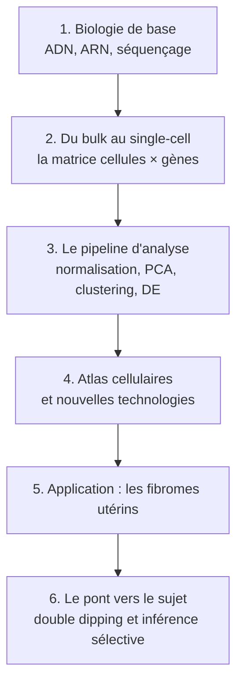

---

## 1. La biologie de base, en terre à terre

### 1.1 ADN, ARN, protéine

Le **dogme central** décrit le sens habituel de circulation de l'information génétique : l'ADN donne de l'ARN, et l'ARN donne des protéines.[^nhgri-dogme] L'ensemble s'appelle l'**expression d'un gène** et comporte deux étapes : la **transcription** (l'ADN est recopié en ARN) et la **traduction** (l'ARN est lu par les ribosomes pour fabriquer une protéine).[^yg-dogme]

L'**ARN messager** (ARNm) est une molécule simple brin fabriquée à partir d'un gabarit d'ADN pendant la transcription. Il transporte l'information du noyau de la cellule vers le cytoplasme, où la machinerie cellulaire la lit pour assembler une protéine.[^nhgri-mrna]

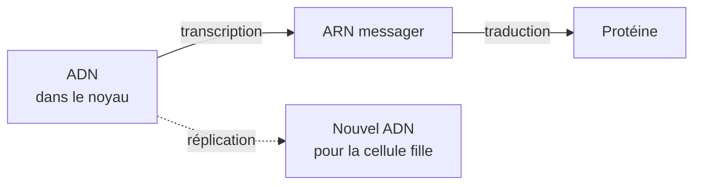

> [!tip] Analogie pédagogique (non sourcée)
> Imagine un **livre de recettes** (l'ADN) gardé dans une bibliothèque (le noyau). Quand la cellule veut cuisiner un plat, elle **photocopie une seule recette** : c'est l'ARN. Le **plat fini** est la protéine. Compter les photocopies présentes dans une cellule, c'est voir ce qu'elle est en train de cuisiner.

Le dogme a des exceptions connues. Par exemple, les prions sont des protéines infectieuses qui se répliquent sans passer par l'ADN ni l'ARN, et la transcription inverse fabrique de l'ADN à partir d'ARN.[^nhgri-dogme][^yg-dogme]

### 1.2 Pourquoi mesurer l'ARN ?

Toutes les cellules d'un organisme contiennent la même information génétique. Ce qui fait la différence entre types de cellules et entre comportements, c'est **quels gènes sont exprimés**.[^hwang] Mesurer l'ARN d'une cellule revient donc à mesurer quels gènes sont « allumés » et avec quelle intensité.

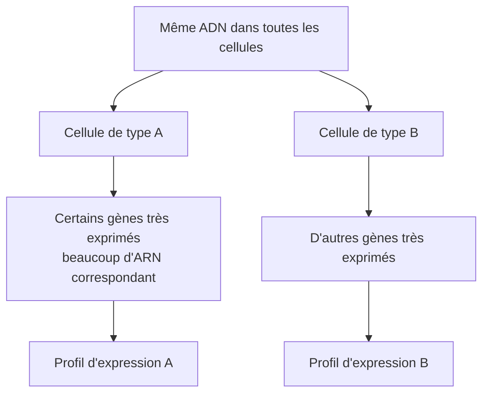

### 1.3 Qu'est-ce que le séquençage, et pourquoi ?

**Séquencer**, c'est déterminer l'ordre exact des quatre « briques » (les bases) d'une molécule d'ADN.[^nhgri-seq] L'ordre des lettres A, T, C, G donne son sens à l'information, comme l'ordre des lettres donne son sens à un mot.[^nhgri-guide]

Dans la méthode la plus courante décrite par le NHGRI, une enzyme fabrique un nouveau brin en incorporant des nucléotides marqués par une fluorescence : le signal diffère selon la base incorporée. Cette méthode produit des **lectures** (« reads ») d'environ 125 nucléotides, et des milliards de lectures à la fois.[^nhgri-guide]

Le **RNA-seq** applique cette idée à l'ARN : c'est une approche génomique de détection et de quantification des ARNm présents dans un échantillon.[^guide-gm]

> [!question] Pourquoi séquencer pour mesurer l'expression ?
> Parce que lire les séquences permet de **détecter** les molécules d'ARN et de les **quantifier** : on obtient, pour chaque gène, un compte de molécules.[^guide-gm] C'est ce compte qui devient la donnée statistique.

> [!note] Ce que ce cours ne détaille pas
> La préparation de l'ARN avant séquençage (les étapes biochimiques) et l'alignement des lectures sur un génome de référence ne sont pas couverts ici faute de source consultée. Pour la suite, il suffit de retenir que l'on obtient un compte par gène et par cellule.

---

## 2. Du bulk au single-cell

### 2.1 Pourquoi « cellule par cellule » ?

Avant le scRNA-seq, on séquençait les cellules **en lot**, ce qui revient à en moyenner les résultats. Les technologies actuelles permettent de séquencer les gènes exprimés dans **une seule cellule**.[^hwang] Le scRNA-seq peut ainsi révéler des populations cellulaires rares ou complexes, des relations de régulation entre gènes et des trajectoires de lignées cellulaires au cours du développement.[^hwang]

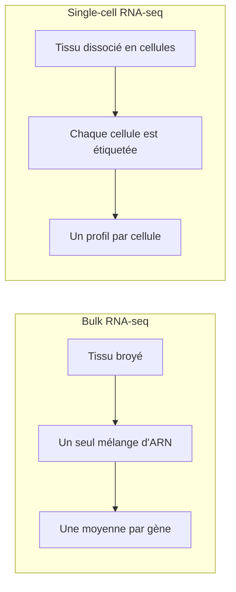

### 2.2 Comment isole-t-on et étiquette-t-on les cellules ?

La méthode **Drop-seq** illustre le principe des technologies à gouttelettes : les cellules sont séparées dans des gouttelettes aqueuses de taille nanolitrique, on associe un **code-barres différent** à l'ARN de chaque cellule, puis tout est séquencé en mélange. On garde ainsi la mémoire de la cellule d'origine de chaque transcrit.[^macosko] Dans l'article fondateur, 44 808 cellules de rétine de souris ont été analysées et 39 populations cellulaires distinctes ont été identifiées, dont de nouveaux sous-types candidats.[^macosko] Les gouttelettes contiennent aussi des microbilles qui apportent les amorces portant les codes-barres.[^macosko]

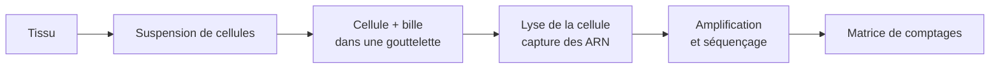

Deux notions de vocabulaire à connaître :

- **Code-barres (barcode)** : séquence courte qui étiquette une cellule (ou un échantillon). Après séquençage, les lectures sont réattribuées à leur cellule grâce à ce code.[^guide-gm]
- **UMI** (*unique molecular identifier*) : étiquette de séquence aléatoire collée à chaque molécule d'ARN **avant** l'amplification.[^guide-gm] Elle permet de repérer les copies d'une même molécule, donc de compter des molécules distinctes plutôt que des lectures.[^butterfly]

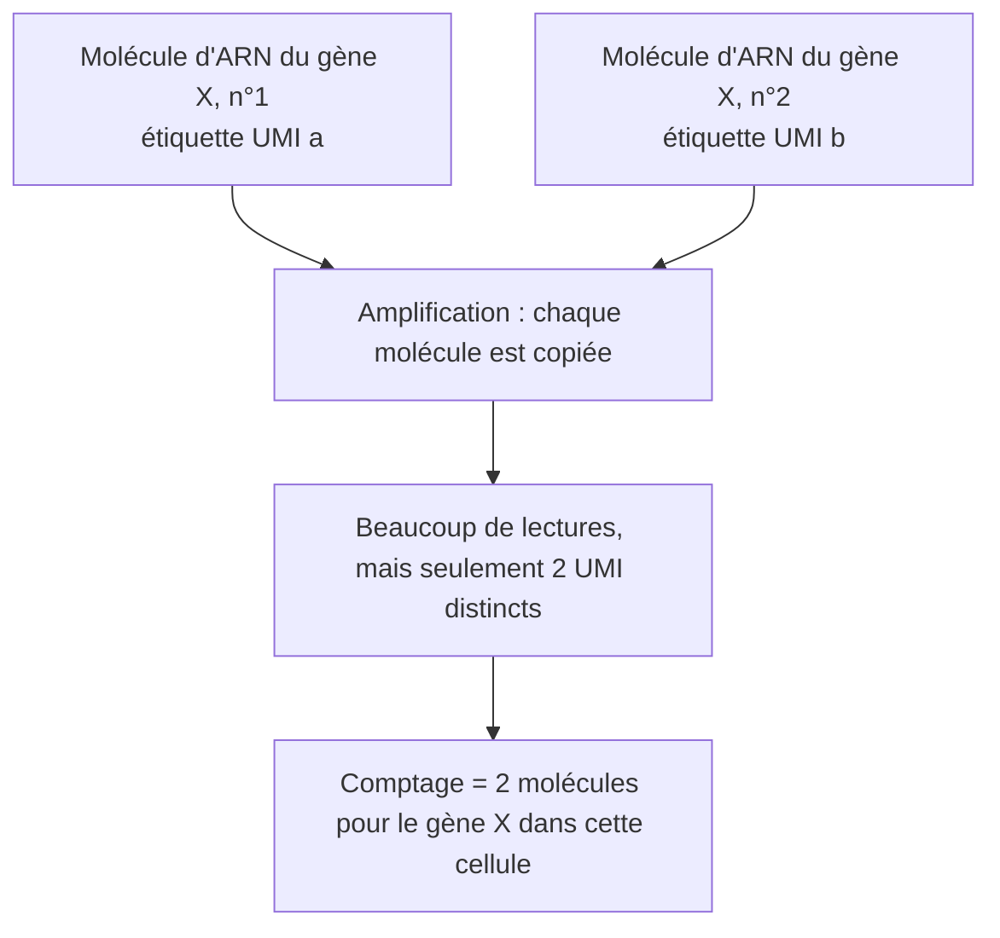

> [!warning] Subtilité
> Le simple retrait des doublons d'UMI peut encore créer un biais, qualifié de « paradoxe de l'amplification poolée » par les auteurs de BUTTERFLY, qui proposent une correction fondée sur un estimateur binomial négatif tronqué en zéro.[^butterfly] Les protocoles diffèrent aussi par l'isolement des cellules, la lyse, l'amplification, la couverture des transcrits et la disponibilité des UMI.[^tech]

La **profondeur de séquençage** est la capacité de séquençage dépensée par échantillon, par exemple le nombre de lectures brutes par cellule.[^guide-gm]

### 2.3 Le résultat : une matrice cellules × gènes

Les données de scRNA-seq présentent des caractéristiques propres : une forte **parcimonie** (beaucoup de zéros) et une grande **échelle**, en nombre de gènes comme en nombre de cellules.[^osca] Le nombre de cellules par étude a crû de façon exponentielle, jusqu'à dépasser le million en 2019.[^zhangthesis]

> [!example] Notation pour statisticienne
> On note $X \in \mathbb{N}^{n \times p}$ la matrice de comptages : $n$ cellules (lignes) et $p$ gènes (colonnes). $X_{ij}$ est le nombre de molécules (UMI) du gène $j$ observées dans la cellule $i$. (Notation de ce cours.)

Exemple jouet, avec trois gènes et quatre cellules :

| Cellule | Gène G1 | Gène G2 | Gène G3 |
|---|---|---|---|
| c1 | 12 | 0 | 340 |
| c2 | 0 | 8 | 2 |
| c3 | 15 | 0 | 290 |
| c4 | 0 | 11 | 1 |

*(Valeurs inventées pour l'illustration.)* On voit déjà deux groupes : {c1, c3} expriment fortement G3, {c2, c4} expriment plutôt G2.

#### Que signifient tous ces zéros ?

Une croyance répandue veut que les zéros soient surtout des « échecs techniques » (*dropouts*). Svensson a étudié des données de contrôles techniques en technologie à gouttelettes et montre que le nombre de zéros est compatible avec des modèles de comptage usuels : les zéros en excès dans des données biologiques viendraient plutôt de la variation biologique, par exemple de différences entre types ou états cellulaires.[^svensson] Une réponse publiée nuance ce message : l'élément décisif est moins la plateforme (gouttelettes ou plaques) que le fait de compter des UMI plutôt que des lectures.[^cao]

---

## 3. Le pipeline d'analyse

### 3.1 Vue d'ensemble

Une analyse type comprend un **pré-traitement** (contrôle qualité, normalisation, correction des données, sélection de variables, réduction de dimension) puis une analyse **au niveau des cellules et des gènes**.[^luecken] Le livre OSCA décrit les mêmes grandes étapes : contrôle qualité, normalisation, réduction de dimension, clustering en sous-populations, détection de gènes marqueurs, annotation des types cellulaires.[^osca-book]

### 3.2 Normalisation et sélection de gènes

- **Normaliser** sert à compenser les différences de profondeur de séquençage entre cellules. Un exemple concret : dans une étude sur les fibromes, les comptages de chaque cellule ont été ramenés à 10 000 UMI.[^goadbio]
- **Sélectionner des gènes très variables** vise à écarter le bruit de fond et à garder les gènes informatifs pour le clustering.[^hvg]

### 3.3 PCA et UMAP

La **PCA** réduit le nombre de dimensions avant le clustering. Dans un tutoriel de cours, on calcule par exemple les 50 premières composantes sur les gènes les plus variables ; des alternatives comme GLM-PCA, l'analyse des correspondances ou ZINB-WaVE existent.[^hicks] (Le chiffre 50 est un exemple de tutoriel, pas une règle.)

L'**UMAP** (comme t-SNE) projette les cellules en 2D pour les regarder. Attention : Chari et Pachter montrent que ces plongements en basse dimension introduisent de fortes distorsions et des pratiques incohérentes, au point d'être contre-productifs pour l'exploration biologique.[^chari]

> [!important] À retenir
> L'UMAP est un **outil de visualisation**. Les décisions (clusters, tests) ne devraient pas reposer sur les distances lues sur un dessin 2D.[^chari]

### 3.4 Le clustering

Dans les pipelines usuels, on construit un **graphe de plus proches voisins** à partir des composantes réduites, puis on applique une détection de communautés comme Louvain.[^hicks]

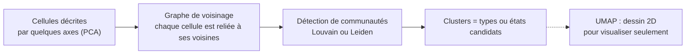

Deux points utiles :

- L'algorithme de Louvain peut produire des communautés mal connectées, voire déconnectées : dans leurs expériences, jusqu'à 25 % des communautés étaient mal connectées et jusqu'à 16 % déconnectées. L'algorithme de **Leiden** garantit des communautés connectées et va plus vite.[^traag]
- Le **paramètre de résolution** fixe le nombre de clusters : une résolution élevée donne plus de communautés, une résolution basse en donne moins.[^traag]

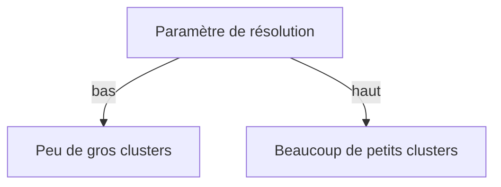

> [!important] Le point qui te concerne
> Le nombre et la forme des clusters sont **des choix faits à partir des données**. Dans l'étude de fibromes citée plus haut, les types cellulaires ont été définis « empiriquement » avec des gènes marqueurs, puis chaque type a été re-clusterisé avec une résolution de 0,4.[^goadbio] Garde cette idée en tête pour la section 6.

### 3.5 L'annotation : donner un nom aux clusters

Une fois les clusters obtenus, on cherche des **gènes marqueurs** pour leur donner un nom.[^osca-book] Exemple dans une étude de fibromes : *ACTA2* et *ACTG2* marquent les cellules musculaires lisses, *DCN* les fibroblastes, *PDGFRB* et *NOTCH3* les péricytes, *VWF* et *PECAM1* les cellules endothéliales, *ITK* et *CD2* les lymphocytes T, *MRC1* les macrophages, *KIT* les mastocytes.[^ijbs-supp]

### 3.6 L'expression différentielle, et le piège de la pseudoréplication

On teste ensuite, gène par gène, les différences entre clusters ou entre conditions (malades contre témoins) au sein d'un type cellulaire.

**Un piège classique : la pseudoréplication.** Les cellules d'un même individu partagent un fonds génétique et environnemental : elles ne sont pas statistiquement indépendantes. Ignorer cette structure hiérarchique conduit à une inférence biaisée et à un taux d'erreur de type I fortement gonflé.[^zimmerman]

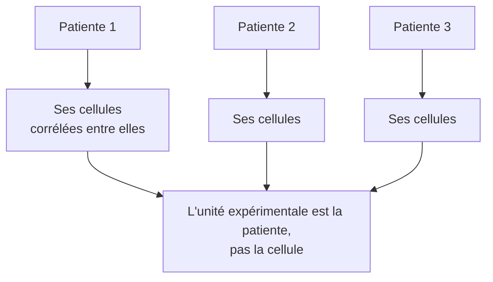

Deux solutions publiées, avec un désaccord sur leurs mérites relatifs :

- **Agrégation en « pseudobulk »** : Squair et al. montrent que la performance des méthodes dépend de leur capacité à tenir compte de la variation entre réplicats biologiques. Les méthodes qui l'ignorent peuvent trouver des centaines de gènes différentiels en l'absence de vraie différence biologique, et les méthodes pseudobulk faisaient mieux dans leur banc d'essai.[^squair]
- **Modèles linéaires généralisés mixtes** avec effet aléatoire par individu : Zimmerman et al. soutiennent que l'agrégation pseudobulk est conservatrice et moins puissante que les modèles mixtes.[^zimmerman] Ce point a donné lieu à un échange publié, dans lequel les auteurs rappellent que les deux approches tiennent compte de la corrélation intra-individu.[^zimmerman-reply]

> [!note] Deux problèmes à ne pas confondre
> La **pseudoréplication** (dépendance entre cellules d'un même individu) et le **double dipping** (réutiliser les mêmes données pour clusteriser puis tester, section 6) sont deux problèmes statistiques distincts.

---

## 4. Pourquoi y a-t-il toujours de nouveaux séquençages ?

On ne connaît **pas encore toutes les cellules**, et c'est justement l'un des objectifs du domaine. Le **Human Cell Atlas** est un effort international qui vise à définir tous les types de cellules humaines par leurs profils moléculaires (par exemple l'expression des gènes), à les relier à des descriptions classiques (position, morphologie) et à servir de référence pour comprendre les dérèglements cellulaires dans les maladies.[^hca] Ses promoteurs le présentent comme l'achèvement d'un effort d'identification des types cellulaires vieux de 150 ans.[^hca]

Plusieurs raisons expliquent que les études continuent :

1. **Le catalogue est incomplet.** Même une seule étude sur la rétine de souris a révélé de nouveaux sous-types candidats.[^macosko]
2. **L'identité d'une cellule a plusieurs facettes.** Elle comprend des types discrets, mais aussi des transitions dynamiques continues et des localisations spatiales, ce qui oblige à redéfinir ce qu'est « un type ».[^wagner]
3. **Il faut une référence saine pour comprendre la maladie.** Une carte de tissus sains fournit un cadre pour comprendre le dérèglement cellulaire dans les maladies,[^hca] et chaque maladie ou sous-type génétique peut exiger sa propre étude (voir les fibromes, section 5).[^goad]
4. **Les technologies évoluent.** Les méthodes de scRNA-seq et de séquençage de noyaux (snRNA-seq) se sont multipliées et ont été comparées dans des bancs d'essai, notamment dans le cadre du Human Cell Atlas ;[^ding][^gw] la **transcriptomique spatiale** mesure l'expression à des positions dans le tissu, et son produit est une matrice gènes × positions.[^rao]

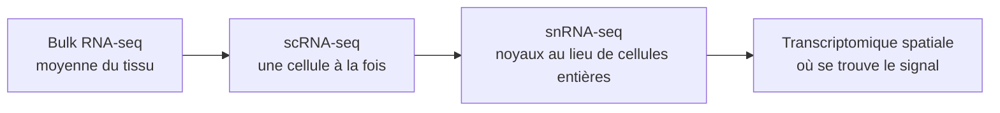

*(Schéma d'ensemble, pas une chronologie stricte.)*

---

## 5. Application : les fibromes utérins

### 5.1 De quoi parle-t-on ?

Les **fibromes** (léiomyomes utérins) sont des tumeurs bénignes du myomètre, le muscle de l'utérus.[^goadbio] Les chiffres de fréquence varient selon les sources : environ 25 % des femmes en âge de procréer dans un préprint,[^goadbio] environ 70 % des femmes en âge de procréer dans une revue,[^ajog] de 70 à 80 % au cours de la vie dans un autre préprint.[^senesc] Prends ces chiffres comme des ordres de grandeur, ils ne mesurent pas la même chose.

### 5.2 Ce que la génétique apporte

Mäkinen et al. ont séquencé les exomes de 18 léiomyomes issus de 17 patientes et ont trouvé des mutations tumorales du gène **MED12** dans 10 d'entre eux. En analysant 207 tumeurs de plus, ils estiment que MED12 est altéré dans 70 % (159 sur 225) des tumeurs, chez 80 patientes au total, toujours dans l'exon 2.[^makinen]

### 5.3 Ce que le single-cell apporte

Les tumeurs avec mutation de MED12 sont composées à parts égales de cellules musculaires lisses et de fibroblastes, tandis que celles avec translocation de HMGA2 sont composées à 90 % de cellules musculaires lisses. Le scRNA-seq a mis en évidence une hétérogénéité supplémentaire : trois populations de cellules musculaires lisses et plusieurs populations de fibroblastes. Toutes les cellules musculaires lisses d'une tumeur mutée ne portent pas la mutation, ce qui suggère que ces tumeurs ne sont peut-être pas monoclonales.[^ajog]

Une étude de référence a construit un atlas cellulaire du myomètre et de léiomyomes porteurs d'un variant de MED12, et a révélé une hétérogénéité dans les cellules musculaires lisses, les fibroblastes et les cellules endothéliales.[^goad] La version préprint de cette étude décrit en plus deux populations de cellules endothéliales lymphatiques dans les léiomyomes, et une infiltration immunitaire qui varie selon le génotype.[^goadbio]

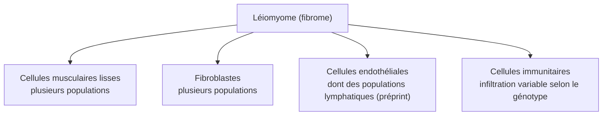

D'autres travaux combinent la **transcriptomique spatiale** et le **snRNA-seq** pour cartographier un léiomyome et la pseudocapsule qui l'entoure.[^ijbs] Un préprint récent utilise le scRNA-seq pour cartographier des cellules sénescentes dans les compartiments stromal, vasculaire et immun des fibromes.[^senesc]

### 5.4 Limites rapportées dans les sources

- L'atlas de référence se concentre sur les léiomyomes **porteurs d'un variant de MED12** ; les auteurs notent que des léiomyomes portant d'autres réarrangements génétiques peuvent différer en composition et en transcriptome.[^goad]
- Pour certaines patientes, l'échantillon de léiomyome était trop petit pour obtenir assez de cellules, ou ne portait pas le variant recherché.[^goad]
- D'après les légendes des figures supplémentaires de l'étude spatiale, l'analyse snRNA-seq porte sur des échantillons de deux patientes (P1 et P2).[^ijbs-supp] Avec si peu d'individus, la question de la **pseudoréplication** (section 3.6) devient centrale.
- Les auteurs de l'étude spatiale expliquent avoir choisi le snRNA-seq parce qu'il présente des avantages, notamment pour les cellules musculaires.[^ijbs]

> [!tip] Ce que cette section donne comme cas d'école
> Les fibromes illustrent bien trois difficultés vues plus haut : des **types cellulaires à définir** (annotation), des **sous-populations dont le nombre dépend d'un choix de clustering** (section 3.4), et un **faible nombre d'individus** (pseudoréplication).

---

## 6. Le pont vers le sujet : double dipping et inférence sélective

### 6.1 Le problème

Dans les pipelines usuels, on **clusterise** les cellules, puis on **teste** quels gènes diffèrent entre clusters, **sur le même jeu de données**. Zhang, Kamath et Tse observent que le clustering force la séparation entre groupes : réutiliser les données produit alors des p-values artificiellement basses et donc des faux positifs.[^zhang] Neufeld et al. décrivent la même situation, en deux étapes : on estime une variable latente (type cellulaire, pseudotemps), puis on teste chaque gène pour son association avec cette variable estimée ; si les mêmes données servent aux deux étapes, les méthodes standard n'ont plus de garanties comme le contrôle de l'erreur de type I.[^neufeld]

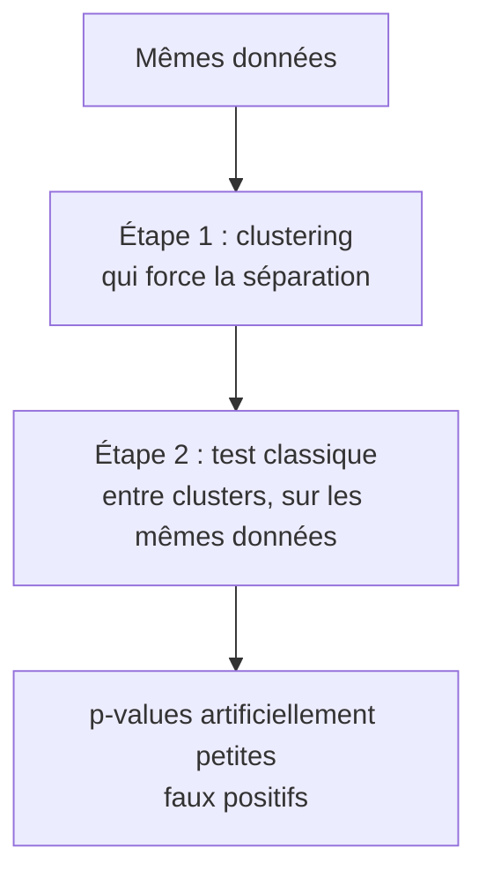

### 6.2 La situation, formalisée

Soit $X$ la matrice de données et $\hat{C}_1, \hat{C}_2$ deux clusters **obtenus par un algorithme appliqué à $X$**. On veut tester une différence de moyennes entre ces deux clusters :

$$H_0 : \mu_{\hat{C}_1} = \mu_{\hat{C}_2}.$$

Gao, Bien et Witten soulignent que l'hypothèse nulle elle-même est **choisie à partir des données**. Les tests classiques de différence de moyennes contrôlent l'erreur de type I quand les groupes sont définis *a priori*, mais pas quand ils sont définis par clustering : le taux d'erreur est alors extrêmement gonflé.[^gao]

> [!warning] Pourquoi couper les données en deux ne suffit pas
> Gao et al. notent que le problème persiste même si deux jeux de données indépendants servent l'un à définir les groupes et l'autre à tester.[^gao] Neufeld et al. ajoutent que des approches comme le découpage d'échantillon, utiles ailleurs, ne s'appliquent pas dans ce contexte du scRNA-seq.[^neufeld]

*(Les formules détaillées de la p-value sélective figurent dans les articles ; )*

### 6.3 Les solutions proposées dans la littérature

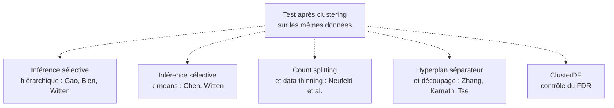

| Approche | Idée centrale | Source |
|---|---|---|
| **Inférence sélective, clustering hiérarchique** | Tester une différence de moyennes entre deux clusters en tenant compte du choix des clusters à partir des données ; p-values exactes pour le clustering agglomératif avec de nombreuses liaisons (*linkages*) ; appliquée à des données de scRNA-seq | Gao, Bien, Witten[^gao] |
| **Inférence sélective, k-means** | Même objectif pour k-means ; une p-value conditionne sur toutes les affectations intermédiaires de l'algorithme et contrôle l'erreur de type I sélective en échantillon fini | Chen, Witten[^chen] |
| **Count splitting** | Séparer les comptages en deux parties pour estimer le clustering sur l'une et tester sur l'autre ; valable pour presque toute méthode d'estimation, sous une hypothèse de loi de Poisson, puis étendu à la loi binomiale négative ; un package R existe | Neufeld et al.[^neufeld] |
| **Data thinning** | Séparer une observation en parties indépendantes dont la somme redonne l'observation, pour les lois « stables par convolution » (gaussienne, Poisson, binomiale négative, gamma, binomiale, etc.) ; sert aussi à valider k-means ou l'ACP | Neufeld, Dharamshi, Gao, Witten[^thinning] |
| **Test conditionnel à l'hyperplan** | Conditionner sur l'événement de clustering à l'aide de l'hyperplan séparateur, avec une étape de découpage des données, pour des clusters issus de n'importe quel algorithme | Zhang, Kamath, Tse[^zhang] |
| **ClusterDE** | Méthode post-clustering visant à contrôler le FDR des gènes différentiels quelle que soit la qualité du clustering, utilisable comme ajout à des pipelines comme Seurat | Présentation du séminaire ClusterDE[^clusterde] |

> [!example] Le lien avec le travail
> Dans ce tableau, les références directes sont **Gao, Bien et Witten** (clustering hiérarchique) et, comme comparaison, **Chen et Witten** (k-means). Les autres approches répondent au même problème de double dipping par d'autres moyens (découpage des comptages, conditionnement sur un hyperplan, contrôle du FDR).

---

## 7. Questions de révision

> [!question]- 1. Quelle est la différence entre ADN et ARN messager dans la cellule ?
> L'ADN est le support de l'information génétique, identique dans toutes les cellules. L'ARNm est une copie, fabriquée par transcription, qui emmène l'information du noyau au cytoplasme pour fabriquer une protéine. Voir 1.1.[^nhgri-mrna]

> [!question]- 2. Pourquoi mesurer l'ARN plutôt que l'ADN pour distinguer des types de cellules ?
> L'information génétique est la même dans toutes les cellules ; ce qui diffère, c'est quels gènes sont exprimés. Voir 1.2.[^hwang]

> [!question]- 3. À quoi servent le code-barres et l'UMI ?
> Le code-barres relie chaque lecture à sa cellule d'origine ; l'UMI marque chaque molécule avant amplification pour compter des molécules distinctes plutôt que des lectures. Voir 2.2.[^guide-gm][^butterfly]

> [!question]- 4. Les zéros de la matrice sont-ils tous des échecs techniques ?
> Non : dans des données de contrôle en gouttelettes, le nombre de zéros est compatible avec des modèles de comptage usuels, et les zéros en excès dans des données biologiques viennent plutôt de variations biologiques. Une réponse publiée précise que l'enjeu est de compter des UMI plutôt que des lectures. Voir 2.3.[^svensson][^cao]

> [!question]- 5. Pourquoi ne faut-il pas se fier aux distances sur un UMAP ?
> Les plongements en 2D introduisent de fortes distorsions. Voir 3.3.[^chari]

> [!question]- 6. Pourquoi les cellules d'une même patiente posent-elles problème pour les tests ?
> Elles ne sont pas indépendantes (pseudoréplication) ; l'ignorer gonfle l'erreur de type I. Voir 3.6.[^zimmerman]

> [!question]- 7. Pourquoi le test classique après clustering est-il invalide ?
> Les groupes sont définis à partir des données : le clustering force la séparation, donc les p-values sont artificiellement basses. Même un découpage en deux jeux indépendants ne règle pas le problème pour la différence de moyennes entre clusters. Voir 6.1 et 6.2.[^zhang][^gao]

> [!question]- 8. Cite trois approches pour obtenir des p-values valides après clustering.
> Inférence sélective (Gao et al. ; Chen et Witten), count splitting ou data thinning (Neufeld et al.), conditionnement sur un hyperplan avec découpage (Zhang et al.). Voir 6.3.[^gao][^chen][^neufeld][^thinning][^zhang]

---

## Références

[^nhgri-dogme]: NHGRI, « Central Dogma », *Talking Glossary of Genomic and Genetic Terms*. https://www.genome.gov/genetics-glossary/central-dogma
[^yg-dogme]: yourgenome.org, « How is DNA turned into protein? The Central Dogma of Molecular Biology ». https://www.yourgenome.org/facts/what-is-the-central-dogma/
[^nhgri-mrna]: NHGRI, « Messenger RNA (mRNA) », *Talking Glossary*. https://www.genome.gov/genetics-glossary/messenger-rna
[^nhgri-seq]: NHGRI, « DNA Sequencing Fact Sheet ». https://www.genome.gov/about-genomics/fact-sheets/DNA-Sequencing-Fact-Sheet
[^nhgri-guide]: NHGRI, « A Brief Guide to Genomics ». https://www.genome.gov/about-genomics/fact-sheets/A-Brief-Guide-to-Genomics
[^hwang]: Hwang B., Lee J.H., Bang D., « Single-cell RNA sequencing technologies and bioinformatics pipelines », *Experimental & Molecular Medicine* 50, 2018. doi:10.1038/s12276-018-0071-8. https://pmc.ncbi.nlm.nih.gov/articles/PMC6082860
[^macosko]: Macosko E.Z. et al., « Highly parallel genome-wide expression profiling of individual cells using nanoliter droplets », *Cell* 161:1202–1214, 2015. https://pmc.ncbi.nlm.nih.gov/articles/4481139/
[^guide-gm]: « A practical guide to single-cell RNA-sequencing for biomedical research and clinical applications » (glossaire : barcoding, sequencing depth, unique molecular identifier). https://www.ncbi.nlm.nih.gov/pmc/articles/PMC5561556/
[^butterfly]: Gustafsson J., Robinson J., Nielsen J., Pachter L., « BUTTERFLY: addressing the pooled amplification paradox with unique molecular identifiers in single-cell RNA-seq », *Genome Biology* 22:174, 2021. doi:10.1186/s13059-021-02386-z. https://pmc.ncbi.nlm.nih.gov/articles/PMC8188791
[^tech]: « Single-Cell RNA-Seq Technologies and Related Computational Data Analysis » (revue ; liste des différences entre protocoles). https://www.ncbi.nlm.nih.gov/pmc/articles/PMC6460256/
[^svensson]: Svensson V., « Droplet scRNA-seq is not zero-inflated », *Nature Biotechnology*, 2020. https://authors.library.caltech.edu/records/gjwdt-s5017
[^cao]: Cao et al., « UMI or not UMI, that is the question for scRNA-seq zero-inflation » (réponse à Svensson), *Nature Biotechnology*, 2021. https://duepublico2.uni-due.de/servlets/MCRFileNodeServlet/duepublico_derivate_00078578/Cao_et_al_2021_NatBiotech-UMI-postprint.pdf
[^luecken]: Luecken M.D., Theis F.J., « Current best practices in single-cell RNA-seq analysis: a tutorial », *Molecular Systems Biology* 15:e8746, 2019. https://pmc.ncbi.nlm.nih.gov/articles/PMC6582955
[^osca]: Amezquita R.A. et al., « Orchestrating single-cell analysis with Bioconductor », *Nature Methods* 17:137–145, 2020. doi:10.1038/s41592-019-0654-x. (Résumé consulté : https://rdm.ox.ac.uk/publications/990899)
[^osca-book]: Amezquita R. et al., *Basics of Single-Cell Analysis with Bioconductor* (livre OSCA, chapitres de base). https://bioconductor.org/books/3.23/OSCA.basic/
[^hicks]: Hicks S., support de cours « More Single-Cell Data Science » (SNN + Louvain, ACP sur gènes variables, GLM-PCA). https://www.stephaniehicks.com/cshlgsd2022/articles/adv-single-cell-01.html
[^hvg]: « Distortion-free PCA on sample space for highly variable gene detection from single-cell RNA-seq data », doi:10.1007/s11704-022-1172-z. https://journal.hep.com.cn/fcs/EN/10.1007/s11704-022-1172-z
[^traag]: Traag V.A., Waltman L., van Eck N.J., « From Louvain to Leiden: guaranteeing well-connected communities », *Scientific Reports*, 2019. https://pmc.ncbi.nlm.nih.gov/articles/PMC6435756
[^chari]: Chari T., Pachter L., « The specious art of single-cell genomics », *PLOS Computational Biology* 19(8):e1011288, 2023. doi:10.1371/journal.pcbi.1011288. https://www.ncbi.nlm.nih.gov/pmc/articles/PMC10434946/
[^squair]: Squair J.W. et al., « Confronting false discoveries in single-cell differential expression », *Nature Communications* 12:5692, 2021. doi:10.1038/s41467-021-25960-2. https://pmc.ncbi.nlm.nih.gov/articles/PMC8479118
[^zimmerman]: Zimmerman K.D., Espeland M.A., Langefeld C.D., « A practical solution to pseudoreplication bias in single-cell studies », *Nature Communications* 12, 2021. doi:10.1038/s41467-021-21038-1. https://www.ncbi.nlm.nih.gov/pmc/articles/PMC7854630/
[^zimmerman-reply]: Zimmerman K.D., Evans C., Langefeld C.D., « Reply to: A balanced measure shows superior performance of pseudobulk methods in single-cell RNA-sequencing analysis », *Nature Communications* 13:7852, 2022. doi:10.1038/s41467-022-35520-x. https://pmc.ncbi.nlm.nih.gov/articles/PMC9780219
[^gao]: Gao L.L., Bien J., Witten D., « Selective inference for hierarchical clustering », *Journal of the American Statistical Association* 119(545):332–342, 2024. doi:10.1080/01621459.2022.2116331. arXiv:2012.02936. https://arxiv.org/abs/2012.02936
[^chen]: Chen Y.T., Witten D.M., « Selective inference for k-means clustering », *Journal of Machine Learning Research* 24(152):1–41, 2023. https://jmlr.org/papers/v24/22-0371.html
[^zhang]: Zhang J.M., Kamath G.M., Tse D.N., « Valid post-clustering differential analysis for single-cell RNA-Seq ». Préprint bioRxiv doi:10.1101/463265. Version en accès libre : https://pmc.ncbi.nlm.nih.gov/articles/PMC7202736
[^neufeld]: Neufeld A., Gao L.L., Popp J., Battle A., Witten D., « Inference after latent variable estimation for single-cell RNA sequencing data », arXiv:2207.00554. https://arxiv.org/abs/2207.00554v2. Le README du package R `countsplit` indique une publication dans *Biostatistics* et l'extension à la loi binomiale négative (préprint 2023) : https://cran.ma.ic.ac.uk/web/packages/countsplit/readme/README.html
[^thinning]: Neufeld A., Dharamshi A., Gao L.L., Witten D., « Data thinning for convolution-closed distributions », *Journal of Machine Learning Research* 25(57):1–35, 2024. https://jmlr.org/papers/v25/23-0446.html
[^clusterde]: Présentation de séminaire, « ClusterDE: a Post-clustering Differential Expression (DE) Method Robust to False-positive Inflation Caused by Double Dipping ». https://hg.gatech.edu/node/669993
[^hca]: Regev A. et al., « The Human Cell Atlas », *eLife* 6:e27041, 2017. doi:10.7554/eLife.27041. https://dspace.mit.edu/handle/1721.1/113427
[^wagner]: Wagner A., Regev A., Yosef N., « Revealing the vectors of cellular identity with single-cell genomics », *Nature Biotechnology* 34(11):1145–1160, 2016. https://pmc.ncbi.nlm.nih.gov/articles/PMC5465644
[^ding]: Ding J. et al., « Systematic comparison of single-cell and single-nucleus RNA-sequencing methods », *Nature Biotechnology*, 2020. doi:10.1038/s41587-020-0465-8. https://www.broadinstitute.org/publications/broad628456
[^gw]: GenomeWeb, « New Studies Compare, Set Benchmarks for Single-Cell RNA Sequencing Methods ». https://www.genomeweb.com/node/49156
[^rao]: Rao A., Barkley D., França G.S., Yanai I., « Exploring tissue architecture using spatial transcriptomics », *Nature* 596:211–220, 2021. https://pmc.ncbi.nlm.nih.gov/articles/8475179
[^zhangthesis]: Soutenance de thèse de Jesse Zhang, « Rethinking Single-Cell RNA-Seq Analysis », Stanford, 2019 (résumé). https://tselab.stanford.edu/news/2019/20190603-defense-jesse-zhang
[^goad]: « Single-cell sequencing reveals novel cellular heterogeneity in uterine leiomyomas » (atlas du myomètre et de léiomyomes MED12-positifs). https://pmc.ncbi.nlm.nih.gov/articles/PMC9802286
[^goadbio]: « Single Cell atlas of uterine myometrium and leiomyomas reveals diverse and novel cell types of non-monoclonal origin », préprint bioRxiv, doi:10.1101/2020.12.21.402313. https://www.biorxiv.org/content/10.1101/2020.12.21.402313.full.pdf
[^ajog]: « Uterine fibroids at single-cell resolution: unveiling cellular heterogeneity to improve understanding of pathogenesis and guide future therapies » (revue, 2024). https://researchexchange.ocrahope.org/papers/j-ajog-2024-08-037
[^makinen]: Mäkinen N. et al., « MED12, the Mediator Complex Subunit 12 Gene, Is Mutated at High Frequency in Uterine Leiomyomas », *Science* 334(6053):252–255, 2011. doi:10.1126/science.1208930. https://publications.scilifelab.se/publication/6754e5e0fbbb4d85bc5707ec87f99a76
[^ijbs]: « Integrating Spatial Transcriptomics and Single-nucleus RNA Sequencing Reveals the Potential Therapeutic Strategies for Uterine Leiomyoma », *Int J Biol Sci* 19(8):2515–2530, 2023. doi:10.7150/ijbs.83510. https://ijbs.com/v19p2515.htm
[^ijbs-supp]: Même article, informations supplémentaires (légendes des figures S1 à S4). https://www.ijbs.com/v19/p2515/ijbsv19p2515s1.pdf
[^senesc]: « Senescent cell networks link matrix remodeling and vascular dysfunction in human fibroids », préprint bioRxiv, doi:10.64898/2026.08.06.743362. https://www.biorxiv.org/content/10.64898/2026.08.06.743362.full.pdf
